# 从零开始的网球自习系列课-反手击球点篇

[Bilibili 原课](https://www.bilibili.com/video/BV12Qi5B6E3p/) · 叶修鸽哥 · 合集第 30/35 集 · 时长 04:33 · 整理日期 2026-11-06 · 发布日期 2026-01-01

## 课程总结

本课用两步和四步抛球练习反手击球点，再移到底线处理距离更远的来球。先移动身体接近球，在合适距离上接出拍，击球后继续走出。遇到移动已经到极限的远球时，保留伸臂够球的余量。

## 技术总结

- 用身体向球移动来调整击球距离。
- 接近来球时把移动接到挥拍，打完继续走出。
- 先用两步建立人与球的距离感，再增加到四步。
- 底线练习加入关闭式站位以及更远来球处理。

## 训练路线

1. 先用两步抛球或接球体验接近来球后的继续走出。
2. 结合空挥比较向外移动和向回摆，再增加到四步喂球。
3. 移到底线，从关闭式处理过渡到更远来球。

## 常见问题与调整

| 情况 | 调整方式 |
|---|---|
| 身体离球太远，只能伸臂够球 | 回到近距抛球，先把身体移动到合适距离。 |
| 停下来反复对点，随后才赶着出手 | 练接近来球时衔接挥拍，击球后继续走出。 |

## 按时间顺序的课程记录

### 00:00—00:35：回顾抬大臂之后的反手变化

讲师与同伴回顾第一次见面时对正反手所作的调整，其中首先提出的是抬大臂。他询问改动对比赛的影响，同伴反馈反手不再那么偏向蹭球，控制球更有信心，想打直线时也较少意外撇成斜线。讲师在谈话中做了一次双手反手侧的抬拍空挥，动作从腰前抬到头肩附近，再回收。

这些是两人的训练经历与主观反馈；不能仅凭这段谈话认定调整必然改善所有人的线路控制。配图仅取实际空挥，不用同伴说话时的零碎持拍比划代替演示。

**动作01：开场的反手空挥｜局部空挥｜00:15.300—00:16.600**

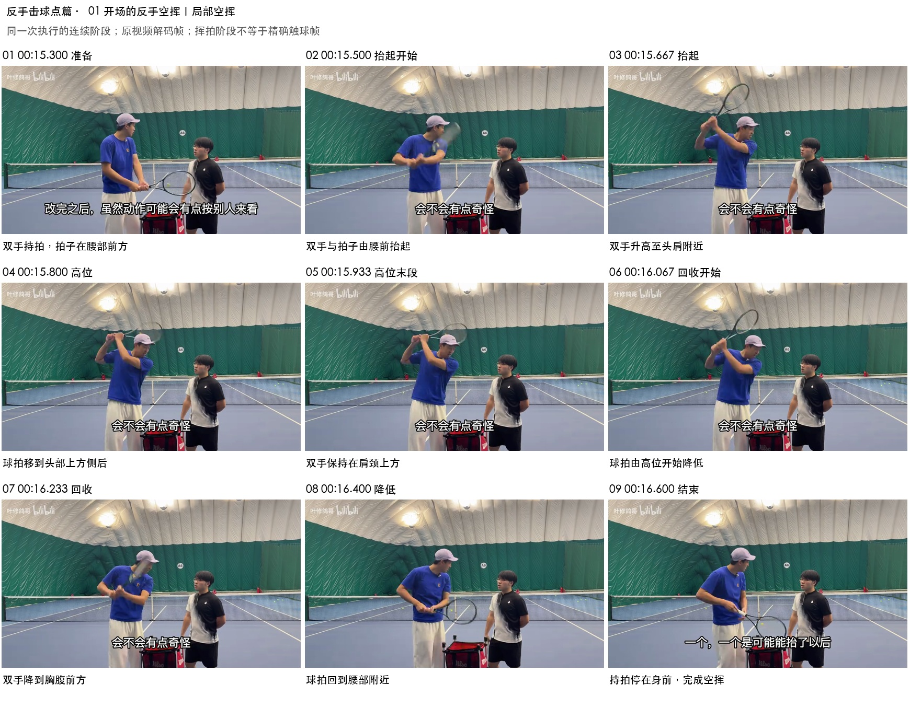

画面可见：双手从腰前抬到头肩附近，再降低回收；只演示局部抬拍，没有来球。

### 00:35—00:58：用两步抛球引出击球点

讲师把击球点放回此前所说的“四件套”语境中，请同伴抛一个大约需要两步接近的球。第一次抛球后没有完成挥拍，双方先重新协调距离；随后再次抛球，讲师迈步完成一次双手反手。

他说很多人会在自己感觉舒服的位置停下来打，但接下来要讨论的正是这个距离是否把身体留得太远。这里的“两步”是现场练习要求，不是固定长度或所有反手都必须使用的步数。

**动作02：两步抛球后的反手｜带球击球｜00:53.700—00:56.400**

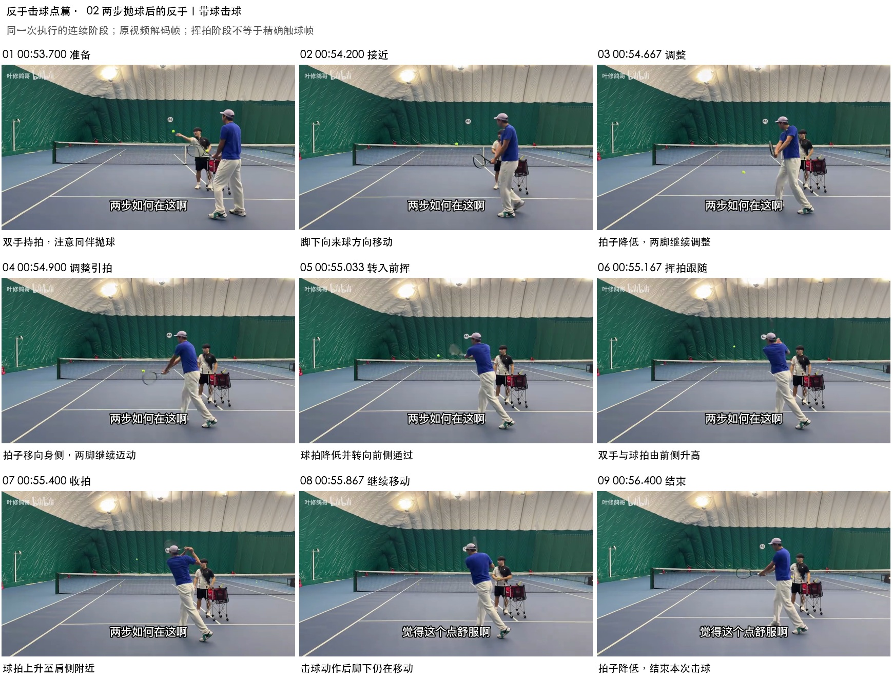

画面可见：同伴抛球、球落地反弹，示范者迈步，球拍由低位通过前侧，上收至肩旁再降低。

### 00:58—01:32：身体离球太远时，容易只剩伸臂够球

讲师用身体与球拍的位置说明，他希望学员重新理解反手防守时的身体—球距离。他主张在所示情境中进一步接近来球，而不是把自己停在较远处，再把手臂完全伸出去。他接着示意：如果停得太远，尝试用手腕勾、掰去补偿距离和方向，反而可能更难处理。

本段主要是位置说明及小幅手腕比划，以文字记录。视频没有给出击球点距身体的厘米数，也没有在此系统区分所有击球高度、握拍或单双反，所以本文不将“靠近”改写成一条通用的固定距离。

### 01:32—01:53：先改变接近来球的逻辑

讲师把这一点与此前起跳练习作类比：让学员掌握处理方式，是为了更敢向目标移动。对本集反手，他反对为了预留一个想象中的手臂距离而过早停下，主张脚步继续接近球、在身体仍移动时完成处理。

下图只是持拍向外走出的局部步法：拍子保持在腰部附近，没有完成完整反手收拍，不能把它写成一次完整击球。

**动作03：持拍继续向外的步法｜局部无球步法｜01:50.500—01:52.300**

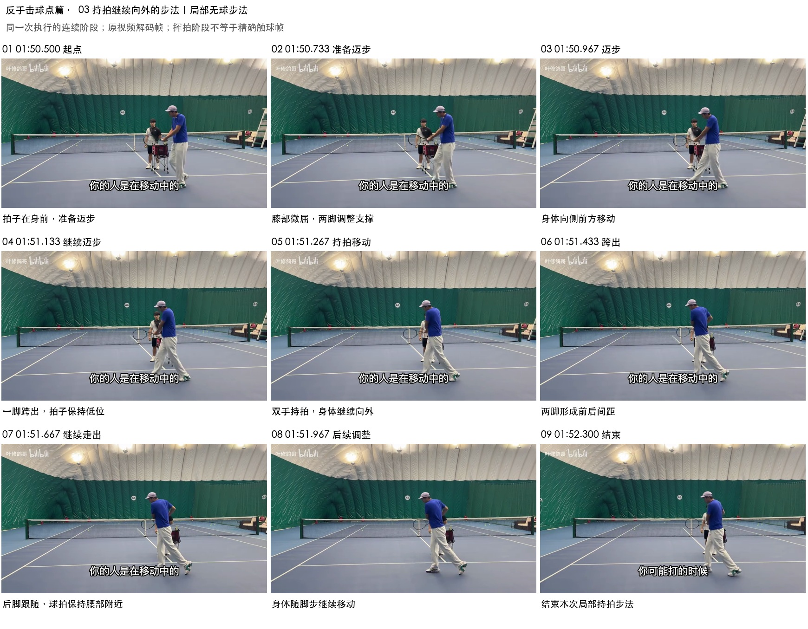

画面可见：持拍保持在腰部附近，双脚先后向外迈动；这一组没有完整的高位收拍。

### 01:53—02:16：先停住再对点，与边接近边打的对比

讲师先演示自己不希望学员采用的方式：走到预选位置、减速停步，再伸拍去对准击球点；他的担心是一旦停的位置不合适，就只能够球。随后另做一次移动空挥，边迈步边把拍子送出并收起。两种执行分别成组，没有拼成一条动作。

之后他说明，球更靠近身体并不必然让他所强调的抬臂动作失去空间，并用不同位置作示意；又谈到斜线、小斜线的处理感觉。这些属于讲师的教学解释，画面不足以量化抬臂范围或证明线路必然变化。

**动作04：先停步再伸拍的对比｜局部对比示范：停步伸拍｜01:55.900—01:58.300**

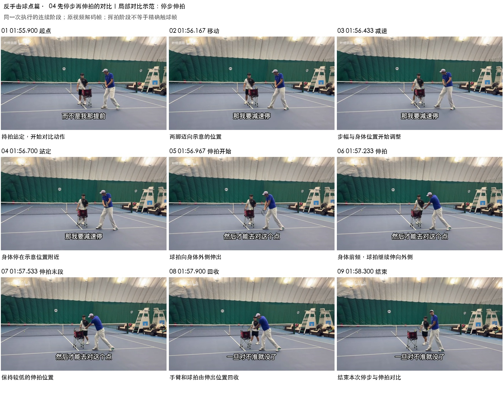

画面可见：迈步后先停在选定位置，再前倾伸拍，最后回收；属于讲师反对的局部对比。

**动作05：继续接近后挥拍的对比｜移动空挥｜01:59.800—02:02.333**

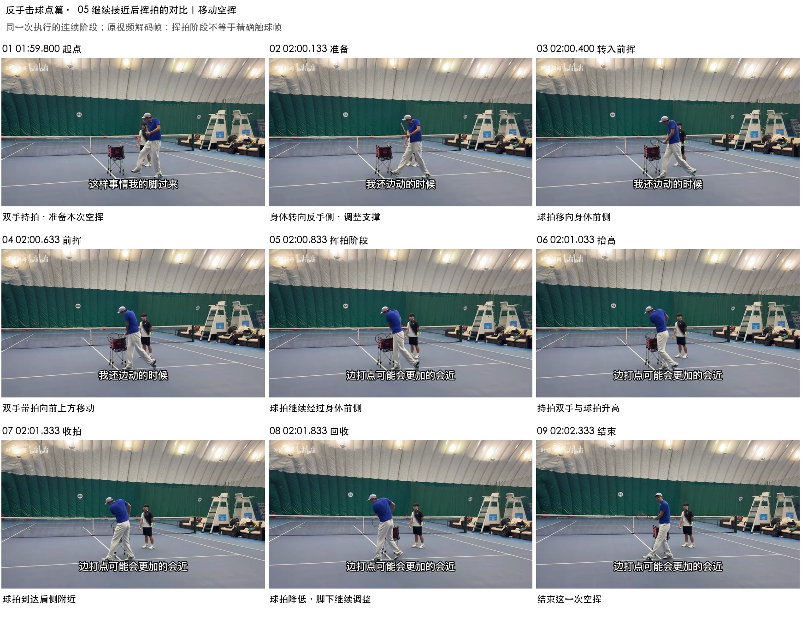

画面可见：迈步与挥拍相连，球拍上升至肩侧后降低；没有实际来球。

### 02:16—02:24：两步接球后，身体仍继续走出

再次请同伴抛两步距离的球。讲师向来球方向迈步，双手反手挥拍上收，随后脚下继续向外移动。他在讲解中提到右脚及身体仍在动；本文保留实际脚步变化，不由一组帧推断哪只脚在主动发力。

**动作06：两步接近来球并继续向外｜带球击球｜02:20.533—02:23.500**

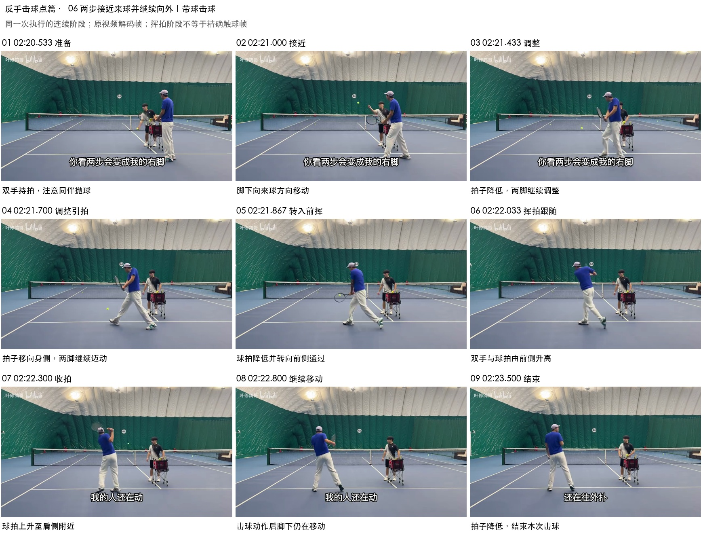

画面可见：由等球、向外接近、球拍前挥到肩侧收拍，再接后续脚步；这些是同一次执行，没有接入下一球。

### 02:24—02:33：向外移动与向回摆的两次空挥

讲师提到“阿卡”等职业球员打完后身体仍可能向外走、看起来有些倾斜，以此强调击球后不必立即把人摆回原位。他先做一次向外走出的空挥，再做一次向回摆的反例。

职业球员在这里只是讲师的口头参照，原片没有插入对应比赛素材；以下两组均是讲师自己的局部示范，不是职业球员动作证据。

**动作07：击球后向外移动的空挥｜移动空挥｜02:25.733—02:28.500**

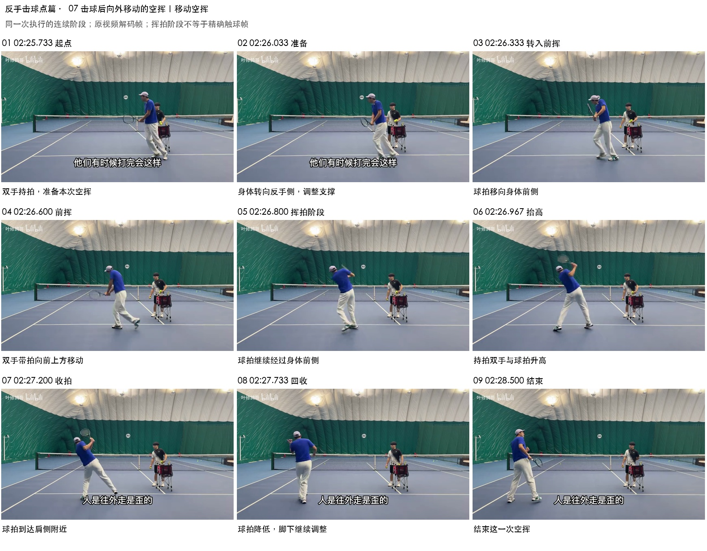

画面可见：由等球、向外接近、球拍前挥到肩侧收拍，再接后续脚步；这些是同一次执行，没有接入下一球。

**动作08：向回摆的反例｜局部对比空挥：向回摆｜02:29.833—02:31.233**

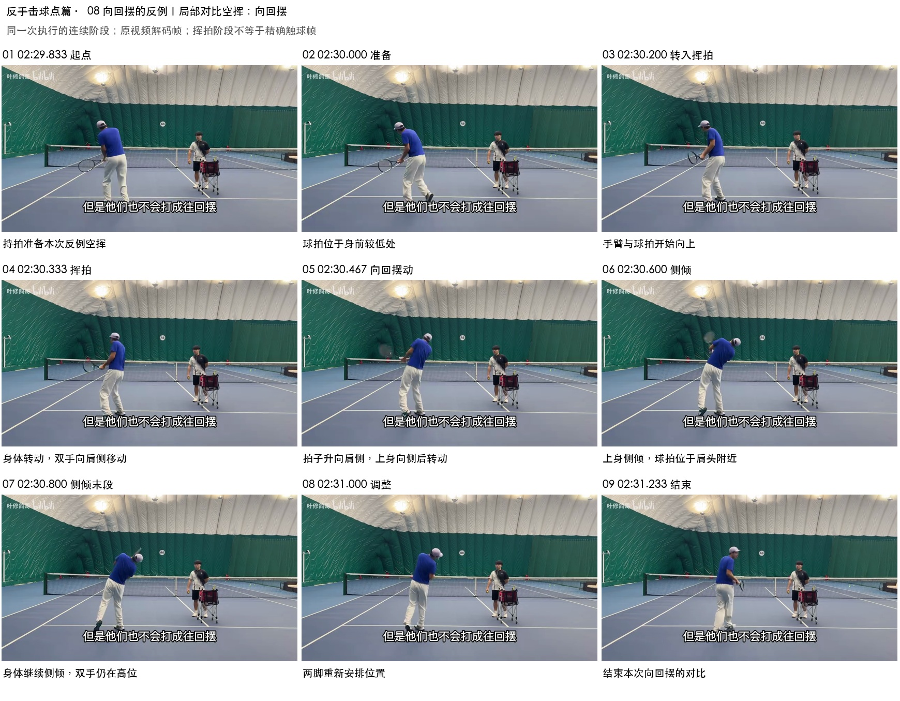

画面可见：拍子升高时身体侧倾，随后往原位置转回；讲师用它对比向外走出的处理。

### 02:33—02:38：再次抛球，接着走出

同伴再次近距离抛球。讲师在球落地后迈步挥拍，双手收至肩侧，后续脚步接着向外走。他用这一球重复说明，人不必在挥拍前后都钉在一个预先选定的位置。

**动作09：第二次两步抛球击球｜带球击球｜02:33.633—02:36.800**

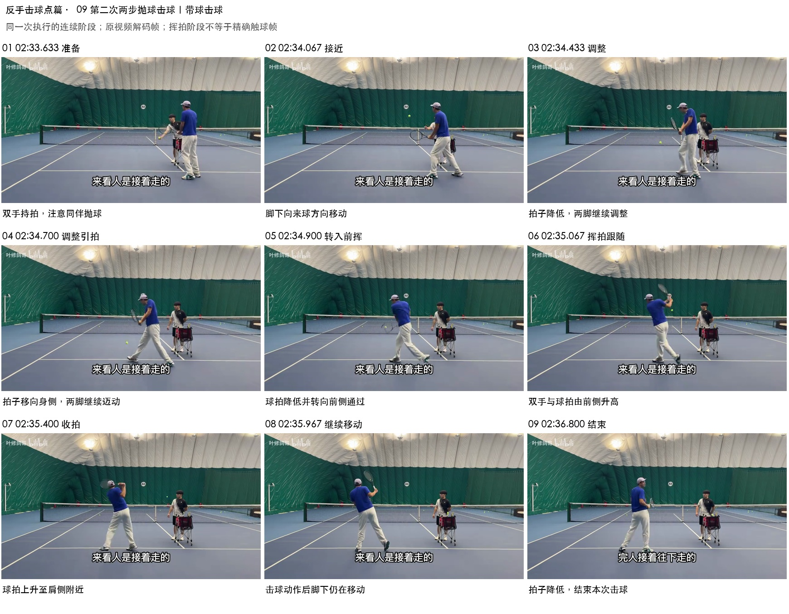

画面可见：由等球、向外接近、球拍前挥到肩侧收拍，再接后续脚步；这些是同一次执行，没有接入下一球。

### 02:38—02:53：增加到四步距离，并调整抛球方式

接下来要求一个更远、约四步距离的球。讲师跑动接近后完成反手，身体和脚步在收拍后仍向外移动。他说明这样练习，是希望学员敢加速去跑，而不是先担心必须提前减速。

随后要求抛得稍快一些，但这次球被抛得较高，讲师追了几步后没有形成击球，并现场调整喂球要求。该次仅记录实际启动、追球及中止，不能算成功击球。

**动作10：较远四步来球｜带球击球｜02:40.200—02:43.667**

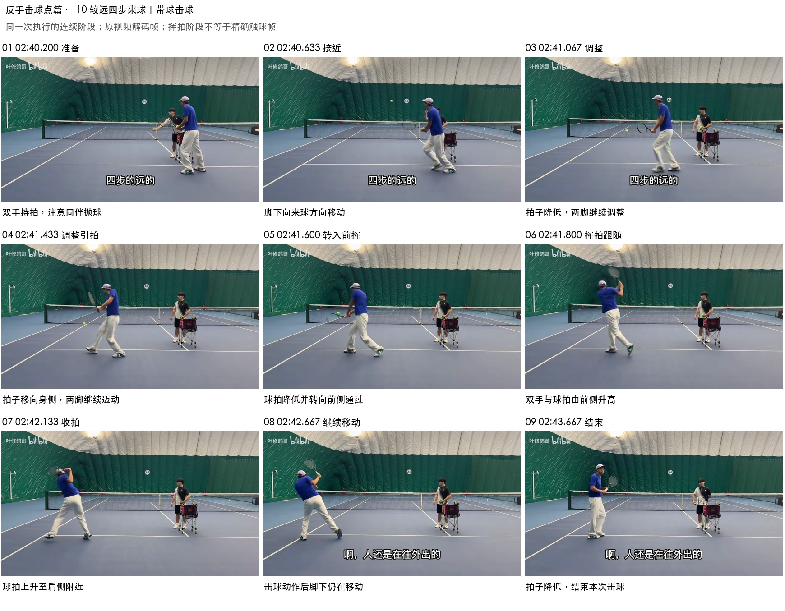

画面可见：由等球、向外接近、球拍前挥到肩侧收拍，再接后续脚步；这些是同一次执行，没有接入下一球。

**动作11：要求更快抛球后的中止｜跑动尝试：未形成击球｜02:49.333—02:51.000**

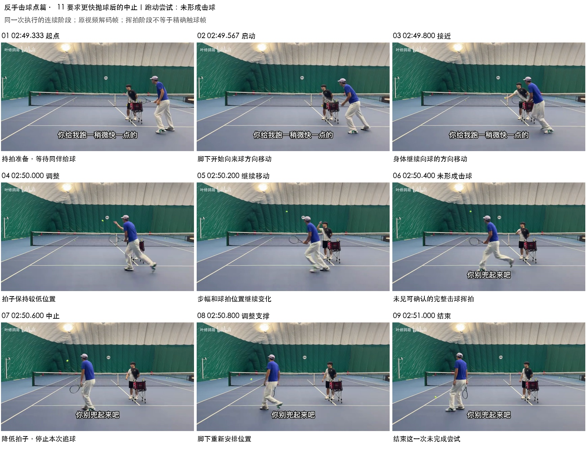

画面可见：球被抛起后，示范者追了几步但没有完成反手挥拍，随后放下拍子。

### 02:53—03:19：移到底线，讨论关闭式处理

双方移到底线附近，先抛一个远球。首次执行主要是追球和重新协调位置，未见完整击球；重新给球后，讲师放慢动作，迈步完成反手，并继续沿移动方向走出。

随后他把这类处理与此前“四件套”及关闭式、开放式站位联系起来，讲到主动安排右脚支撑，以及不同处理下球质可能有差异。

**动作12：底线首次远球尝试｜跑动尝试：未形成击球｜03:02.067—03:04.133**

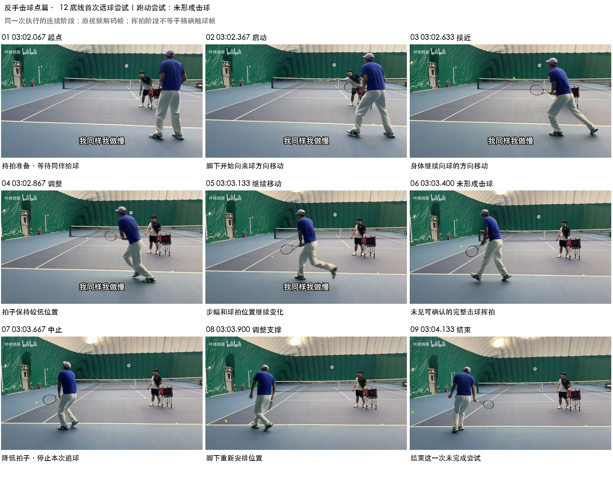

画面可见：示范者追球、脚步继续调整，但未出现完整反手挥拍；随后重新安排抛球。

**动作13：底线重新抛球后的反手｜带球击球｜03:07.400—03:10.033**

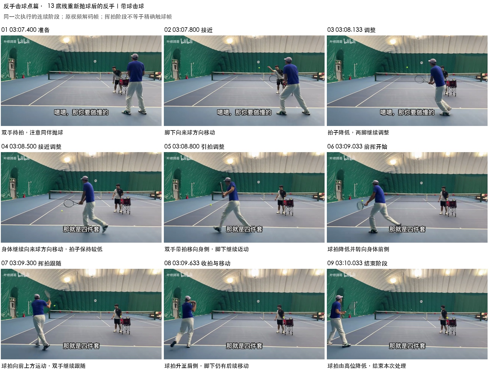

画面可见：由等球、向外接近、球拍前挥到肩侧收拍，再接后续脚步；这些是同一次执行，没有接入下一球。

### 03:19—03:39：继续往外走，较远来球重新尝试

讲师继续做一次带球示范，强调脚下并未因为挥拍而立即停止，收拍后仍向外走。之后要求再远一些；一次追球没有完成击球，现场直接中止，再重新抛球完成下一次反手。

完成后，他评价这种处理的球质仍可保持，也可以打斜线。这是现场教学评价，画面本身没有显示足以核实每一球落点、球速及旋转的完整对面场地细节。

**动作14：继续向外走的反手｜带球击球｜03:19.233—03:22.000**

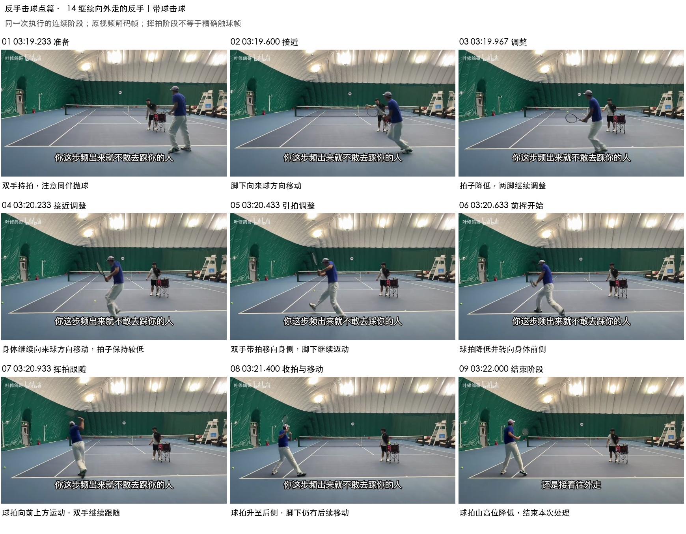

画面可见：由等球、向外接近、球拍前挥到肩侧收拍，再接后续脚步；这些是同一次执行，没有接入下一球。

**动作15：更远来球的未完成尝试｜跑动尝试：未形成击球｜03:26.133—03:28.867**

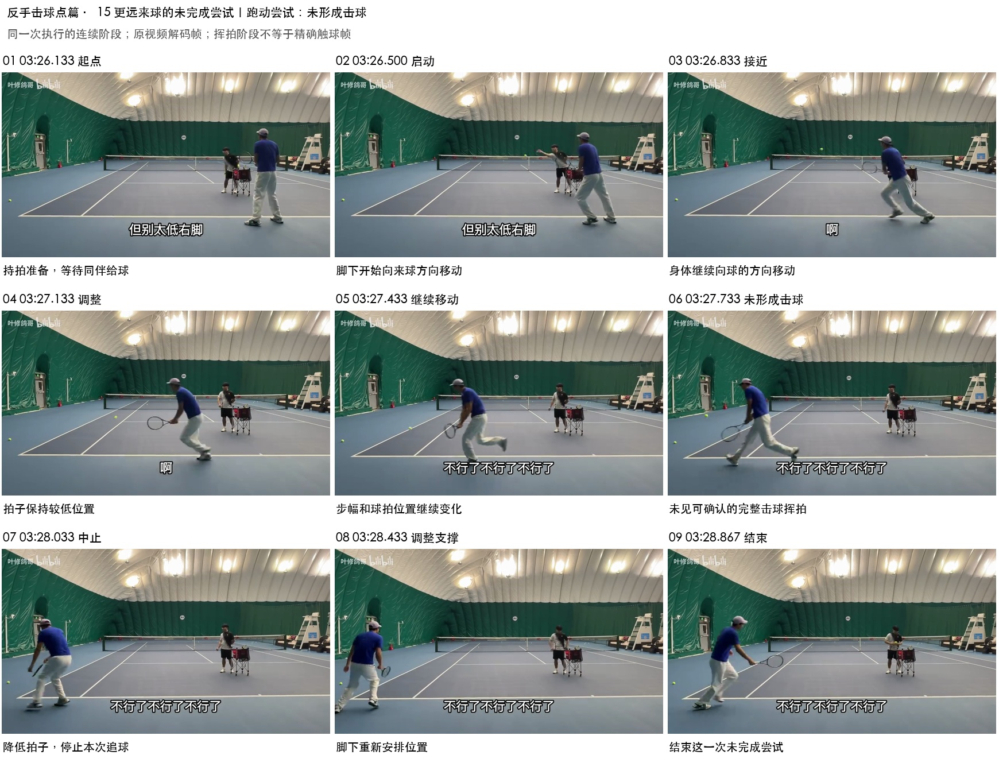

画面可见：脚步加快向外追球，拍子维持低位，随后中止并转回。

**动作16：底线再次向外击球｜带球击球｜03:31.133—03:34.033**

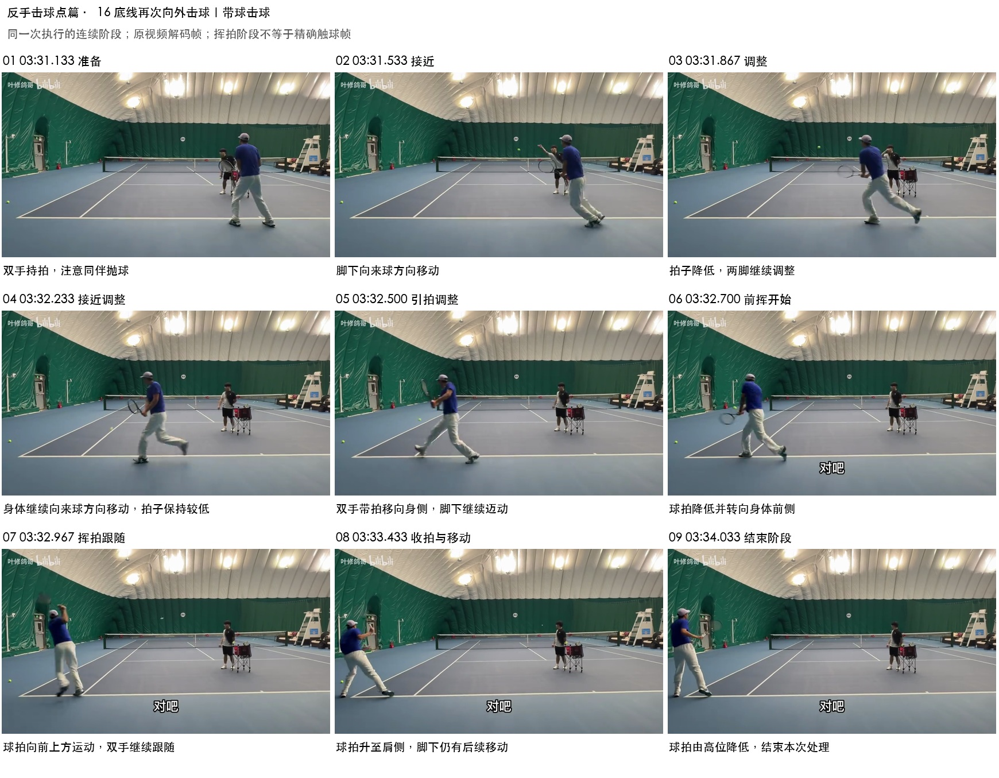

画面可见：由等球、向外接近、球拍前挥到肩侧收拍，再接后续脚步；这些是同一次执行，没有接入下一球。

### 03:39—03:52：停下够球的反例，与伸臂转动的能力对比

自己希望学员在移动过程中完成处理，避免先提前减速停下，再把手伸出去够。他实际做了一次停步伸拍的局部反例，随后演示伸臂并转动上身、再抬臂的局部空挥。

他的解释是：不能默认普通学员都能在手臂伸得很远时，仍具备他口头举例的那种转动与抬臂能力。画面只能确认伸臂、上身转动和球拍升降，不能据此证明胸椎的具体角度或关节主动用力。

**动作17：提前停下再够球的反例｜局部对比示范：停步伸拍｜03:43.367—03:45.300**

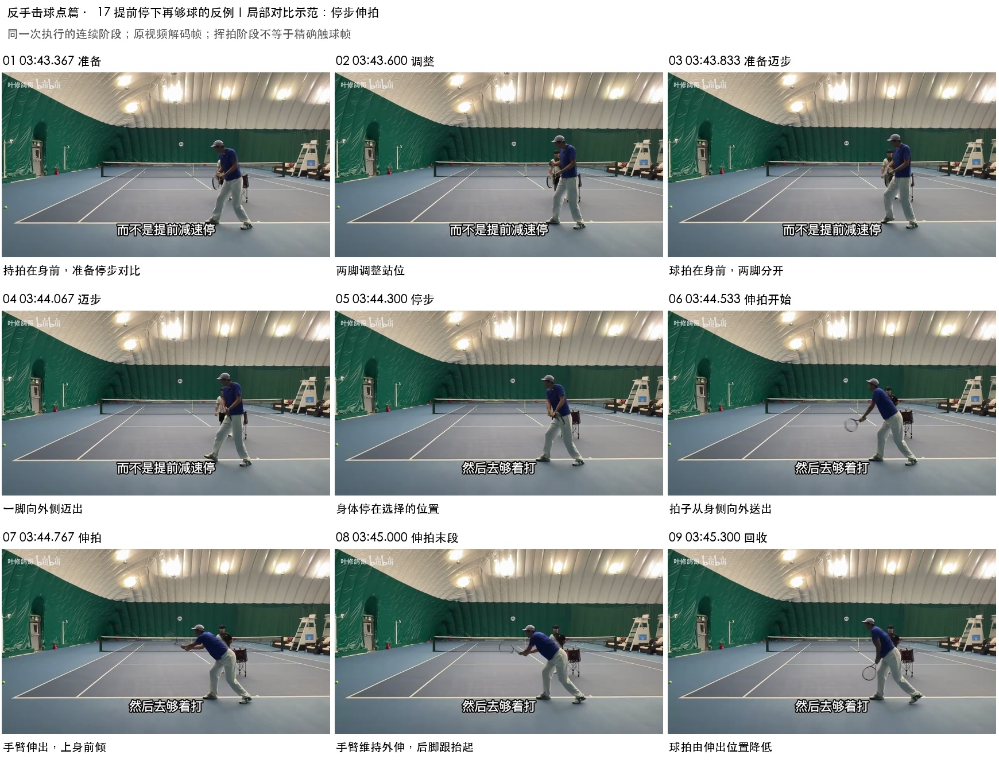

画面可见：先安排脚下位置，再俯身向外伸拍，最后降低拍子；不是实球击球。

**动作18：伸臂转动的能力对比｜局部空挥：伸臂转动｜03:47.267—03:49.467**

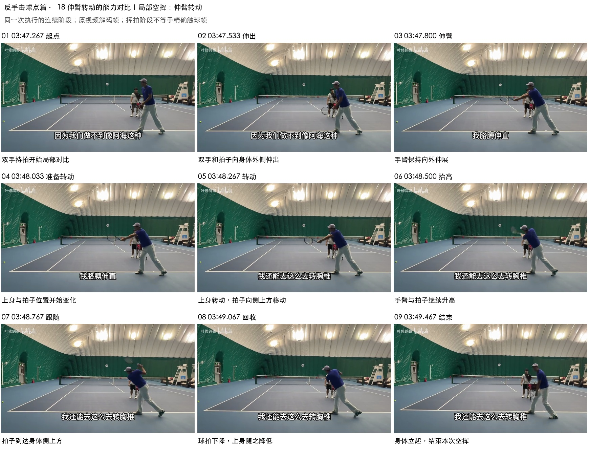

画面可见：手臂先伸向外侧，上身转动，双手及拍子升高后回收；不是关节发力测量。

**动作19：抬臂的局部空挥｜局部空挥｜03:50.233—03:51.500**

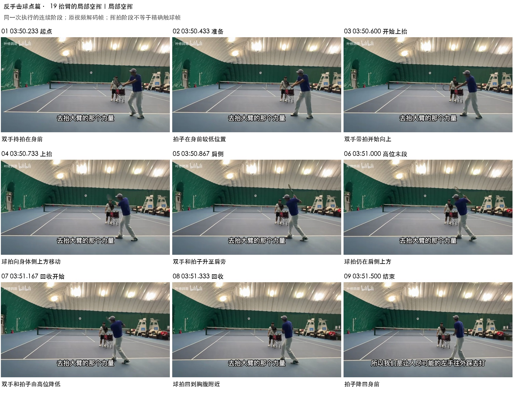

画面可见：双手从身前将球拍抬到肩侧，再降低；局部抬臂示范与前一次伸臂空挥分开保存。

### 03:52—04:07：把向外迈步接到实际来球

讲师让同伴继续抛球，演示脚下向外迈入、双手反手上收及后续继续走出。随后他提到职业球员防守时也会出现离身体较近的处理，并又完成一次带球示范。

这一段示范向外迈步。职业球员的姓名和技术特点没有另行核实，不能把他的口头举例当作独立证据。

**动作20：向外迈步再击球｜带球击球｜03:52.600—03:55.433**

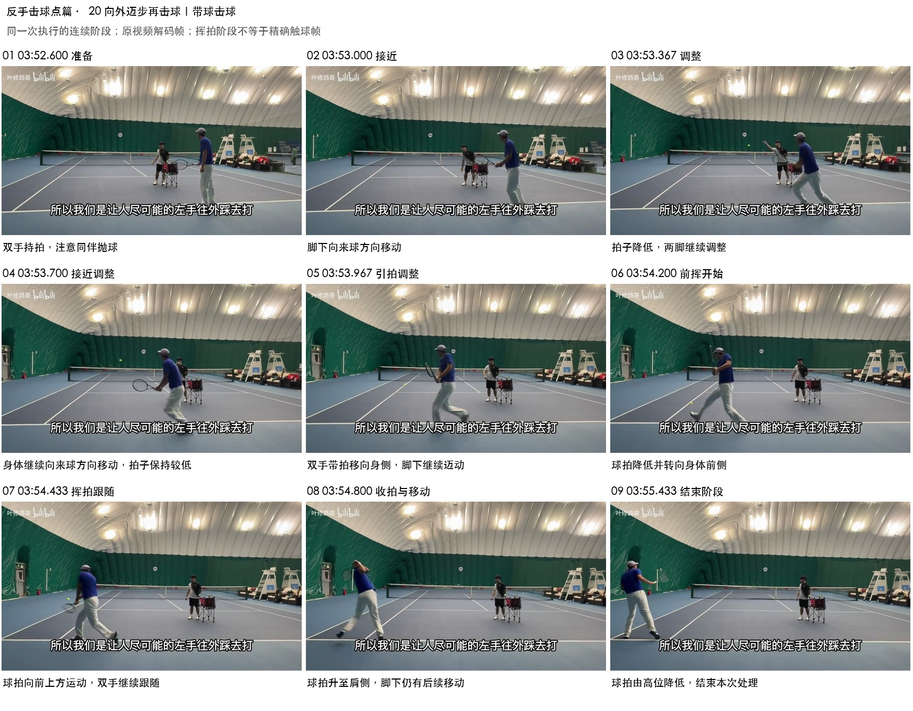

画面可见：由等球、向外接近、球拍前挥到肩侧收拍，再接后续脚步；这些是同一次执行，没有接入下一球。

**动作21：较近击球位置的带球示范｜带球击球｜04:04.067—04:06.867**

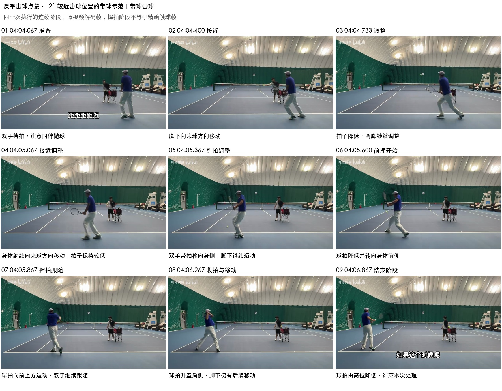

画面可见：由等球、向外接近、球拍前挥到肩侧收拍，再接后续脚步；这些是同一次执行，没有接入下一球。

### 04:07—04:25：跑到极限仍偏远时，保留够球余量

若已经尽力、全速去跑，球仍比预期更远，落到以前觉得舒服但偏远的位置，也不是完全不能处理。他要改变的重点，是还没有充分接近来球，就预先认定自己该停在哪里。

最后用两次分开的空挥作对比：先演示提前停步后伸拍，再演示直接向外迈入、挥拍上收及身体继续走出。因此本集不能被简化为“离身体远的球都不能打”，也不是要求所有来球都挤到身上。

**动作22：结尾先停步的对比｜局部对比示范：停步伸拍｜04:19.200—04:20.833**

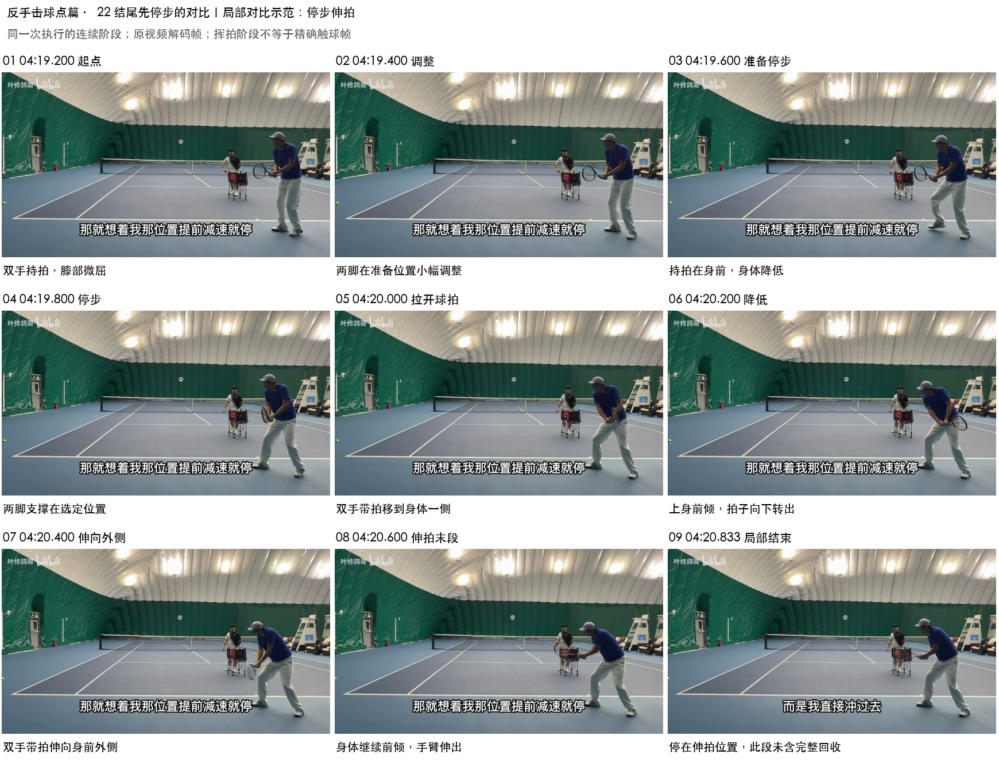

画面可见：两脚在选定位置支撑，上身前倾，球拍向外伸出；所选区间止于局部伸拍末段。

**动作23：结尾直接向外的空挥｜移动空挥｜04:21.100—04:23.700**

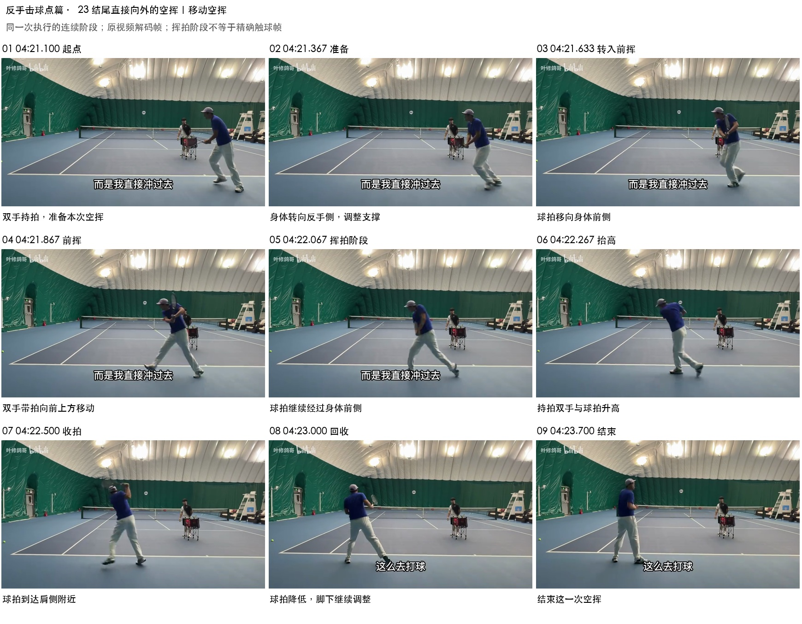

画面可见：迈步向外、双手挥拍上收，随后身体随脚步继续移动；这一次没有实际喂球。

### 04:25—04:33：结束与邀请同伴尝试

讲师表示演示结束、已经没劲，随后邀请同伴试试。原片到此结束，没有继续展示同伴按这套要求完成实球练习，因此不补写学员训练效果。
