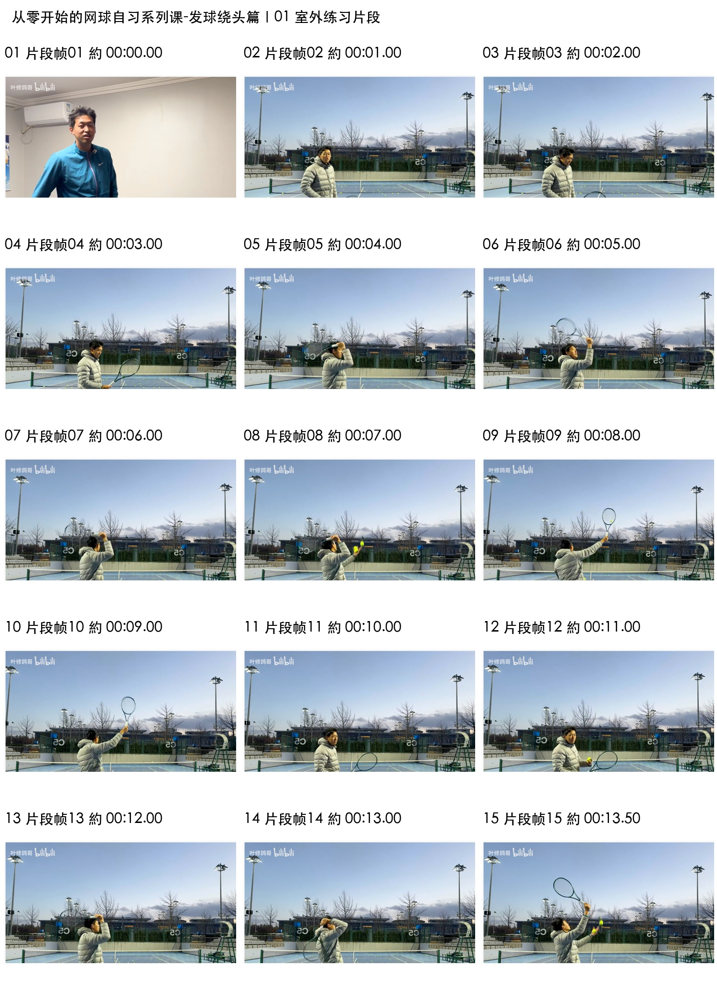
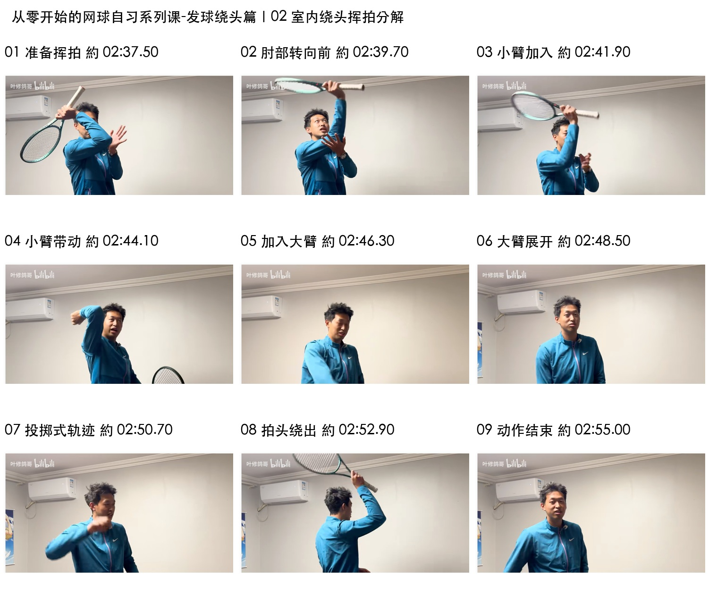

# 从零开始的网球自习系列课-发球绕头篇

[Bilibili 原课](https://www.bilibili.com/video/BV14XzVYpEbG/) · 叶修鸽哥 · 合集第 12/35 集 · 时长 02:56 · 整理日期 2026-11-05 · 发布日期 2024-11-26

## 课程总结

本课用投掷动作帮助理解绕头出拍。先看从背后擦球的反例，再练上臂先出来、拍头随后绕出，并用分解练习找回挥拍路线。

## 技术总结

- 用投掷体会从身后绕出并向前挥的路线。
- 先让大臂出来，再让拍头顺势绕出。
- 放松完成挥拍，在结束位置停住体会动作终点。

## 训练路线

1. 先空手做投掷路线，辨认大臂和拍头出来的先后。
2. 持拍慢速把绕出、向前挥和结束位置接起来。
3. 完整路线不顺时拆开练，再重新连成一次挥拍。

## 常见问题与调整

| 情况 | 调整方式 |
|---|---|
| 球拍一直从背后蹭球 | 回到投掷练习，让大臂先走、拍头随后绕出。 |
| 绕头路线接不上 | 用分解练法先走顺各段路径，再放松连起来。 |

## 按时间顺序的课程记录

### 00:00–00:43｜从背后蹭球为什么难以稳定平击

叶修先指出，许多人发平击球时会从球的后侧向上蹭，随后再用一个类似“平拳”的动作向前加速。球有时也能发平，但如果为了增加挥拍速度而让前臂、手腕继续赶动作，肘部容易超伸，或手腕被压住；若把手腕固定住，挥速又可能提不上去。教学者把这种路径与投掷动作作对照，认为单靠末端手腕追求速度会让动作难以协调。

### 00:43–01:10｜用投掷路线理解绕头

叶修让学员从侧后方观察。这里要找的是投掷动作中手臂从身体侧后方向前上方展开的路线，而不是只把手腕向后折，再用手腕把拍子甩出去。他用简单的投掷手势说明发球动作要从手臂整体展开，随后拍头才有空间自然绕出。

### 01:10–01:45｜先让大臂出来，再让拍头绕出

回到正常发球动作时，叶修指出许多人只做“掉拍头”，结果看起来只有小臂在动，手臂没有从后侧展开。他示范从投掷式展开开始，让大臂先带出，拍头随动作自然绕到前上方。拍头达到高点时再向球挥出，避免把手腕压住或在末端硬掰。

他将理想结果描述为更容易把拍头送到较高击球点，并且能增加拍头速度。这里记录为本课的教学说法；画面用于说明动作路线，不能单独证明速度或伤病因果。

### 01:45–02:18｜放松挥拍，并在结束位置停住

叶修用类似套绳的比喻说明手臂需要放松，才能让拍头速度带起来。他同时提醒放松不等于把手腕压弯或过度翘起。练习时可以先把动作做慢，从绕出到结束位置停住，建立路线和控制，再逐步连接到发球。

### 02:18–02:56｜绕头做不出来时的分解练法

如果学员暂时做不出投掷式展开，叶修建议先用更简单的路线：身体面向前方，先把肘部转向前，再练小臂的旋转；小臂能稳定完成后，再加入大臂转动，让投掷路线和绕头动作逐步连起来。不会投掷动作时就从头分解练起，最后再加入击球。结尾再次强调，先能让拍头绕出来，再把它连接到发球。

