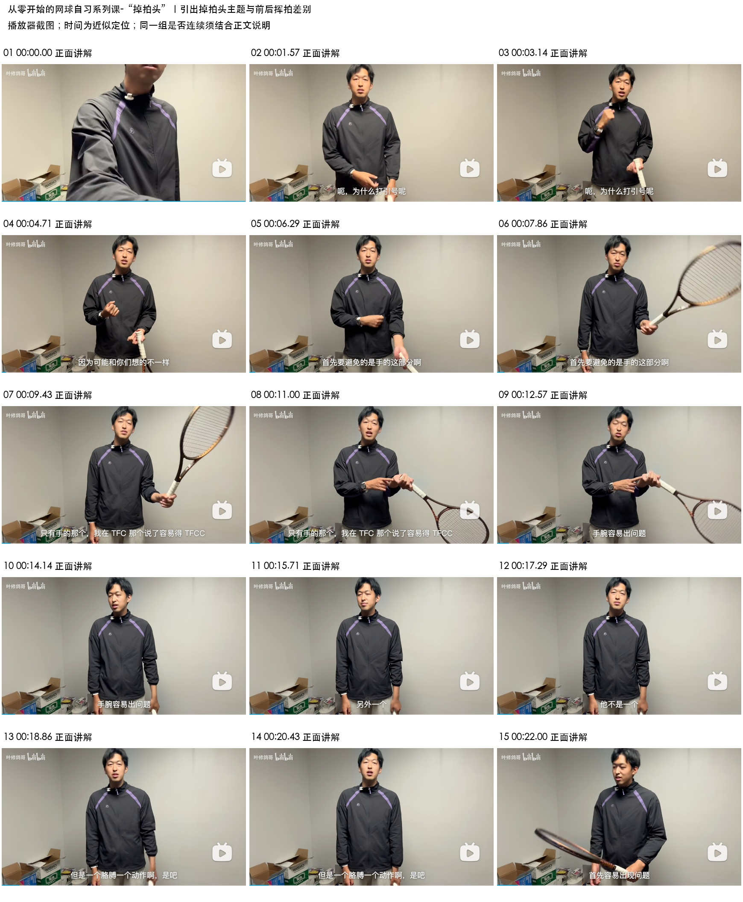
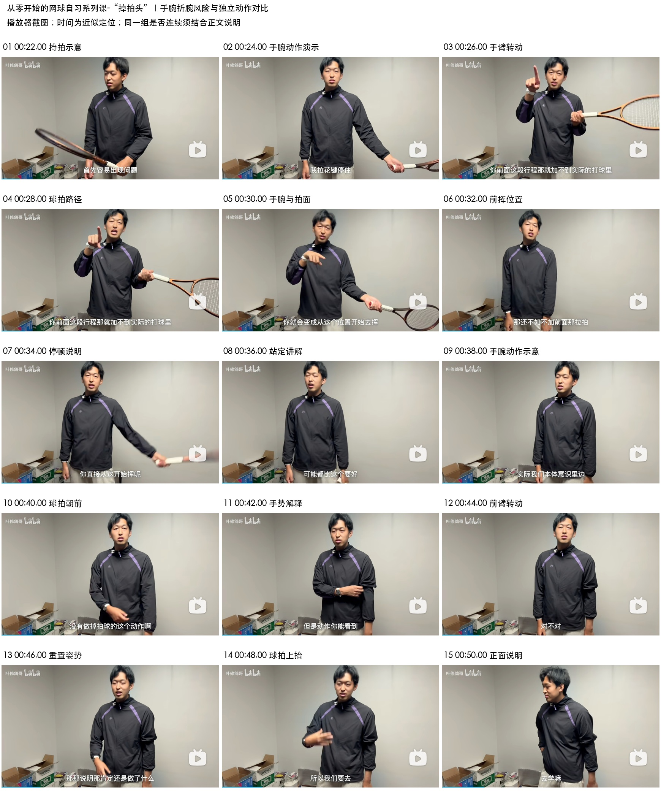
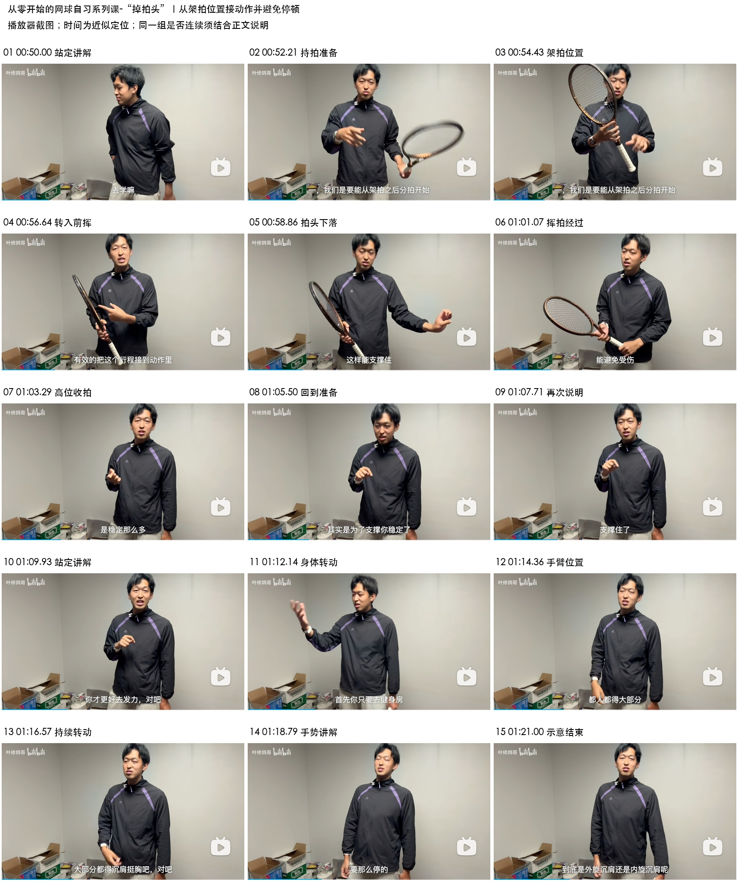
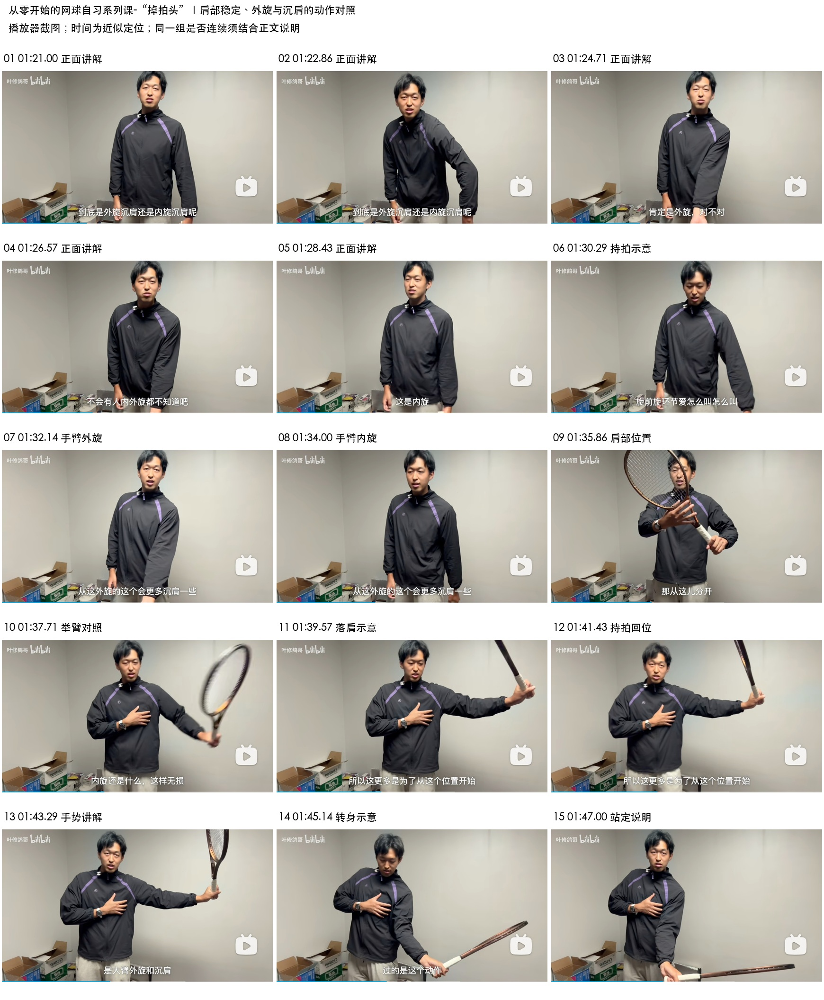
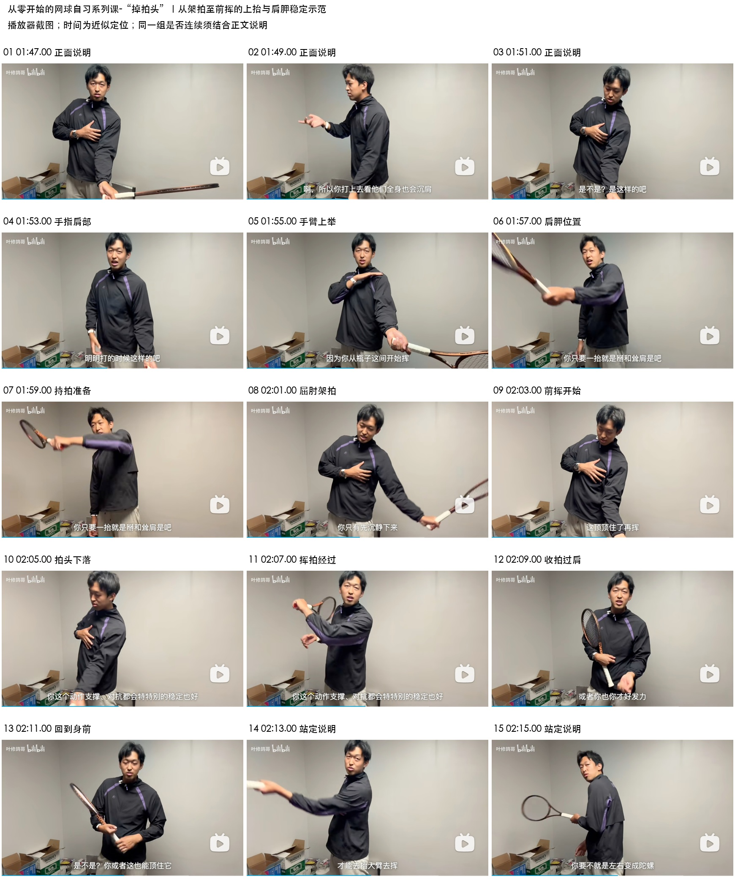
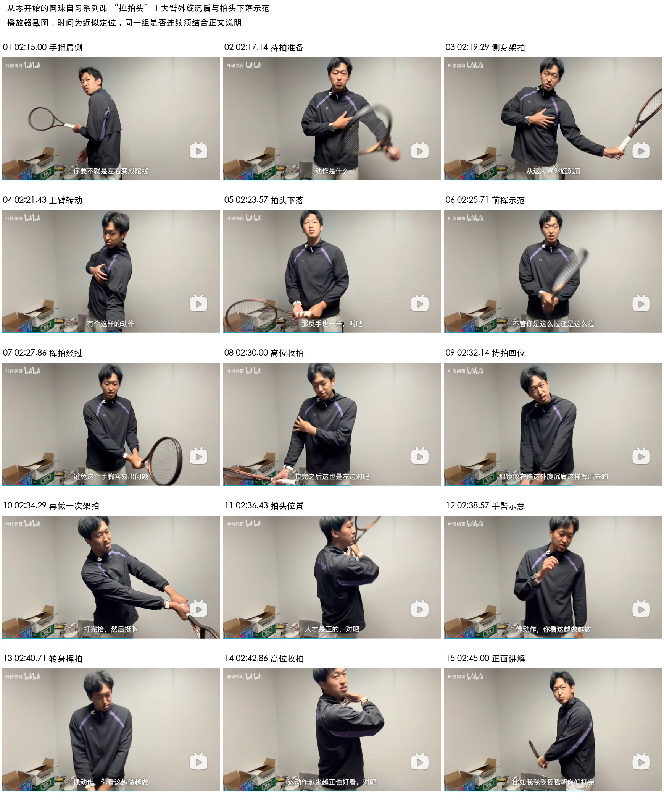
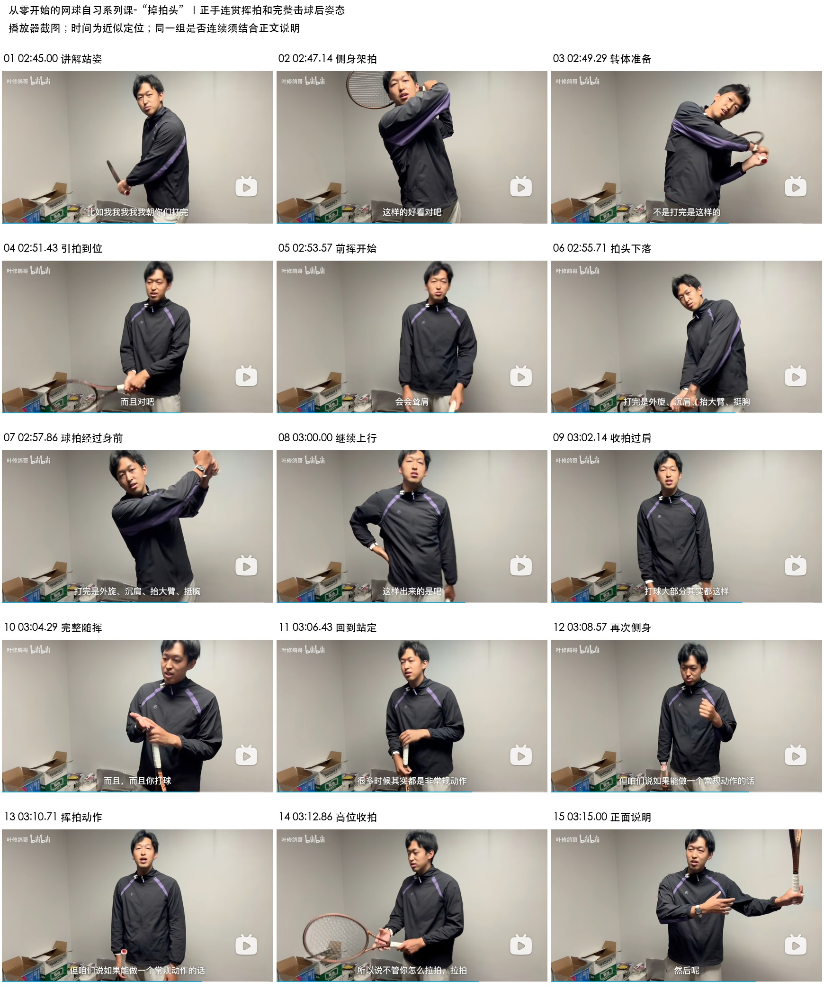
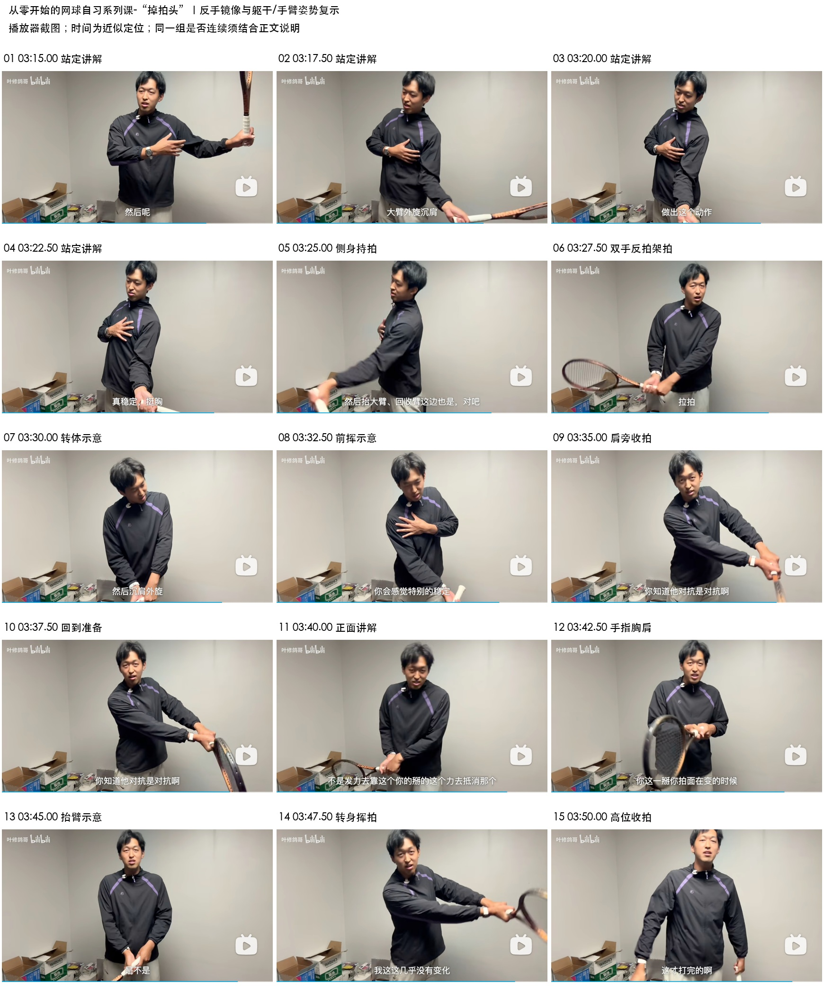
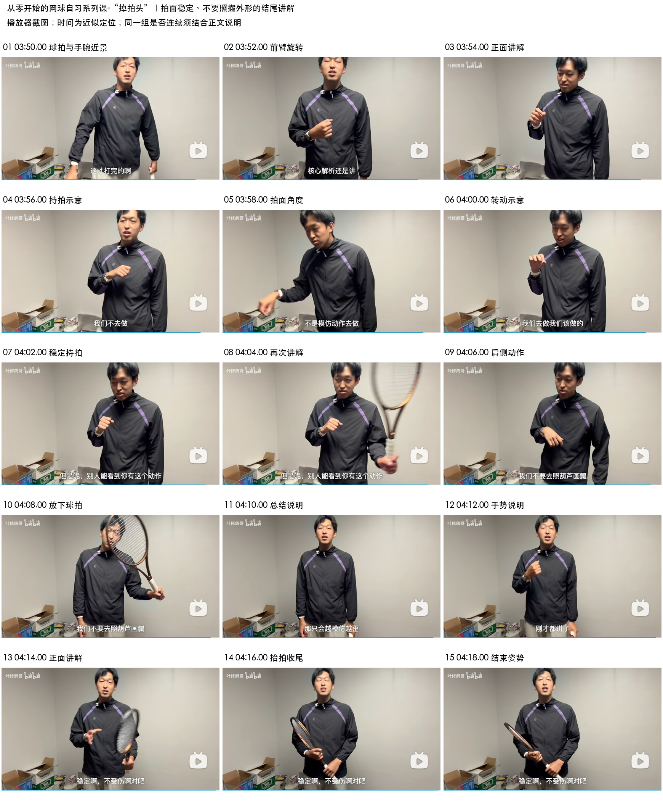

# 从零开始的网球自习系列课-“掉拍头”

[Bilibili 原课](https://www.bilibili.com/video/BV18adkY7E5x) · 叶修鸽哥 · 合集第 19/35 集 · 时长 04:19 · 整理日期 2026-11-06 · 发布日期 2025-04-13

## 课程总结

本课用空挥理解拍头下落如何接在架拍和前挥之间，并对照肩部外旋、沉肩、抬臂和手腕硬掰等不同做法。

## 技术总结

- 从架拍进入拍头下落，再连续接前挥。
- 用肩部外旋和沉肩体会拍头位置变化。
- 先建立肩胛支撑，再把抬臂接入挥拍。
- 把掉拍头放回完整动作练习。

## 训练路线

1. 慢速对照从架拍衔接与从低处重新开始的两种挥拍。
2. 通过分段空挥体会肩部动作及拍头下落。
3. 把架拍、拍头下落和前挥连在一起，再观察随挥。

## 常见问题与调整

| 情况 | 调整方式 |
|---|---|
| 挥拍前半段断开，球拍落低后重新启动 | 放慢整套空挥，让拍头下落接在架拍和前挥之间。 |
| 靠手腕硬掰出掉拍头外形 | 回到肩部与拍头衔接的慢速示意。 |

## 按时间顺序的课程记录

### 00:00–00:22｜从前挥衔接处引出“掉拍头”

讲师开场从挥拍过程的衔接讲起，提出不应只把球拍头单独做一个下落动作。他提醒要注意手腕部分，并提到单靠手腕做动作可能带来手腕问题，其中提到 TFCC。这里是讲师的风险提示，不是对任何人的伤病诊断。

【图 01：主题引入与持拍说明，00:00–00:22，15 帧】出镜者在室内正面讲解并举拍说明，属于分段口头示范，不含来球或触球。

### 00:22–00:50｜不要把挥拍前程截掉，再从低处重新开始

若前面的引拍行程没有接入实际挥拍，最后变成从一个低位重新启动，前面的动作就没能连到整次挥拍中。他强调需要理解拍头下落出现的位置与前后挥拍的关系，而不只是手腕单独折动。

【图 02：手腕、球拍与动作衔接的分段对比，00:22–00:50，15 帧】出镜者多次举拍、指手腕和示意挥拍路线，动作之间有重置，不是连续击球。

### 00:50–01:21｜从架拍位置接入拍头下落

从架拍之后练习如何接入拍头下落这段行程，使其有效地连到完整动作里。他再次提醒不要单做手腕折动，并把稳定和减少受伤风险列为教学目标。随后他用手臂、肩部和球拍做动作说明，强调支撑稳定后再继续挥拍。

【图 03：架拍位置到前挥的分段练习说明，00:50–01:21，15 帧】可见出镜者持拍摆位、转身和空挥；阶段在讲解中多次重来，非一拍连续动作。

### 01:21–01:47｜肩部外旋、沉肩与抬臂的对照

讲师谈到常见训练中肩部与上身姿势，提出“沉肩”“挺胸”，并对比外旋与内旋的动作名称。他用手臂转动、抬臂和球拍姿态说明自己的理解，称其中更强调大臂外旋、沉肩。

【图 04：肩部与手臂动作对照，01:21–01:47，15 帧】有手臂举起、转动、持拍对照及回位，均是原地分解示意。

### 01:47–02:15｜抬臂前先稳定肩胛，再继续挥拍

讲师把讲解落到从架拍开始的动作：如果一开始就抬手，容易出现他所说的“掰”和耸肩；先让肩胛区域稳定，再抬臂和挥拍。他演示一侧手臂抬起、另一只手按在胸肩位置的姿势，用来说明如何感觉支撑与稳定。画面只呈现姿势变化，不能单独证明具体肌肉募集顺序。

【图 05：肩胛稳定与抬臂的分段示范，01:47–02:15，15 帧】单臂举拍、手按胸前、回到架拍等动作是分段摆姿势。

### 02:15–02:45｜大臂外旋、沉肩并让拍头下落

讲师继续示范从架拍位置启动。他将大臂外旋和沉肩作为拍头下落前后的动作提示，并用侧身持拍、球拍转动、空挥和回到准备位置反复说明。此处没有来球；球拍下落与前挥路径是影子挥拍示范。

【图 06：大臂外旋、沉肩与拍头路径，02:15–02:45，15 帧】同一段中包含多次分解与重置，不应把所有姿态拼成单次击球。

### 02:45–03:15｜正手挥后姿势与“常规动作”

讲师展示挥拍之后较直立的完成姿态，结合“外旋、沉肩、抬大臂、挺胸”等动作提示，并对比挥后身体过度歪斜的样子。他说实际打球常会遇到非常规情形，但仍可以先练习一个常规动作。这里是室内无球空挥及姿态对照，不是球场击球录像。

【图 07：正手空挥至挥后姿势的连续示意，02:45–03:15，15 帧】前半段展示收拍姿态与不理想外形对照，约 02:53–03:04 可见一次连贯影子挥拍；没有球和可确认的触球帧。

### 03:15–03:50｜用稳定支撑完成挥拍，不靠手腕硬掰

讲师再次从引拍位置讲起，重复大臂外旋、沉肩、肩胛稳定、挺胸和抬臂等口令，再做空挥。他提醒不要用手腕“掰”的力量去抵消拍面变化，而应先稳住相关位置。

【图 08：架拍、稳定与挥拍路线重复演示，03:15–03:50，15 帧】由手指胸肩讲解、架拍、空挥到收拍，多次重复和重新摆位；不是单次击球连续帧。

### 03:50–04:19｜练动作要点，不照搬外形

结尾讲师总结，不要只照着别人动作外形模仿，而要做自己该做的动作；如果动作思路合适，外观上可能出现相近的姿态。他提及动作行程、稳定和避免受伤等本集目标，随后结束课程。末尾出现下一集自动播放提示，不属于本集教学内容。

【图 09：拍面与手腕稳定的结尾说明，03:50–04:18，15 帧】包含球拍近景、手腕转动示意、正面总结和一次收拍，均为讲解画面。

