# 从零开始的网球自习系列课-高压入门篇

[Bilibili 原课](https://www.bilibili.com/video/BV1BAreYPEMp/) · 叶修鸽哥 · 合集第 15/35 集 · 时长 03:44 · 整理日期 2026-11-05 · 发布日期 2025-01-09

## 课程总结

本课从网前架拍和向后启动开始，通过固定方向退步、自抛自打、慢跑和搭档喂球建立高压衔接。回位和调整脚步贯穿练习，最后以先把高压打稳作为比赛应用目标。

## 技术总结

- 第一步先确定来球方向，同时开始架拍。
- 固定斜后方向练退步，用场地线和余光感知位置。
- 按移动能力选退步方式，击球后接下一步调整。
- 来球位置改变时保留脚下调整余量。

## 训练路线

1. 先沿固定方向走动退步并架拍。
2. 加入自抛自打，把启动、后退、挥拍和下一步连起来。
3. 走动熟悉后逐步加入慢跑与搭档喂球。

## 常见问题与调整

| 情况 | 调整方式 |
|---|---|
| 一后退就转头反复找路线 | 先用固定斜后路线练习，借余光和场地线定位。 |
| 位置还在变就过早站死 | 保持脚下调整，确定击球距离后再完成高压。 |

## 按时间顺序的课程记录

### 00:00–00:17：先接上架拍与挥拍的基础

高压入门要接着前面的视频学，特别是上一部分提到的“小臂内旋”。他举起持拍臂示意：球来了，至少能够架拍，并把已经学过的挥拍动作做出来，让球有机会被挡回去。他也用不同的手臂姿势作对照，说明不能连基本的架拍和向上处理球都没有。

这里是手臂动作的分段说明，不是一次完整高压击球。画面能看到举臂、抬拍与不同挥拍姿势；“小臂内旋”是讲师沿用的教学术语，静态图片不能据此确定各关节的实际转动或发力贡献。

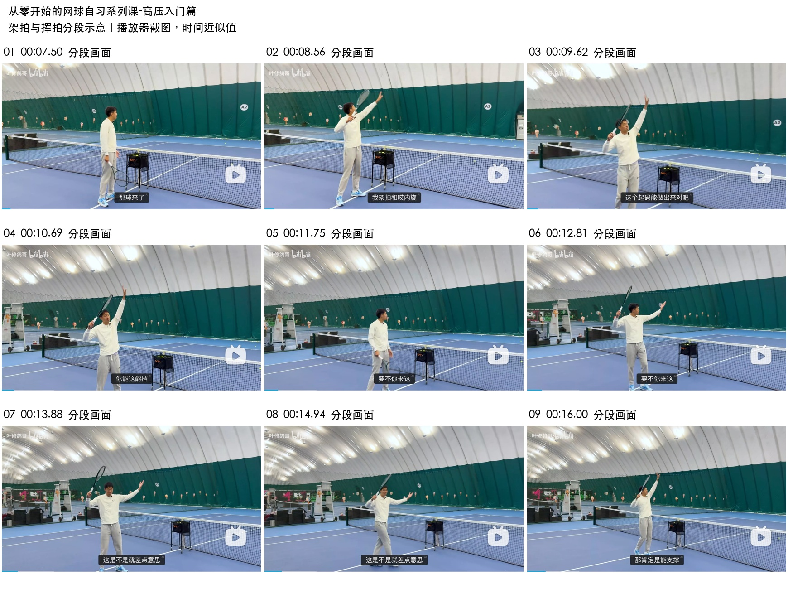

### 00:17–00:42：第一步决定移动方向，同时开始架拍

接下来重点转向脚下。讲师以画面中的右手持拍示范为例，强调右侧击球的第一步先动右脚；高压尤其需要关注第一步往哪里走。他依次指示斜后、正后、侧后等不同方向，说明面对不同落点，不能都用同一个后退方向。

在启动的同时把架拍带起来：不是脚先走完，再临时抬手，而是练习第一步与双臂准备的配合。这里的方向名称依照讲师口述保留，不把单机位画面换算成精确角度。

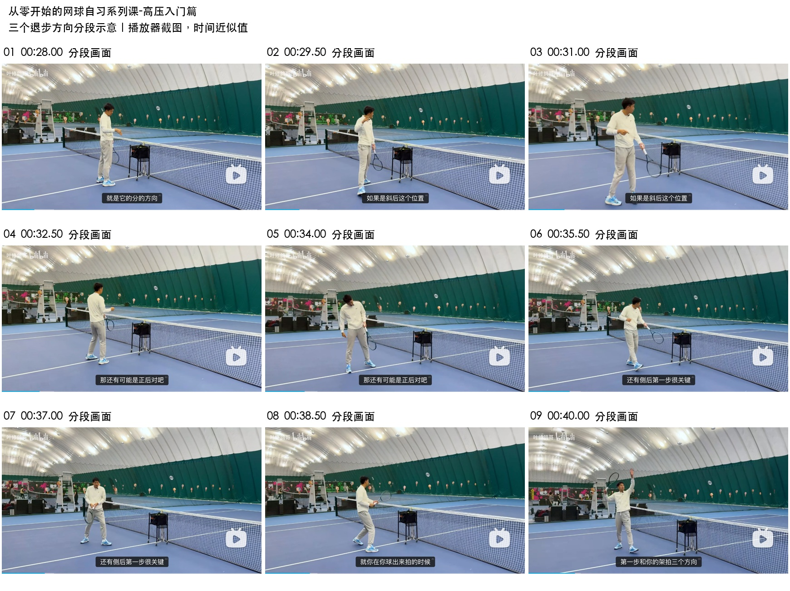

### 00:42–01:24：不回头找路线，借助余光和场地线练退步

先固定练一个斜后方向。讲师从网前附近启动，抬起手臂，沿着预定角落后退。他要求练习时不要为了找路线不断转头往后看，而是保持向上观察的状态，通过余光感知场地位置。

退到位置以后再看走得是否准确：是不是朝着想去的角移动，还是以为自己走对了，实际却偏到别处。讲师把它解释为本体感觉和场地感知的练习，方向越准确越好。

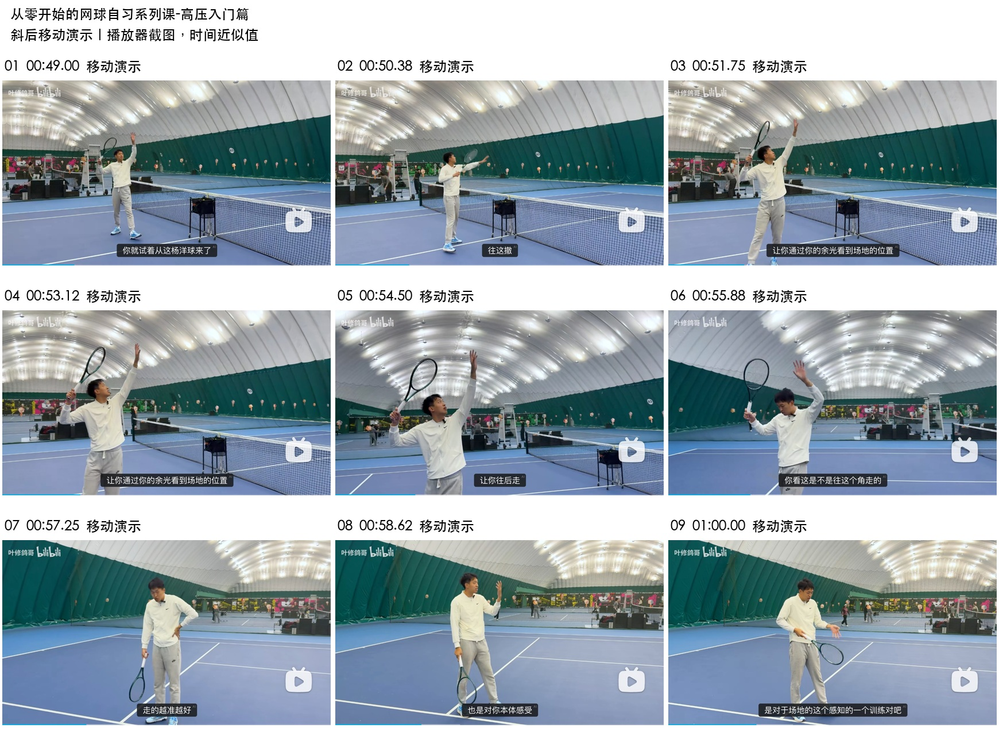

随后练正后方向：借助上方视线、余光和场地参照，判断自己是否沿着同一条路线移动，而不是一路盯着脚下找线。最后换另一个斜后方向，第一步出去后继续顺着该方向退。三组画面分别对应不同的路线演示，不是同一次击球的连续阶段。

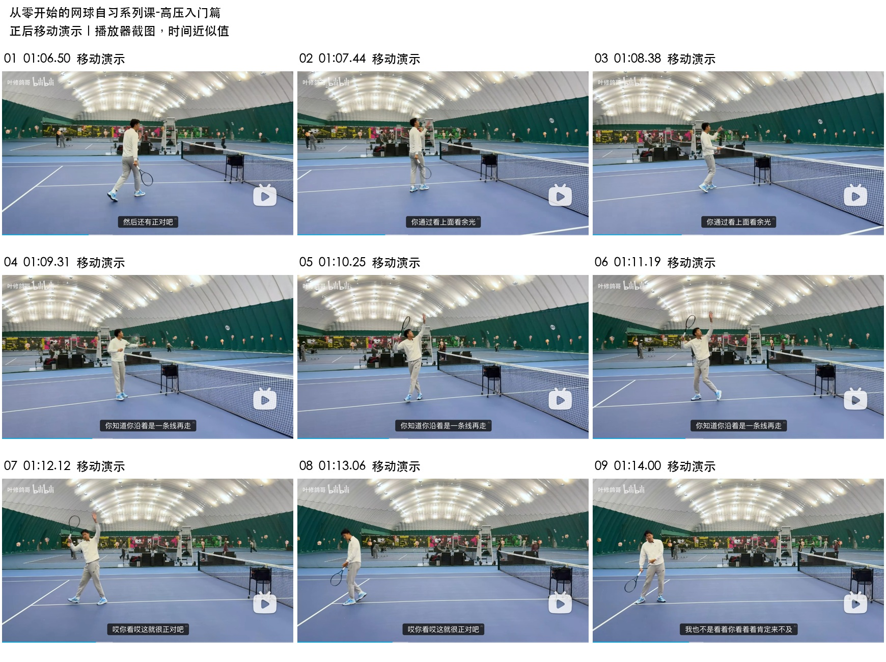

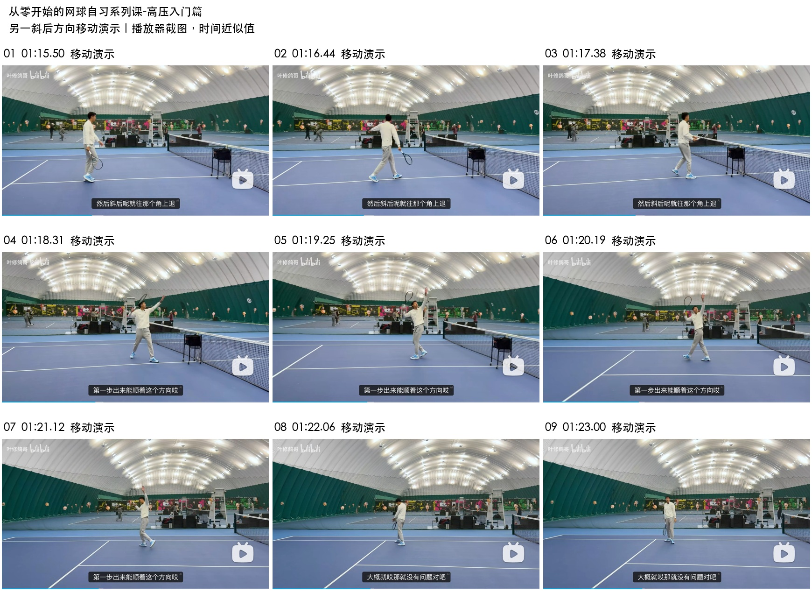

### 01:24–01:56：根据移动能力选择步法，不要求人人做成一样

如果髋部灵活、力量条件也不错，可以采用他所示范的前后交叉移动；如果这样移动很别扭，可以先用更简单的向后走或向后跑。

他强调，入门的目的在于更容易学会和完成任务，不是所有人一定做出同一种步法。对髋部活动不顺的人，勉强交叉反而可能卡住动作。画面随后示意把髋转向移动方向，身体向后方行进，同时转头继续看球并保持持拍臂的准备。讲师认为，这样也能衔接挥拍。

以下是多次步法与姿态的分段比较，不是把不同演示拼成一套连续动作。

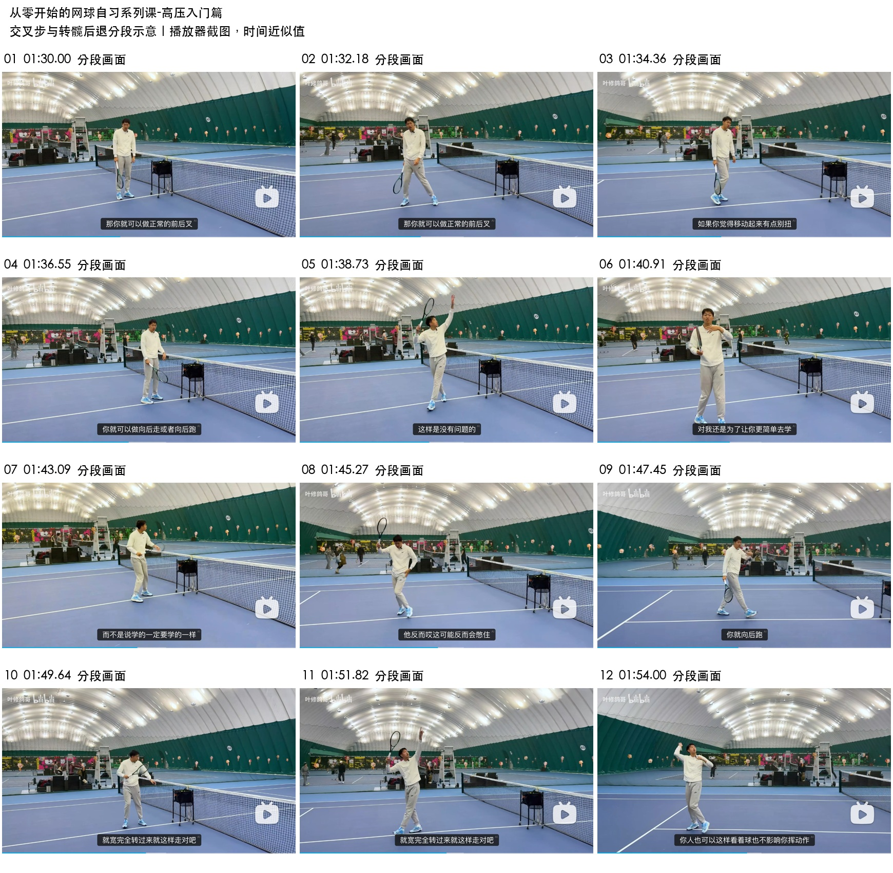

### 01:56–02:15：先自抛自打，把第一步、移动和挥拍连起来

没有搭档时，可以自己拿球，分别模拟三个移动方向。本课只选其中一个方向展示：先迈出第一步、架拍，继续移动，看准位置后自己把球抛起来，再把挥拍接上。

先在移动中把高球稳稳打回去，再逐步提高击球速度。当前目标是减少失误，先把高球打回去。

**自抛自打｜约 02:04.00–02:09.00**。抬拍后退、自抛球、挥拍、随挥、恢复站姿。

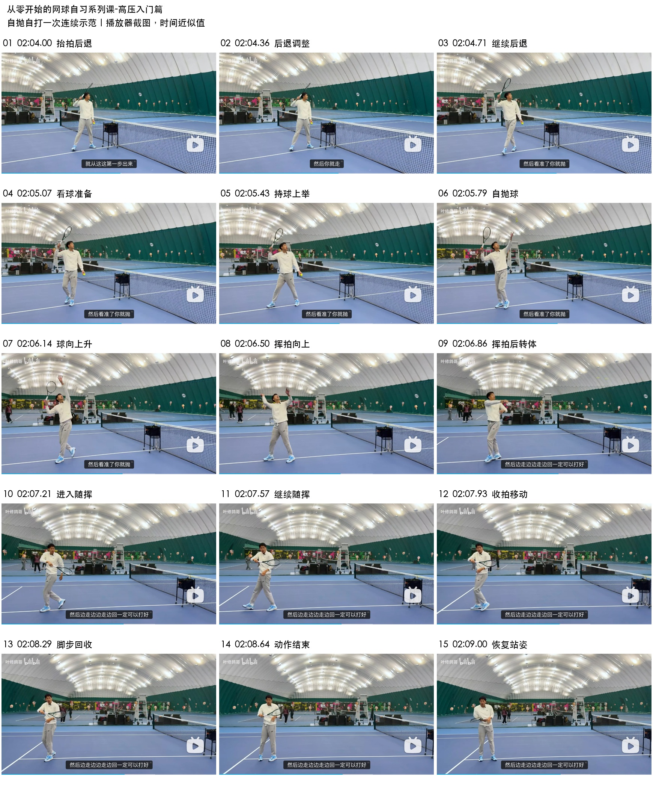

### 02:15–02:33：重复后退来球情境，击球后继续衔接下一步

讲师再次模拟一个向后方来的高球：启动、移动、自抛，然后挥拍处理。他仍把重点放在先不失误，而不是每次都把高压打成直接得分球。

这段随后谈到控制击球，以及打完以后可以继续退到底线，也可以重新上网。

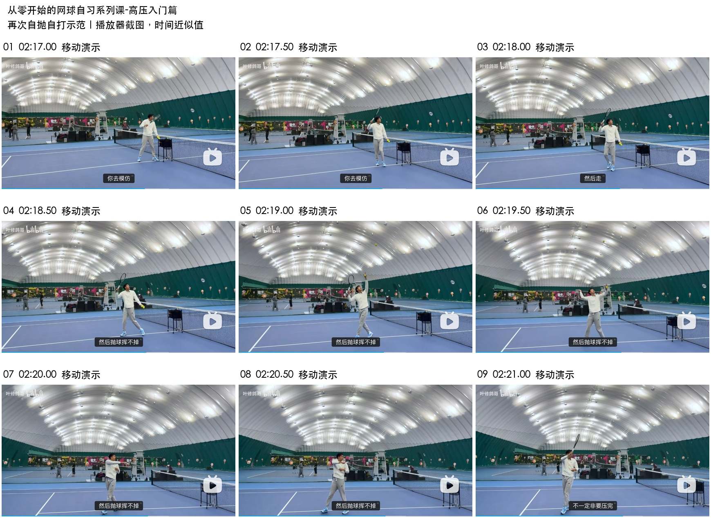

### 02:33–02:51：走动练习熟悉后，再尝试慢跑和搭档喂球

如果走着移动已经没有问题，下一步可以试着向后慢跑，再自抛、挥拍。画面展示了从持球准备到抬拍、抛球和挥拍的衔接。原视频在这里推近并抬高镜头，部分帧只看得到上半身，不能用这组近景判断完整脚步或落地过程。

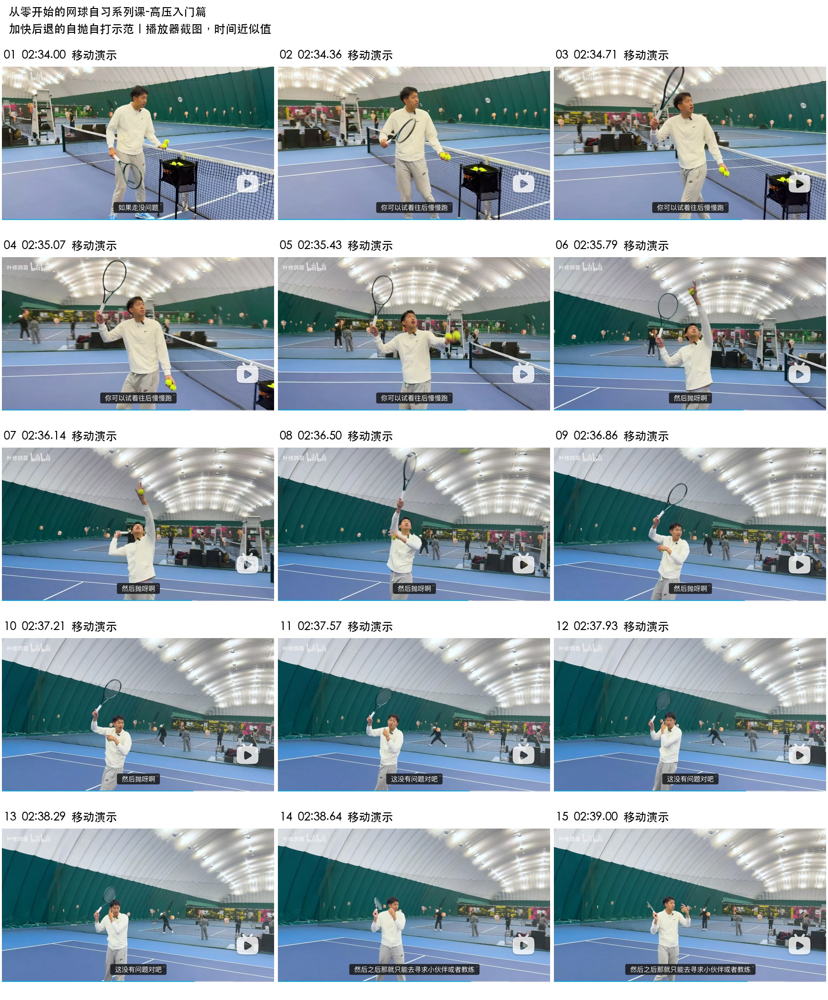

然后找小伙伴或教练喂球。讲师指出，最初较难的是三个方向的第一步，以及脚下启动和抬起两侧大臂的协调。把这一配合练顺，再继续增加来球判断任务。

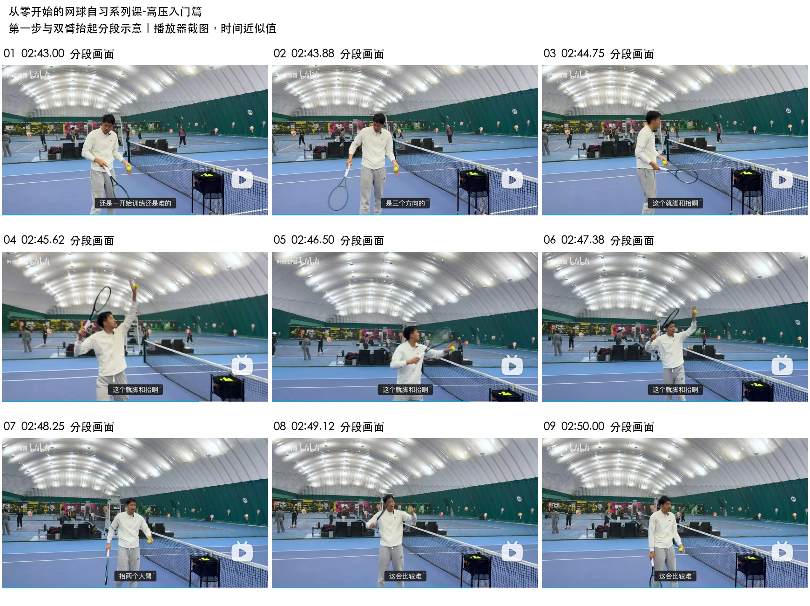

### 02:51–03:19：来球位置会变，脚下不要过早站死

实际打球并不是每个高球都让人向后跑，球落在前面的情况也要练。接下来要提高对来球的判断，根据球的位置持续调整。

来球仍在移动，脚下要继续调整；一旦提前固定位置，后面才发现与球的位置对不上，就难以处理。入门阶段先调整着把球压过去。随着练习量增加，踩点更准确，再逐步加入力量和脚下发力；讲师把这放在后续阶段，而不是本课要求立即完成的动作。

下图是这段讲解中的站位、手势和挥拍分段示意，不是一次完整移动高压。

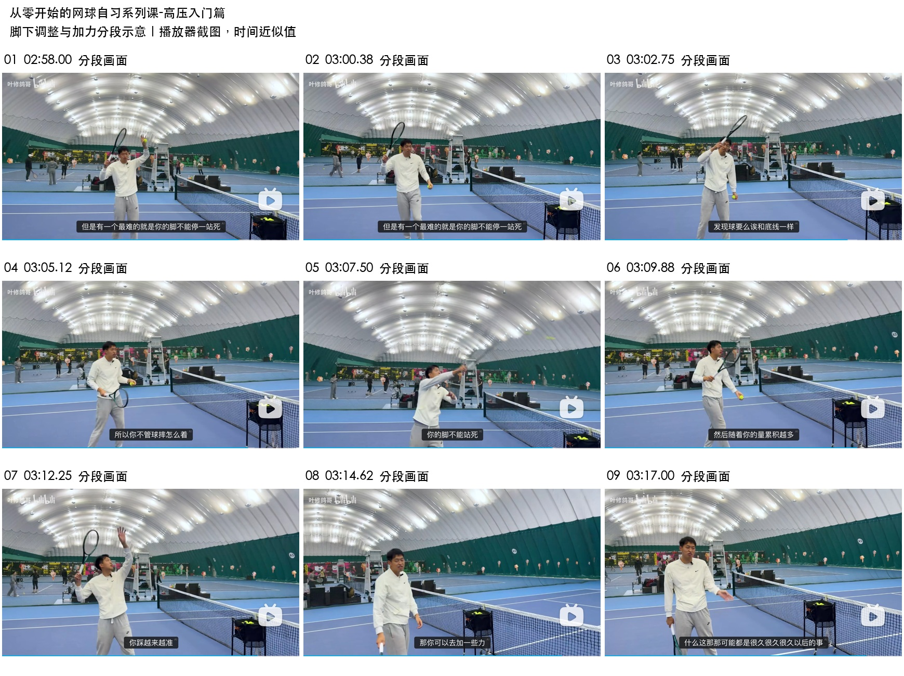

### 03:19–03:44：单打双打都先减少高压失误，保留继续打的机会

结尾把目标拉回比赛。讲师提醒，不要看到高球就觉得理应一拍打死；对入门者，高压本来就是很难的来球。单打或双打先争取不失误，把球回过去，后面就还有机会继续进行这一分。

他提到常见的中场高压场景，再次强调先让比赛继续下去，随后结束。
