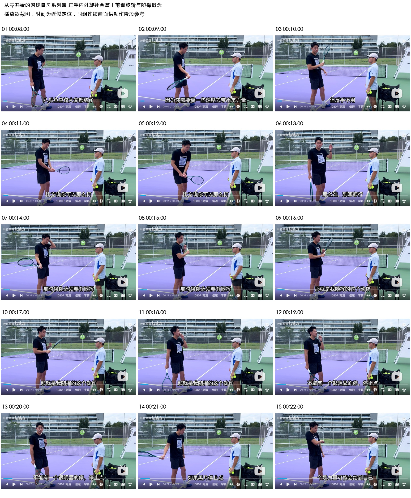
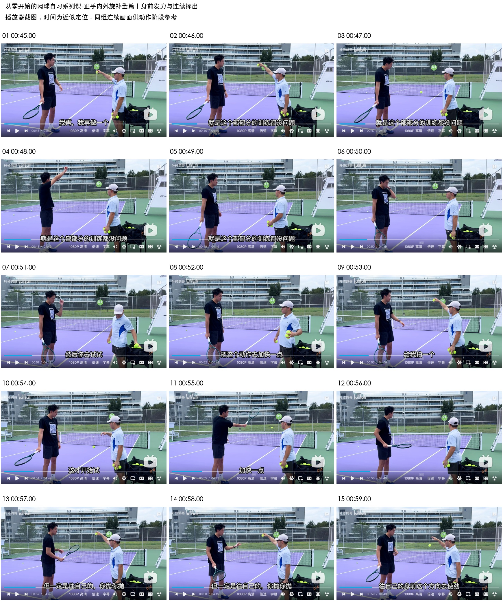
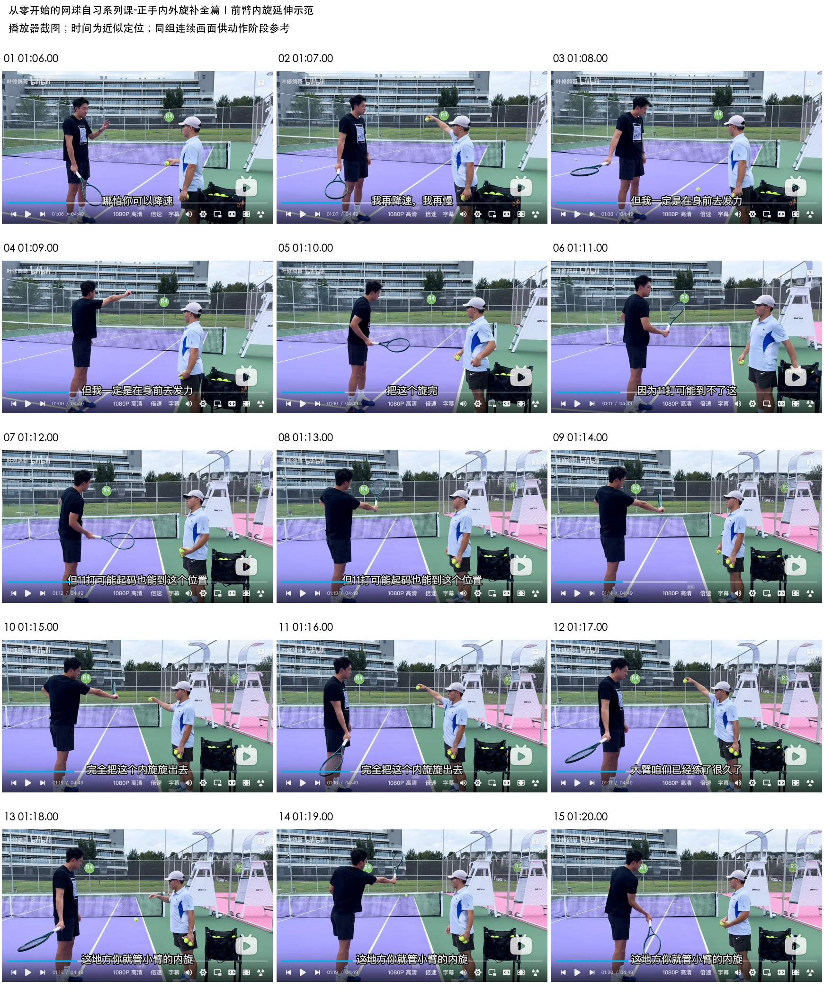
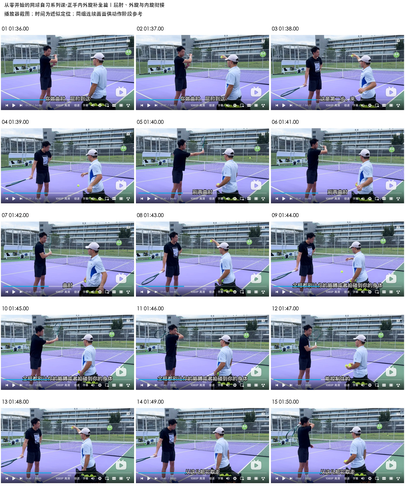
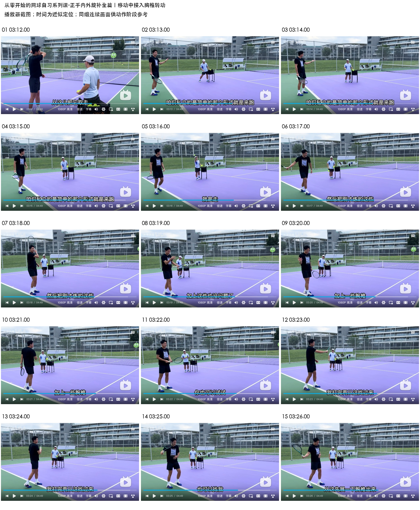
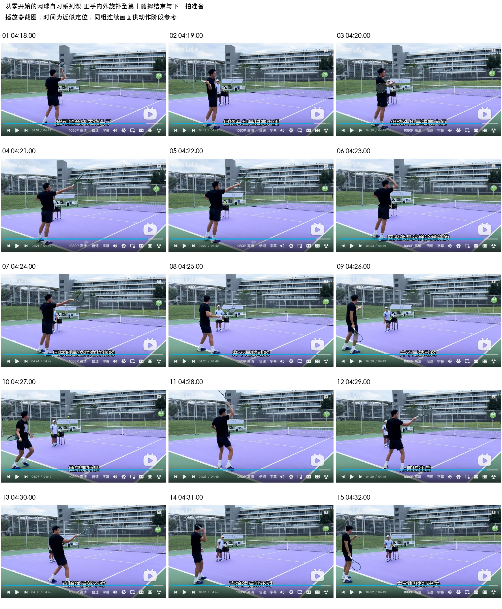

# 从零开始的网球自习系列课：正手内外旋补全篇（改掰网球肘）

来源：[Bilibili 原课](https://www.bilibili.com/video/BV1PZgbzYEFf/) · 叶修鸽哥 · 合集第 23/35 集 · 时长 04:49 · 整理日期 2026-11-06

## 课程总结

本课从正手随挥开始，练习在击球后继续把拍头送出去，再将屈肘、外旋、前臂内旋和向前延伸接成连续挥拍。动作先在站定和身前喂球中练习，熟悉后再加入移动、胸椎转动和下一拍回位。课程最后把关注点放回完整随挥与连续击球，不在触球后停拍或突然向后甩拍。

## 技术总结

- 击球后继续挥拍，让拍头穿过击球区域并向前延伸，不在触球后突然停住。
- 在身前进行低速喂球练习，体会前臂内旋与向前送拍的连续过程，不把内旋做成原地单独转前臂。
- 将屈肘、外旋、内旋和向前延伸顺接起来；分解动作只用于熟悉各环节，完整挥拍保持连贯。
- 手臂和球拍经过身前时留出空间，避免动作挤碰身体。
- 先在站定练习中熟悉手臂路径，再加入脚步移动和胸椎转动。
- 击球后完成随挥，并重新准备下一拍，使移动击球能够连接回位。
- 随挥按向前延伸并自然回收的路线完成，不把收拍做成球拍直接向后甩。

## 训练路线

1. **站定随挥**：从简单正手挥拍开始，击球后继续完成随挥，不在击球点停拍。
2. **身前喂球与延伸**：搭档将球送到身前，降低球速，练习前臂内旋并把球拍向前延伸；先确保击球和挥拍路径连续。
3. **组合手臂动作**：熟悉内旋与延伸后，加入屈肘和外旋，再连接成完整挥拍。练习中让球拍顺畅经过身前，不挤碰身体。
4. **加入移动与躯干转动**：在喂球下移动到位后击球，逐渐接入胸椎转动；击球后调整回下一拍位置。
5. **连续随挥与回位**：将完整挥拍、收拍和重新准备连接起来，按来球连续完成，不在击球后把拍头向后甩或停在身前。

## 常见问题与调整

| 情况 | 调整方式 |
|---|---|
| 触球后立刻停拍 | 回到低速喂球，练习拍头继续向前通过击球区并完成随挥。 |
| 只在原地单独转动前臂 | 结合身前喂球，把内旋放回完整挥拍中，并继续向前延伸。 |
| 屈肘、外旋、内旋变成互不相连的停顿动作 | 先分解熟悉，再降低速度把各环节顺接成连续挥拍。 |
| 手臂或球拍经过身前时挤碰身体 | 调整准备和出拍空间，让球拍顺畅通过身前。 |
| 加入移动后手臂路径散乱 | 退回站定或短距离喂球，先恢复手臂路径，再加入脚步和胸椎转动。 |
| 收拍时把球拍直接向后甩 | 保持拍头向前延伸，再屈肘回收并准备下一拍。 |

## 按时间顺序的课程记录

### 00:00–00:36｜随挥从击球后继续

本课从正手随挥开始。击球后继续让身体和手臂沿挥拍方向运动，不在击球点突然停住，也不只在触球前后用手臂硬掰。随挥延续挥拍速度与方向，为完整动作留出空间。

### 00:36–01:30｜身前练习前臂内旋与向前延伸

搭档从身前喂球，先以站定或短距离练习控制难度。降低球速，体会前臂内旋，并把球拍向前延伸出去；内旋是挥拍过程的一部分，不是停在原地单独转一下前臂。喂球位置保持在身体前方，先把动作路线接顺，再逐步增加速度。

### 01:30–02:24｜把屈肘、外旋与内旋接成连续挥拍

在前臂内旋和向前延伸的基础上，加入屈肘与外旋，再把各环节接成连续挥拍。分开示范可以帮助辨认动作顺序，实际击球时不需要每一步都停顿摆姿势。球拍经过身前时留出空间，避免手臂和球拍挤碰身体；随挥可以自然接到绕头方向。

### 02:24–03:48｜加入脚步移动与胸椎转动

手臂路径熟悉后，把练习放到场上移动中。根据喂球移动到位，完成正手挥拍，再调整位置准备下一球。先把脚步和手臂动作接起来，再逐步加入胸椎转动与躯干参与；打完继续回到下一拍准备，而不是结束在单次挥拍上。

### 03:48–04:49｜完成随挥并连接下一拍

结尾继续练习随挥位置和拍头路径。拍头穿过身前后继续向前挥出，再自然回收；避免向后甩拍，也不要把拍头停在身体前方。喂球和挥拍重复后，回到准备位置，连接下一拍。

