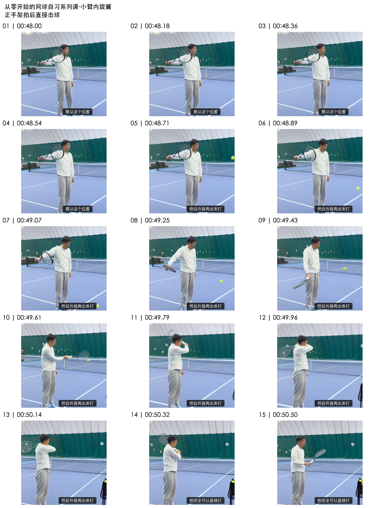
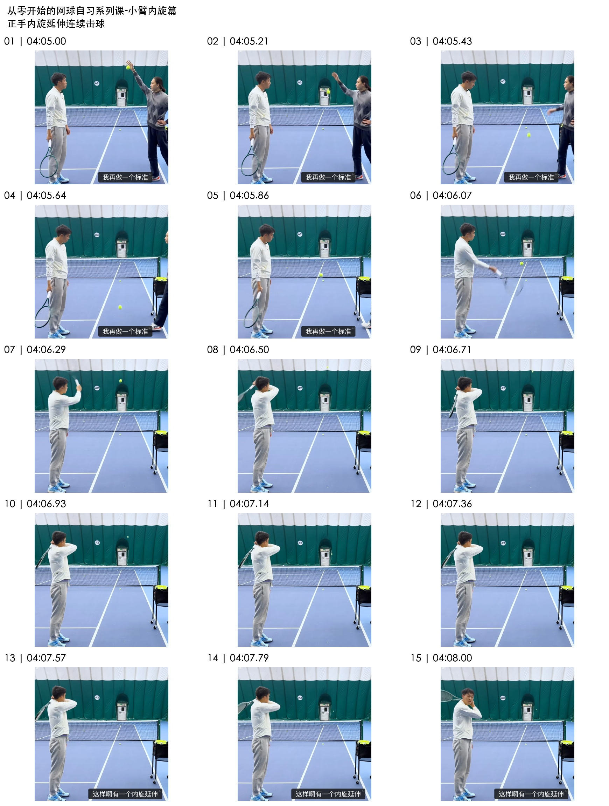
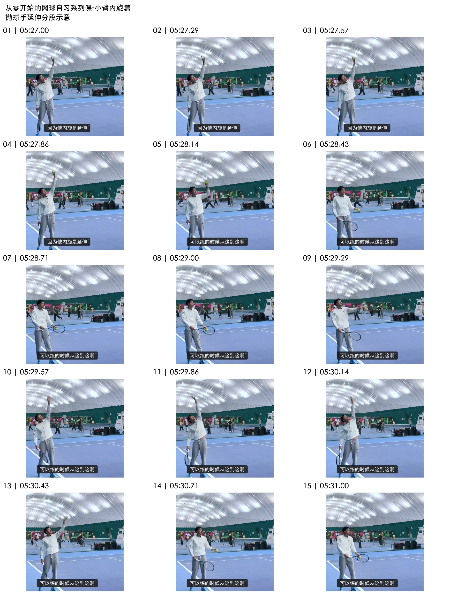
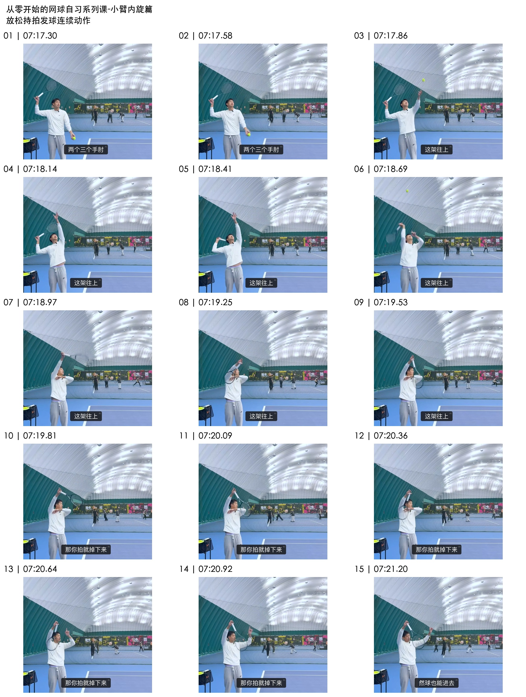

# 从零开始的网球自习系列课-小臂内旋篇

[Bilibili 原课](https://www.bilibili.com/video/BV1egreYbEbt/) · 叶修鸽哥 · 合集第 13/35 集 · 时长 07:38 · 整理日期 2026-11-05 · 发布日期 2025-01-09

## 课程总结

本课把小臂内旋放进正手架拍、向前延伸和收拍，也分别练习发球抛球臂与持拍臂的向上延伸。

## 技术总结

- 正手架好后直接击球。
- 出拍时让拍头沿出球方向延伸，再屈肘回收。
- 发球先练抛球臂向上展开，再接持拍臂绕头后的向上挥拍。
- 高点保持挥拍运行，减少主动压拍。

## 训练路线

1. 先空挥练架拍后直接启动与向前延伸。
2. 加入喂球，把手腕支撑和屈肘回收接到挥拍上。
3. 分别练发球抛球臂与持拍臂，再用两三指持拍体会送出拍头。

## 常见问题与调整

| 情况 | 调整方式 |
|---|---|
| 触球后立刻横向搂拍 | 先空挥体会拍头沿出球方向持续延伸。 |
| 发球在高点主动向下压拍 | 回到向上送拍练习，接上球拍的后续运行。 |

## 按时间顺序的课程记录

### 00:00–00:46：从功能理解架拍阶段的小臂内旋

小臂内旋要放进完整的准备与挥拍过程练习，先体会它在动作衔接中的作用。

他首先讲正手架拍：准备阶段的内旋与延伸，是为了减少奇怪、多余的拉拍以及二次拉拍，给后续外旋、沉肩和击球留出空间。准备已经完成后，应能直接进入击球，不必再把手放下来重新开始一次。

练习时，意图是小臂内旋和延伸，但个人可能同时感到肩或肩胛骨参与。讲师把这些区别描述为个人体感，要求先抓住练习目的，不必为了只动小臂而把其他部位锁住。

### 00:46–01:06：架好后直接打，避免先放下再启动

请同伴抛球，从架好的位置外旋并挥拍出去。示范用来说明：这一准备姿势可以直接接续击球。如果架好后又放下手，再开始挥拍，就把原本可以衔接的动作拆成了两次。

讲师又让同伴抛一次，重复从准备位置进入内旋、击球，强调不用额外增加中间动作。

### 01:06–02:04：击球时少做横向雨刷，把动作与球分开

转入正手击球阶段，讲师要求少做单纯的雨刷动作，多体会内旋同时延伸的部分。

他提出练习时要把“完成动作”和“球已经离拍”分开理解。初学者害怕把球打飞，容易只碰一下，球一离拍就结束动作；即使水平提高，若只是把这个碰球动作做快，问题仍然存在。现场通过同伴抛球，展示碰到球就停止的状态。

讲师希望练习者能够主动决定什么时候击球、用什么部位怎样随挥、从哪里离开以及用多大力量离开。如果一碰到球动作就结束，这些后续过程就没有实际练习到。

### 02:04–03:08：持续延伸，拍头朝出球方向，减少往左搂

先不打球，体会拍面经过球的后侧、上侧或内侧附近之后继续延伸的过程。这里强调“一直在延伸”，而不是触球后立刻往身体左侧带走。

手臂挥动本来就容易形成向左的轨迹，如果再主动顺着这个方向去搂，身体也容易跟着歪。他让观众在练习中尝试向外延伸，抵消过早往左收的习惯。

随后再接抛球。球在前面的阶段已经离拍，后面仍继续做要练的动作，最后让拍头指向球离开的方向。现场多次提醒“不要往左”。讲师把这样的出球描述为较正的向上旋转，而不是因向左掰、搂而产生斜着的旋转；即使初期方向控制不好，也先观察球的旋转状态。这是本课的练习观察要求。

### 03:08–04:11：加入手腕支撑，再把屈肘连接起来

前一部分能完成后，再加入手腕的支撑，继续接同伴抛球。中间有喂球不理想的情况，现场调整后继续。

延伸方向仍向外；加入支撑后，当球拍背面、拍面与肘部的相对位置到达示范中的衔接阶段，再把屈肘收回接起来。他用“越往外，越屈肘回来”描述这两部分的连接，要求不要把向外延伸和收拍割裂。

接着展示另一个常见状态：只在一条线上做上下动作，缺少延伸，容易打框。随后再做一次示范，要求观察击球后仍存在的内旋延伸，而非只有上下刷动。

### 04:11–04:41：比较屈肘回收与顺势往左掰

讲师继续比较两种回收方式：一是在延伸后用屈肘衔接收回；另一种是到那个位置后，继续顺着向左的力量往左掰。他把后者描述为更容易给关节增加负担的做法。

他还提醒，不能因为某个人打了很多年没有受伤，就认为所有人都能承受同样的动作；个人身体条件不同，应尽量选择自己能够承受、动作结构更协调的方式。此处是讲师的风险解释，课程没有提供伤病统计资料。

### 04:41–05:15：转入发球，先讲抛球手的延伸

讲师总结前面是正手的两个部分，接着说发球也分两部分。第一部分是抛球手。

他展示抛球手从下向上推起，越过水平位置，肩胛骨也能随动作参与，手臂能够向上支撑。与此对比，有的人手抬到某个高度就卡住，或因为怕来不及发球而提前停止抛球侧动作。

这一段练习向上推起并维持支撑，动作可以提前结束。

### 05:15–05:42：抛球后的内旋延伸，找向上展开的感觉

为了让抛球侧动作做完，讲师要求抛出后仍有内旋延伸，并以手部继续转出的外形作示意。他认为这样能帮助肩部更好地向上支撑。

现场重复从准备到上举的练习，让观众体会展开、向上顶出的感觉。讲师说明，这不是要求实战最后必须停在某个固定姿态；练习要找的是展开和支撑感，不能把示意的终点当作必须定格的姿势。

这组是约05:27–05:31的重复姿态示意，包含不止一次上举，没有将其标为一次完整发球。

### 05:42–06:32：持拍手从绕头接续向上内旋，别在高点主动下压

第二部分是发球持拍手，衔接上一课的绕头动作。讲师认为，拍头从绕头轨迹出来时已经开始进入内旋，随后向上延伸出去；不要先追求在最高点把手臂顶死，再额外向下掰。

他分别示范向上延伸和高点下压的区别，说明自己担心后者叠加发球的力量与速度，会使肘、腕或肩承受负担。他在这一段使用了“80%”等口头比例解释伤病原因；本课未给出统计来源，这里保留其讨论内容，不把该比例作为经核实的事实。

动作要求是：向上延伸时不把关节卡死，随后让球拍继续运行；不要到了高处再刻意往下加力，或用手压住球拍。

### 06:32–07:12：两三根手指持拍，体会把拍头送出去

讲师提供放松持拍练习：先试用两根手指持拍，如果担心握不住，可用三根。他示范从架好位置或球拍放到身后的位置开始，试着把拍头的力量送出去。

按他的解释，球拍通过击球后会继续内旋并自然落下来，重点是“掉下来”，而不是靠主动压手腕把拍头压下来。练习还要求把球发进指定区域，不只做空挥外形。

讲师展示球拍保持较松的状态，强调力量向上支撑、向外送出，然后完成发球；如果到了高点还用手控制、压下来，就偏离了这组练习的目的。

### 07:12–07:38：再次示范正确练习，观察出球效果

结尾再示范一次。准备时可以先架好，也可以先把拍子放下；用两三根手指保持轻松持拍，向上送出后让拍头继续运行、落下，同时球能够进入目标区域。

现场看球的结果并简短确认，课程结束。

