# 从零开始的网球自习系列课-减速站定击球篇

[Bilibili 原课](https://www.bilibili.com/video/BV1vLcBzSE1P/) · 叶修鸽哥 · 合集第 34/35 集 · 时长 09:11 · 整理日期 2026-11-09 · 发布日期 2026-03-12

## 课程总结

本课练习在移动后主动减速、提前到位再击球，并把方法用到正反手、深球与短球。短球处理后留在能应对下一拍的位置，再根据对方回球决定是否继续上前。

## 技术总结

- 先选能提前到位的范围，给落脚与出手留出时间差。
- 较远的球用最后一步主动找位置，深球也要练向后调整。
- 先控制到位和落点，再增加击球力量。
- 短球先减速，前脚找深浅，后脚留住身体。
- 处理短球后等下一拍，再补位拦截。

## 训练路线

1. 从两步以内的正反手喂球练站稳和落点。
2. 逐渐扩大移动范围，加入更远及更深来球。
3. 加入短球和跑动，练减速、击球、等待后再接拦截。

## 常见问题与调整

| 情况 | 调整方式 |
|---|---|
| 边迈最后一步边赶着打 | 缩短移动距离并提早落脚，等身体稳住再挥拍。 |
| 打完短球一路冲到网前 | 先用最后一步减速，打完留在能接下一拍的位置。 |

## 按时间顺序的课程记录

### 00:00—00:48：先把身体稳住，再逐渐扩大移动范围

讲师把本集的站定击球解释为提前到位，并特别强调身体姿态也要稳定：脚到了位置，身体还在晃动就挥拍，不算这里要练的状态。开场回顾此前移动击球的基础；近球原本也能打，但现在要主动留出稳定的时间。

练习范围先选自己能够提前到位的距离，例如两步以内，再逐渐扩大。初练时可以把到位时间放得更早，让人更稳，然后才打球。约00:29的短正手空挥与后面的正手执行同类，不重复出图。

### 00:48—01:06：站稳是选择发力方式的前提

讲师分别以转肩、转胸椎、转髋和蹬地作口头与局部动作说明，表示可以探索自己觉得能够用力的方式，但前提是人稳定，脚不再忙着补位。这里记录的是他的教学口令，画面不能证明具体关节的主动用力。随后请旁边的协助者抛球，完成一次提前站稳的正手。不同发力提示不各算一次完整击球。

**动作01：提前站稳后的正手｜实球示范｜01:03.100—01:06.100｜15图**

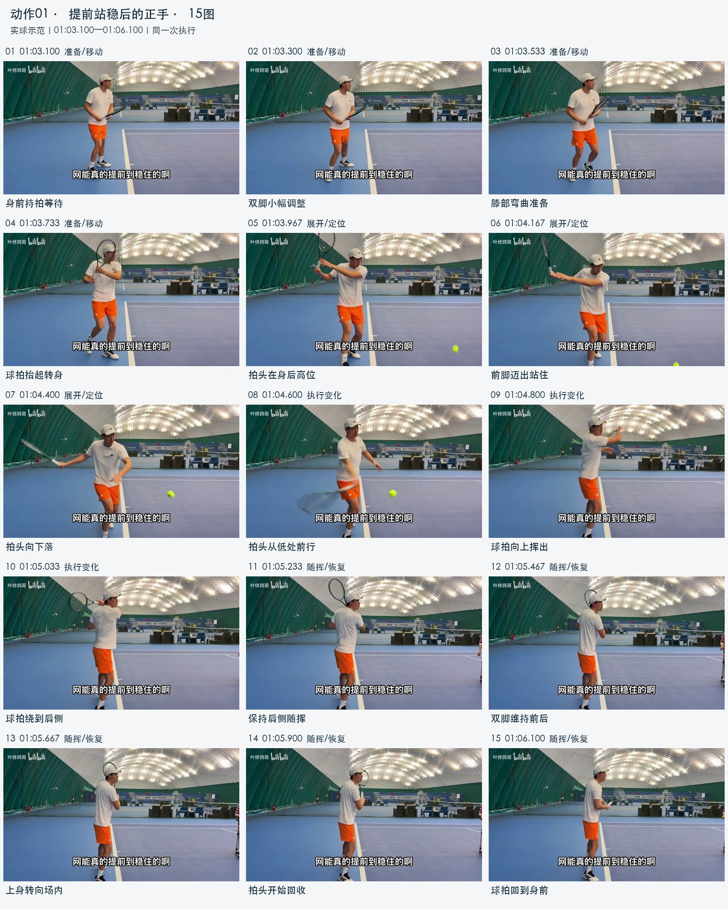

### 01:06—01:45：距离判断偏了，先把这一球处理回去

讲师对照两种处理：球比预计远了一点时，可以伸手先处理；若距离不合适，仍强行带动身体去打，反而可能使人发生额外位移。他不把伸手处理这一球等同于以后都应如此，而是说下一球应调整对来球的预判与站位。

来球是斜着进入的，抛球练习也容易让落点与预期不同，因此脚要提前迈到真正能稳定身体的位置。约01:29再次示范够球，约01:34再次示范到位；与前面的距离对照、站稳正手合并。末段仍让练习者探索合适的发力方式。

**动作02：距离偏远时伸手处理｜实球对照｜01:08.933—01:11.000｜15图**

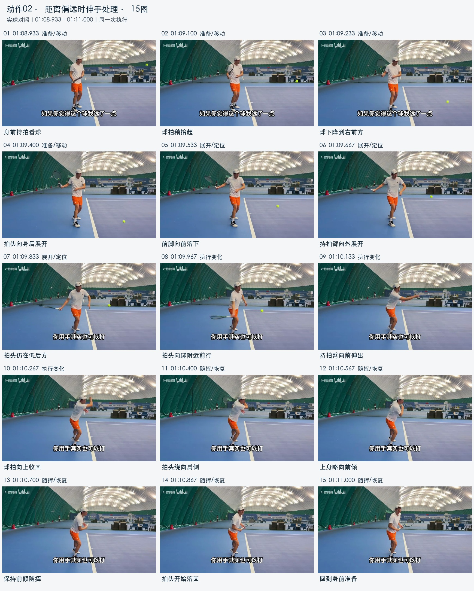

**动作03：距离不合仍带动身体的反例｜错误示范｜01:14.133—01:16.100｜15图**

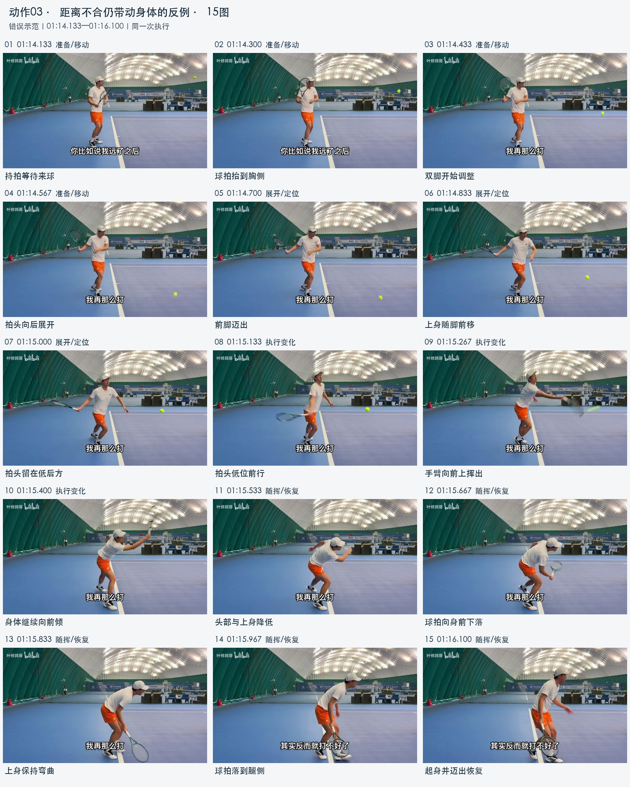

### 01:45—02:24：反手把落脚与挥拍分开

换到反手后，讲师要求初练时把提前到位和等待的时间拉长。实际打球时未必需要这么长停顿，但练习阶段要能脚先落好、看到球再决定挥拍。

他担心总在刚到位时立即挥拍，会把落脚与挥拍绑成同一个习惯，后来不再根据球决定启动时间。先保留一次较明显的反手等待，再保留一次用于说明“脚一落便挥”的实球对照；后者的错误性质来自讲师当段的解释。约01:49与02:17的同类反手不重复。

**动作04：反手先到位再等待｜实球示范｜01:58.900—02:01.800｜15图**

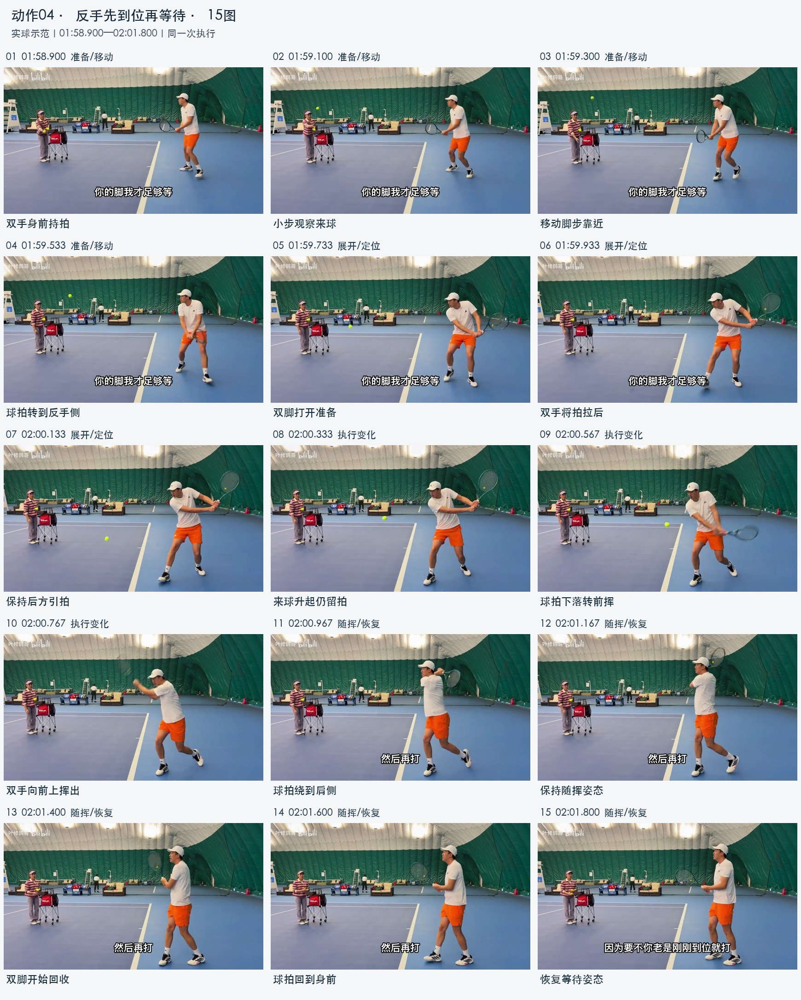

**动作05：落脚便启动挥拍的对照｜错误示范｜02:10.300—02:12.500｜15图**

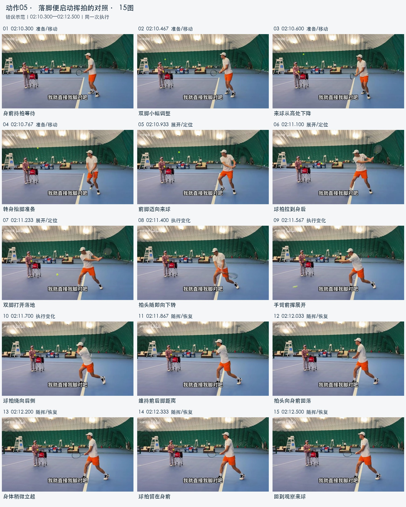

### 02:24—03:01：更远的球，最后一步主动找位置

讲师先演示随球移动、把球回过去的基础处理，再提出如果还想进一步提高这一球的质量，要更早完成前几步的移动，并用最后一步主动找球。

他用局部跨步说明两腿的交替，把找球的范围放到侧前方，也包括球偏后时向后找。约02:50—02:58的跨步局部练习，合并到后面带后脚保留与接续挥拍的一次空挥；走到位置、指示方向本身不另算击球。

**动作06：随球移动后回球｜实球基础练习｜02:30.267—02:32.600｜15图**

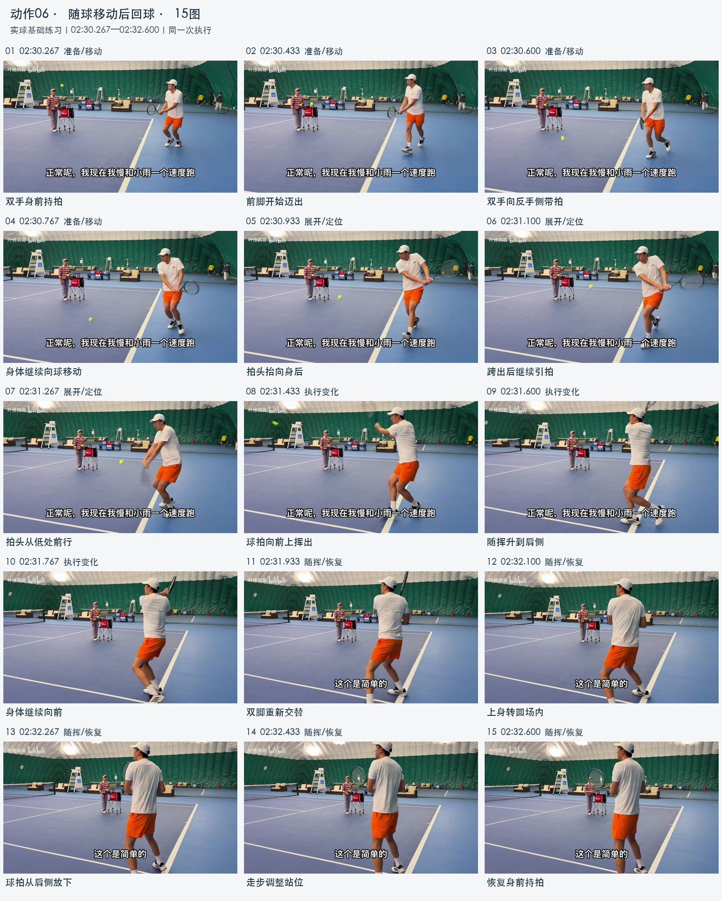

### 03:01—03:31：不要等差半步时再临时补

讲师用短步对照说明，他不推荐到了附近还差一点，再临时补一个半步。他也承认水平较高、移动较快时可能有余地继续调整；本集给出的练法是进入相应范围后，用最后一个跨步主动找住球。

随后提醒后脚不要马上跟上来，否则身体容易被带起；他用“拖住”的口令描述后脚保留。先前较短的跨步示意与这里同类，只保留一遍从跨步到挥拍结束的空挥。图记录脚与球拍的可见位置，不把“拖住”直接写成已测得的制动力。

**动作07：临近球再补半步的对照｜局部步法示范｜03:09.333—03:12.000｜15图**

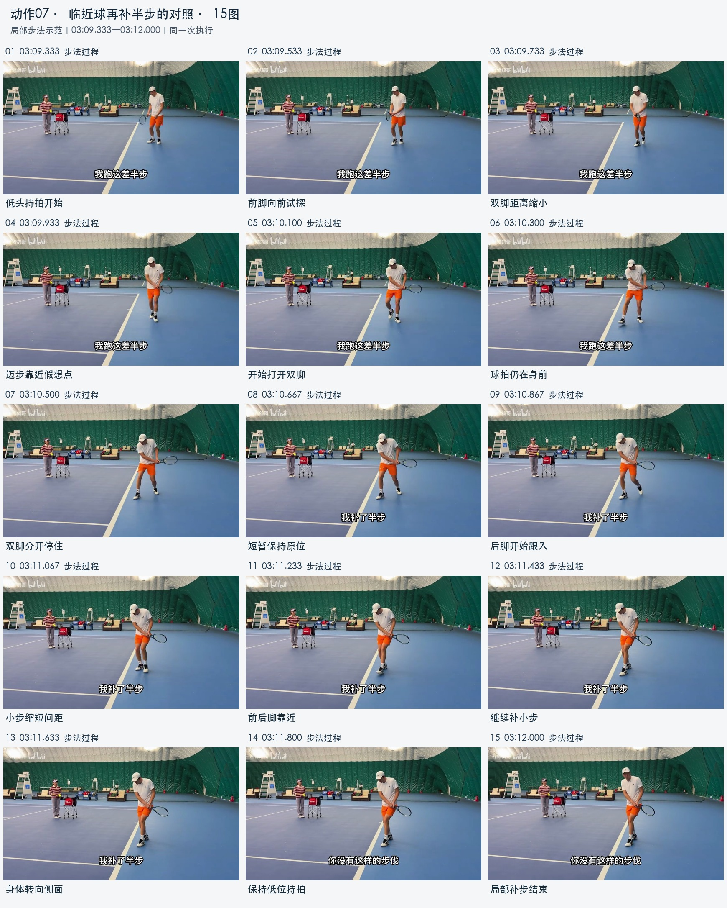

**动作08：跨步后保留后脚再挥拍｜无球空挥｜03:26.500—03:28.700｜15图**

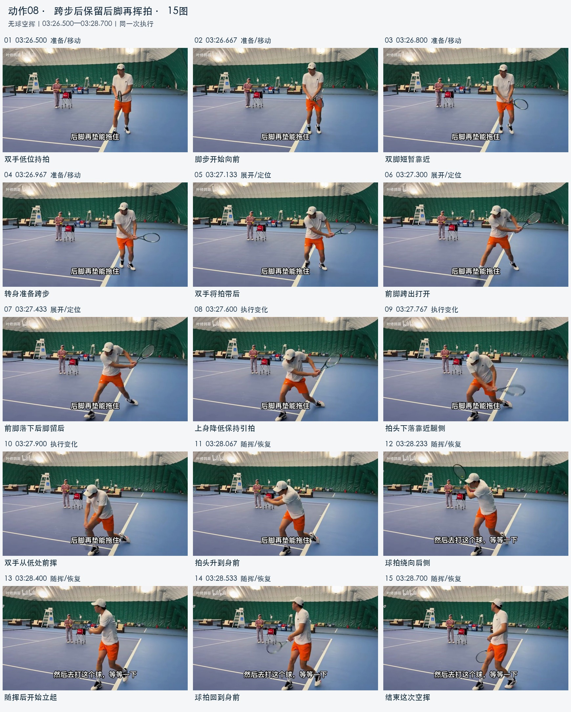

### 03:31—04:07：扩大最后一步，也试着向后找深球

协助者继续抛较远的球。讲师提示最后一步可以跨得稍大，主动去找；随后要求把球抛得更靠后、更深，并演示向后调整的反手。两种不同来球情境各留一次。

约03:43开始要求调整拍摄位置，镜头逐渐转到身后。选帧没有跨越这段换位；较深球组的挥拍过程完整可见，回位末段人物接近画面左边缘。

**动作09：最后一步跨出找球｜实球示范｜03:38.900—03:41.600｜15图**

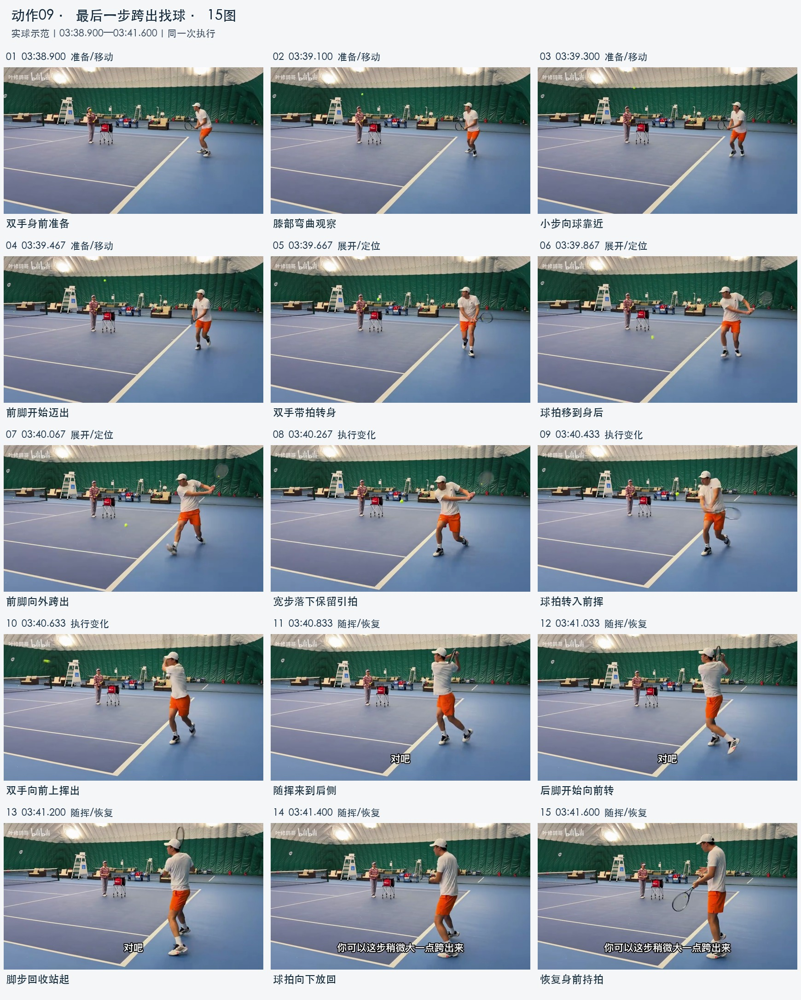

**动作10：向后找较深来球｜实球示范｜04:02.100—04:04.600｜15图**

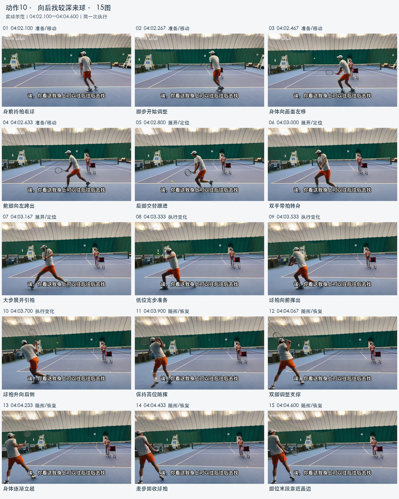

### 04:07—04:26：先控制到位与落点，再考虑加力

进入对拉前，讲师说练习站位可以略往后。提前到位并不保证每次距离都判断准确，到了之后可以缓一下，先控制回球与落点。只有自己觉得调整得合适，再尝试增加力量、增加落点变化，不必一站定就急于加力。

### 04:26—05:21：移动快，等球与出手留出节奏差

讲师要求节奏有明显变化：快速出去、提前到位，留时间看球，再打回去并回位。随后连续对拉，多次展示到位后等待。这里只保留一次包含移出、准备、出手和回收脚步的正手。

练习熟悉之后，等待时间可以逐渐缩短、站位可以再往前；初练仍应真的把时间留出来。约04:38—05:12的相同正手循环合并，不能把多次对拉拼成一组挥拍。

**动作11：快速移动后留出等待时间｜对拉中的节奏练习｜04:58.000—05:00.900｜15图**

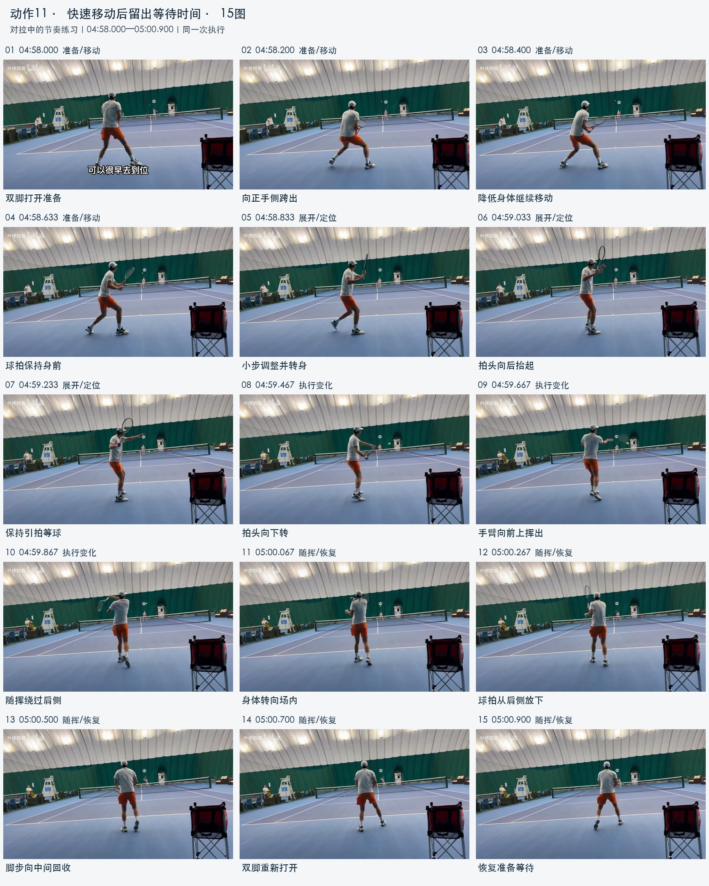

### 05:21—05:48：最后一步敢落下，别边迈边赶着打

常见问题是最后一步尚未落稳就挥拍。他再做一遍提前落脚等待的正手，然后与仍在迈步时就急于出手的动作比较：后者会让人总觉得最后一步来不及。正确等待与前面组11同类，迈步启动的问题与反手组5合并记录，重复动作不另加图。

### 05:48—06:22：短球后一路冲到网前的风险

话题转到中前场浅球。讲师以他所说的2.5或3.0阶段为例：对方有意或无意打浅，接球者轻推后顺着球一直往前，等球飞过去时人已贴得过近。

他用一遍持拍向网前推进的移动反例说明位置变化。这一遍手里仍持球，没有挥拍击球，明确列为无球移动反例。他把贴得过近与对方仍在原处、容易挑高联系起来；这是他针对该单打情境的战术说明。

**动作12：顺势一直冲向网前的反例｜无球移动反例｜06:07.000—06:10.500｜15图**

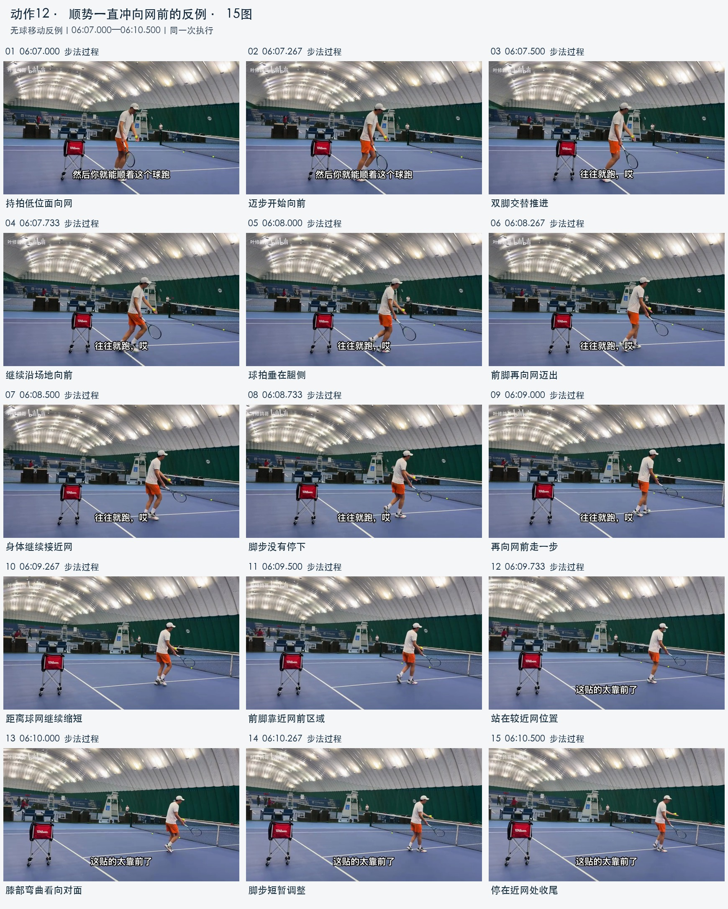

### 06:22—06:53：先降低自己的速度，才有条件控制短球

这里先把球轻、低地送回去。他做一遍自抛后的短推，随后强调：前提是自己能先把跑动速度降下来，否则一路冲来停不住，处理后又会顺势跑得太靠前。

他把前段横向找球的最后大步，转到向前找球的情境。

**动作13：自抛后轻推低球｜自抛球练习｜06:28.000—06:29.800｜15图**

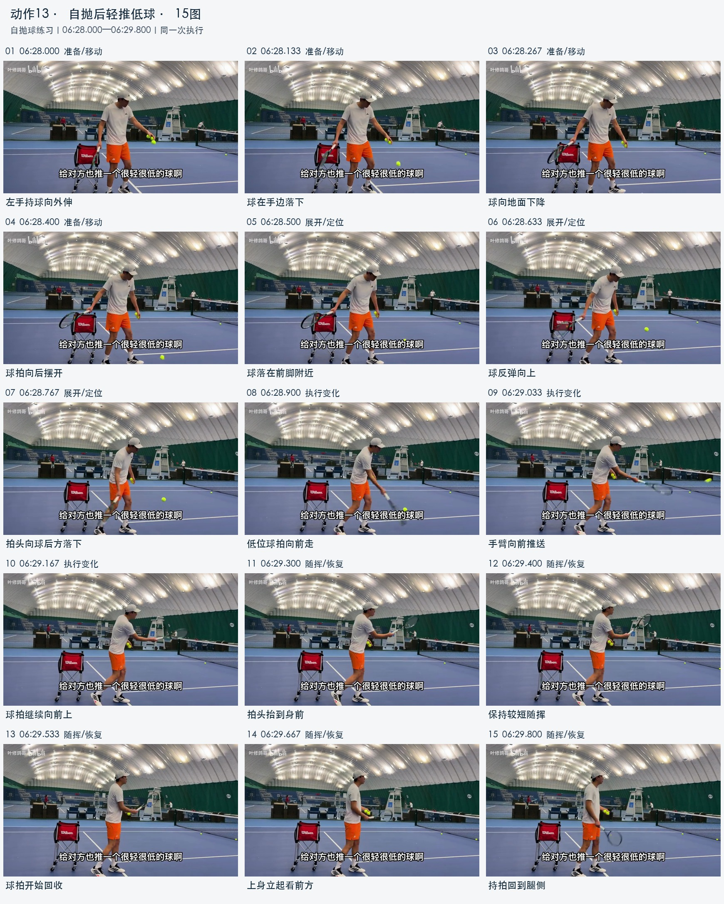

### 06:53—07:24：前脚找深浅，后脚留住身体

先在较近距离喂球，来球位置有近有远、有浅有深，讲师用一步向前跨出处理。重点仍是后脚不要马上跟上，身体不要过早站起。

他另做一次低位长步的无球示范，说明后脚保留的外观；随后用身体抬起作对照。依讲师的解释，先减速，才更容易控制出球。多次相同的向前一步处理合并为一次实球组，低位步法局部练习单列；抬起身体的重复对照只记文字。

**动作14：一步向前找球并停住｜喂球练习｜06:57.200—06:59.300｜15图**

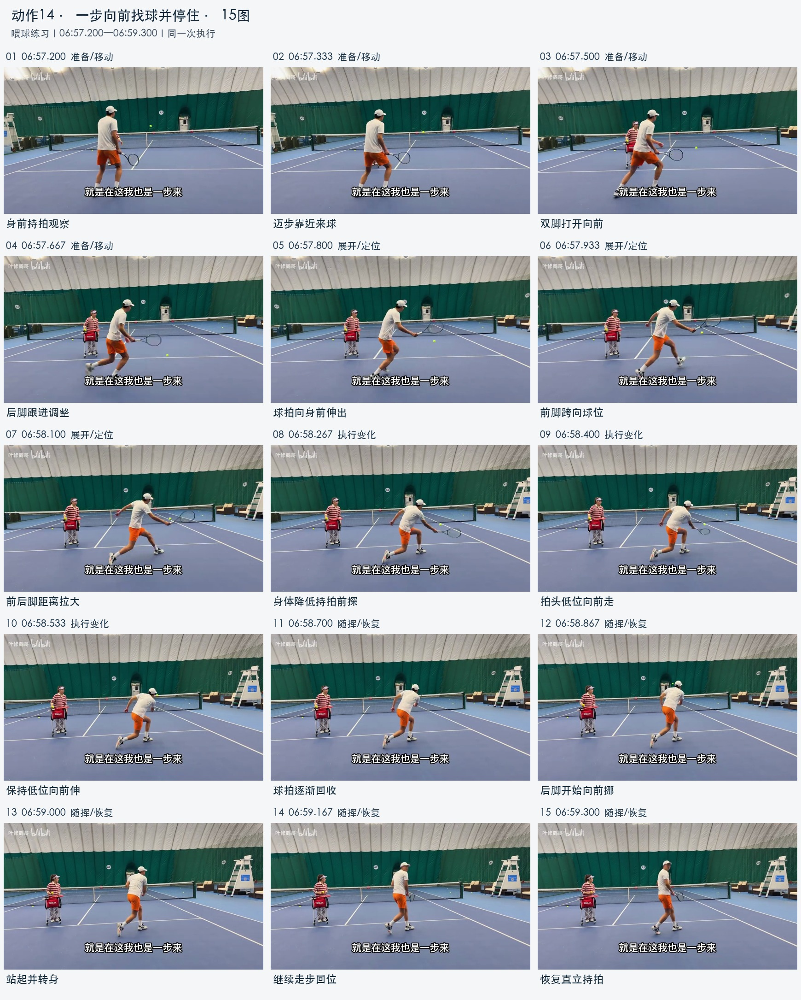

**动作15：后脚留在后方的减速步｜无球局部步法｜07:14.500—07:15.900｜15图**

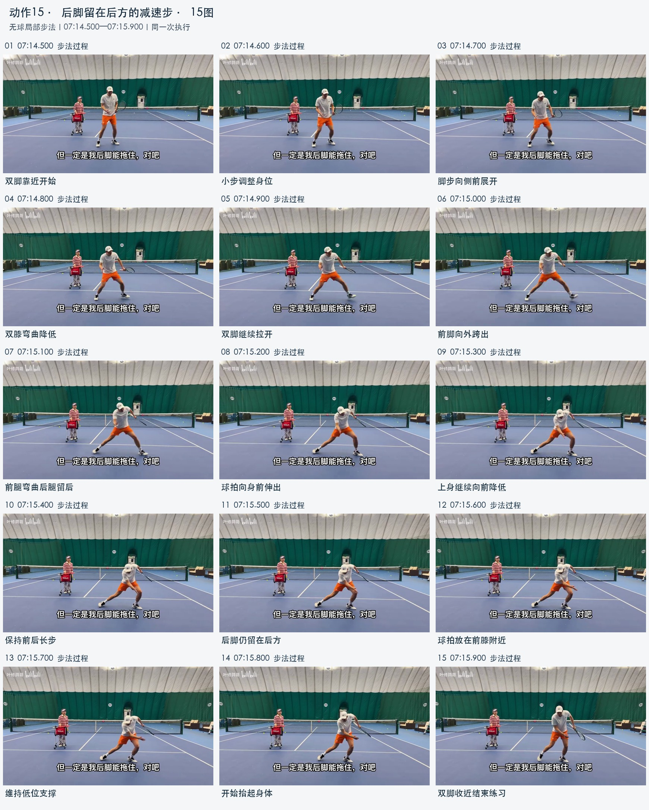

### 07:24—08:16：加上跑步，处理完后敢留在合适位置等

近距离处理可以完成后，再从后方跑上来。讲师强调仍要停住，并尝试把球控制回去；随后可练直线或斜线。几轮正手短球重复只保留一组，从启动跑步到减速、低位出手、停止前进。

接着说明后续安排：给对方浅球，让对方也上来，再准备补一拍截击。已经减速后不用急着继续贴网，他给出的等待位置约在发球线前一米，并分别用手势说明推直线、推斜线后的等待与拦截方向。这里的位置是该示范的教学安排，不能从一段视频推广为每个回合的固定站位。手势说明不另配图。

**动作16：跑上来后减速正手处理短球｜喂球练习｜07:37.000—07:39.900｜15图**

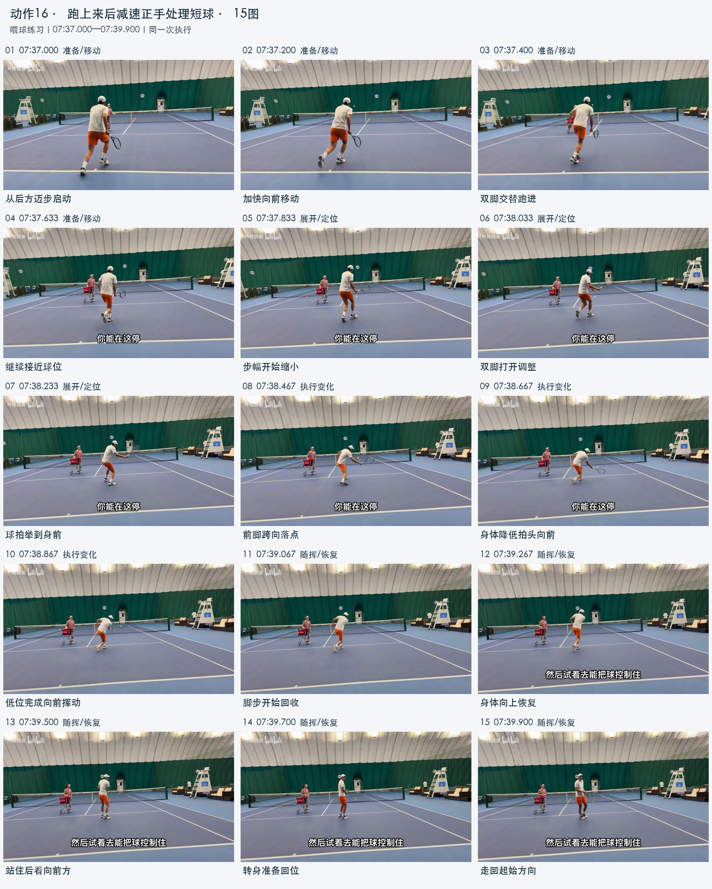

### 08:16—08:51：反手侧镜像，前几步仍要快

换到反手侧时，讲师说基本思路镜像，脚的关系反过来。他连续演示跑上来、降低身体、短幅度处理并停住。选一遍代表执行，其他同类喂球合并。

他反复提醒把自己的速度降下来，但这不意味着前面慢慢跑：前几步仍要快，才有时间到球前控制。随后提到移动更快时停车可能出现滑步；本片没有为这一点另做清楚的独立滑步示范，不额外编出滑步图组。

**动作17：反手侧跑上来后减速处理短球｜喂球练习｜08:21.300—08:24.600｜15图**

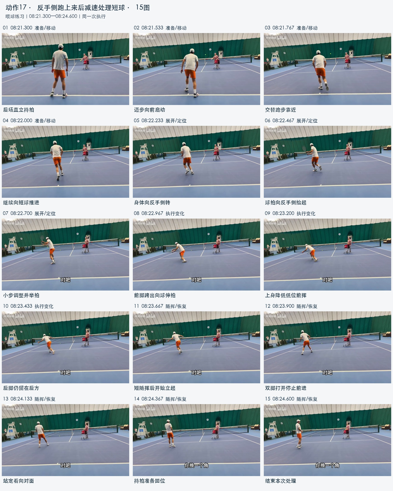

### 08:51—09:11：处理后等待，再补一拍拦截

讲师回到短球后续：认为在他展示的来球与站位情境里，对方上来多半只能救球，可以准备补截击。末段先做一次与前面同类的正手向前处理，去重后不再出图；紧接着打开双脚等待，再向一侧伸拍做短拦截，这个接续动作单列。

最后解释对方处在较浅、较难受的位置，特别反手侧可能只能切削，因此不必总想着继续往网前推，应该敢于等待并拦截。这里是讲师的战术判断，并非保证对方只能使用某一种回球。约09:09收尾，记录覆盖至页面末尾09:11。

**动作18：短球后等待并拦截｜接续截击示范｜08:58.500—08:59.900｜15图**

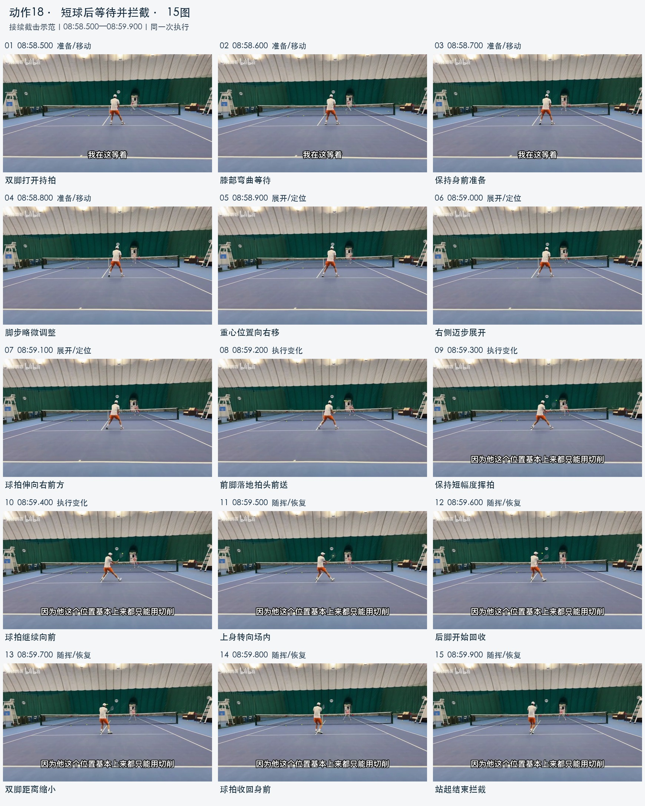
