# 从零开始的网球自习系列课-削球截击篇

[Bilibili 原课](https://www.bilibili.com/video/BV1zJ4m1A7Sc/) · 叶修鸽哥 · 合集位置待核 · 时长 09:50 · 整理日期 2026-11-04

## 课程总结

本课分为底线切削和网前截击两部分。切削先练正反手的扎实接触与向前推送，再加入旋转变化。截击从近距离抛接开始，逐步增加距离、来球变化和移动范围。

## 技术总结

- 正反手切削先把球打实，再决定挥拍怎样离开。
- 反手先练低位放松准备，再用辅助持拍把拍架到肩部附近。
- 截击近距离先轻送回球，正反手都让大臂参与准备。
- 从固定位置过渡到移动截击，按来球留出出拍空间。

## 训练路线

1. 切削从低位和短距离开始，逐步练课程四档距离与架拍变化。
2. 网前两人近距离抛接，正反手都能轻送回球后再后退。
3. 从固定截击接到先准备再拦球，最后扩大移动覆盖。

## 常见问题与调整

| 情况 | 调整方式 |
|---|---|
| 切削一开始就只想做旋转 | 先恢复打实、向前送球，再增加旋转。 |
| 反手截击只靠掰小臂 | 退回近距离抛接，先抬起大臂再轻送。 |

## 按时间顺序的课程记录

### 00:00–00:31：先打实，再决定球拍怎样离开

开头稍作现场调整后，讲师引出切削。他希望学员理解前面几种练习共同的意思：不论准备打哪种旋转，首先都要能把球打实。

按照本课的表述，打实后从球的上方离开，得到上旋；从下方离开，得到下旋。技术更熟练时，还可以尝试从球的内侧离开，打出他所说的滑板球。但前期优先练的是把球打实，而不是急着增加旋转。

### 00:31–01:01：反手切削第一组，低位放松准备

先讲反手切削，也沿用前课的四档距离练习：小场地到小场地、小场地到底线、底线到小场地、底线到底线。

第一种从球拍自然放下的位置开始，手臂保持放松，同伴喂球后把球送出去。讲师要求先感到球被打实，不要把动作做成明显地切一下。这个阶段球不会转得很多，肉眼能辨认出一点向回转的下旋，就已经足够。

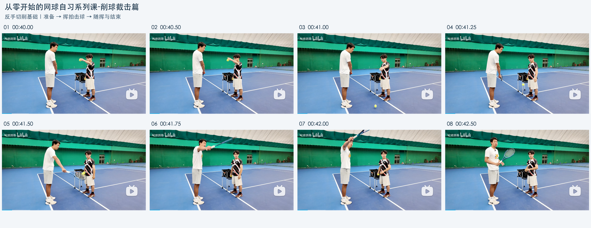

### 01:01–01:48：反手切削第二组，辅助持拍架到肩部附近

前一组能完成后，用辅助手把球拍架到对侧肩部附近。讲师展示不同架拍外形，表示可以选择自己觉得合适的姿态，但辅助手要能帮助把拍子架起来。

随后把球推出去。讲师强调大臂的抬起，小臂可以顺着球下方作延伸，两者的配合比例在练习中体会；即使暂时没有明显的小臂动作，也可以先用抬起、送出的方式练。

这一段分别示范了向下切和左右切的动作，提醒初练时不要一直想着用这种切动制造旋转。先把球推送出去，球的旋转少一点也没有关系。

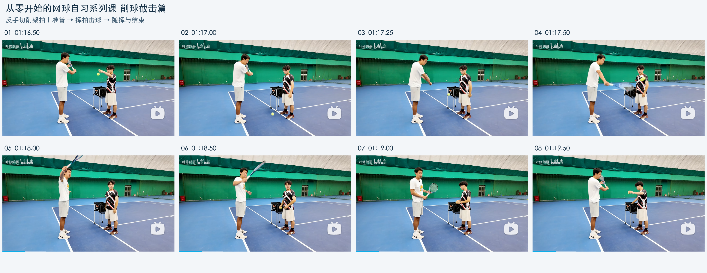

### 01:48–02:01：熟练后再增加旋转变化

当推送和打实的感觉练到一定程度，可以再尝试控制不同旋转。讲师表示，届时不必过度拘泥动作外形；这里的前提仍然是前面的基础练习已经熟练。

### 02:01–02:50：正手切削，同样从放松和推送开始

现场交换位置，转入正手切削。第一组同样先放松，把拍子放在身体这一侧，接同伴喂球，把球送出去。初期的球也不需要很多旋转。

接着抬起大臂，加入架拍，再把球推出去。讲师反复强调，大臂要能抬起来，动作的重点是向外推送，而不是猛切一下。

等到实际击球时也能感到球被推实，再考虑在末段增加旋转变化。球感足够后可以尝试更多变化，但他继续提醒：这些变化不能替代把球送出去的基础。

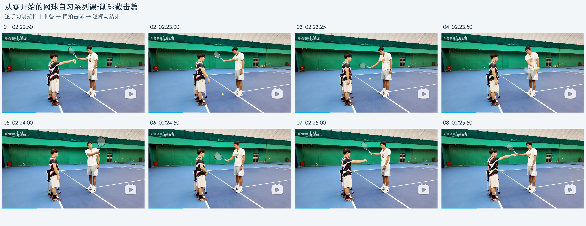

### 02:50–03:26：补拍正反手切削背后视角

讲师补充背后视角，先演示正手，再换成反手，让学员看球离拍后的状态。他再次说明，这些示范中的球带有能看见的旋转，但不是靠一个很明显的切动完成。

现场重复喂球，出现一次没有打好的击球后又继续示范。下图分别保留正手和反手的片段，不将不同次击球拼成同一次动作。

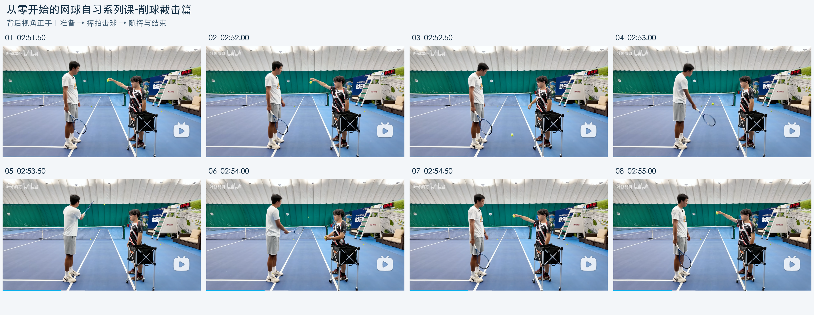

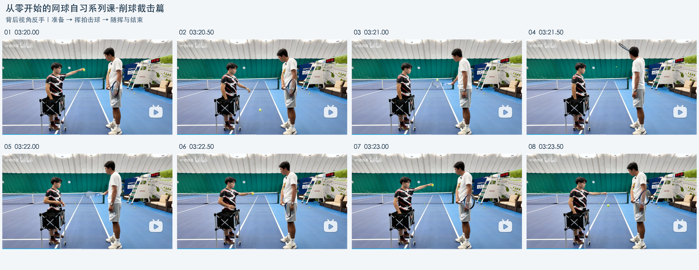

### 03:26–04:02：截击第一组，近距离同伴抛接

截击最好找同伴配合，发球机也可以。两人先站得近一些，由同伴朝预先摆好的拍子附近抛球，讲师轻轻把球送回，对方再接住。

练习不要用太大力量。讲师用玩笑提醒距离近时猛打容易打到同伴，接着示范很轻的截击也能完成抛接。重点是大臂抬起并维持在准备位置，让拍子把球送回去，而不是追求转得很多。

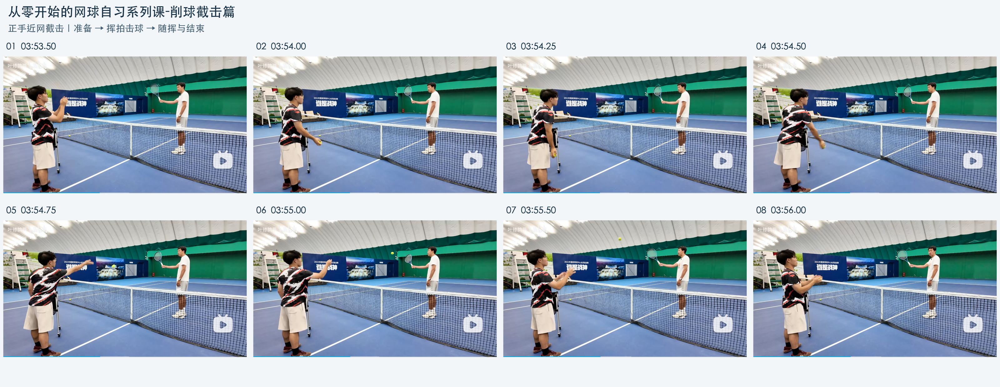

### 04:02–04:33：反手截击，抬起大臂，别掰小臂

反手也按同样方式练：先把大臂抬起来，球拍放好，同伴往拍子附近喂球，再把球送回给同伴。课程中用对方上身、头部附近的位置描述回球方向，同时延续前面轻力抛接的要求。

截击时让大臂维持支撑，避免单独掰动小臂。他把这里的截击描述为作用在球偏下的位置，因此回球带有一点弧线。正反手都先完成稳定的拦送，大臂要能维持准备和支撑。

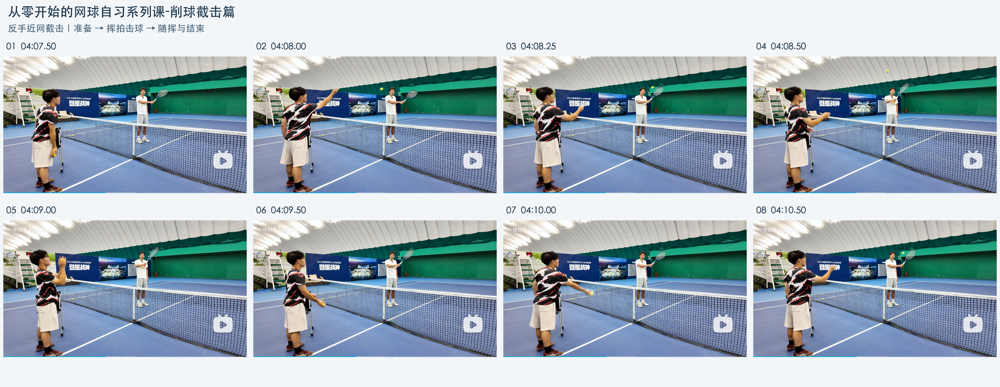

### 04:33–05:31：双方后退，增加距离和来球变化

基础抛接能完成后，两人各后退一步，再继续正反手练习。距离增加后，大臂仍然向目标方向带出，不靠突然扭小臂把球弹过去。

这组练习先尽可能不依赖脚步调整，多试不同远近、高低的来球，练手臂应对变化的灵活度。确实够不到就够不到，但不要一发现球近了、远了就认为无法截击。

这里训练的是容错，因为实战的来球不会总落在一个非常准确的位置。现场让同伴往斜前方抛，再调整高度和远近，继续示范怎样适应。

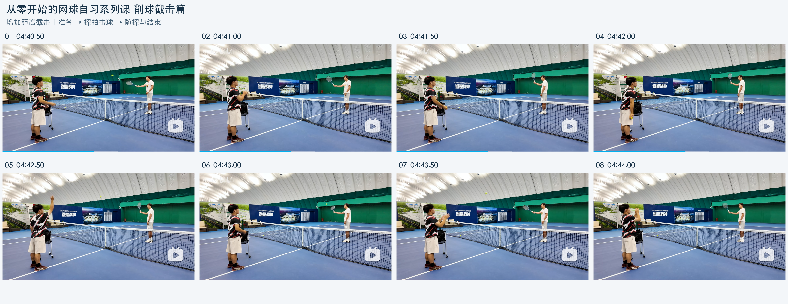

### 05:31–06:16：截击从固定位置，过渡到准备后再拦球

讲师表示切削不再重复配合“四件套”的演示，接下来用截击说明。先把拍子举好，直接等待喂球并拦送；再从完整准备开始，抬起大臂、架好拍，然后接球。

正手示范后交换位置，反手也分别做已经举好的拦送，以及先抬起、再拦送的衔接。大臂在这些动作中仍要能抬住。

落点可以按训练目标变化：打到小场地，或把球送得更深，逐项练习即可。本集提到的“四件套”指前课内容，这里没有重新完整展开其定义。

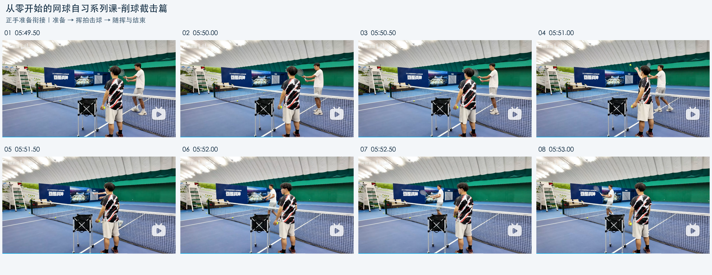

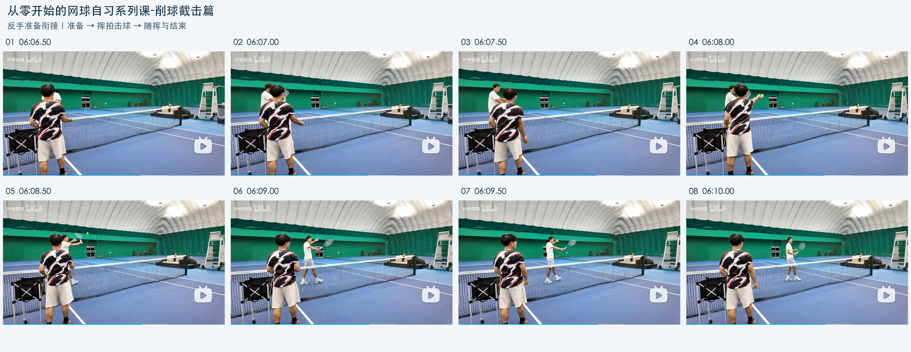

### 06:16–06:54：讲师比较侧向跨步与向外覆盖

接着讲截击与常见教学做法的差别。讲师先示范侧向跨步、配合重心转移的动作，并表达自己不希望学员以这种方式给膝盖施加较大压力。他还认为，这样处理容易使拦球范围局限在较近的位置。

随后讲解向外扑接的情况：按他的描述，支撑和拦球发生在前，跨出的脚可能是截击完成后才落下，不能一律理解为落脚同时击球。这一段是讲师对时序和支撑的解释。

### 06:54–07:50：移动截击，让覆盖范围延伸出去

让同伴从中间给球，先展示只靠习惯中的一步跨出所能到达的位置，再把喂球放远，说明若动作限制在这里，就会够不到。

讲师接着用右脚参与移动的示范，说明怎样把覆盖范围继续延伸。课中将左脚称为中间的支撑脚，用后续一步和身体移动说明截击能够覆盖更远的位置。这里记录其右手持拍示范中的左右脚口令，不另推成所有情境下固定的步序。

他又从准备开始示范垫步和向外截击，表示正反手都可以这样结合前课脚步练习，争取更大的拦球范围。

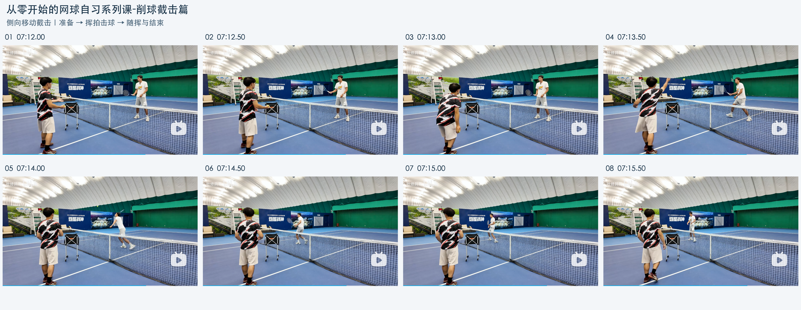

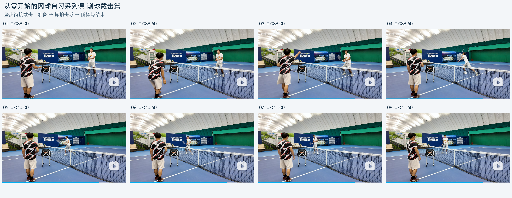

### 07:50–08:35：讨论架拍幅度，不能只看拍子是否拉得大

最后一个问题是截击拉拍大。讲师提到费德勒的截击，反对仅用“球拍不能离开视线”“不能超过耳朵”等外形限制判断动作。

他用站定脚步后的架拍示范说明：脚步不动，再叠加较大的拍子动作和重心转移，外形就会显得夸张，动作也不容易流畅。他希望把架拍放在移动和整体动作里一起看。

### 08:35–09:07：在移动中准备，让大臂参与动作

让同伴退回中间、把球抛高一点，讲师开始移动中截击。示范把朝球移动、前课脚步和大臂准备连起来，再与站定后才做拍子动作的方式作对比，邀请观众观察哪种更流畅。

这一段重点是移动和准备的衔接，而不是单独追求某个架拍大小。

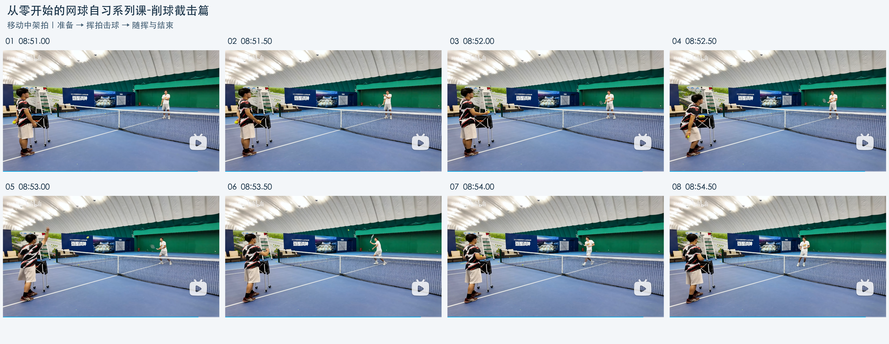

### 09:07–09:50：主动加力需要动作空间，反手同理

大臂能够参与，才更容易把力量送出去。如果把动作限制得非常小，往往只能磕挡；若希望移动后主动加力，却又不给动作行程和空间，就不容易完成。

结尾再用反手截击说明同样的意思。先展示动作被限制时的状态，再抬起大臂、接同伴喂球，把球拦送出去。现场出现抛球偏高的情况，调整后继续示范。

课程最后回到大臂参与、能把球送出去这一点，结束全课。

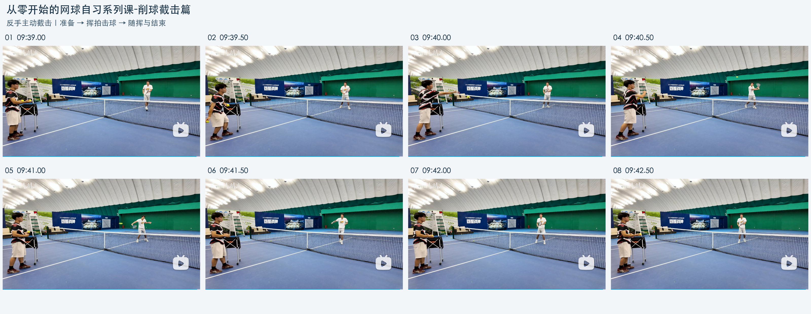
