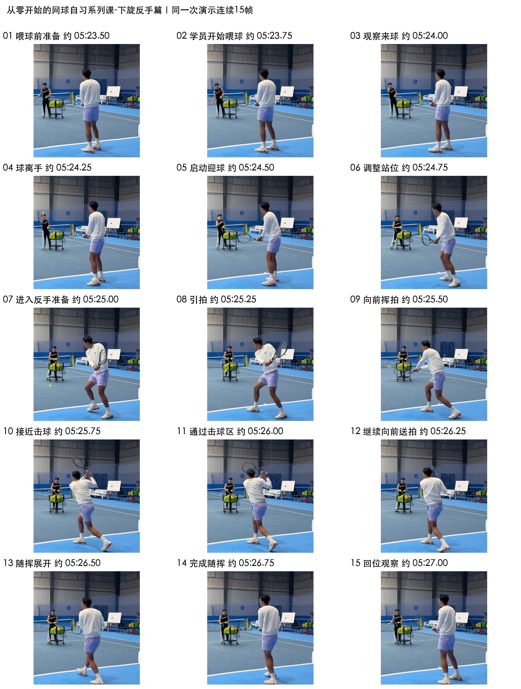

# 从零开始的网球自习系列课-下旋反手篇

[Bilibili 原课](https://www.bilibili.com/video/BV15RmrYPEx1/) · 叶修鸽哥 · 合集第 11/35 集 · 时长 06:00 · 整理日期 2026-11-05

关联课程：[反手篇](反手篇.md) · [削球截击篇](削球截击篇.md)

## 课程总结

本课比较上旋反手与下旋反手在低球上的处理方式，从球拍向前通过击球区讲起，再练球路方向和双手辅助准备后分手的变化。

## 技术总结

- 低球难以用上旋稳定处理时，可以尝试反手下旋。
- 让球拍从球下方通过并向前送，保留出球方向。
- 根据目标在球速、下旋和方向控制之间取舍。
- 双手可以辅助准备，随后分手接单手切削。

## 训练路线

1. 先比较上旋和下旋的拍路，确认低球下方有出拍空间。
2. 用同伴喂球练向前通过击球区，再尝试改变方向。
3. 在前送动作稳定后加入双手支撑、分手后切削。

## 常见问题与调整

| 情况 | 调整方式 |
|---|---|
| 低球反复刷到拍框 | 降低处理难度，尝试从球下方向前送。 |
| 下旋球只剩向下切 | 把挥拍方向重新放回向前通过击球区。 |

## 按时间顺序的课程记录

### 00:00–02:04｜教学方法因人而异，先形成自己的理解

开头讲师谈到自己做系列教学的出发点。他认为不同人的运动经历、协调性、力量基础不同，学习过程和理解技术的方式也会不同。教学者不应因学员暂时做不到、或采用不同方法，就把对方简单评价为“没有天赋”或“学不会”。他希望练习者能够长期、安全地打网球，并愿意对常见教法提出问题、结合理论和实际练习去验证。

这一段是课程的学习态度说明：讲师将自己的内容视为一种可实践、可讨论的教学路径，而不是要求观众不加判断地照搬。观众需要亲自试做，观察结果，再理解动作与击球效果之间的关系。

### 02:04–02:37｜从上旋反手转入下旋反手

讲师转入反手，回顾前面练过的上旋反手动作。他以球拍从球的上方通过和从球的下方通过，说明两种不同的拍头路径：从球上方刷过可以形成上旋；从球下方通过并向前送，则可练习下旋球。

他特别把讨论放在双手反手常见的用力方式上：有些练习者主要靠左手弯曲、拉动来完成击球，右手参与有限。讲师借此提出问题：既然双手握拍，是否应观察两只手各自承担了什么作用；如果实际动作几乎变成单手在做，双手形式是否反而增加了限制。这是他引出单手下旋反手的思考，并非说双反都应改成单反。

### 02:37–03:27｜低球上的上旋失误与替代路径

讲师接着列举他在业余练习中看到的上旋反手问题，包括低球时弯曲、拉扯过多、过度刷球、击中拍框或只擦到球等。他认为低球本来就常见，若仍试图从球的上方强行制造很大的拍头速度，失误会更容易出现。

他提出可以换一种路径来处理低球：在接触球时先确保打实，再从球的偏下位置向前送拍。讲师把这描述为更容易形成稳定向前的下旋击球方式。新学者初练时，即使球速还不快，只要接触扎实、球能稳定过网，也可以先建立这种击球感觉；不要因为暂时缺少速度，就重新用很大的向上刷动补偿。

### 03:27–04:10｜现场示范强调向前通过击球区

讲师在球场示范下旋反手的挥拍与出球方向，并从不同机位展示击球过程。他希望观众观察拍头怎样通过击球区，以及球离拍后的轨迹。与高弧线的上旋球相比，他将此类下旋球描述为弧线较低、轨迹更平、向前通过的感觉更明显。

此处的教学重点是拍头沿目标方向通过球，而不是只在球下方做一个短促的“切”动作。讲师也指出，球拍向前送出的过程可以更长；刚开始时不必急着追求很快的拍头速度，先练习把球打实并送向目标。

### 04:10–05:08｜下旋球的特点、速度取舍与方向

讲师比较下旋球和上旋球时，提到下旋球出球较平、弹跳较低，适合在低球情境中变化击球方式，也可以用来改变对手熟悉的节奏。他同时提到代价：如果过分追求速度，容易打框或失去稳定；速度稍慢一些时，可能更容易把球稳定送到场内。

方向控制上，他用向目标方向送拍来说明线路：希望打直线，就沿直线方向送；希望打斜线，则将送拍方向相应调整。不要把全部练习都变成高弧线上旋球，让对手一直在舒服的击球高度处理来球；不同球路可以用来增加变化。

### 05:08–05:53｜双手支撑后分手的练习变化

讲师为力量或协调条件不同的练习者提出一种起步变化：先用双手帮助稳定球拍和准备姿势，在挥拍过程中逐渐分开双手，再以单手完成向前的下旋击球。两手一起时先建立支撑感，分手后体会拍头通过击球区的路径。

这是一种练习过渡方式，不要求每个人都必须采用，也不代表标准的单手反手握拍。练习者可以比较双手持续握拍与分手完成击球时，哪种方式更容易打实并把球送到目标区域。

### 05:53–06:00｜尝试多种方式

结尾讲师鼓励观众多尝试不同的下旋反手练习方法。课程的落点仍然是先体会稳定接触和向前送拍，再逐步增加速度或调整线路。

---

**现场示范｜约 05:23.50–05:27.00**。从学员喂球到击球和随挥。
