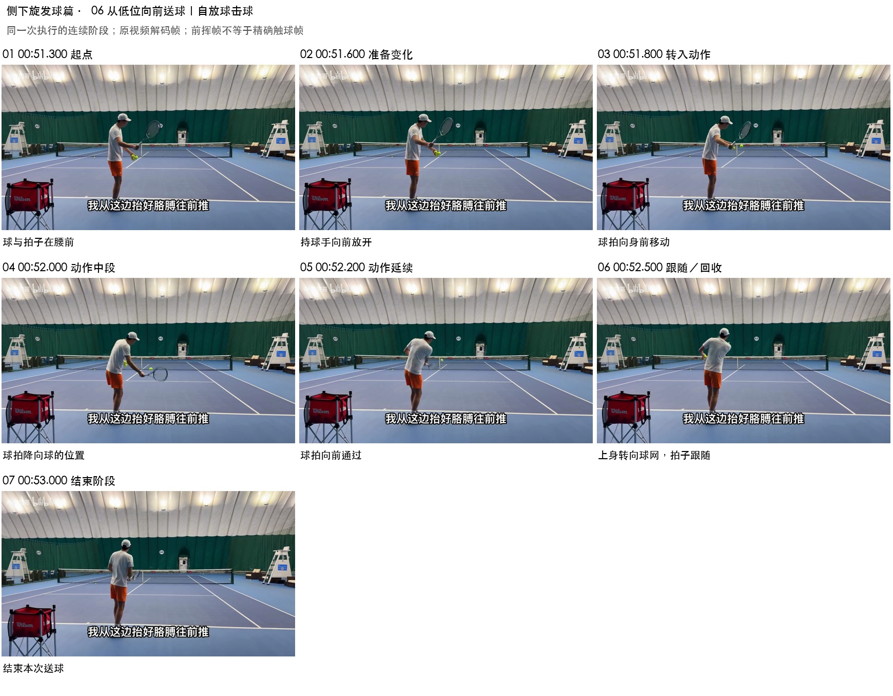
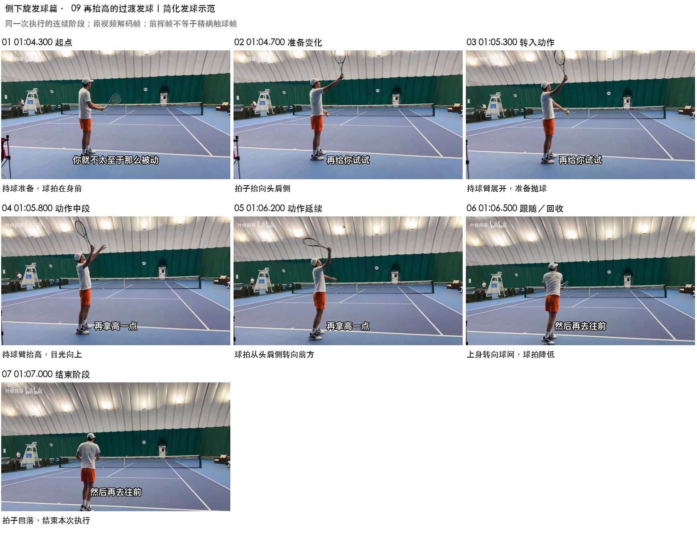
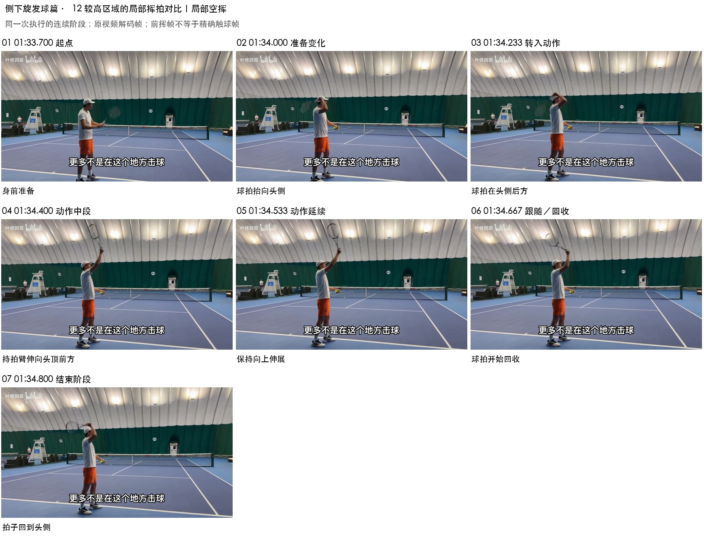
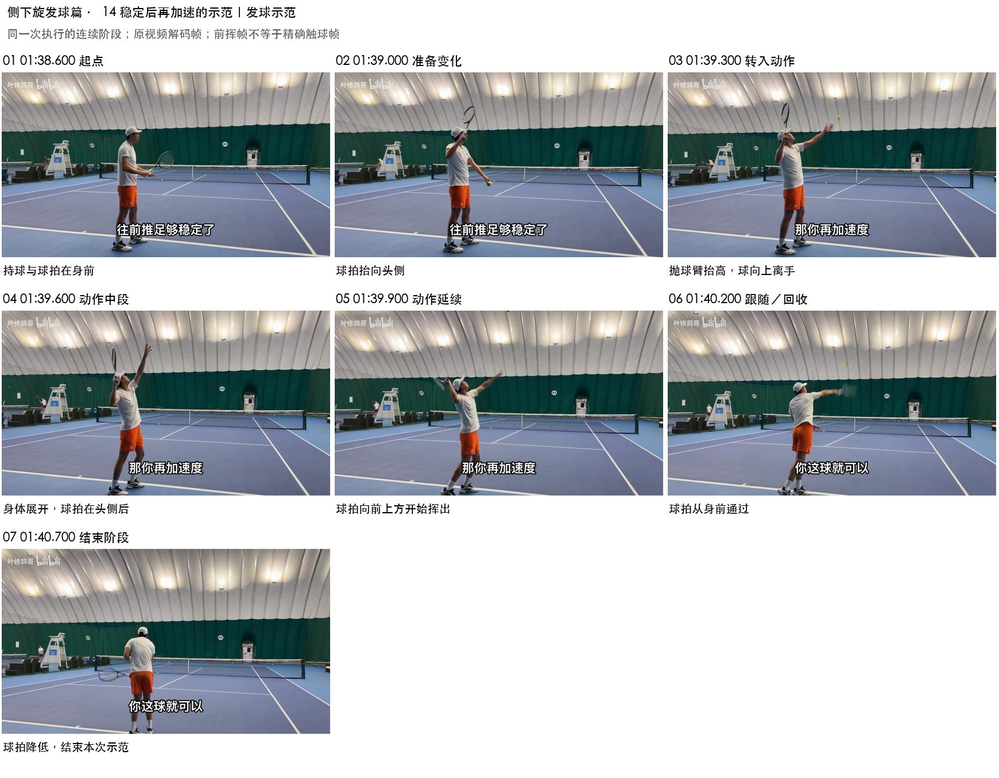

# 从零开始的网球自习系列课-侧下旋发球篇

[Bilibili 原课](https://www.bilibili.com/video/BV1NfwwzBE8q/) · 叶修鸽哥 · 合集第 32/35 集 · 时长 02:20 · 整理日期 2026-11-06 · 发布日期 2026-03-12

关联课程：[发球篇](发球篇.md) · [发球架拍篇](发球架拍篇.md) · [侧旋篇](侧旋篇.md)

## 课程总结

本课对比高弧线和低球两种发球选择，重点练习低位向前送球，再逐步抬高到简化发球。最后把较低的球路用到一区外角和追身。

## 技术总结

- 先让拍头把球往前送，稳定低球的出球方向。
- 从低位自放球开始，逐步把出手位置抬高。
- 初练可尝试将抛球偏右，向前送稳定后再加速。
- 一区外角用角度拉开对方，追身球让接发者从低处处理。

## 训练路线

1. 先练低位的向前送球，再提高一点出手位置。
2. 把低位送球接到简化发球，先看能否保持向前和低球路。
3. 练习一区外角与追身，在方向稳定后增加速度。

## 常见问题与调整

| 情况 | 调整方式 |
|---|---|
| 球路一加力就抬高 | 缩小动作退回低位送球，先找回向前出球。 |
| 逐步抬高出手后失去方向 | 在能控制的高度多练，再接下一档准备。 |

## 按时间顺序的课程记录

### 00:00–00:22｜从常见侧上旋与高弧线方案引入

一般教学中较常见的是侧上旋（发球往往不是纯上旋，而是带有侧向旋转）。讲师先以较高弧线的发球作对比：这种方案的安全感来自球足够高，再在此基础上加上侧旋，让对手不容易处理；但有些人并不容易把球发得这么高。

**动作 01：高弧线发球对比｜发球示范｜00:09.000–00:11.500**

### 00:22–00:45｜另一种思路是低，并强调向前

另一些人的安全感来自速度；高弧度的球通常较慢，但给对手带来的困难不同。除了高，讲师提出另一种方向：让球足够低，并增加侧旋。

他先用局部上挥演示“向上的部分”，与后面希望的向前处理作对比，并把本课目标概括为“往前推的下旋”（即本集标题所称的侧下旋）。

**动作 02：向上拍路的局部空挥对比｜局部空挥｜00:37.733–00:39.433**

### 00:45–01:04｜从低位送球开始，先找向前的感觉

练习从低位开始。讲师把它类比为在底线用球拍把球拦送进目标区域，提示先抬好胳膊，再往前送。他先自放球做一次低位送球，然后略抬高做过渡击球。

第二球后，他强调这种球很低、弹跳不容易起来，并用一次低位向上拉起的空挥说明接球者被迫向上拉球，从而减少发球方的被动。

**动作 03：从低位向前送球｜自放球击球｜00:51.300–00:53.000**

**动作 04：稍抬高后的过渡球｜自抛球击球｜00:54.400–00:56.300**

**动作 05：接球者向上拉起的示意｜局部空挥｜01:00.800–01:02.100**

### 01:04–01:17｜逐步抬高，衔接到简化发球准备

讲师把位置再拿高一点，继续往前送，完成一球较高位置的过渡发球；随后抬拍示意更高的准备位置，并用“打电话”作姿态类比。

**动作 06：再抬高的过渡发球｜简化发球示范｜01:04.300–01:07.000**

### 01:17–01:33｜初练可以把抛球偏右，先做出低球

初练时抛球可以偏右一些，因为开始阶段很难把动作与球的位置直接重合。只要球足够低，暂时不用追求速度，熟悉后再慢慢加速（此处“偏右”以右手发球示范为例）。

**动作 07：偏右抛球后的侧旋示范｜简化发球示范｜01:22.500–01:24.500**

### 01:33–01:44｜区分挥拍区域，向前稳定后再加速

讲师先在较高区域做一次局部挥拍对比，再做一次更向前延伸的局部挥拍，强调重点在后面向前的这段处理。等往前送足够稳定后再加速度，他接着发一球，并用“向下钻、向下加侧旋”来形容希望打出的球路体感。

**动作 08：较高区域的局部挥拍对比｜局部空挥｜01:33.700–01:34.800**

**动作 09：向前击球区域的局部挥拍｜局部空挥｜01:34.900–01:36.300**

**动作 10：稳定后再加速的示范｜发球示范｜01:38.600–01:40.700**

### 01:44–02:04｜一区外角与追身应用

- **一区外角**：从当前站位把球送到外角，可以在角度上把对方拉开。
- **追身**：挤着对方反手方向，把球路压低，让对方被迫从较低位置把球拉起来。

**动作 11：一区外角发球示范｜发球示范｜01:47.000–01:49.500**

### 02:04–02:20｜收尾再提醒往前

结尾再次提示不要先追求速度，随后连续发两球，最后以“往前、大臂外旋推出去”的口令收尾。

**动作 12：结尾发球示范｜发球示范｜02:05.000–02:07.700**

