# 从零开始的网球自习系列课-侧下旋发球篇

[Bilibili 原课](https://www.bilibili.com/video/BV1NfwwzBE8q/) · 叶修鸽哥 · 合集第 32/35 集 · 时长 02:20 · 整理日期 2026-11-06 · 发布日期 2026-03-12

## 课程总结

本课对比高弧线和低球两种发球选择，重点练习低位向前送球，再逐步抬高到简化发球。最后把较低的球路用到一区外角和追身。

## 技术总结

- 先让拍头把球往前送，稳定低球的出球方向。
- 从低位自放球开始，逐步把出手位置抬高。
- 初练可尝试将抛球偏右，向前送稳定后再加速。
- 一区外角用角度拉开对方，追身球让接发者从低处处理。

## 训练路线

1. 先练低位的向前送球，再提高一点出手位置。
2. 把低位送球接到简化发球，先看能否保持向前和低球路。
3. 练习一区外角与追身，在方向稳定后增加速度。

## 常见问题与调整

| 情况 | 调整方式 |
|---|---|
| 球路一加力就抬高 | 缩小动作退回低位送球，先找回向前出球。 |
| 逐步抬高出手后失去方向 | 在能控制的高度多练，再接下一档准备。 |

## 按时间顺序的课程记录

### 00:00—00:08：从常见侧上旋发球引入

片头保留了一次动作的末段，随后进入讲解。一般教学中较常见的是侧上旋（发球往往不是纯上旋，而是带有侧向旋转）。

**动作01：开场仅保留的挥拍末段｜不完整动作片段｜00:00.000—00:00.700**

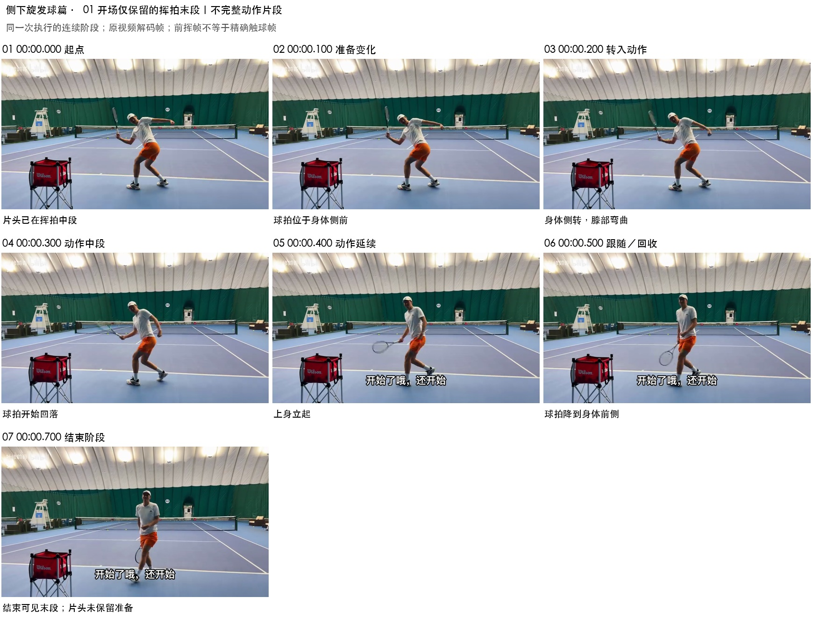

可见过程：片头已在挥拍中段 → 身体侧转，膝部弯曲 → 上身立起 → 结束可见末段；片头未保留准备。

### 00:08—00:22：先演示高弧线方案

讲师先以较高弧线的发球作对比，认为这种方案的安全感来自球足够高，再在此基础上加上侧旋，让对手不容易处理。他连续做了两次发球，两次准备、抛球与收拍各自成组。随后提出，有些人不容易把球发得这么高。

**动作02：高弧线对比第一球｜发球示范｜00:09.000—00:11.500**

可见过程：持球准备，球拍在身前 → 持球臂展开，准备抛球 → 球拍从头肩侧转向前方 → 拍子回落，结束本次执行。

**动作03：高弧线对比第二球｜发球示范｜00:17.000—00:19.500**

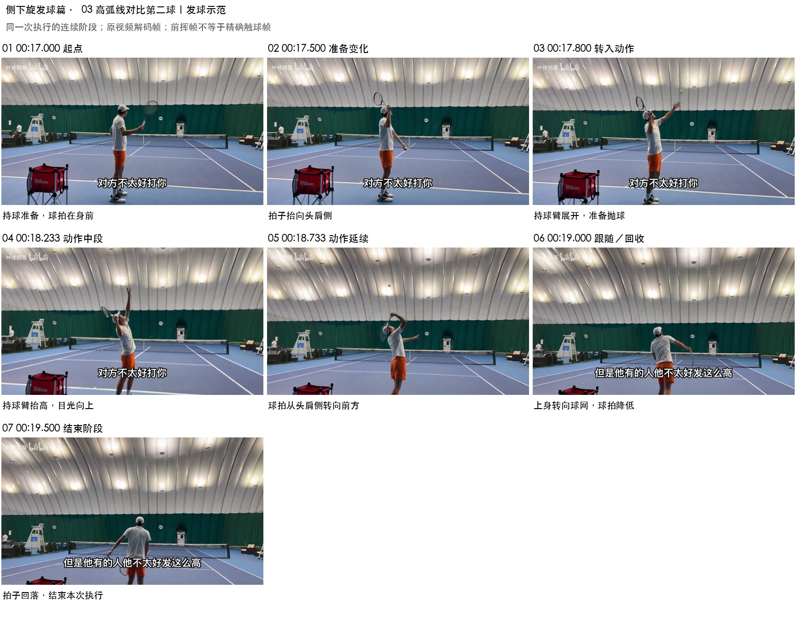

可见过程：持球准备，球拍在身前 → 持球臂展开，准备抛球 → 球拍从头肩侧转向前方 → 拍子回落，结束本次执行。

### 00:22—00:45：另一种思路是低，并强调向前

讲师接着谈到，另一些人的安全感来自速度；高弧度的球在他的描述中通常较慢，但给对手带来的困难不同。除了高，他提出另一种方向：让球足够低，并增加侧旋。

他用两次局部上挥演示“向上的部分”，与后面希望的向前处理作对比，并把本课目标概括为“往前推的下旋”（即本集标题所称的侧下旋）。

**动作04：向上拍路的第一次局部空挥｜局部空挥｜00:37.733—00:39.433**

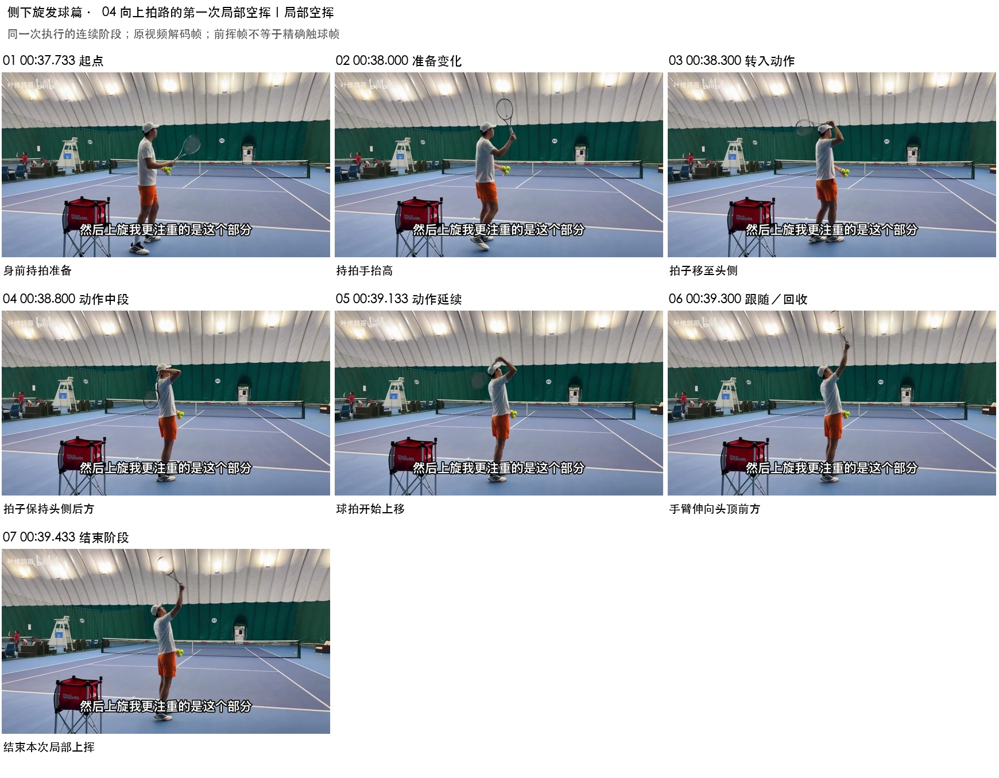

可见过程：身前持拍准备 → 拍子移至头侧 → 球拍开始上移 → 结束本次局部上挥。

**动作05：向上拍路的第二次局部空挥｜局部空挥｜00:39.500—00:40.600**

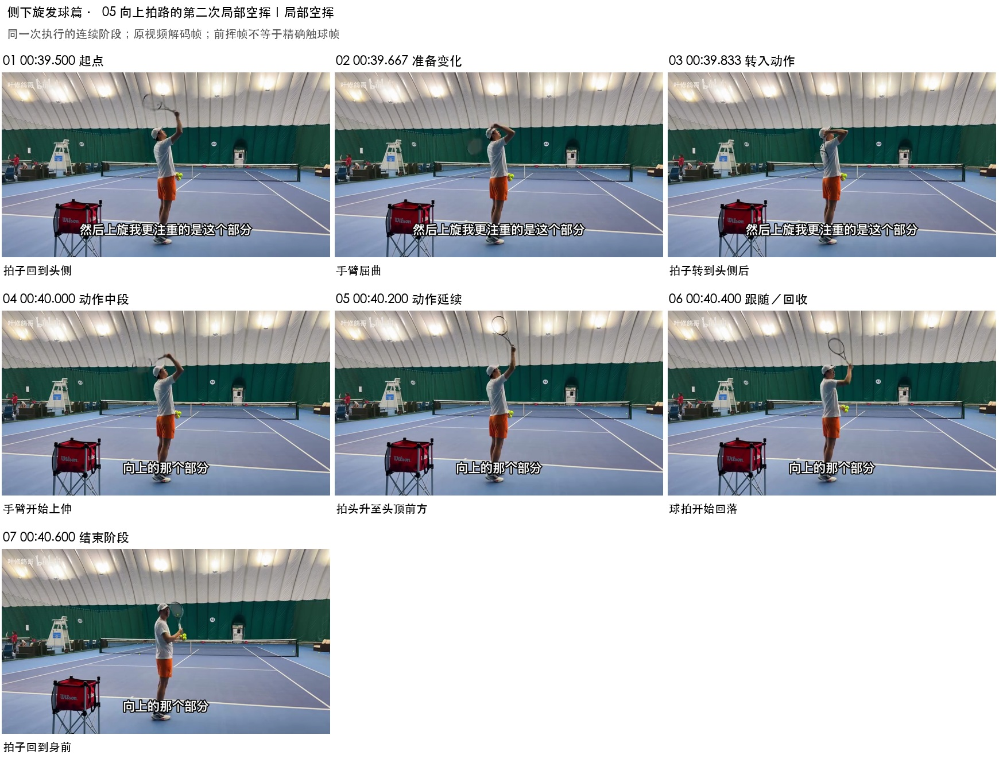

可见过程：拍子回到头侧 → 拍子转到头侧后 → 拍头升至头顶前方 → 拍子回到身前。

### 00:45—01:04：从低位送球开始，先找向前的感觉

练习从低位开始。讲师把它类比为在底线用球拍把球拦送进目标区域，提示先抬好胳膊，再往前送。他先自放球做一次低位送球，然后略抬高，做第二次过渡击球；此处尚不是完整的头顶发球。

第二球后，他强调这种球很低、弹跳不容易起来，并用一次低位向上拉起的空挥说明接球者被迫向上拉球，从而减少发球方的被动。

**动作06：从低位向前送球｜自放球击球｜00:51.300—00:53.000**

可见过程：球与拍子在腰前 → 球拍向身前移动 → 球拍向前通过 → 结束本次送球。

**动作07：稍抬高后的第二球｜自抛球击球｜00:54.400—00:56.300**

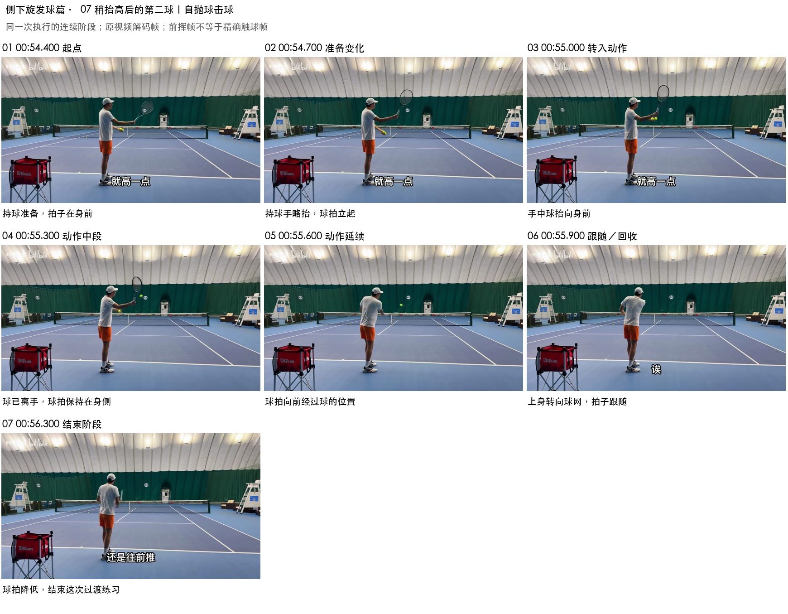

可见过程：持球准备，拍子在身前 → 手中球抬向身前 → 球拍向前经过球的位置 → 球拍降低，结束这次过渡练习。

**动作08：接球者向上拉起的示意｜局部空挥｜01:00.800—01:02.100**

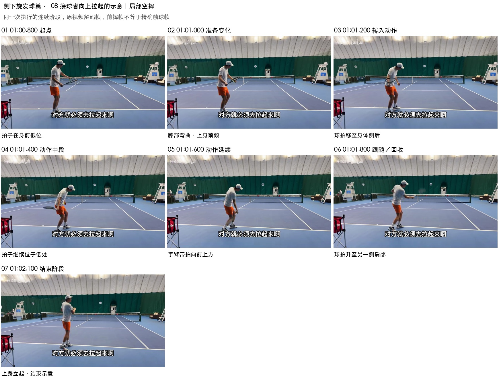

可见过程：拍子在身前低位 → 球拍移至身体侧后 → 手臂带拍向前上方 → 上身立起，结束示意。

### 01:04—01:17：逐步抬高，衔接到简化发球准备

讲师说再试一次，把位置拿高一点，然后继续往前。他完成一球较高位置的过渡发球，再次指出后续弹跳低。接下来才是慢慢过渡到更高的准备位置。

约 01:13—01:16，他抬拍示意准备位置，并用“打电话”作姿态类比。

**动作09：再抬高的过渡发球｜简化发球示范｜01:04.300—01:07.000**

可见过程：持球准备，球拍在身前 → 持球臂展开，准备抛球 → 球拍从头肩侧转向前方 → 拍子回落，结束本次执行。

### 01:17—01:33：初练可以把抛球偏右，先做出低球

讲师接着提示，初练时抛球可以偏右一些，因为开始阶段很难把动作与球的位置直接重合；在他的教学安排里，暂时偏右没有关系。随后完成一次简化发球，要求先试着把侧旋做出来。

他强调，只要球足够低，暂时不用追求速度，熟悉后再慢慢加速（此处“偏右”以右手发球示范为例）。

**动作10：偏右抛球后的侧旋示范｜简化发球示范｜01:22.500—01:24.500**

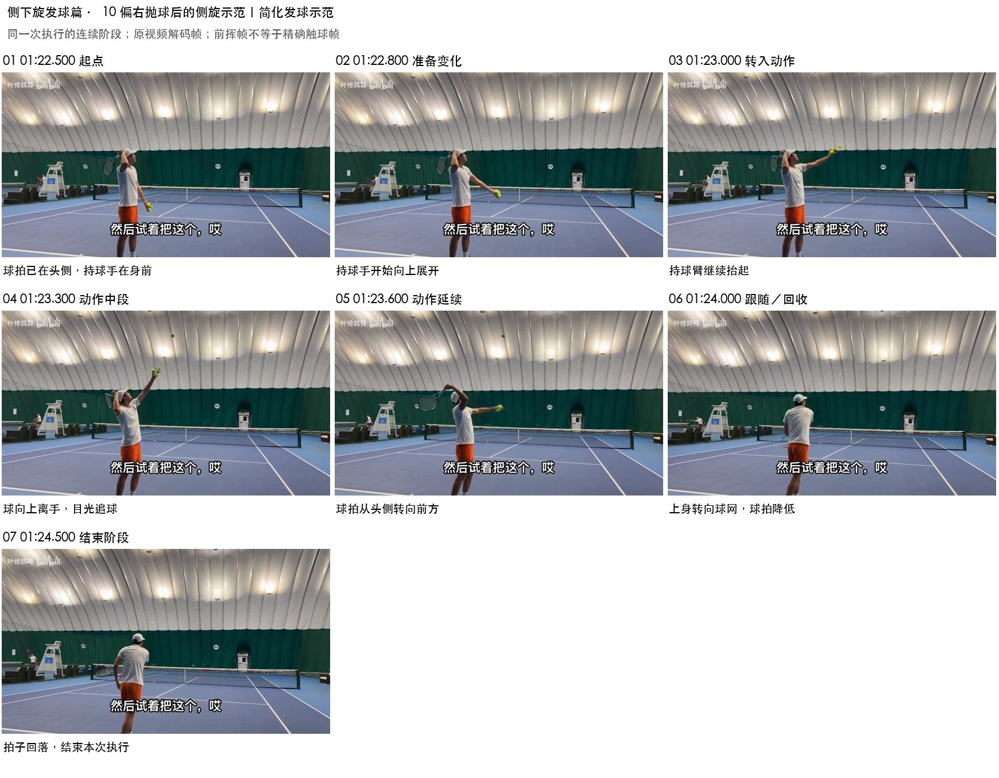

可见过程：球拍已在头侧，持球手在身前 → 持球臂继续抬起 → 球拍从头侧转向前方 → 拍子回落，结束本次执行。

**动作11：熟悉后的接续发球｜简化发球示范｜01:27.700—01:30.500**

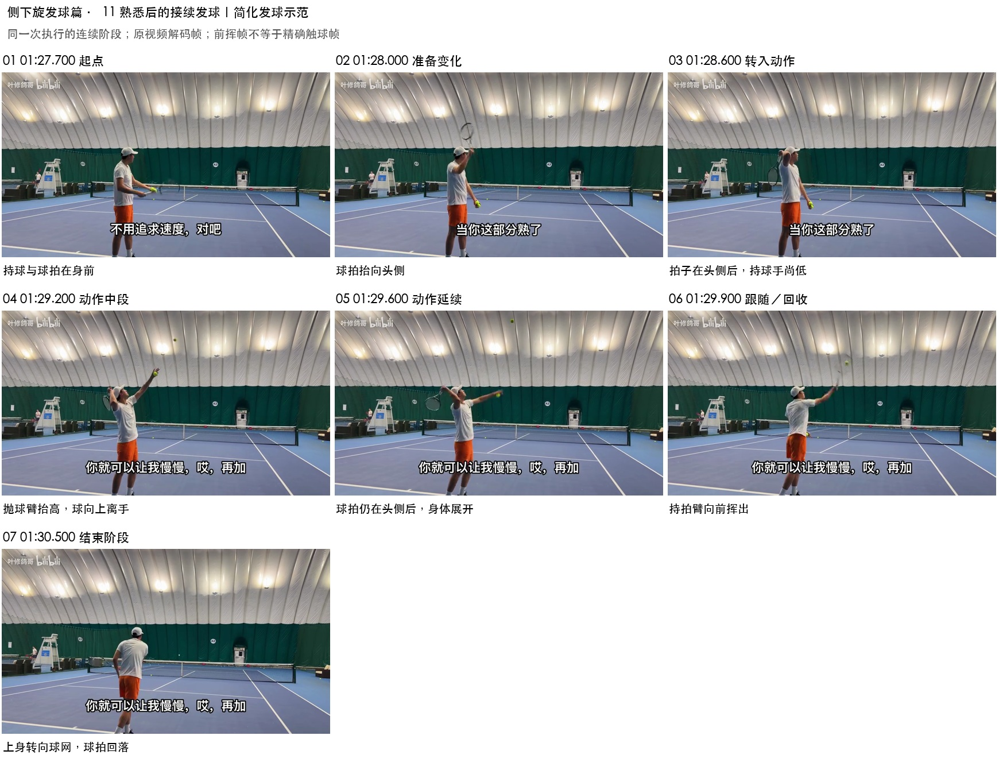

可见过程：持球与球拍在身前 → 拍子在头侧后，持球手尚低 → 球拍仍在头侧后，身体展开 → 上身转向球网，球拍回落。

### 01:33—01:44：区分挥拍区域，向前稳定后再加速

讲师先在较高区域做一次局部挥拍对比，再做一次更向前延伸的局部挥拍。他强调的不是只在前一个位置击球，而是后面这部分的处理。两次局部执行分别拆开。

等往前送足够稳定，再加速度。他接着发一球，并用“向下钻、向下加侧旋”来形容希望打出的球路体感。

**动作12：较高区域的局部挥拍对比｜局部空挥｜01:33.700—01:34.800**

可见过程：身前准备 → 球拍在头侧后方 → 保持向上伸展 → 拍子回到头侧。

**动作13：向前击球区域的局部挥拍｜局部空挥｜01:34.900—01:36.300**

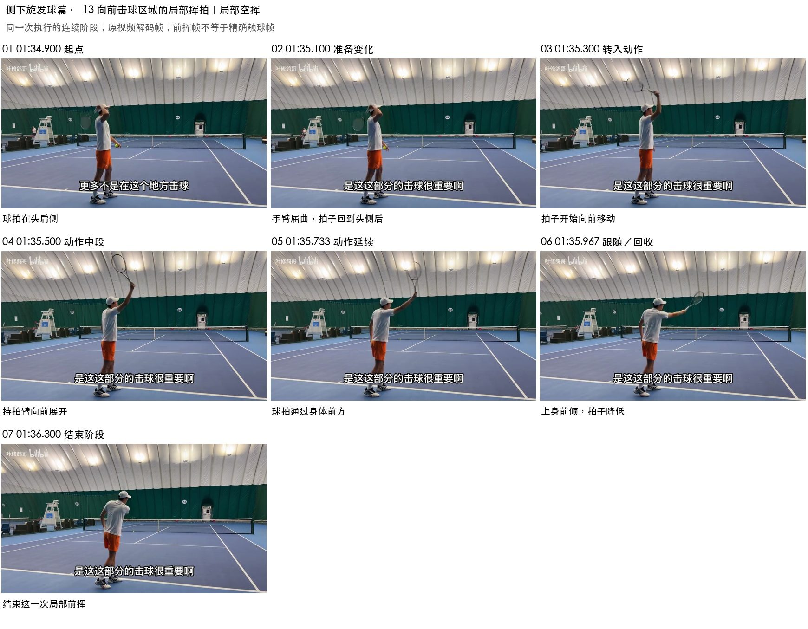

可见过程：球拍在头肩侧 → 拍子开始向前移动 → 球拍通过身体前方 → 结束这一次局部前挥。

**动作14：稳定后再加速的示范｜发球示范｜01:38.600—01:40.700**

可见过程：持球与球拍在身前 → 抛球臂抬高，球向上离手 → 球拍向前上方开始挥出 → 球拍降低，结束本次示范。

### 01:44—01:54：一区外角，利用角度拉开对方

讲师转到一区外角的使用场景：从当前站位把球送到外角，可以在角度上把对方拉开，随后连续示范两球。

**动作15：一区外角第一球｜发球示范｜01:47.000—01:49.500**

可见过程：持球准备，球拍在身前 → 持球臂展开，准备抛球 → 球拍从头肩侧转向前方 → 拍子回落，结束本次执行。

**动作16：一区外角第二球｜发球示范｜01:50.300—01:52.500**

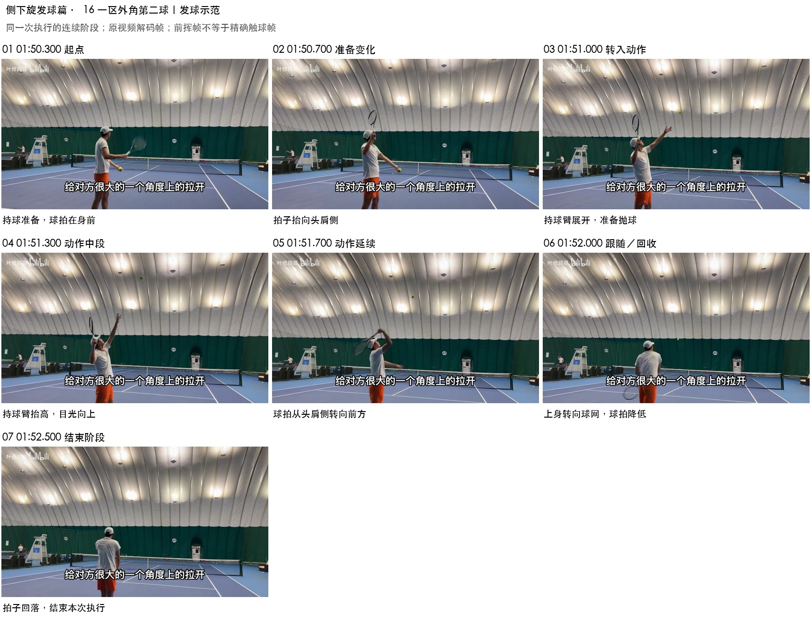

可见过程：持球准备，球拍在身前 → 持球臂展开，准备抛球 → 球拍从头肩侧转向前方 → 拍子回落，结束本次执行。

### 01:54—02:04：追身，以及让对方从低处处理

另一种使用方式是追身：挤着对方反手方向，把球路压低，让对方被迫从较低位置把球拉起来。

### 02:04—02:20：连续两球收尾，再提醒往前

结尾再次提示不要先追求速度，随后连续发两球，最后以“往前、大臂外旋推出去”的口令收尾。

**动作17：结尾连续发球第一球｜发球示范｜02:05.000—02:07.700**

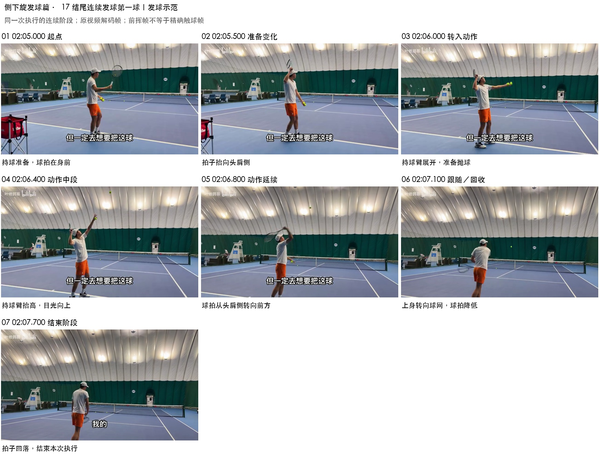

可见过程：持球准备，球拍在身前 → 持球臂展开，准备抛球 → 球拍从头肩侧转向前方 → 拍子回落，结束本次执行。

**动作18：结尾连续发球第二球｜发球示范｜02:08.400—02:10.800**

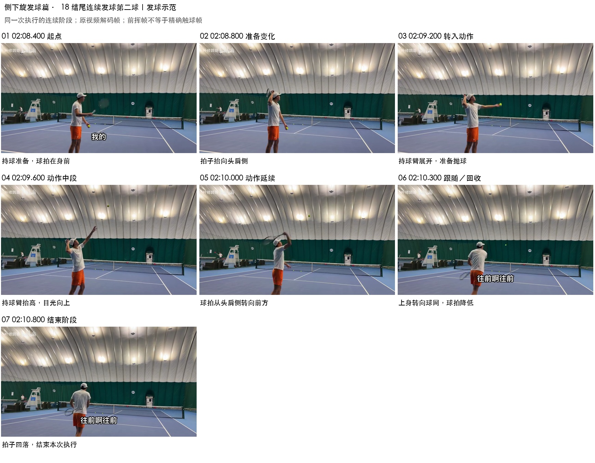

可见过程：持球准备，球拍在身前 → 持球臂展开，准备抛球 → 球拍从头肩侧转向前方 → 拍子回落，结束本次执行。
