# 从零开始的网球自习系列课-反手击球点篇

[Bilibili 原课](https://www.bilibili.com/video/BV12Qi5B6E3p/) · 叶修鸽哥 · 合集第 30/35 集 · 时长 04:33 · 整理日期 2026-11-06 · 发布日期 2026-01-01

关联课程：[反手篇](反手篇.md) · [各种反手球的处理办法](各种反手球的处理办法（要学会灵活变通哦）.md) · [减速站定击球篇](减速站定击球篇.md)

## 课程总结

本课用两步和四步抛球练习反手击球点，再移到底线处理距离更远的来球。先移动身体接近球，在合适距离上接出拍，击球后继续走出。遇到移动已经到极限的远球时，保留伸臂够球的余量。

## 技术总结

- 用身体向球移动来调整击球距离。
- 接近来球时把移动接到挥拍，打完继续走出。
- 先用两步建立人与球的距离感，再增加到四步。
- 底线练习加入关闭式站位以及更远来球处理。

## 训练路线

1. 先用两步抛球或接球体验接近来球后的继续走出。
2. 结合空挥比较向外移动和向回摆，再增加到四步喂球。
3. 移到底线，从关闭式处理过渡到更远来球。

## 常见问题与调整

| 情况 | 调整方式 |
|---|---|
| 身体离球太远，只能伸臂够球 | 回到近距抛球，先把身体移动到合适距离。 |
| 停下来反复对点，随后才赶着出手 | 练接近来球时衔接挥拍，击球后继续走出。 |

## 按时间顺序的课程记录

### 00:00–00:35｜回顾抬大臂之后的反手变化

讲师与同伴回顾第一次见面时对正反手所作的调整（核心是抬大臂）。同伴反馈改动后反手不再那么偏向蹭球，控球更有信心，打直线时也较少意外撇成斜线。讲师在谈话中做了一次双手反手侧的抬拍空挥。

**动作 01：开场的反手抬拍空挥｜局部空挥｜00:15.300–00:16.600**

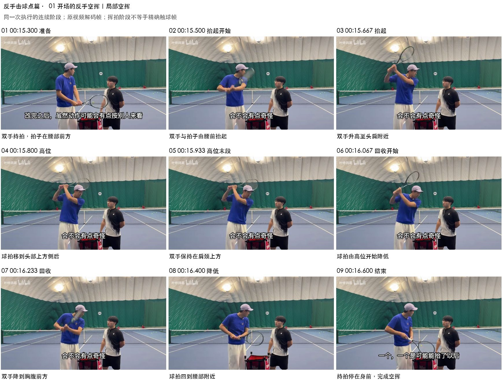

### 00:35–00:58｜用两步抛球引出击球点

讲师把击球点放回此前所说的“四件套”语境中，请同伴抛一个大约需要两步接近的球，迈步完成双手反手。很多人会在自己感觉舒服的位置停下来打，而接下来要讨论的正是这个距离是否把身体留得太远（这里的“两步”只是用来找距离感的练习设定）。

**动作 02：两步抛球后的反手｜带球击球｜00:53.700–00:56.400**

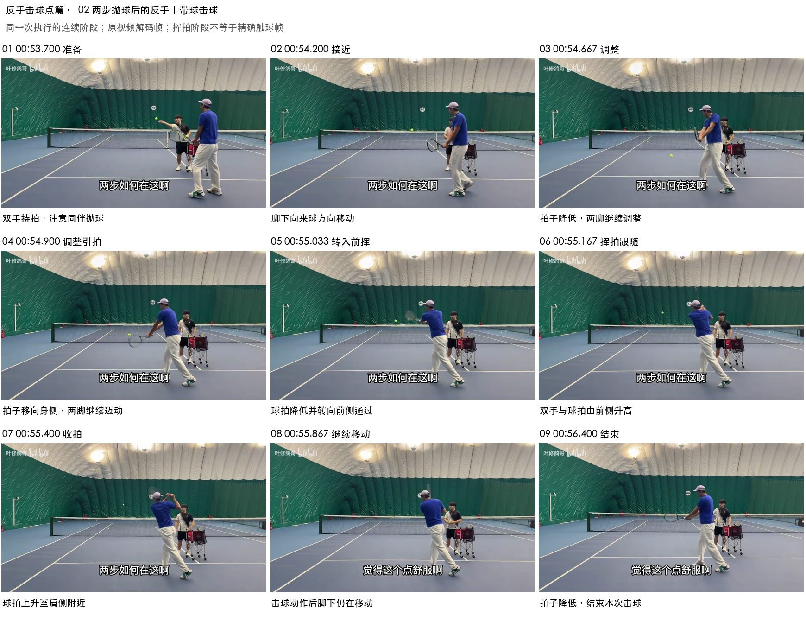

### 00:58–01:32｜身体离球太远时，容易只剩伸臂够球

讲师用身体与球拍的位置说明反手防守时的身体—球距离：主张进一步接近来球，而不是停在较远处、把手臂完全伸出去够球。如果停得太远，再用手腕勾、掰去补偿距离和方向，反而更难处理。

### 01:32–01:53｜先改变接近来球的逻辑

讲师把这一点与此前起跳练习作类比：掌握处理方式，是为了更敢向目标移动。对反手来说，不要为了预留一个想象中的手臂距离而过早停下，脚步应继续接近球、在身体仍移动时完成处理。

**动作 03：持拍继续向外的步法｜局部无球步法｜01:50.500–01:52.300**

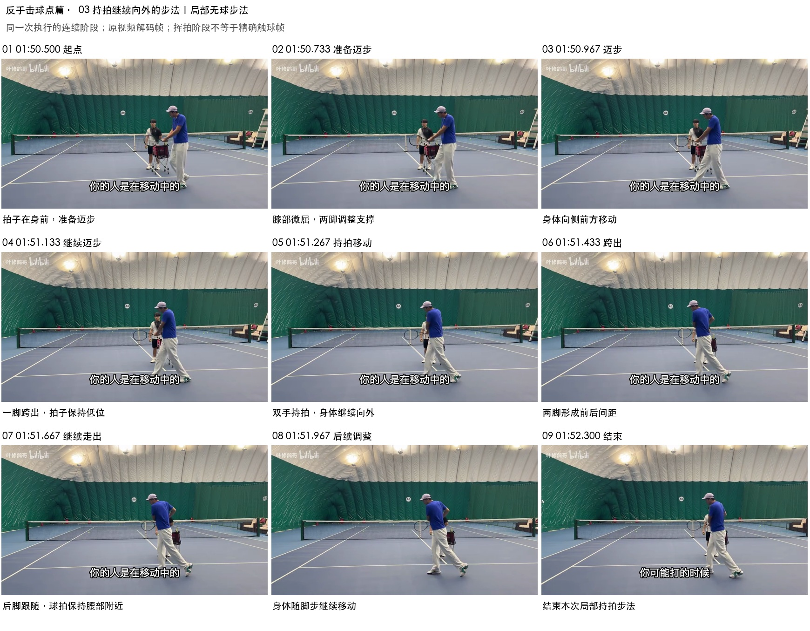

### 01:53–02:16｜先停住再对点，与边接近边打的对比

讲师先演示反例：走到预选位置、减速停步，再伸拍去对准击球点——一旦停的位置不合适，就只能够球。随后演示移动空挥，边迈步边把拍子送出并收起。之后说明球更靠近身体并不会让抬臂失去空间，并结合不同位置说明打斜线和小斜线的处理感觉。

**动作 04：先停步再伸拍的反例｜局部对比示范：停步伸拍｜01:55.900–01:58.300**

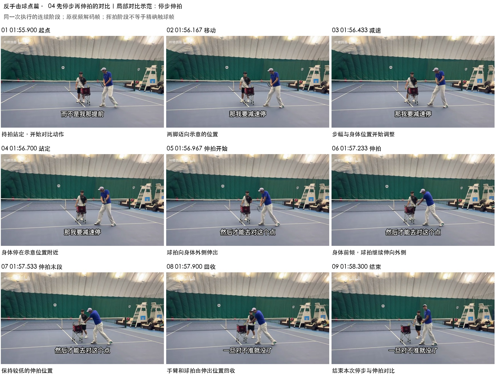

**动作 05：继续接近后挥拍的对比｜移动空挥｜01:59.800–02:02.333**

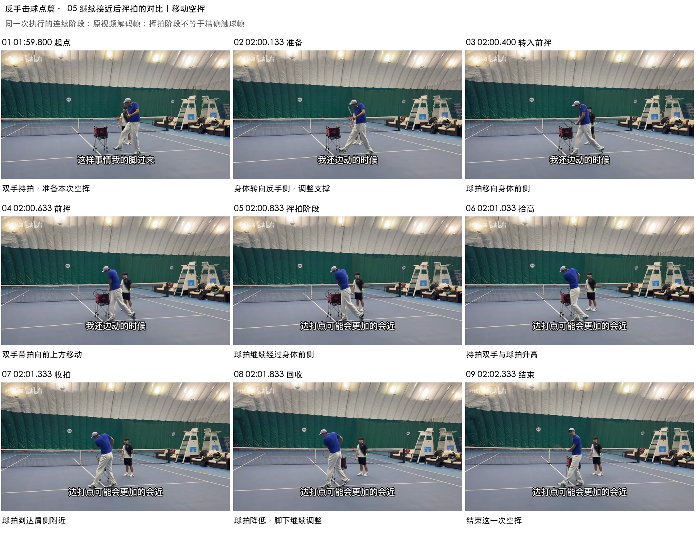

### 02:16–02:24｜两步接球后，身体仍继续走出

再次请同伴抛两步距离的球。讲师向来球方向迈步，双手反手挥拍上收，随后脚下继续向外移动，并强调右脚及身体在击球后仍在继续走出。

**动作 06：两步接近来球并继续向外｜带球击球｜02:20.533–02:23.500**

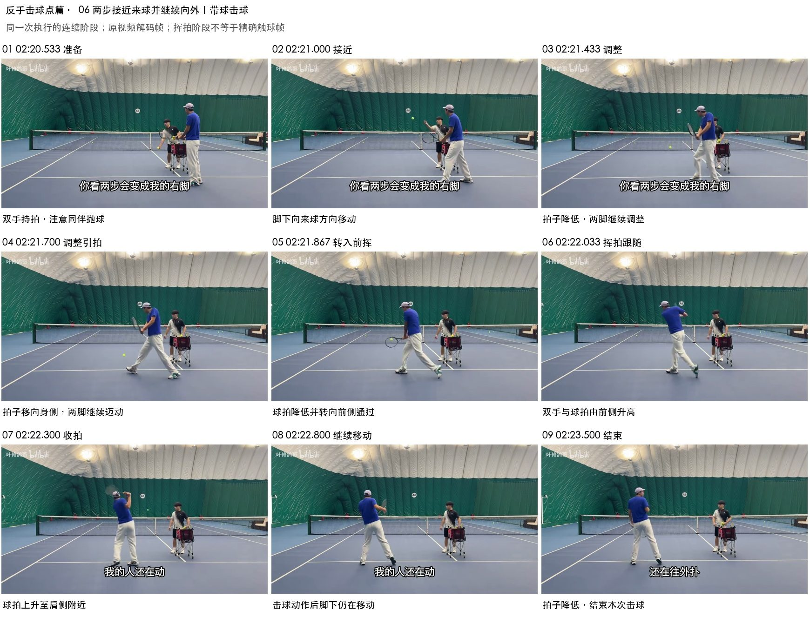

### 02:24–02:38｜向外移动与向回摆的两次空挥

讲师提到“阿卡”等职业球员打完后身体仍会向外走、看起来有些倾斜，以此说明击球后不必急着把人摆回原位。随后分别示范向外走出的空挥与向回摆的反例，并再次抛球巩固。

**动作 07：击球后向外移动的空挥｜移动空挥｜02:25.733–02:28.500**

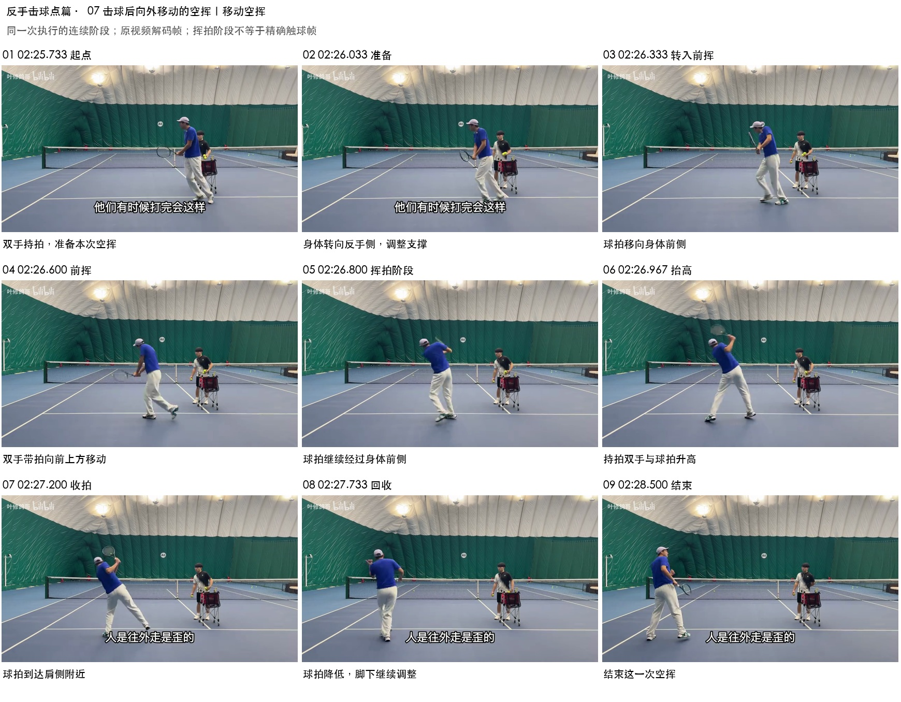

**动作 08：向回摆的反例｜局部对比空挥：向回摆｜02:29.833–02:31.233**

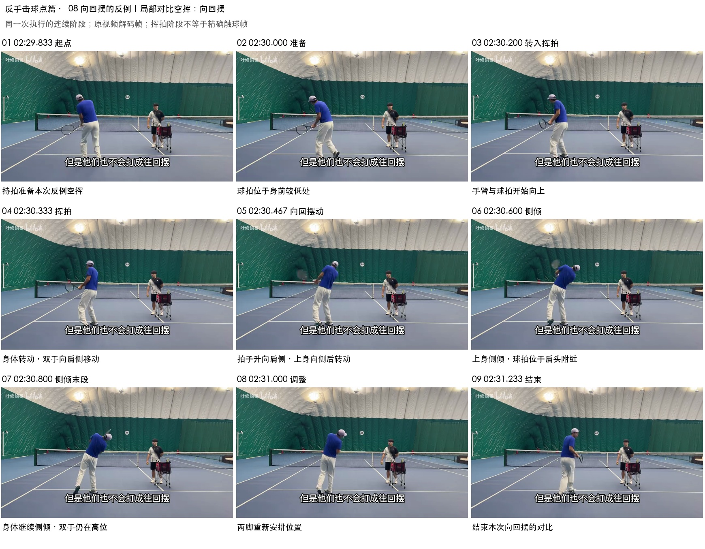

### 02:38–02:53｜增加到四步距离

接下来要求一个更远、约四步距离的球。讲师跑动接近后完成反手，身体和脚步在收拍后仍向外移动。这样练习是希望学员敢加速去跑，而不是先担心必须提前减速。

**动作 09：较远四步来球｜带球击球｜02:40.200–02:43.667**

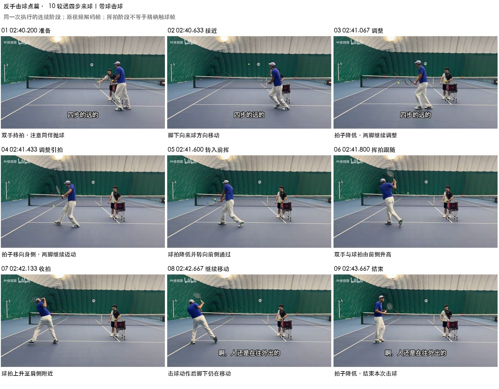

### 02:53–03:39｜移到底线，讨论关闭式处理与更远来球

双方移到底线附近，抛远球放慢动作完成反手，并继续沿移动方向走出。随后把这类处理与此前“四件套”及关闭式、开放式站位联系起来，讲到主动安排右脚支撑，以及不同处理下球质和斜线线路的保持。

**动作 10：底线关闭式向外击球｜带球击球｜03:07.400–03:10.033**

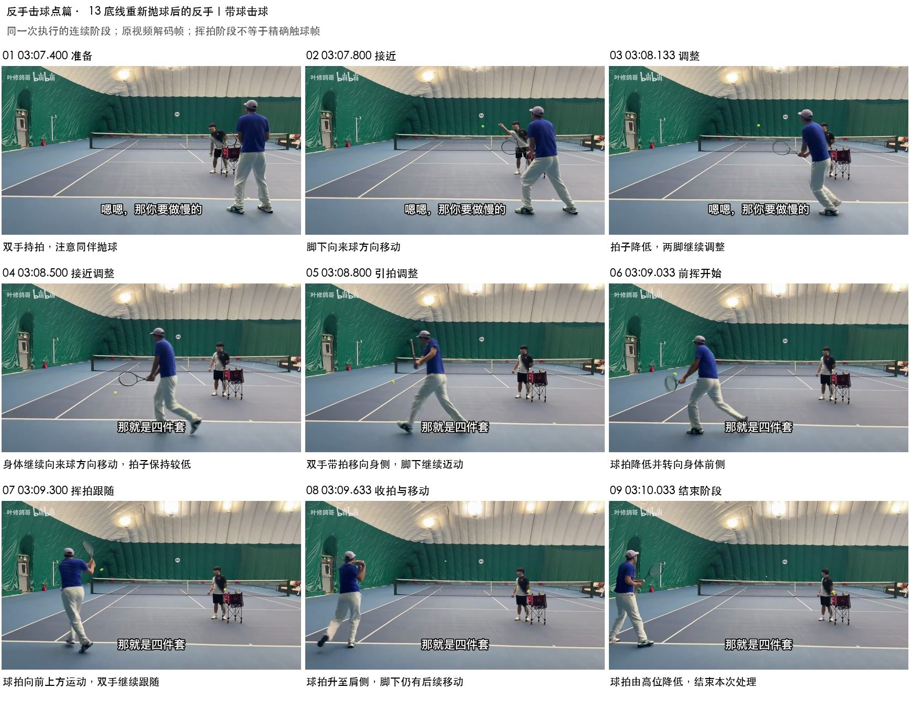

### 03:39–03:52｜停下够球的反例，与伸臂转动的能力对比

讲师希望学员在移动过程中完成处理，避免提前减速停下再把手伸出去够。他先做一次停步伸拍的反例，随后演示伸臂转动上身、再抬臂的局部空挥，说明普通学员很难在手臂伸得很远时还保持足够的转动与抬臂能力。

**动作 11：提前停下再够球的反例｜局部对比示范：停步伸拍｜03:43.367–03:45.300**

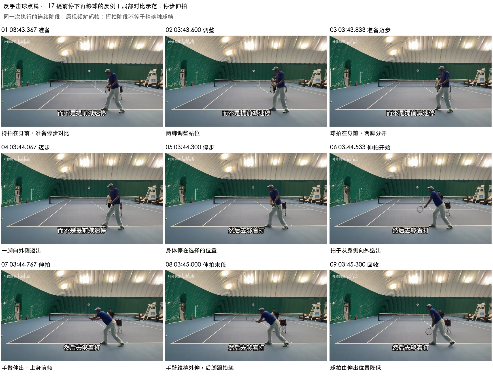

**动作 12：伸臂转动的能力对比｜局部空挥：伸臂转动｜03:47.267–03:49.467**

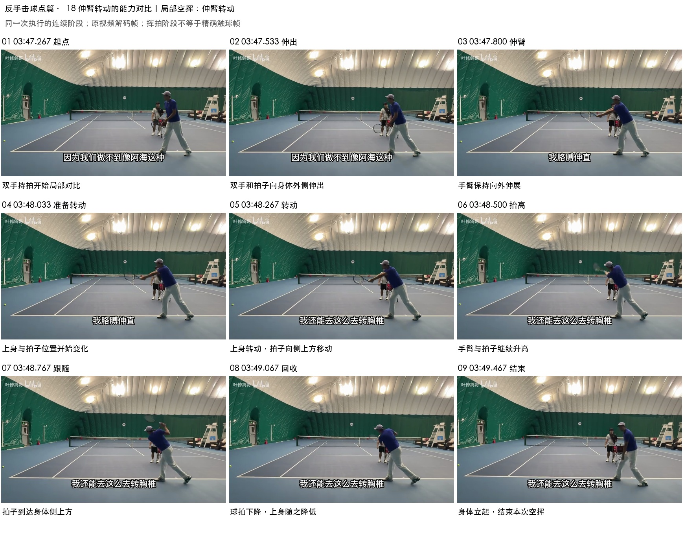

### 03:52–04:07｜把向外迈步接到实际来球

讲师让同伴继续抛球，演示脚下向外迈入、双手反手上收及后续继续走出。随后提到职业球员防守时也会在离身体较近的位置处理，并又完成一次带球示范。

**动作 13：向外迈步再击球｜带球击球｜03:52.600–03:55.433**

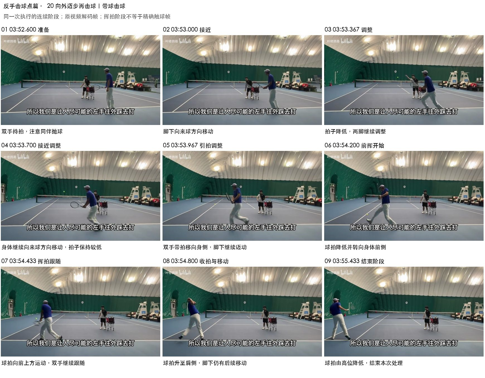

### 04:07–04:33｜跑到极限仍偏远时，保留够球余量

若已经尽力、全速去跑，球仍比预期更远，落到以前觉得舒服但偏远的位置，也不是完全不能处理。重点是改变“还没充分接近来球就预先停下”的习惯，而不是要求把所有来球都挤到身上。最后用直接向外迈入的空挥收尾，邀请同伴上手尝试，课程结束。

**动作 14：结尾直接向外迈入的空挥｜移动空挥｜04:21.100–04:23.700**

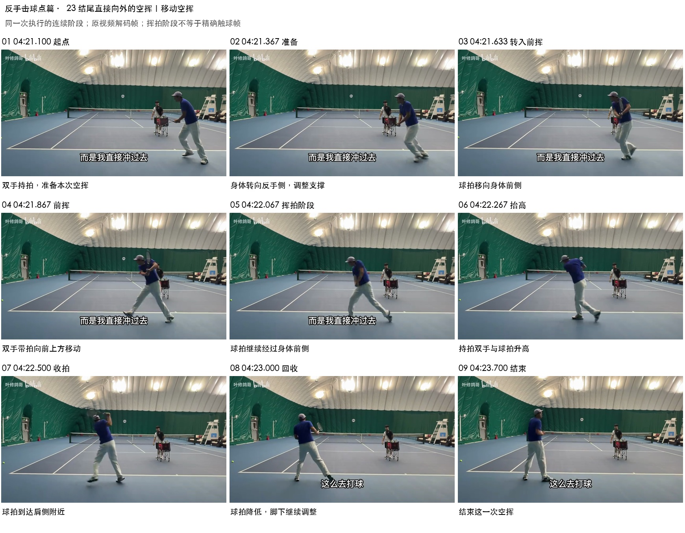
