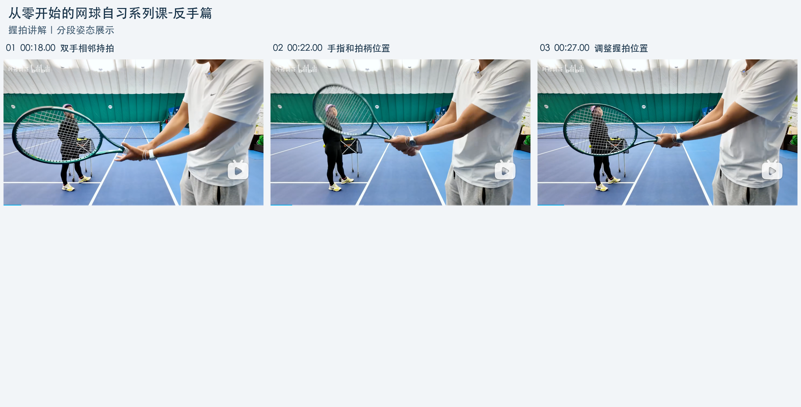
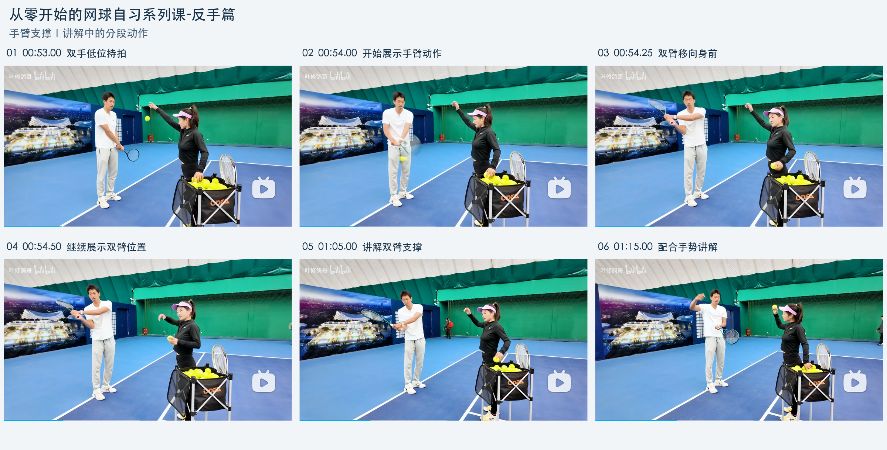
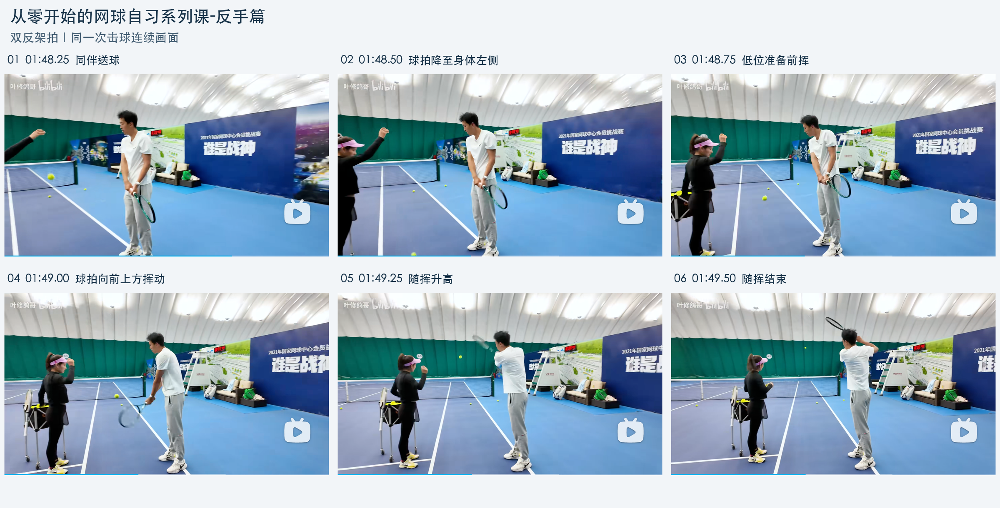
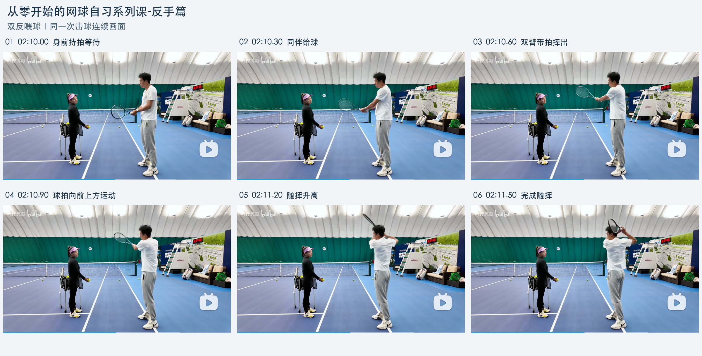
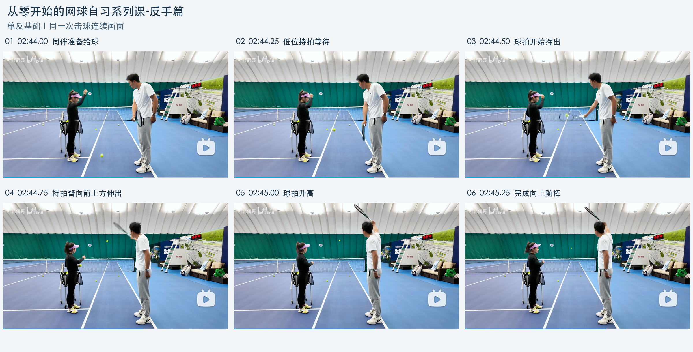
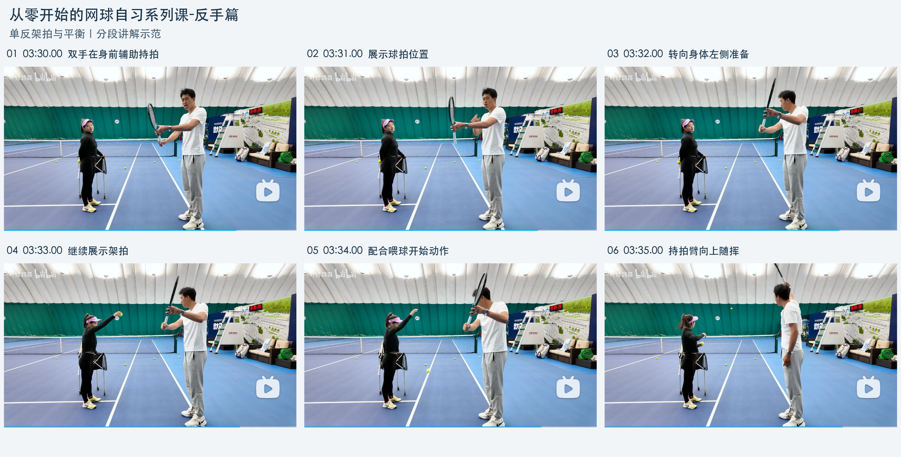
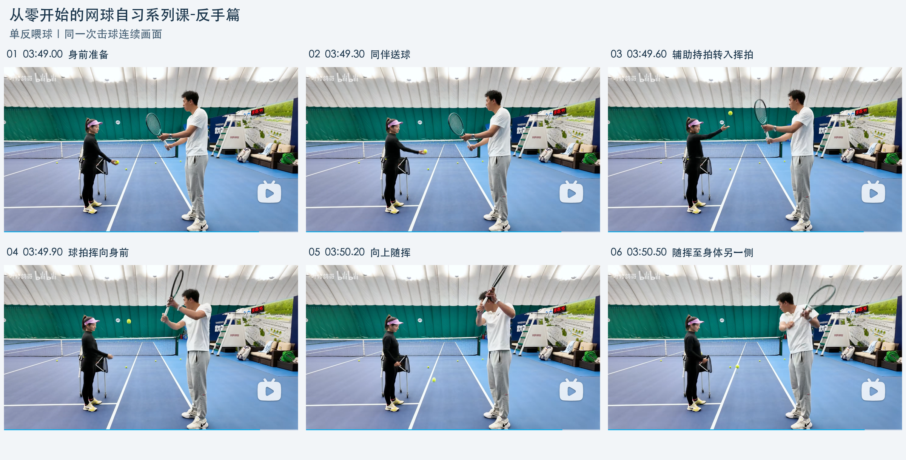

# 从零开始的网球自习系列课-反手篇

[Bilibili 原课](https://www.bilibili.com/video/BV1fp421S7BM/) · 叶修鸽哥 · 合集第 4/35 集 · 时长 04:24 · 整理日期 2026-11-04 · 发布日期 2024-04-29

## 课程总结

本课把双手反手和单手反手分别拆为低位起拍、预设架拍和身前准备接喂球三组练习。练习从近距离开始，逐步延长击球距离。两种反手都先把球打实，再让球拍向前、向上离开。

## 技术总结

- 双反两手沿拍柄相邻放置，保持两侧大臂支撑。
- 第一组从球拍自然下垂开始，先把球送出去再向上离开。
- 预设架拍后直接打，随后过渡到身前准备接喂球。
- 单反低位起拍时自然向上带，架拍阶段用左手辅助持拍和平衡。

## 训练路线

1. 先完成双反三组练习，从低位起拍到预设架拍，再接同伴喂球。
2. 单反换用能完成练习的握法，依次练低位抬起、左手辅助架拍、身前准备接喂球。
3. 每组从容易控制的距离开始，再按课程四档距离推进。

## 常见问题与调整

| 情况 | 调整方式 |
|---|---|
| 双手在拍柄上分开或相互交缠 | 把两手沿拍柄贴近放好。 |
| 单反靠局部掰动带拍 | 退回低位练习，连续向前、向上带起。 |

## 按时间顺序的课程记录

### 00:00–00:13｜沿用四档距离，从简单的开始

反手也和正手一样，按四种力量要求逐级练习。这里用击球距离区分：小场地打小场地、小场地打到底线、底线打向小场地、底线打到底线。先从最容易控制的距离开始，再逐渐增加要求。

### 00:13–00:33｜双反握拍，双手相邻并尝试调整

先双手持拍。两只手不要隔开，也不要相互交缠，沿拍柄贴着放好，配合左手食指的位置。讲师用近景展示双手怎样放在拍柄上。

握拍不要求先认定一个不能变化的固定位置。觉得拍面不容易打开时，可以沿拍柄稍作调整；换一个方向握也可以试，找到能顺利完成接下来练习的位置。

### 00:33–01:08｜双反第一组，从自然下垂开始，双侧大臂要有支撑

双臂先自然垂下，球拍放在身体左侧附近，从这个简单位置开始击球。现场让同伴给球，再示范怎样把球打出去。这一段还调整了拍摄机位，方便看见手臂动作。

主要靠小臂掰动时，右侧大臂的挥动空间会变小。这种挥法可能只蹭到球，球没有被送出去，甚至过不了网。

他要求打球时右侧大臂也能抬起，两侧大臂都要能支撑动作。不是一边的小臂单独扭动，而是让双臂参与向前、向上的挥动（下图为分段手臂姿态示意）。

### 01:08–01:27｜先把球送出去，再向上离开

继续体会从球偏下的位置进入，击球后向上离开。讲师认为，这样的挥拍已经可以产生上旋，不必为了旋转主动用手往上蹭。

他反复强调球拍要能够作用在球的后方，把球送出去。如果只追求向上摩擦而没有把球打出去，球就容易走不远。练习中继续让右侧大臂能够抬起，用前面要求的双臂支撑完成动作。

### 01:28–01:56｜双反第二组，加入架拍位置

在第一组基础上，把手臂抬起，尝试预先架拍。架拍位置可以稍高、稍低，或调整与身体的距离，先找舒服的位置；要求仍然是两侧大臂能参与动作，不要又回到小臂掰动。

同伴继续喂球，讲师从架拍位置完成击球，示范球拍下降后向前上方挥出、随挥升高。练习仍然延续把球送出去并带出旋转的感觉。这一段中途移动了拍摄机位，下面选择机位调整后同一次击球的连续画面。

### 01:56–02:26｜双反第三组，从身前准备，接同伴喂球

再从身前准备开始，把架拍和击球连起来。同伴可以把球抛高一点，留出更多时间，让准备、球拍下降、向前挥出和随挥能够顺畅衔接。

讲师希望练到这种抬起、挥出的感觉能随时做出来，而不是每次都刻意拼接动作。他随后提醒：连续练习时很容易又变成掰小臂，要及时回到顺势抬起的动作。双反部分到这里结束。

### 02:26–02:40｜转入单反，先选择能完成练习的握拍

单反同样先从简单的练习开始。讲师提到反手东方式和大陆式握拍，可以分别尝试，体会能否完成后面的动作。本段没有要求只准使用其中一种。

### 02:40–03:13｜单反第一组，从低位自然抬起

球拍稍放在身体左侧，从球偏下的位置向前、向上抬起。讲师连续示范：不必因为动作像把球托起来，就认为它一定没有上旋。

他的解释是，球拍打到球的后方后自然向上离开，也可以带出上旋；不需要先刻意做一个很大的刷球动作。他让同伴再次喂球，重复低位准备、挥出和向上随挥，提醒不要着急。

### 03:13–03:28｜继续向上抬，不要靠掰动完成

讲师再次区分抬起与掰动，要求把球从偏下的位置带起来，而不是用手臂突然掰一下。他在课中提醒，反复这样掰动可能让手肘承受不适，并提到高尔夫球肘。这是讲师在本段给出的训练提醒。

### 03:28–03:46｜单反第二组，左手辅助持拍并保持平衡

左手先辅助持拍，在身体左侧准备，再完成挥出。击球时双臂可以分开，左臂配合保持身体平衡，持拍臂仍然向前、向上运动。

双臂分开时保持身体平衡，避免向右侧猛掰。图中按时间列出辅助持拍、架拍和喂球后的示范，属于分段讲解。

### 03:46–04:04｜单反第三组，从身前准备接喂球

最后也从身前准备开始，由同伴把球适当抛高，再把准备和击球连在一起。继续体会向上抬起，把球打出去，同时保持身体平衡。

现场重复喂球演示，讲师用球的飞行说明，这种向前、向上完成的挥拍同样可以带出旋转。

### 04:04–04:24｜熟练后手更放松，旋转仍来自把球打实后的挥出

随着练习增加，手更放松、对击球更有感觉，旋转可能自然增加。但讲师提醒，不要把增加旋转理解为手上再主动夹一下、掰一下。

本课最后回到同一个要求：先把球打实，从球后方向前、向上带起，在连贯的挥拍中产生旋转。双反和单反都沿用这个训练思路。
