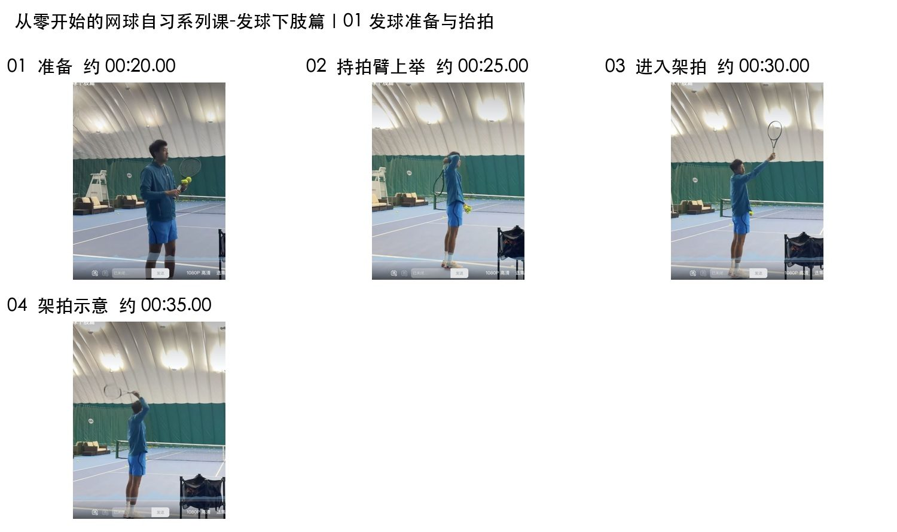
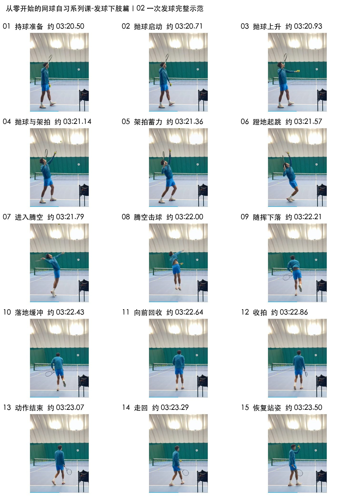

# 从零开始的网球自习系列课-发球下肢篇

[Bilibili 原课](https://www.bilibili.com/video/BV1h24qenEqf/) · 叶修鸽哥 · 合集第 10/35 集 · 时长 07:44 · 整理日期 2026-11-05 · 发布日期 2024-09-11

## 课程总结

本课先练打实和击球后的延伸，再把抛球、架拍与蹬地起跳接在一起。后半段围绕躯干参与、起跳时机和动作幅度调整完整发球。

## 技术总结

- 先把球打实，再让拍头在接触后继续延伸。
- 先完成抛球与架拍，再把下肢蹬地接到挥拍。
- 起跳与向上击球协调进行，先找到合适的时机和幅度。

## 训练路线

1. 从不强调起跳的击球练习开始，先找扎实接触和延伸。
2. 按抛球、架拍、蹬地、向上挥拍的顺序练完整动作。
3. 根据躯干和下肢的配合微调跳起时机及幅度。

## 常见问题与调整

| 情况 | 调整方式 |
|---|---|
| 加了起跳后打不实 | 先回到简化击球，恢复接触与延伸再接蹬地。 |
| 起跳和挥拍脱节 | 先缩小跳起幅度，重新练抛球、架拍和向上击球的衔接。 |

## 按时间顺序的课程记录

### 00:00–00:30｜先建立能把球打实的接触

讲师从击球接触讲起，提出先把球打实、在碰到球后控制拍子，再逐步把动作连起来。开始阶段先练碰球后收回或停住，不急于一开始就追求完整、快速的发球。随着接触稳定，再把拍子继续向前延伸。

### 00:30–01:00｜接触后继续延伸

讲师把击球后的动作描述为继续向前延伸，并谈到前臂内旋。练习时先让拍子接触球，再把动作延伸出去；这一段强调动作路线和接触感，不要求先用腿去追求力量。随后他把讲解转到发球姿势和来球落点。

### 01:00–02:30｜从抛球、架拍到跳起击球

示范中先抬拍进入架拍位置，再抛球并挥拍。讲师指出，如果抛出的球落得太靠近身体，球可能会挤压击球空间；因此练习时要让抛球和击球点相配合，并尝试在较高的位置击球。

之后他让学员尝试跳起来击球，并做了一次完整示范。讲解把“抛球后抬高击球点”与起跳、腾空时机连起来：先让球能在身体前上方被够到，再逐渐把下肢动作并入发球。连续示范约在 03:20.50–03:23.50：从持球准备、抛球与架拍，接到蹬地起跳、腾空击球、随挥落地和动作结束。图中 15 帧按这一时间段等间隔抽取，未把后续停顿或下一次发球并入动作序列。播放器时间为近似定位。

### 02:30–04:50｜围绕躯干动作的问答与演示

讲师随后以较长的架拍姿势停留在画面中，与同伴讨论发球时身体如何动作。对话提到髋部向后、身体旋转以及躯干伸展等常见描述。讲师通过口头交流和定格姿势说明，不要只凭外观给动作贴标签；讨论的重点放在身体转动与伸展如何配合，以及不要把发力理解为单独把某一处向后顶。

这一段主要为静态定格姿势讲解。

### 04:50–07:44｜跳起时机与动作幅度

结尾继续讨论什么时候起跳，以及腿部弯曲、蹬起的外观。讲师提到有人在刚起腿时就跳到最高点，也有人采用不同节奏；最终提醒不必把动作做得过多。练习重点仍是让抛球、击球点和起跳时机相互配合，再根据自身动作找到能连贯完成的幅度。
