# 从零开始的网球自习系列课-发球架拍篇

[Bilibili 原课](https://www.bilibili.com/video/BV1H2w2zsEV6/) · 叶修鸽哥 · 合集第 33/35 集 · 时长 03:17 · 整理日期 2026-11-06 · 发布日期 2026-03-16

## 课程总结

本课接续早期绕头练习，用投掷、预设架拍和接抛球发球建立实际发球的准备位置，最后对比两种进入架拍的顺序。

## 技术总结

- 用投掷建立上臂打开和向前出手的路径。
- 架拍时让持拍手来到头侧、球拍略斜，再接翻转和挥拍。
- 简化准备仍保留架拍节点，架拍高度可以适应个人动作。
- 区分早期绕头轨迹练习和实际发球的准备路线。

## 训练路线

1. 先投掷，体会上臂位置和向后拉开的感觉。
2. 预设架拍位置，先停一下确认抛球，再从该位置直接发球。
3. 把简化准备接回完整动作，对比两种进入架拍的顺序。

## 常见问题与调整

| 情况 | 调整方式 |
|---|---|
| 架拍时掉肘或翻腕抢拍 | 回到投掷和预设架拍练习，先找到头侧的持拍位置。 |
| 刻意摆奖杯姿势后动作停住 | 缩小准备动作，保留架拍节点并接着挥出。 |

## 按时间顺序的课程记录

### 00:00—00:16：回顾早期的绕头练习

讲师说，这部分材料以前在群内讲过，但还没有做正式版本。早期发球教学提到过绕头和小臂；如果还没有相关动作习惯，可以用这种无球轨迹练习来寻找球拍的运行路线。

### 00:16—00:30：区分入门轨迹练习与实际发球

讲师随即收紧适用范围：实际发球不建议专门增加一段绕头。多绕一圈会增加路程和耗时，而发球希望在较短时间内完成爆发。

### 00:30—00:54：先解决投掷能力

讲师把发球与投掷联系起来，认为应先具有基本的投掷动作；如果不会投掷，反过来靠学习网球发球补投掷基础，在他的教学逻辑中顺序不合适。

他建议先让教练帮助纠正投掷，再处理发球动作，投掷改善后学发球会更容易一些。

### 00:54—01:05：掉肘、翻腕与刻意摆奖杯姿势

讲师现场分别做掉肘与翻腕的局部反例：前者是抬臂后肘部与球拍下落，后者是持拍手提前翻腕改变拍框朝向。

随后他提到，职业球员的连续动作中可能经过一些相似位置，但不建议初学时刻意摆出静态的“奖杯姿势”。

**动作01：掉肘的现场反例｜局部错误示范｜00:55.000—00:56.800｜15图**

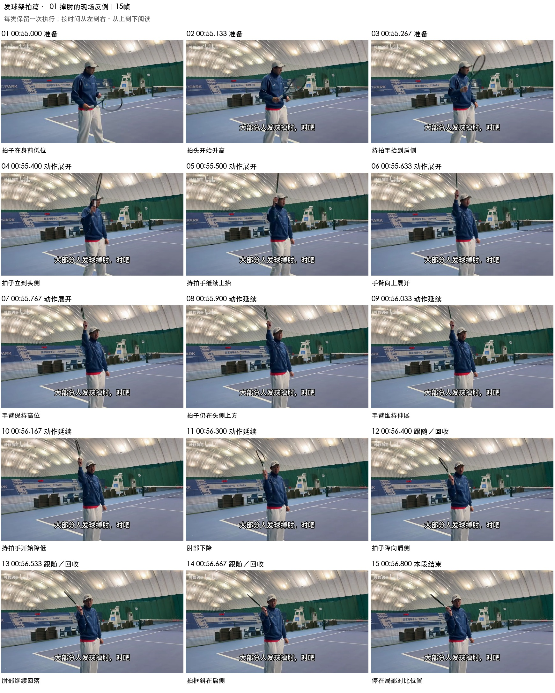

**动作02：翻腕的现场反例｜局部错误示范｜00:57.500—00:59.300｜15图**

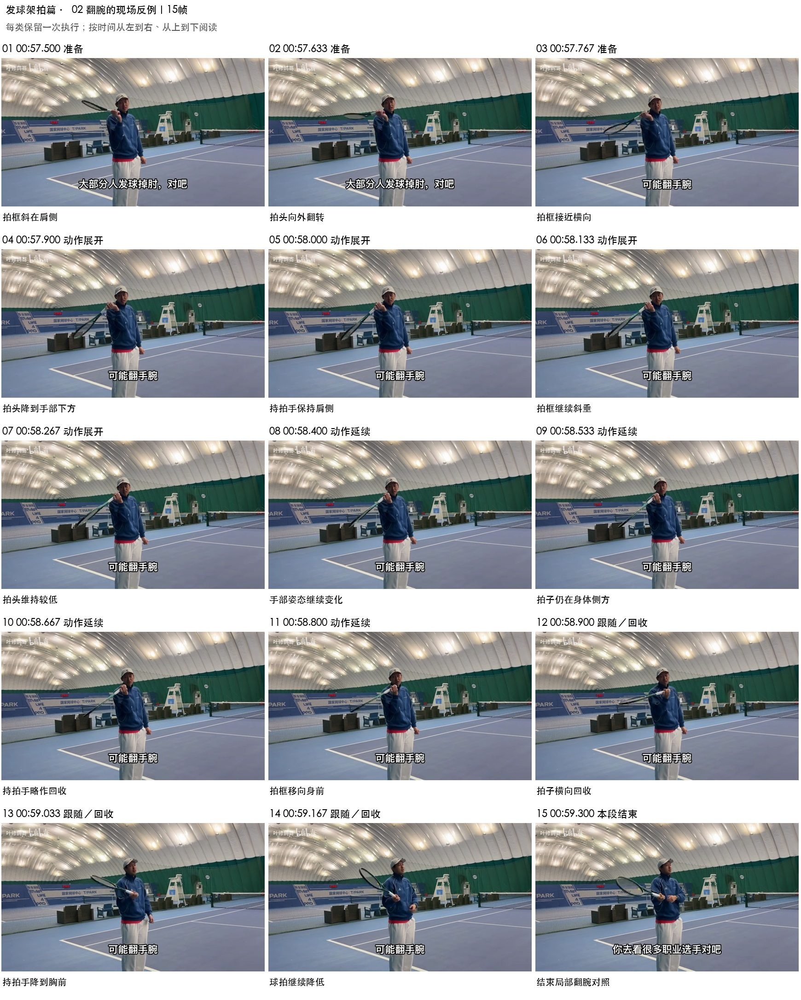

### 01:05—01:21：上臂位置与向后拉开的感觉

不希望持拍肘一直落在身体前面的平面中；他把这种准备与后续容易掉肘联系起来。接下来用拉弓作类比，强调上臂抬起时要向后拉开。

他说的上臂“水平”，并非把手臂横摆在胸前。他通过局部移动作对照，再把持拍臂收回并重新后拉，强调保持向后的张力感。

**动作03：拉弓式向后拉拍｜局部架拍练习｜01:10.700—01:12.500｜15图**

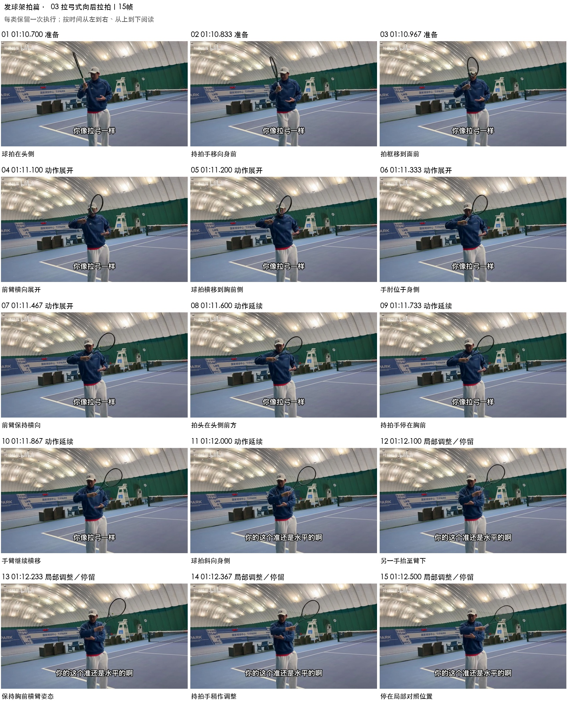

**动作04：回收后再次向后拉｜局部架拍练习｜01:18.500—01:19.800｜15图**

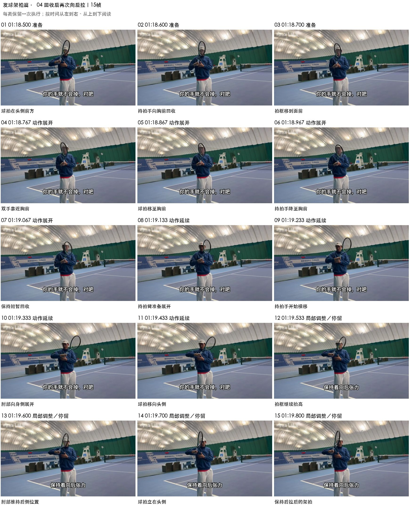

### 01:21—01:46：手在头侧、球拍略斜，直接翻转即可

持拍手的位置被类比成打电话：在头的外侧附近，而不是贴在头顶。球拍略有倾斜，过于竖直会多出一段多余的回程；手腕的口令是“顶着”，不必刻意扣腕。

随后他说明，从这个位置直接翻过去，已经包含需要的绕头过程，并示范局部空挥；约 01:41 之后另做一次额外绕大圈的反例对照，说明不必多绕这一圈。

**动作05：竖拍需要回程的局部对比｜局部对比空挥｜01:26.700—01:28.000｜15图**

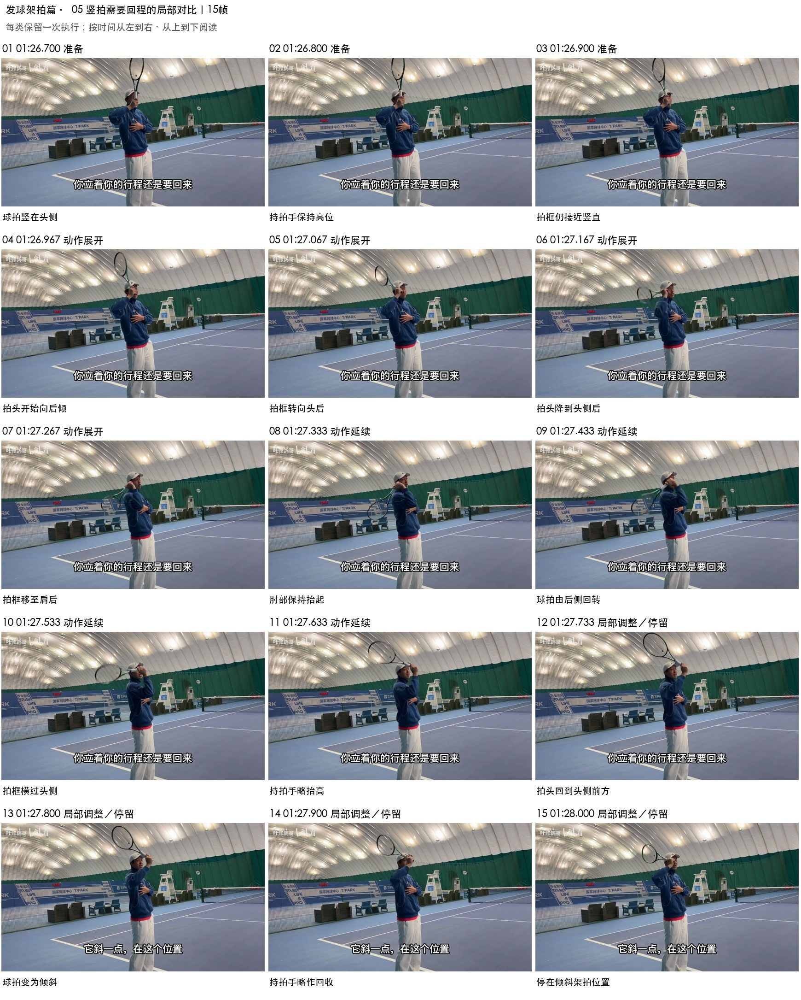

**动作06：直接翻拍代表动作｜局部发球空挥｜01:38.800—01:40.000｜15图**

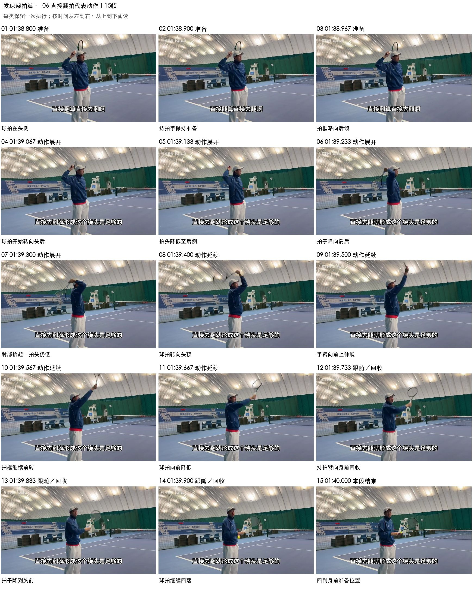

**动作07：额外绕大圈的反例｜局部错误示范｜01:41.600—01:44.400｜15图**

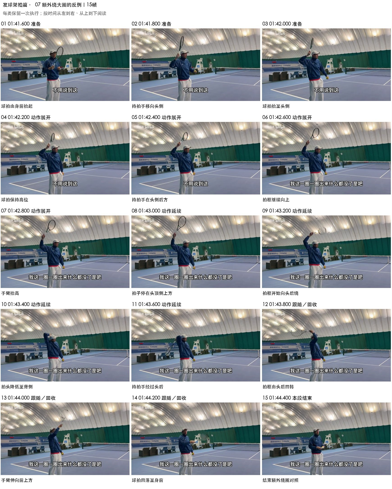

### 01:46—02:01：重新定位，并先做一次抛球停顿

讲师再整理位置：上臂抬起并向后，持拍手靠近耳侧。由于人的肢体长度不同，外观位置可能有差异，重点仍是后拉和保持。

约 01:58 开始，他保留头侧架拍，仅做一次抛球、停顿和抛球臂回落（抛球局部练习，未接发球挥拍）。

**动作08：保持架拍后的一次抛球停顿｜抛球局部练习：未完成发球｜01:57.900—02:00.200｜15图**

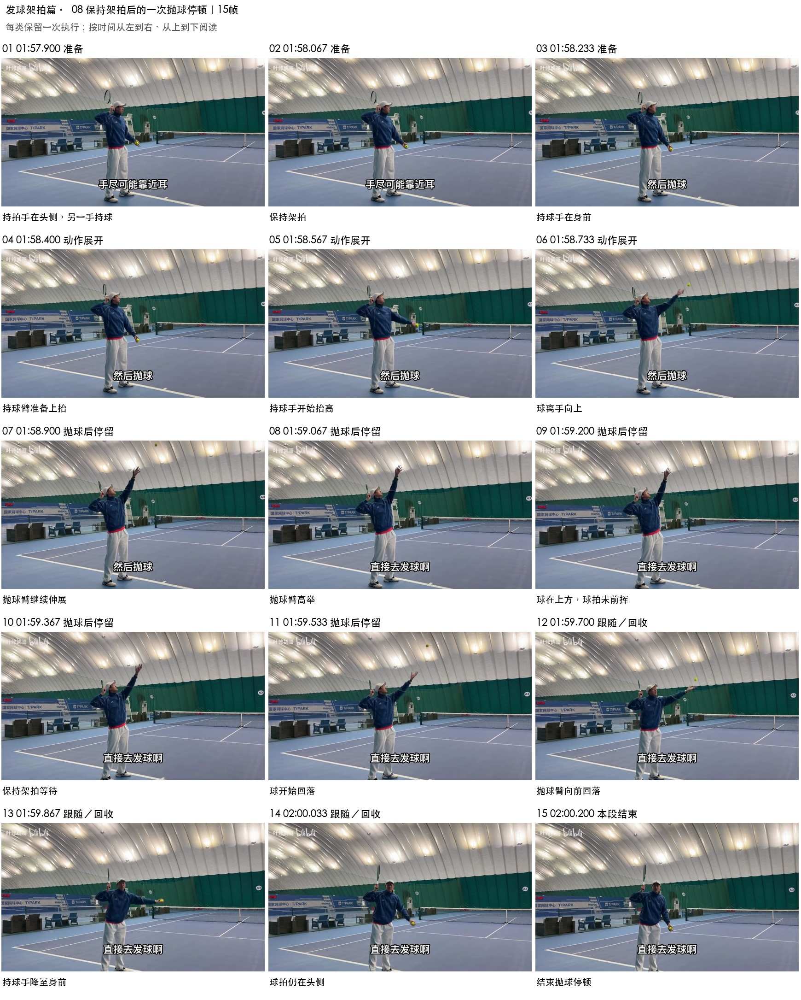

### 02:01—02:14：从预设架拍位置直接发球

讲师用预先架好的持拍臂直接发球，连续完成三球示范（期间短暂停在准备位置用非持拍手示意抛球）。

他用“稳”“卡住”等口令形容准备状态，并说明这种准备可以衔接侧旋或平击发球。

**动作09：预先架拍后的代表动作｜简化发球示范｜02:07.000—02:09.300｜15图**

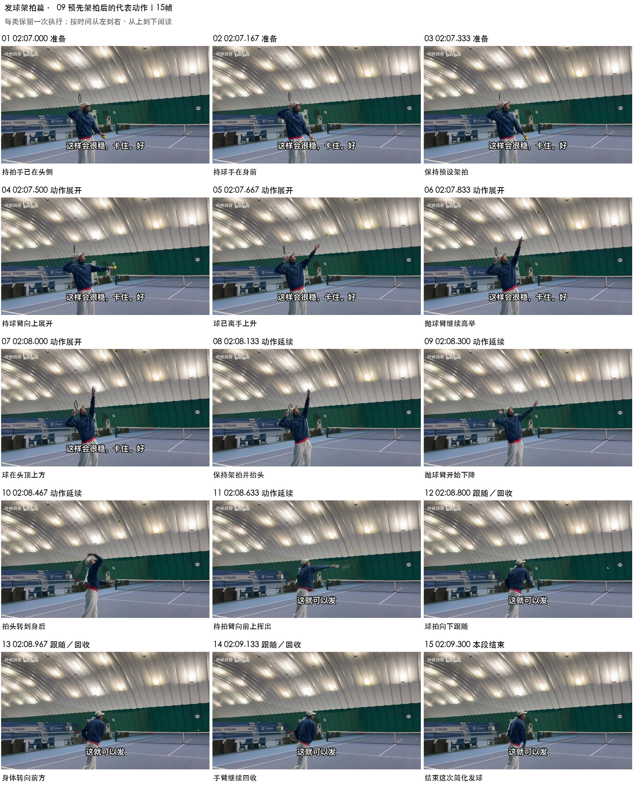

### 02:14—02:34：切镜后的补充，简化准备也可以练

讲解继续强调，可以较长时间练从预设架拍位置开始的发球，把这里作为简化动作的起点。讲师认为，前面的引拍部分并不自动带来多少收益，没必要执着于“必须有大幅前置动作才能发快”。

### 02:34—02:47：两种进入架拍的顺序

第一种是两臂同时拉开，直接去找架拍位置；第二种是先把持拍肘向后顶住，再把持拍手和另一只手抬起来。以下三组为无球架拍分解练习。

**动作10：同时拉开的代表动作｜架拍分段练习｜02:37.300—02:39.500｜15图**

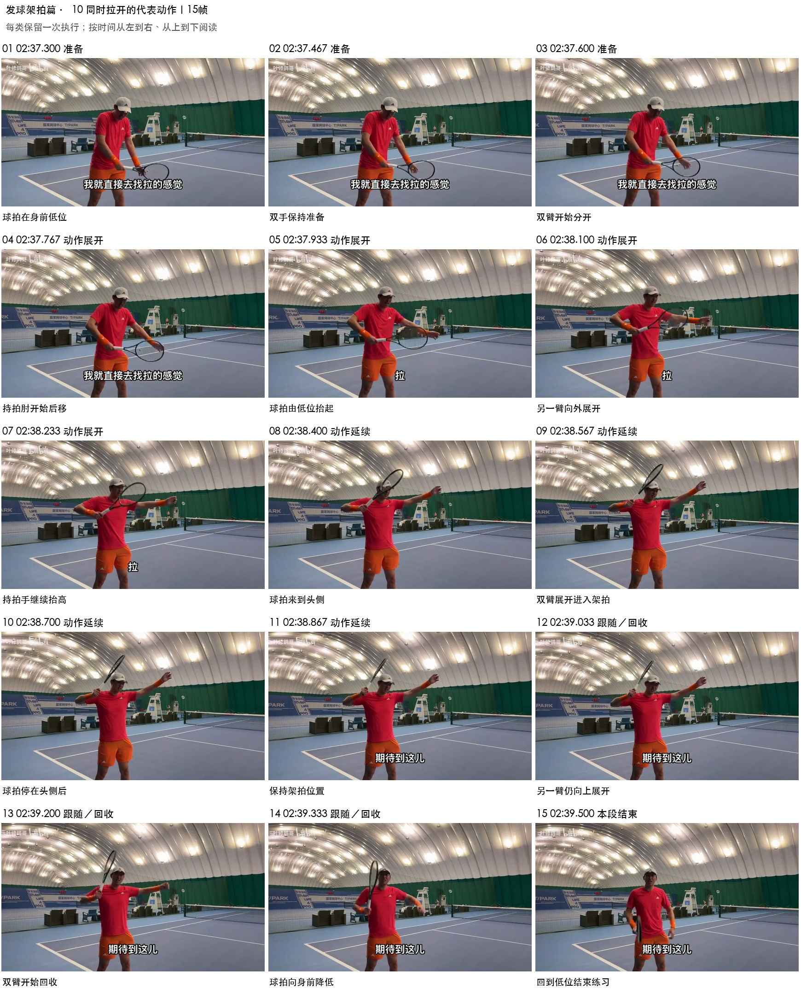

**动作11：先向后顶肘的短练习｜架拍局部练习｜02:41.100—02:42.300｜15图**

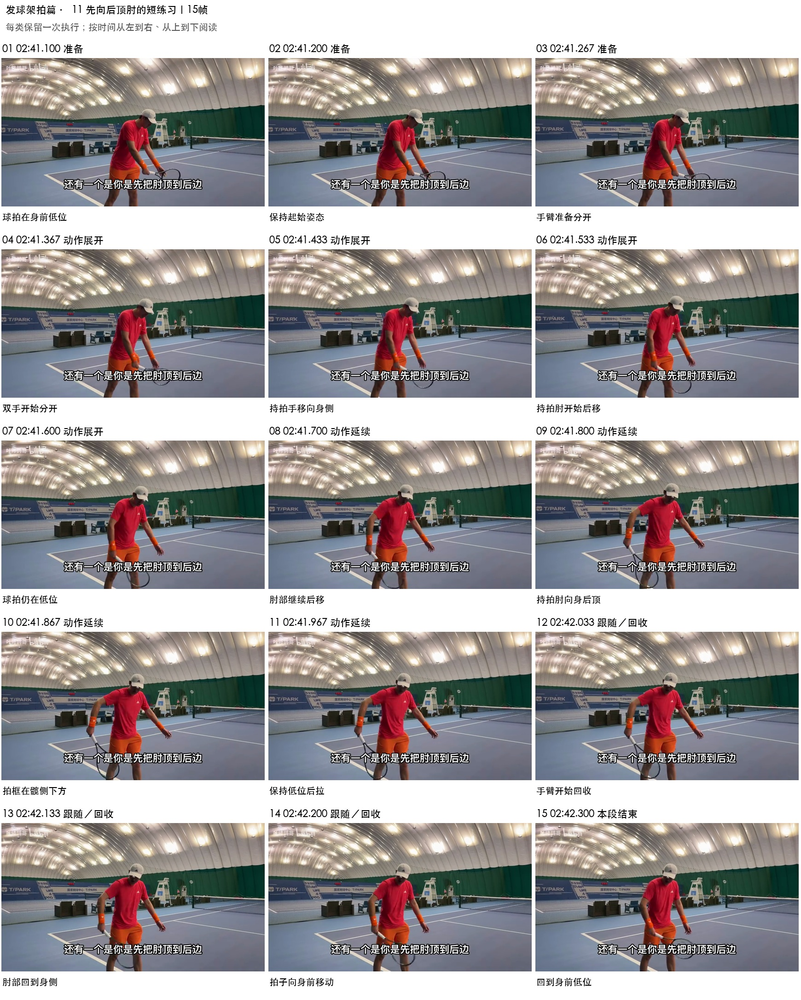

**动作12：先顶肘再抬拍的完整分段｜架拍分段练习｜02:44.000—02:45.800｜15图**

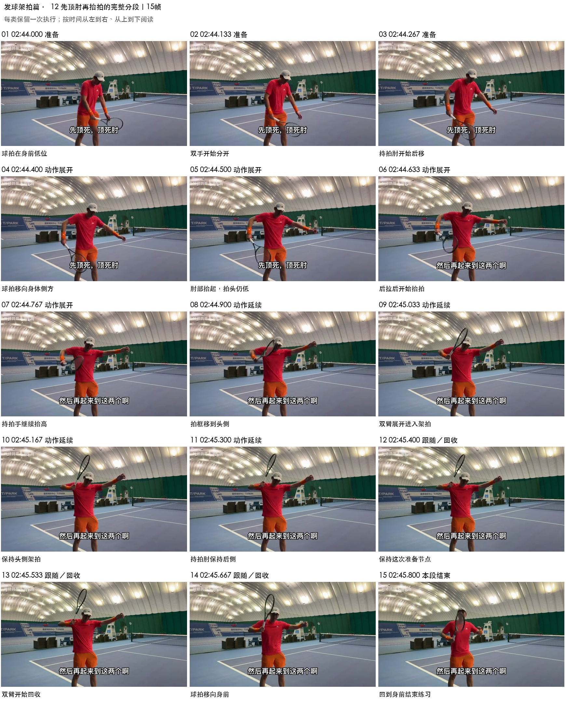

### 02:47—03:08：重复比较，并允许架拍高度有差异

讲师再次展示两臂同时拉开，回收后又做一次接续到前挥的无球发球空挥。随后转回先拉肘的方式：先做一遍短后拉，再做一遍后拉后抬到头侧，并停留在架拍位置。

接下来他进入架拍后改变手臂高度，说明这个节点不必苛求完全一致的外观；又示范了一个相对低一些的架拍位置，并提到职业选手中也常见更低的架拍。

**动作13：接续架拍到前挥的一遍｜无球发球空挥｜02:50.600—02:52.800｜15图**

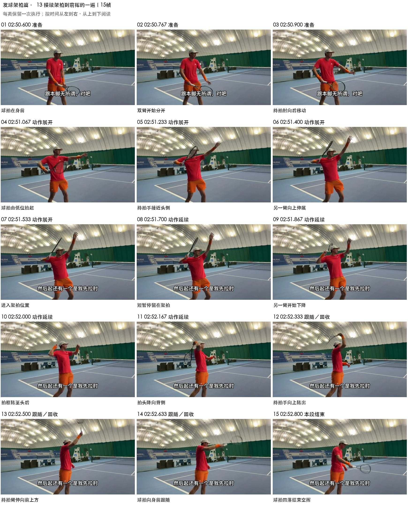

**动作14：较低架拍位置的局部对照｜局部架拍调整｜03:02.500—03:06.700｜15图**

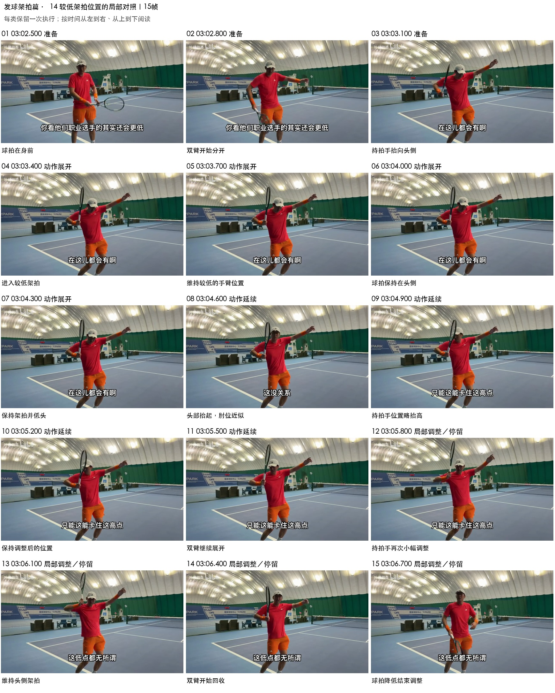

### 03:08—03:17：保留准备节点，结尾再做绕头反例

结尾强调，重点是能进入并保持这个准备节点，再从这里开始发球。他完成最后一次无球发球空挥，随后再次演示额外绕大圈的反例作对照，课程结束。
