# 从零开始的网球自习系列课-发球篇

[Bilibili 原课](https://www.bilibili.com/video/BV11w4m1k7gm/) · 叶修鸽哥 · 合集第 7/35 集 · 时长 05:05 · 整理日期 2026-11-04 · 发布日期 2024-08-08

## 课程总结

本课从低位把球打进发球区开始，逐步提高持拍和触球位置，再加入抛球、侧身与握拍变化。先建立向上送拍的动作，再观察弧线与反弹，过渡到侧上旋。

## 技术总结

- 先让球落地再下手打入区，熟悉后直接打抛出的球。
- 把持拍位置从低位逐步提高到肩部和更高的位置。
- 抛球时向上托送，避免甩腕或后仰凑高度。
- 先正面对网体会向上挥，再加入侧身、握拍变化与收拍。

## 训练路线

1. 从低位发球开始，能把球送进目标区后逐档抬高。
2. 单练向上托球，再把抛球、高位起拍和向上挥拍接起来。
3. 加入侧身和握拍变化，从背后观察球路弧线与反弹。

## 常见问题与调整

| 情况 | 调整方式 |
|---|---|
| 一开始就从完整发球起步，难以打进区 | 回到低位送球，掌握方向后逐档抬高。 |
| 抛球靠甩腕或身体后仰 | 放慢抛球，用抛球手向上托送。 |

## 按时间顺序的课程记录

### 00:00–00:34｜入门起点与发球方向

叶修先交代，这一课从初学者容易完成的下手发球开始。前面练过的发力方式可以继续用在这里。先确定要把球送往哪个发球区，再小幅调整站位和身体朝向，让肩部方向与目标方向相配。一区、二区需要相应改变朝向，不必为瞄准做很大的转身。

### 00:34–00:49｜先让球落地，再下手打入区

第一步先放球，让球在地面反弹后，用下手动作把它打过网、送进对应发球区。叶修分别示范两个方向。这一步用于建立方向和手感；他也在讲解中把它与正式发球作了区分。先把简单的送球练稳定，再进入不落地的版本。

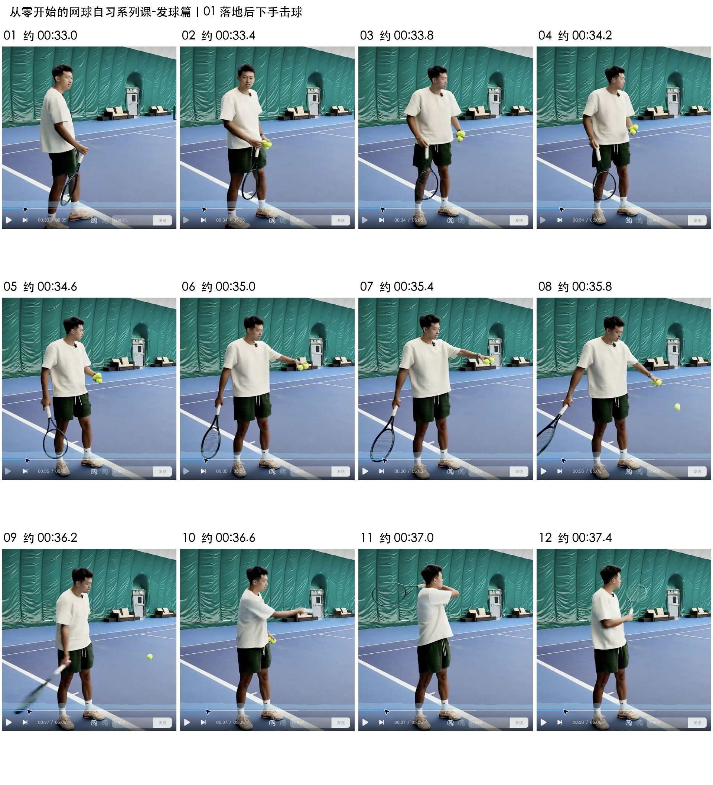

### 00:49–01:06｜改成直接击打抛出的球

接下来抛起球，在落地之前直接下手击出。这里仍然先追求把球发进去，同时让球有向上的弧线和较高的反弹。叶修用这个练习说明：动作简单也可以先建立能开始回合的发球，不必一开始追求很猛、很低的球。

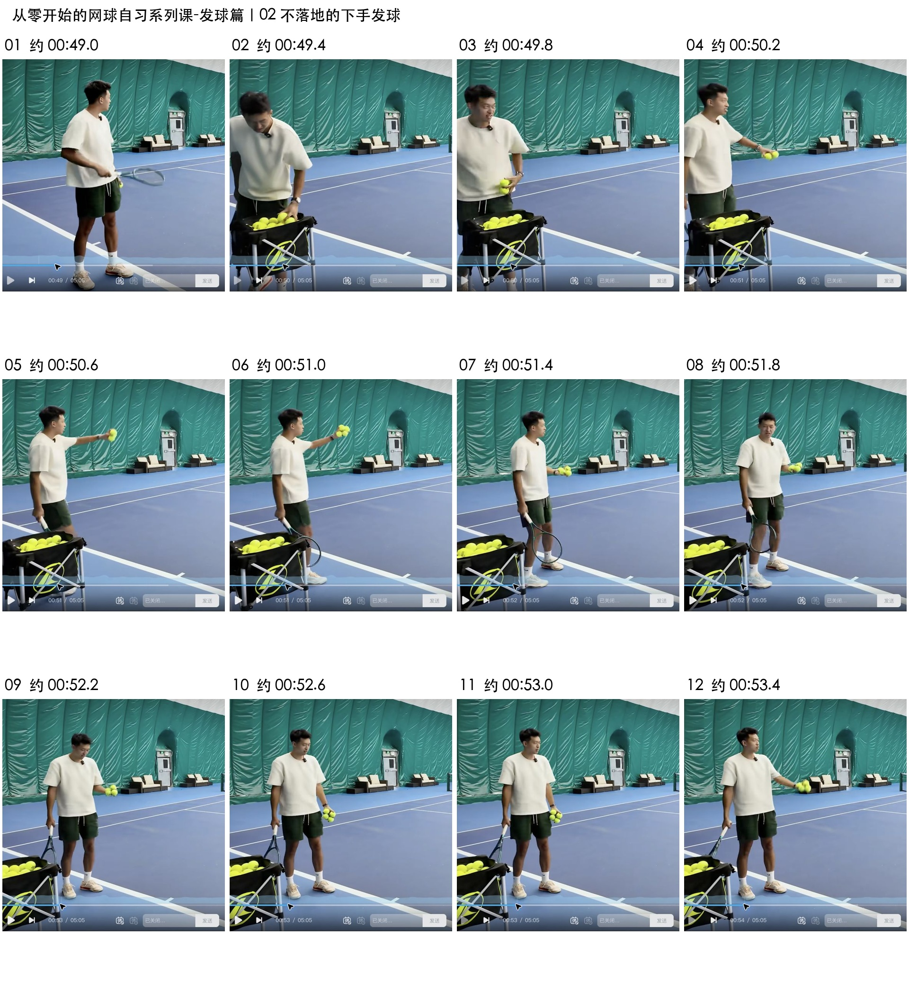

### 01:06–01:18｜持拍位置逐步升到肩部

在前一步的基础上，把持拍手提高到肩部附近，抛球后直接把球送出去。练习的变化是起拍位置变高，仍延续把球向上送出的感觉。

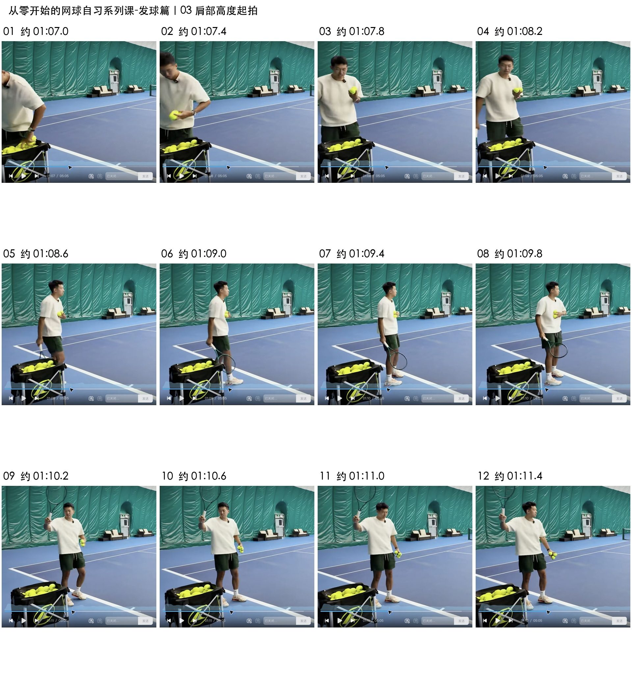

### 01:18–01:35｜再把持拍手抬高

继续把持拍手抬到自己能舒服完成动作的位置，抛球、击球。叶修此时更看重球感和能否把球送出去，暂时不要求外形都做成某一种标准姿势。图中保留这一阶段的连续准备与抬拍示范。

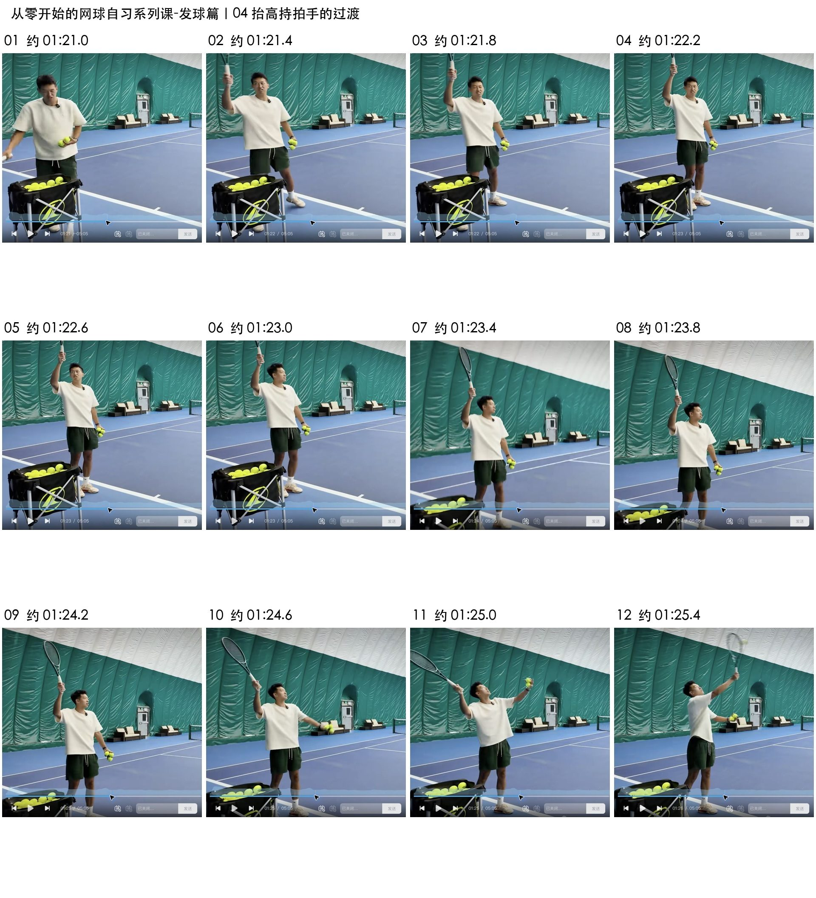

### 01:35–02:27｜抛球：向上托，不靠甩腕或后仰凑高度

叶修先展示用手腕、小臂去甩抛时的不稳定，再说明只抬胳膊会遇到高度限制。有的人为了继续抬高，会变成身体起伏或向后倒。他提出的感觉是让肩胛区域参与上举，用手托着球向上送；掌根也有向上托的感觉。

这一段的重点是把托举与甩抛区别开：只甩胳膊容易把球甩出去，再用身体后仰补偿，抛球位置更难重复。示范图记录肩胛区域、手臂上举和托球方向，是分段动作说明。

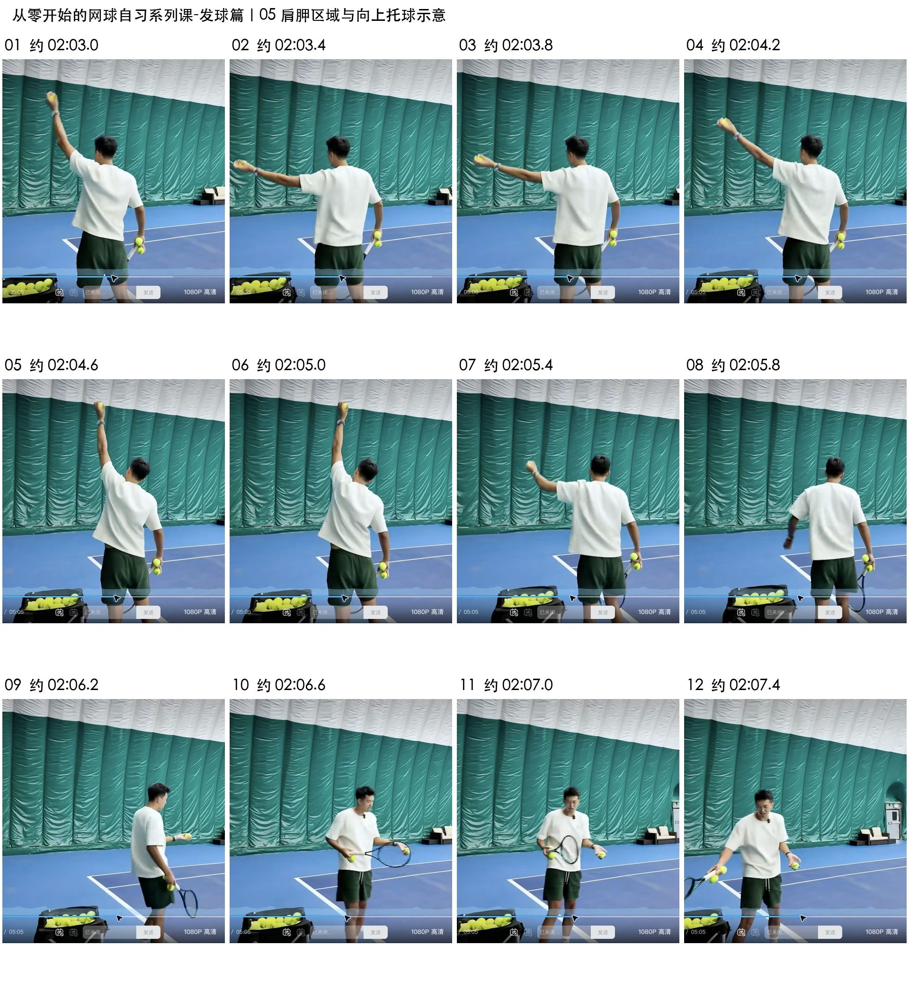

### 02:27–02:55｜先正面对网，建立向上发的感觉

接着进入上手发球的简化练习。叶修允许入门时先用半西方式或东方式等容易找到拍面的握法，身体先较正地面对目标，抬大臂、再让小臂参与，轻抛后向上击球。

他在这一段反复强调向上送，避免主动向下摁，并把向下摁与小臂、手腕不舒服联系起来。这是课中的教学解释；本节记录的是这一步的练习顺序和动作口令。

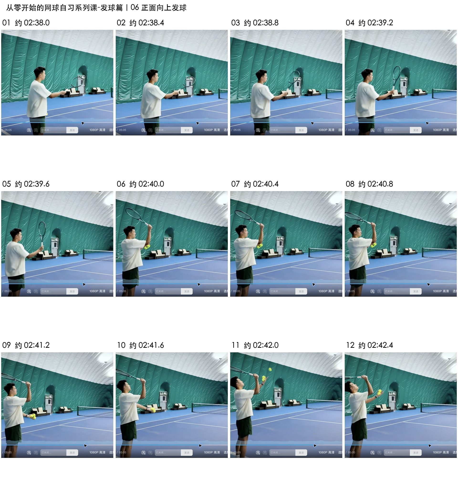

### 02:55–03:25｜逐步侧身，同时改变握拍

在正面能向上发出的基础上，身体向右转一点，握拍也相应向左调整，继续用同样的向上挥拍感觉。叶修示范此时球开始带一些旋转。再从斜侧逐步变成更充分的侧身，握拍逐渐回到大陆式。整个过渡过程中，他一直要求保留向上送出的动作，不要因为站位变了就改成往下压。

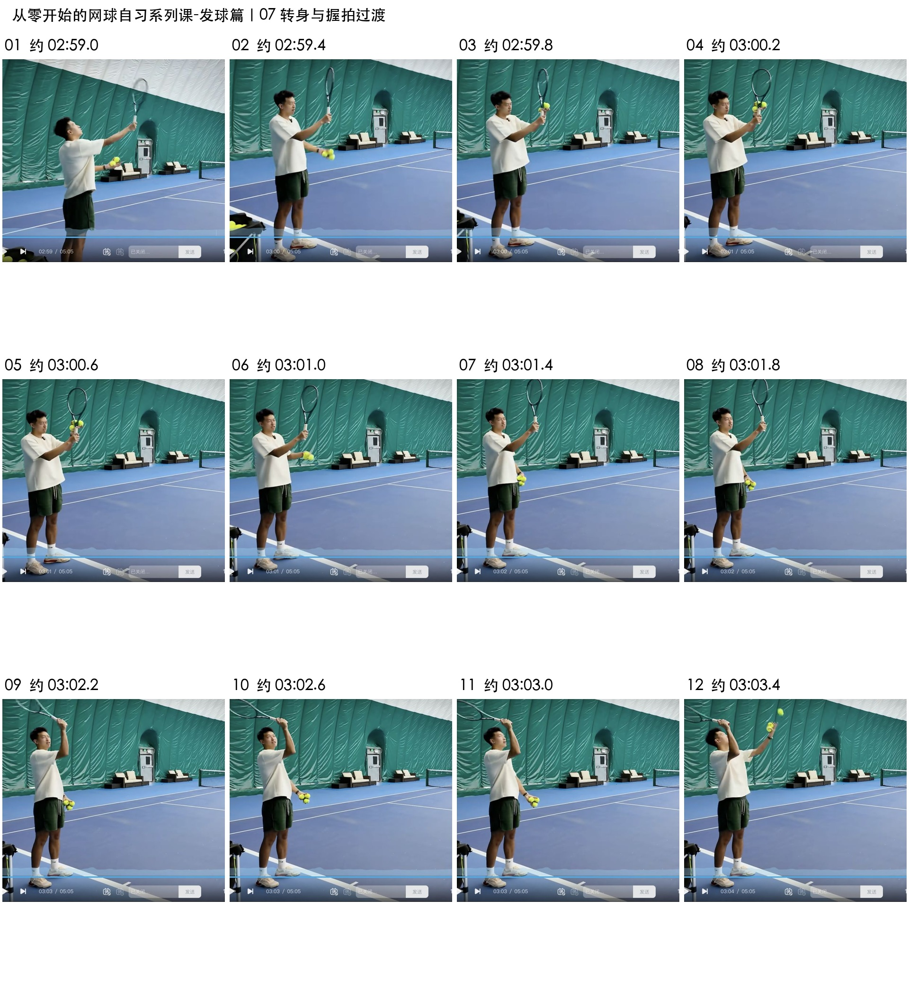

### 03:25–03:36｜困难时，先把大臂架好

如果从低处连起来还难，可以先把大臂抬到准备位置，再抛球、向上击球。叶修特别区分抬大臂与只把手晃起来。先简化准备过程，完成向上发出的动作，再逐步连贯。

### 03:36–04:10｜背后观察发球弧线和反弹

镜头换到背后，叶修用球飞行及落地后的表现说明这组练习的目标。他指出示范中球的后续弹跳能延伸到较深的位置；相反，初学者若把球向下摁，容易发成又短又低的球，给接球者直接进攻的机会。这里的评价围绕弧线、反弹和对方是否容易处理，而非只看发球动作外形。

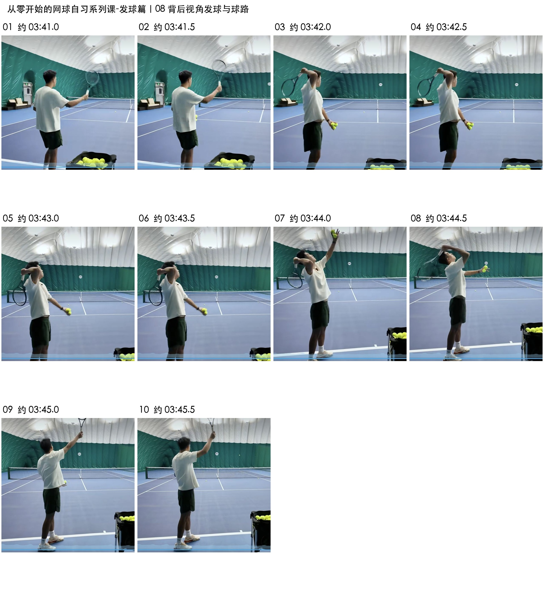

### 04:10–04:36｜向侧上旋方向过渡

保持前面向上发的基础，再把挥拍方向从最高处稍向右侧调整。叶修要求改变方向时仍保留球的反弹，不要在后段又加一次向下摁。其口令仍是向上离开，通过这一变化逐步做出侧上旋发球。

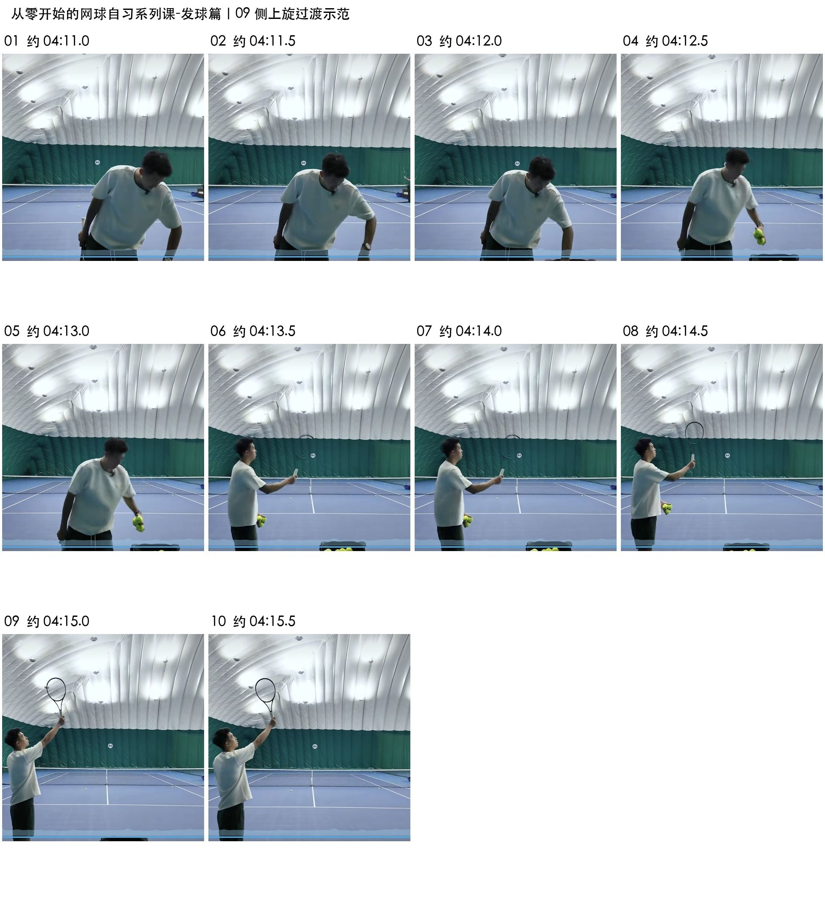

### 04:36–05:05｜发出去以后，手臂怎样收回

最后讲动作结束：不要在发出后主动把手臂直直拍落。叶修以大臂外旋回来描述收回和减速的过程，并连续示范向上挥出、再收回的路线。讲解中也保持身体朝前、较直立的展示姿势。下面两组分别保留向上挥拍的示范，以及后面从准备、抛球到挥拍收回的连续画面。

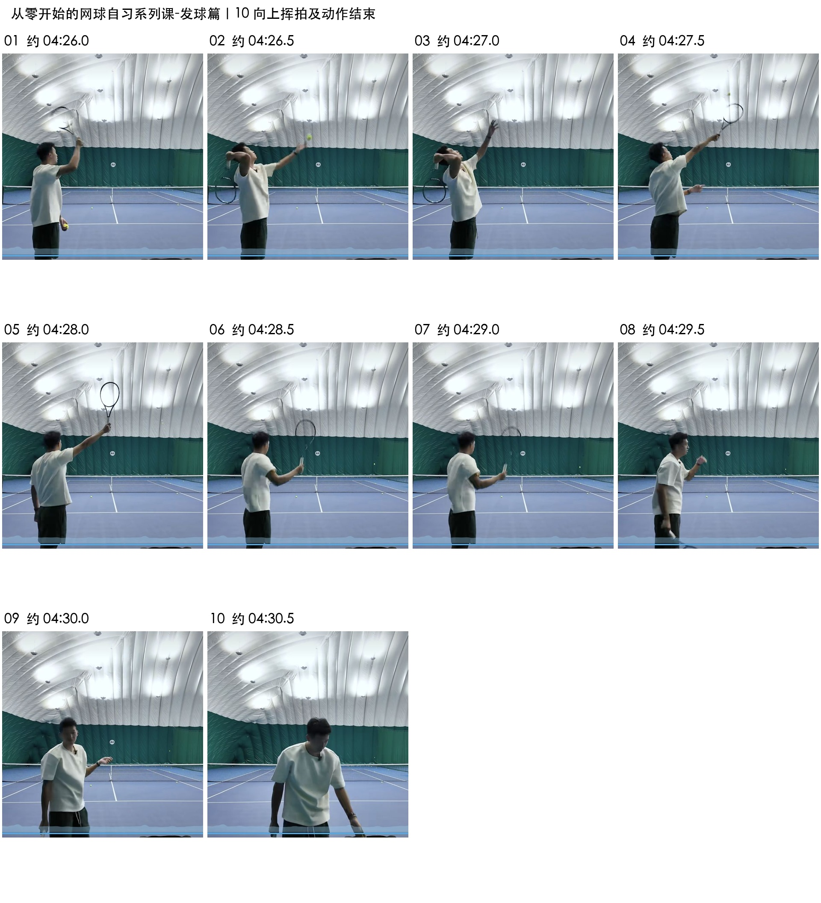

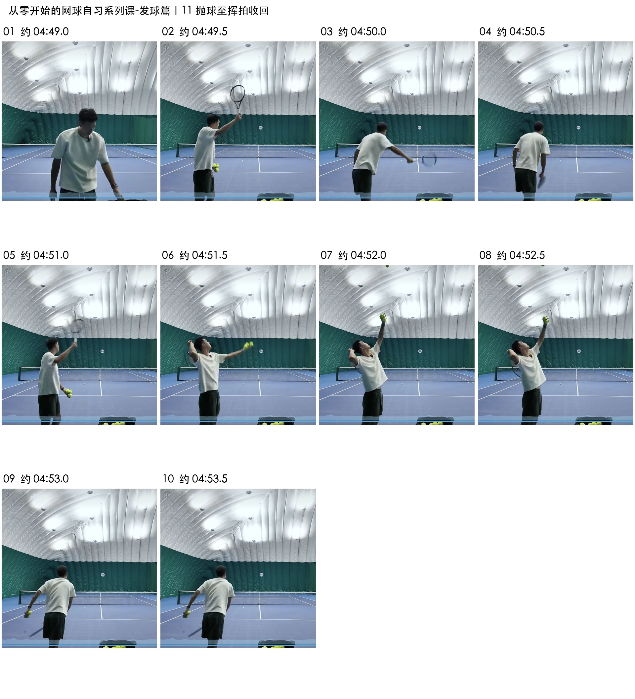
