# 从零开始的网球自习系列课-各种反手球的处理办法（要学会灵活变通哦）

[Bilibili 原课](https://www.bilibili.com/video/BV1MCYdzTEMe/) · 叶修鸽哥 · 合集第 25/35 集 · 时长 08:21 · 整理日期 2026-11-06

## 课程总结

本课按来球距离、高度和到位时间选择反手处理。先从普通回球和远球扩大覆盖，再比较后退等球下降、上前抢上升期和起跳处理高球，最后把选择带入多球及回合练习。

## 技术总结

- 普通与较远来球以能完成回球和回位为目标。
- 要主动加速时先把落脚调准确，低球适当降低身体。
- 高球有时间退时退够，重新建立击球空间后等球下降。
- 抢上升期要先到位，球已升高时再根据条件选择起跳等办法。
- 高球处理保留向前击球空间，避免只抬拍头向下摁。

## 训练路线

1. 用普通和较远反手喂球练回击与回位，再加低球和移动球。
2. 分别练后退处理和上前抢点，比较各自需要的空间和时间。
3. 在多球练习中加入高球变化，再放入回合，根据每球条件选择。

## 常见问题与调整

| 情况 | 调整方式 |
|---|---|
| 后退后仍被高球顶住 | 退到有足够击球空间的位置，再等球下降。 |
| 想抢上升期但到位已经晚了 | 根据当时的高度和站位另选处理方式。 |

## 按时间顺序的课程记录

### 00:00—00:24：先判断选择是否合理

很多反手失误涉及来球处理的选择，不应一失误就归因于技术。技术要学，但录像复盘还应看当时为什么上前、后退、等球或进攻，所选方案是否适合那一球。本集重点是把已有动作放到不同来球中灵活使用。

### 00:24—00:51：普通来球与远球——能打到，也能回来

先用此前“四件套”的普通反手处理。讲师让同伴逐渐把球喂远，说明这套移动与击球衔接要扩大击球覆盖范围、增加容错；远处打完仍能回位，才算把处理做完。前三组分别是普通回击、第二次普通回击和更远来球的一次移动回击。

**动作 01：普通来球：移动后回击｜00:27.600—00:30.500｜9 帧**

**动作 02：普通来球：第二次回击｜00:33.000—00:35.600｜9 帧**

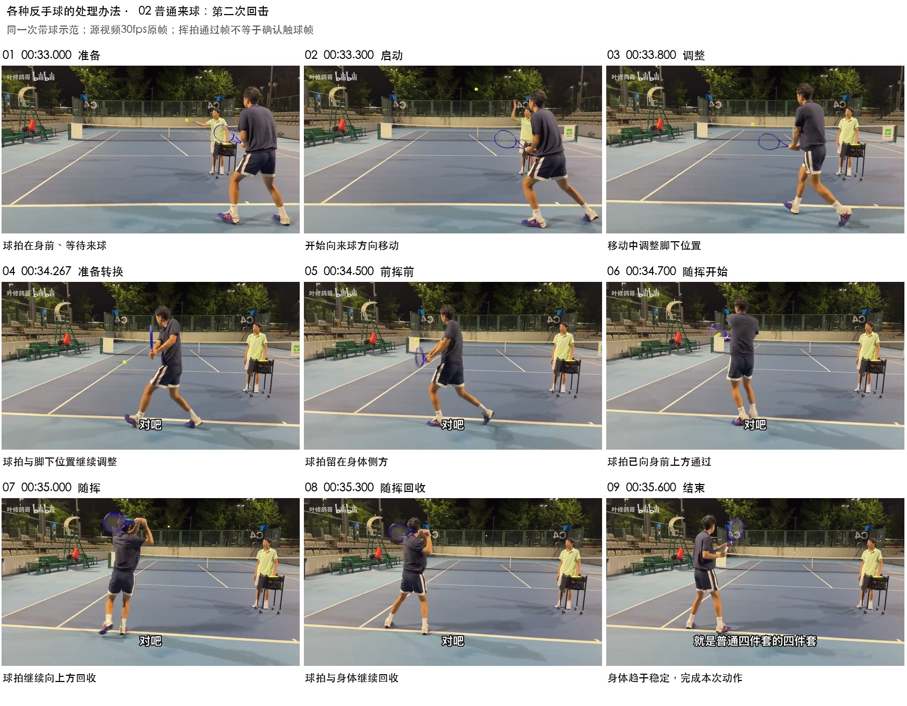

**动作 03：远球：扩大移动范围并回位｜00:45.400—00:49.000｜9 帧**

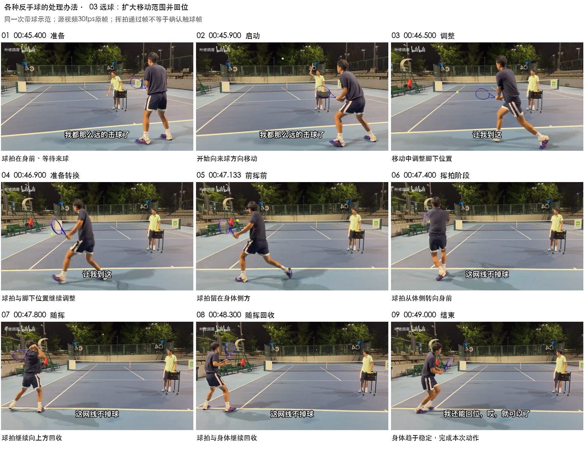

远球组要连着看：起动时与球仍有距离，连续移动接近，跨步接挥拍，随挥后重新调整支撑并回向准备位置。

### 00:51—01:26：想加速进攻，落脚就要更准确

讲师把反手相对舒服的击球区域描述为髋到胸之间；到肩、腋附近会更难。他不是要求所有球都硬抬到高点打，而是让脚下把人和球的关系安排好。

如果普通处理之外还想进攻、加速，他提出从普通“三步”衔接改为“四步”，口令为“左、右、左、右”，最后右脚要迈到合适位置。增加这一步同时提高了落脚准确性的要求，不是机械地多倒一步；即使需要跑动，也要把跑动接到最后击球这一步。

**动作 04：进攻步法：四步接击球｜01:21.400—01:24.300｜9 帧**

### 01:26—01:41：低球降低身体，稍高球仍找舒服击球区

低球示范中，讲师先接近来球，再屈膝降低身体后回击。他紧接着要求稍高来球，用来说明自己所说的舒适区域上界约在胸部附近。

**动作 05：低球：降低身体后回击｜01:31.000—01:34.000｜9 帧**

**动作 06：稍高来球：胸部附近击球区示范｜01:36.500—01:39.700｜9 帧**

### 01:41—02:23：移动击球要稳，别让后脚急着追过去

练习初期击球时先别急着跟后脚，用支撑与蹬的感觉保持人稳，击球后再出来、再回收。他希望移动更直接地奔向球，减少最后因为不敢上、距离跑不准而让球从身边错过的情况。

01:49—01:53 的带球示范可见：接近、较低位置挥拍，随后上方收拍，后腿离地并重新调整支撑。后面的约 02:03—02:07 为“不打”的跑位练习，约 02:11—02:15 故意演示跑不准、球从身边经过的情况。

**动作 07：移动击球：击球后的平衡与回收｜01:49.500—01:53.000｜9 帧**

### 02:23—03:16：高球先看能否改变人与球的位置

转入反手高球时，讲师仍沿用髋到胸的舒适区思路，反对只因为球高就一味把动作抬到肩以上硬处理。他提到还有切削选择，但本段继续讲此前的反手处理路线，没有展开切削技术。

这里多次纠正喂球：希望球落地后有向前的弹跳，不是原地向上抛，同时给击球者留出后退处理的空间。下图为这一段的喂球试打。

**动作 08：高球喂球试打｜02:54.300—02:57.000｜9 帧**

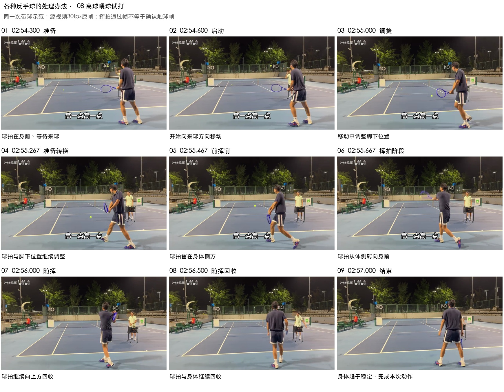

### 03:16—04:20：选择后退，就退够、等球下降

两次回击后，讲师说明自己会往后调一点，希望球仍落在胸与髋之间。如果已经选择后退，就把空间放得更舒展，不要一边决定退、一边又急着挤在高点出手。

**动作 09：高球：调整位置后回击｜03:16.700—03:19.700｜9 帧**

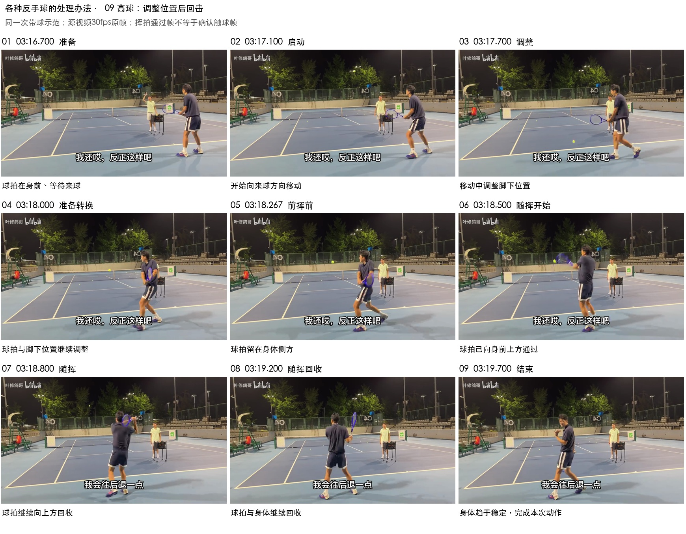

**动作 10：高球：再次后调位置｜03:24.500—03:27.500｜9 帧**

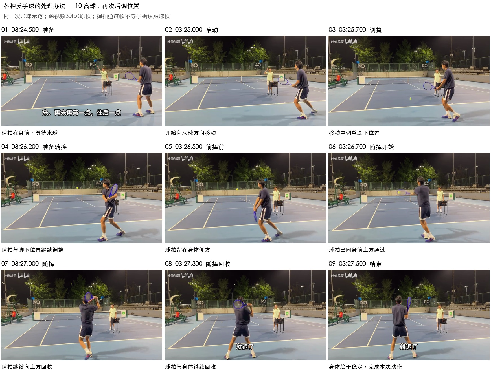

03:32—04:00 仍有较长的喂球沟通：要求落地后向前弹、有足够深度与力度。这个过程说明练习来球条件，但不是每一球都形成有效击球演示。

04:00 后的两次示范更清楚地展示：移动调整位置，等球落到可处理的高度再打。来球更深、更高时继续后调。讲师强调“别太着急”，回球可以稍高、稍慢，为自己争取回位时间。

**动作 11：后退等待：让球落入击球区｜04:01.500—04:04.733｜9 帧**

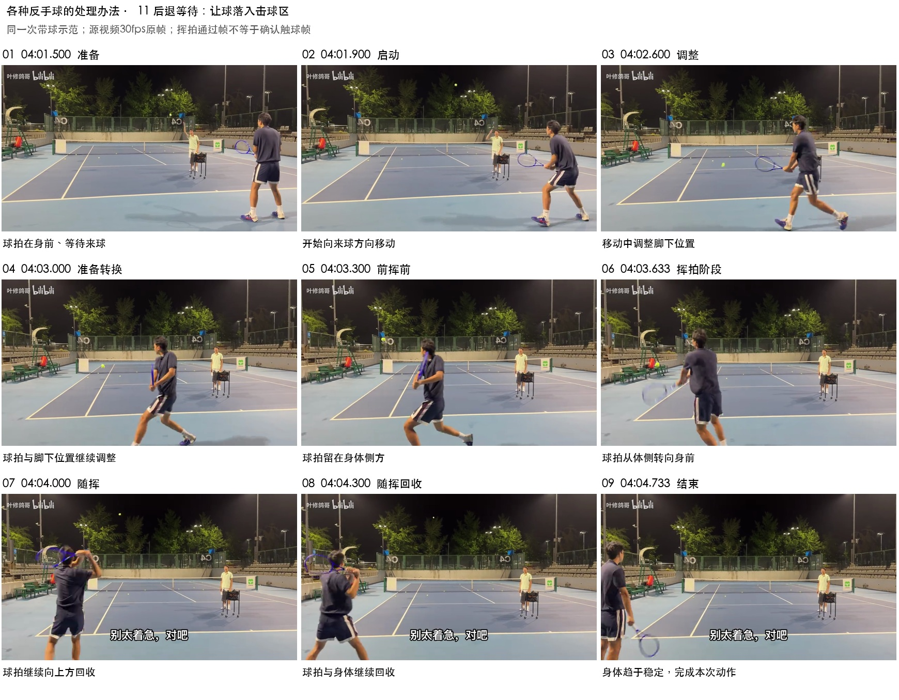

**动作 12：更深高球：继续后调再回击｜04:09.700—04:13.500｜9 帧**

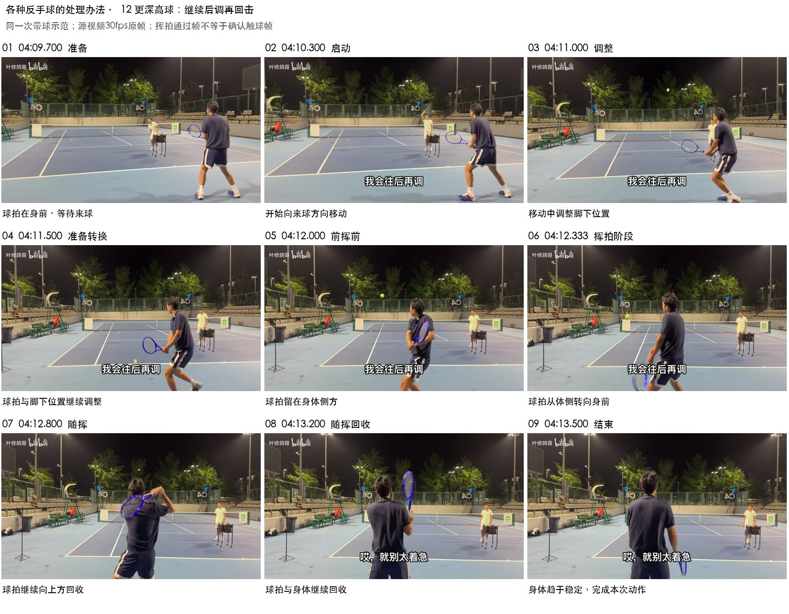

### 04:20—04:35：后退处理的代价

上述办法较保守，适合 2.5～3.0 阶段；水平更高时，对手可能趁你后退上前截击施压。课程由此引出另一种选择：上前抢球。

### 04:35—05:09：上前抢上升期，关键是到位时机

讲师要求直接奔向球，在弹起上升的阶段赶到，让球仍处在自己能处理的髋胸区域。他强调难点是对击球区域的感受和来球判断，而不是只把手挥快。第一次完成示范之后，下一球喂得不够高、未完成预期示范，随后重试。

**动作 13：上前抢点：第一次回击｜04:46.300—04:48.500｜9 帧**

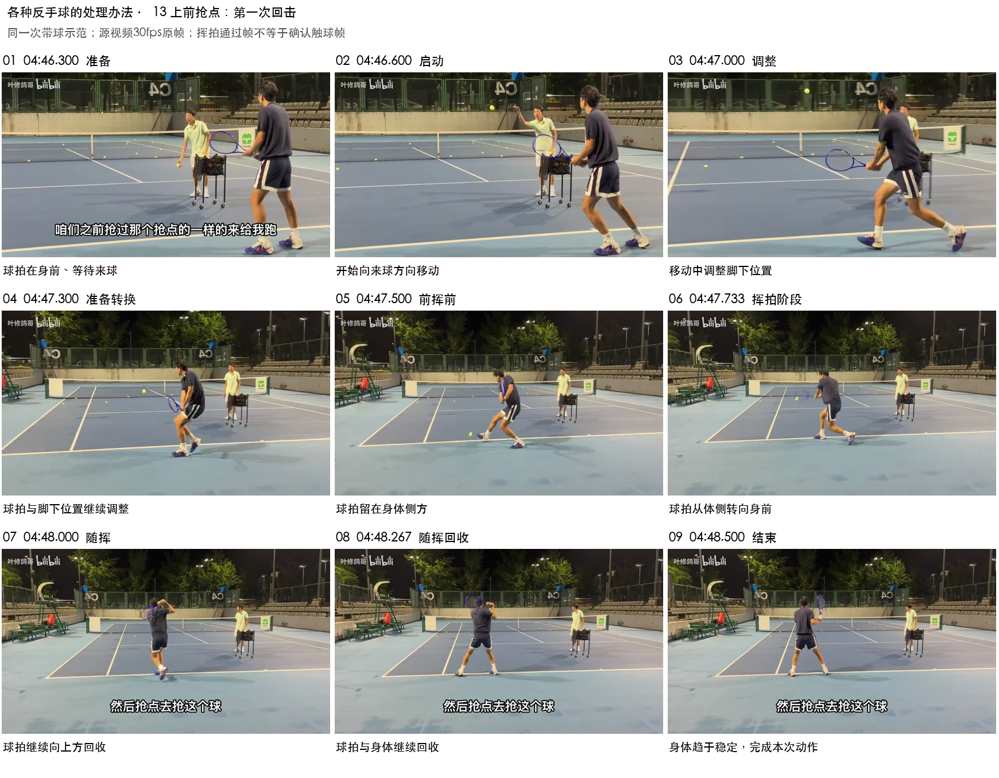

**动作 14：上前抢点：再次回击｜04:59.800—05:02.500｜9 帧**

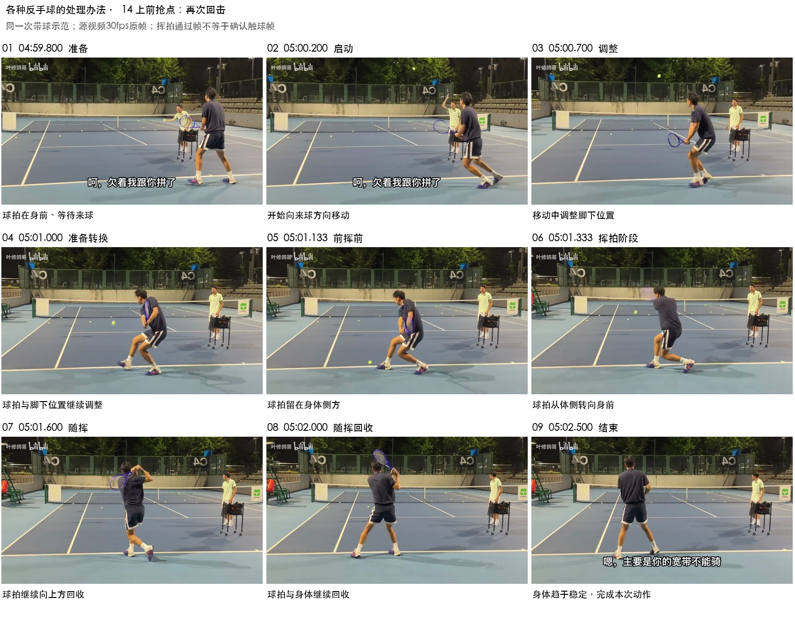

约 05:02—05:08，以降低身体的空挥和姿态对照说明抢点时的位置。

### 05:09—06:13：原本想抢点，球已升高又不想退怎么办

实际回合涉及回位和不同落点，不能期待对手每球都落在同一个地方。讲师举例：本来想抢，但到位时球已经起来，自己又不想退，这时可以考虑起跳反手。

他把起跳说成支撑步的延伸：原先向前走的一步，转为把身体蹬起来。口令重点是“先跳”，随后在空中找球，不要把“挥拍同时才开始跳”当作目标。此时不宜过分追求球质，先避免被一路压退，4.0 以下业余对局把球稳稳送回对方反手通常就够用。

### 06:13—06:58：六次起跳反手，分开看进场到落地

第一组展示从等待、移动、侧转与支撑，到身体上移、空中挥拍、随挥和落地回收的完整顺序。

**动作 15：起跳反手：进场、蹬起、空中挥拍与落地｜06:14.800—06:17.800｜12 帧**

讲师随后说明挥拍与另一条腿的动作需要平衡，并在下一次示范强调“踩在右脚”“右脚再跳”。

**动作 16：起跳反手：右脚支撑后的重复示范｜06:27.800—06:30.600｜12 帧**

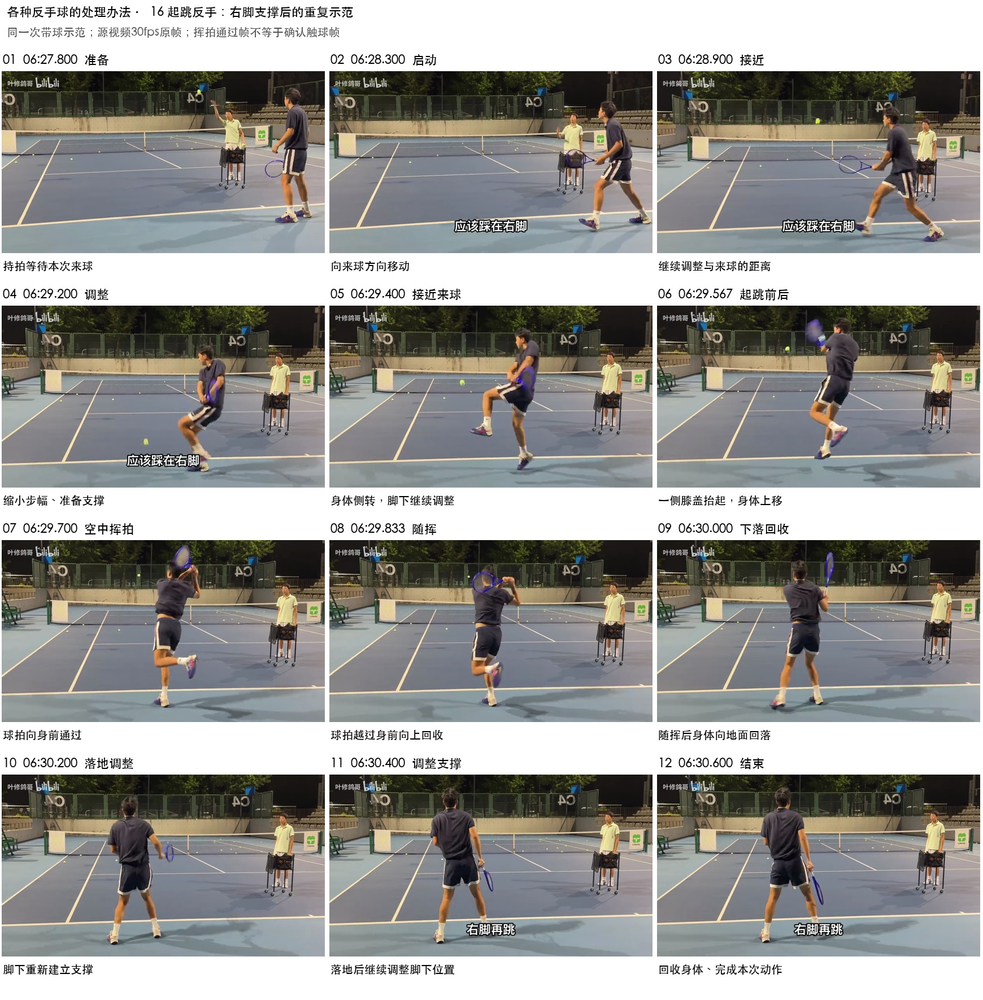

再把球喂远：先增加移动，再衔接同一套起跳处理。

**动作 17：起跳反手：较远来球｜06:33.700—06:37.200｜12 帧**

较浅来球也需要根据实际距离提前调整，不照搬远球的进场距离，随后继续两次起跳重复示范。

**动作 18：起跳反手：较浅来球｜06:41.700—06:44.500｜12 帧**

**动作 19：起跳反手：连续练习中的单次动作一｜06:48.000—06:50.600｜12 帧**

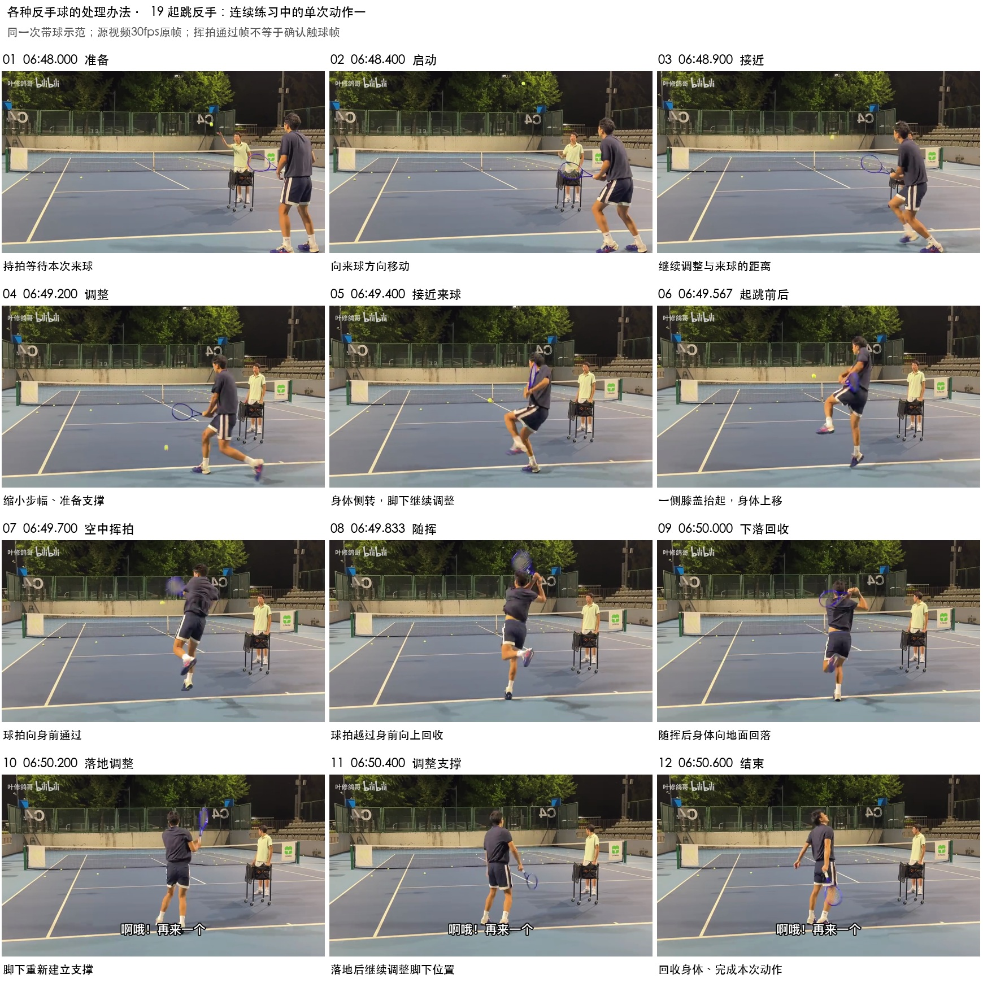

**动作 20：起跳反手：连续练习中的单次动作二｜06:53.700—06:56.500｜12 帧**

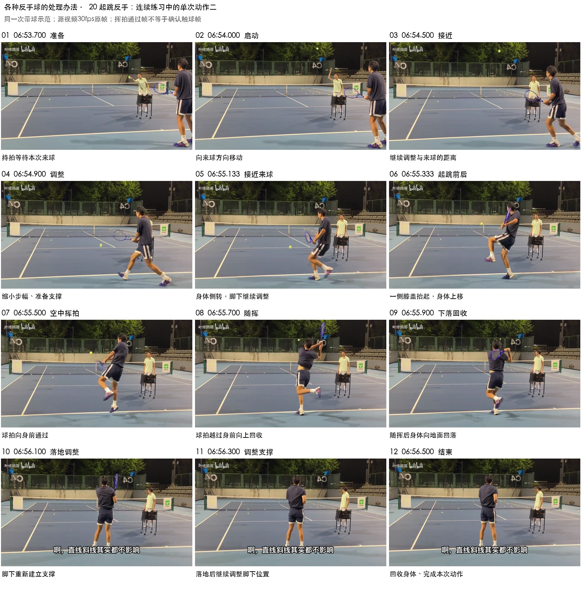

讲师最后说直线、斜线的起跳时机和支撑原则是相通的。

### 06:58—07:42：高球别只抬拍头向下摁；转为单手示范

讲师转而提到单反学习者常见的高球处理：想把拍头抬起来，再向下摁。他给出“最好别让拍头高过手腕”的口令，提醒避免向下压拍；即使球到较高位置，也要向外挥出。

以下画面可见单手持拍臂向前挥出，另一臂分离，故与前面双反单列。第一组是高位回击，第二组是起跳后的单手回击，第三组为再次示范。他反复强调“平着出去”“别摁你的拍”。

**动作 21：单反高位回击：向外挥出的示范｜07:19.200—07:22.000｜9 帧**

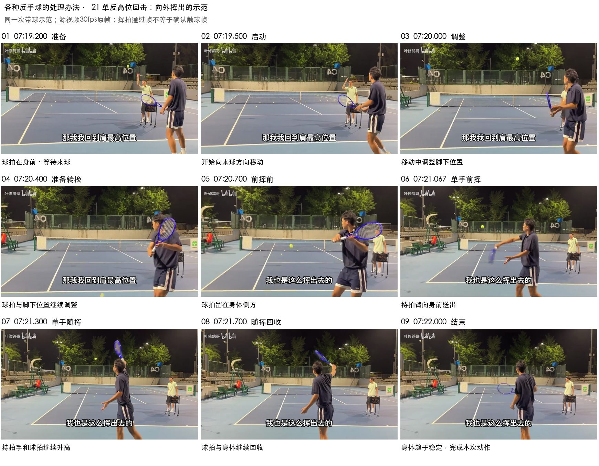

**动作 22：单反高位回击：起跳后的挥拍｜07:31.200—07:33.900｜12 帧**

**动作 23：单反高位回击：再次示范｜07:37.200—07:39.700｜9 帧**

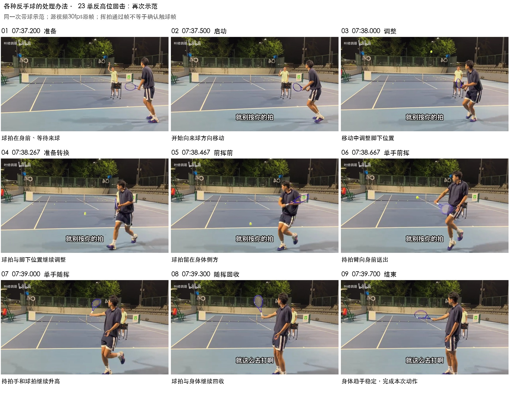

### 07:42—08:21：把多球练习接到回合与比赛

多球练熟后，让同伴从球网另一边喂球，再接实战组合、回合和比赛，重点是敢于用这些选择。最后以“想变强还是想赢”作对比：如果当下只求少失误，可以保守推回去；若练习目标是进步、主动施压，就要尝试更多组合与进攻处理。

下图为他演示“推”时的保守回球示例（仍带有完整侧转与高位随挥）。

**动作 24：保守回球：以稳定回去为例｜08:03.500—08:06.500｜9 帧**

