# 从零开始的网球自习系列课-四力四件套比赛应用和下旋正手篇

[Bilibili 原课](https://www.bilibili.com/video/BV1rddeBMEQi/) · 叶修鸽哥 · 合集第 35/35 集 · 时长 10:52 · 整理日期 2026-11-09 · 发布日期 2026-04-17

## 课程总结

本课先把四力四件套放入相持和移动击球，再通过碰球停练习控制短球，逐步从小场推进到底线抢节奏。后半段转入跑动击球，练习用步频启动、自然摆臂、迈步接引拍，并把相同的移动原则用于双手反手和单手切削。最后回到正手，练习抬大臂的短幅度处理及下旋变化；其中前一阶段动作外形像下旋，但课程说明该练法仍以打出上旋为主。

## 技术总结

- 相持时放慢移出节奏，击球后尽快回到中间准备区域，为下一拍缩短移动距离。
- 碰球停练习以轻碰后停止挥拍为目标，正手和反手都先在近距离完成。
- 向前抢节奏时，先把注意力放在脚步和到位上，手上动作可缩短为碰球处理。
- 由小场中路开始练短处理，再扩大落点；熟悉后移到底线练向前抢拍。
- 跑动击球时让手臂自然摆动，启动先增加步频，再接制动和击球；迈步与持拍臂后摆可以连成正手准备。
- 双手反手跑动时，让手臂摆动与身体转动配合；单手处理可在移动后接反手切削。
- 碰球停时避免翻腕擦球。抬大臂练习先从身前抬起、拍面朝上的短动作开始，再按需要接紧凑收拍。
- 区分两种正手变化：抬大臂、拍面朝上的练法用于形成类似下旋的动作感觉，课程称其球路仍为上旋；后续再加入向左带拍和大臂外旋，尝试带下旋与侧旋。

## 训练路线

1. **相持节奏与回位**：从能从容完成的移动速度开始，打完尽快回到中间区域，准备下一拍。
2. **正反手碰球停**：在近距离喂球下轻碰后停住，控制球轻而浅地越网；若挥拍继续向上，减小动作重新练习停拍。
3. **小场抢节奏**：从中路开始，移动到位后用正反手短幅度处理；能控制后再把落点向两侧展开，可采用固定线路或随机喂球。
4. **底线向前抢拍**：协助者正常回球，练习者主动向前接近来球。先将第一拍打到合适落点，再练跟进和下一拍衔接。
5. **跑动击球与摆臂**：先练步频启动和自然摆臂，再连接迈步、持拍臂后摆与正手引拍；双手反手练身体转动配合，单手则接移动切削。
6. **正手抬臂及旋转变化**：先练拍面朝上的抬臂和短击球，再练抬臂后的紧凑收拍；熟悉后尝试课程末段的下旋、侧旋变化。

## 常见问题与调整

| 情况 | 调整方式 |
|---|---|
| 移出时急跑、到球时又急着挥拍 | 降低移出节奏，完成击球后加快回位，先把每拍处理完整。 |
| 碰球停时球拍仍继续向上挥 | 缩短动作，在近距离重新练习轻碰后停住。 |
| 向前抢节奏时站在后场只加大力量 | 先练脚步向前到位，手上动作缩短为碰球处理。 |
| 跑动时一直举着球拍，摆臂受限 | 放松持拍臂，练自然摆臂和步频启动，再连接引拍。 |
| 正手准备时额外做很大幅度的拉拍 | 练迈步与持拍臂后摆衔接，缩短多余的拉拍幅度。 |
| 双反跑动时只摆手臂，身体没有跟上 | 降低移动速度，练手臂摆动与身体转动配合后再接球。 |
| 碰球停时翻腕擦球 | 回到轻碰练习，稳定拍头方向并完成碰球下方的短处理。 |
| 将抬臂式正手直接当成下旋球 | 先按课程区分练习阶段：抬臂短处理是上旋练法，再练后段加入的下旋变化。 |

## 按时间顺序的课程记录

### 00:00–00:34｜把已有动作放进相持

本课承接四力与四件套，转入比赛相持应用。比赛中需要稳定地与对手多拍相持；如果每拍都急于发力进攻，容易先因失误丢分。

先用四件套，以从容完成击球的移动节奏处理来球，让动作与球的到达时间匹配。

### 00:34–00:54｜急跑急打的对照

比赛中容易既着急跑，又着急打，跑到哪里就赶着挥到哪里。本段用一次跑动正手呈现这种状态，随后转为每拍先处理完整，不因着急主动送分。

**动作 01：急跑急打的对照｜实球错误对照｜00:40.000–00:42.200｜15 帧**

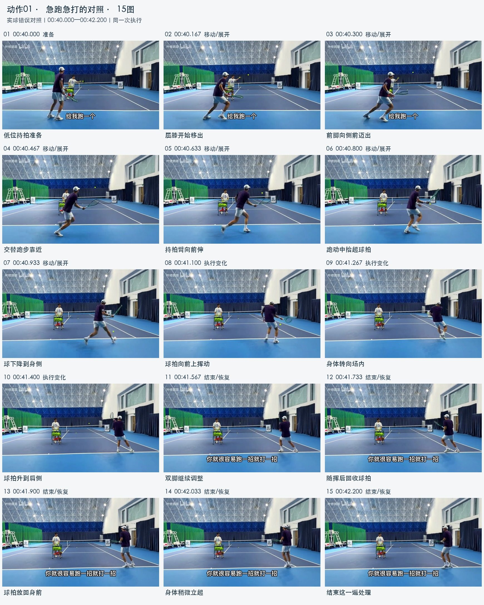

### 00:54–01:46｜慢移出、快回位，从中间准备下一球

最简单的比赛应用是从容移动到球旁，击球后尽快回到准备区域，再从中间位置启动，以减少下一球需要覆盖的距离。移动练习沿用同侧脚两步到球的四件套口令。

从同伴抛正手开始，练习移出、回球并马上回中间；随后加入正反手对拉，区分从容移出与快速回位。动作图保留一遍完整正手移出回位，以及一遍反手回球后回位。

**动作 02：正手慢移出、快回位｜实球节奏练习｜01:06.300–01:09.800｜15 帧**

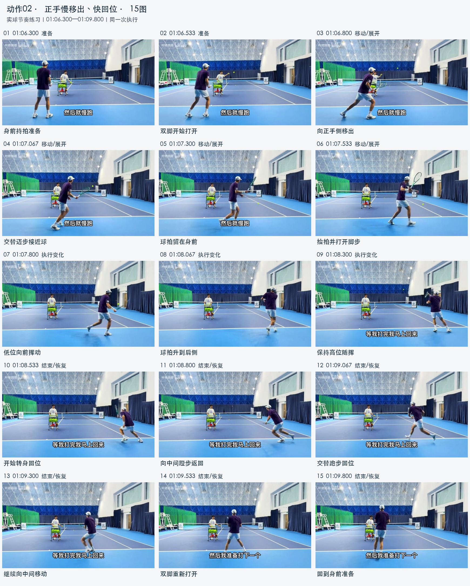

**动作 03：反手回球后回位｜实球节奏练习｜01:17.000–01:19.600｜15 帧**

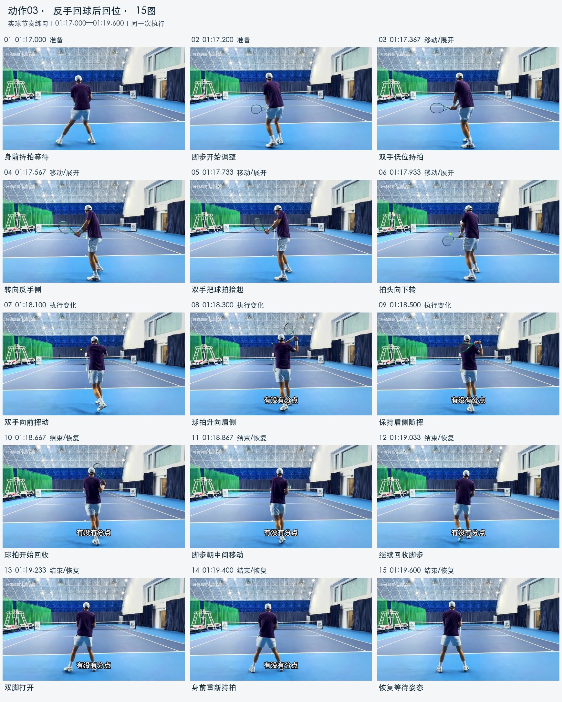

### 01:46–02:16｜进小场前，先检查碰球停

练习转到前场，开始前先检查四力中的碰球停。随后调整抛球位置和拍摄方向。

### 02:16–02:40｜正手真停住，主动控制力量

正手练习以轻碰后停住为目标，让球轻、浅地越网。球拍若碰球后仍继续向上挥，就没有完成这项停拍练习。

用主动控制的力量完成轻碰，不额外蹭球或动手腕。一次击球没有打准后重新抛球再做。动作图保留一遍短幅度轻碰和一遍碰球后继续挥出的对照。

**动作 04：正手轻碰后停住｜近距离喂球｜02:18.000–02:20.100｜15 帧**

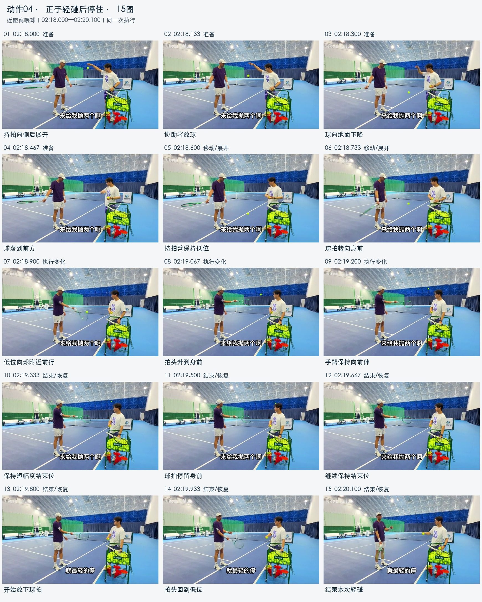

**动作 05：说停却继续挥出的对照｜实球错误对照｜02:21.500–02:23.400｜15 帧**

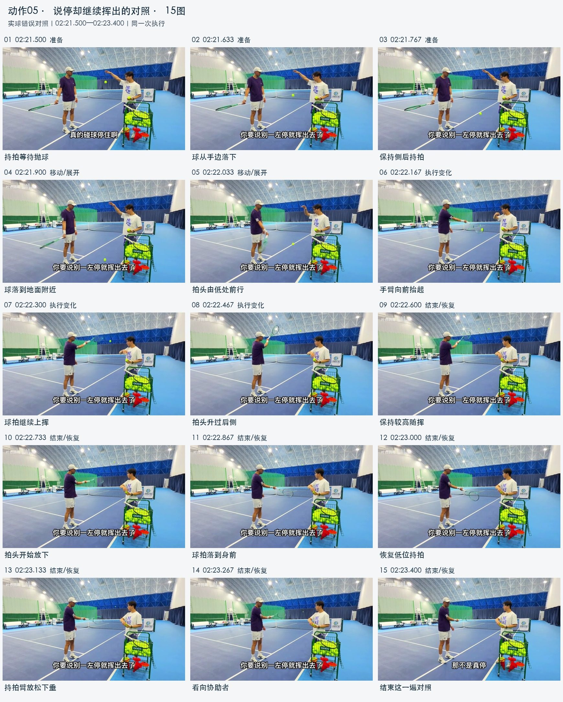

### 02:40–03:00｜反手同样碰球停

换到反手侧继续近距离抛球，练习轻碰后停住，不把短处理变成大随挥。正手和反手都要能完成轻碰控制。

保留一次反手实球执行；约02:46、02:50及后续相同喂球合并。

**动作 06：反手轻碰后停住｜近距离喂球｜02:53.000–02:55.000｜15 帧**

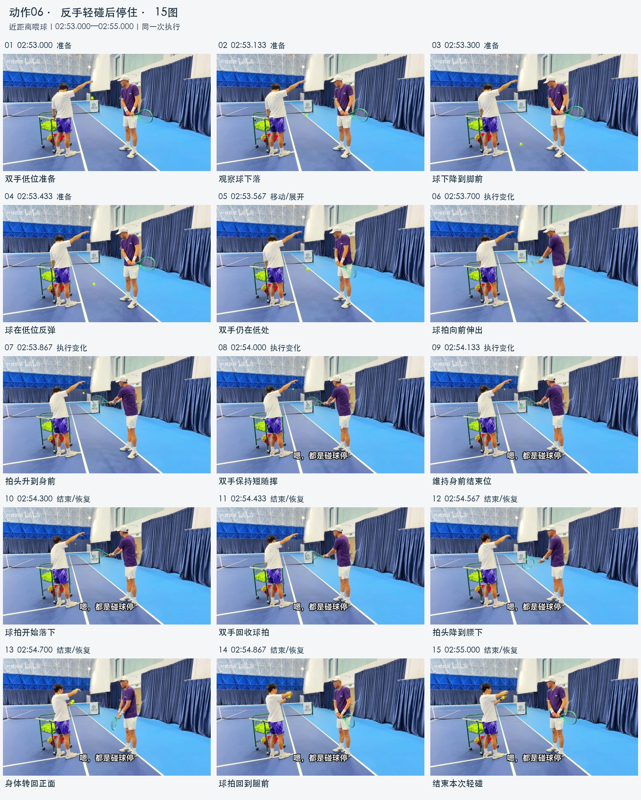

### 03:00–03:31｜向前抢节奏，重点先放在脚

从后场相持转向向前抢节奏时，不必每次都完成完整的大动作。先向前移动到球附近；一直站在后面加大力量，不能替代提前到位。

练习时把主要注意力放在脚步上，先敢于向前移动；手上可以只做碰球处理。课程用“八成注意力放在脚上”提示练习重点。

### 03:31–04:10｜从小场中路开始，正反手只碰

两人在小场先打中路，移动到位后用正反手短幅度碰球，练习控制落点并利用来球力量，不因担心过不了网就额外加大动作。

中路能连续处理后，再把落点向两边展开。此时仍在小场练习。动作图分别保留正手和反手各一次短处理。

**动作 07：小场正手短幅度处理｜小场对拉｜03:48.200–03:50.100｜15 帧**

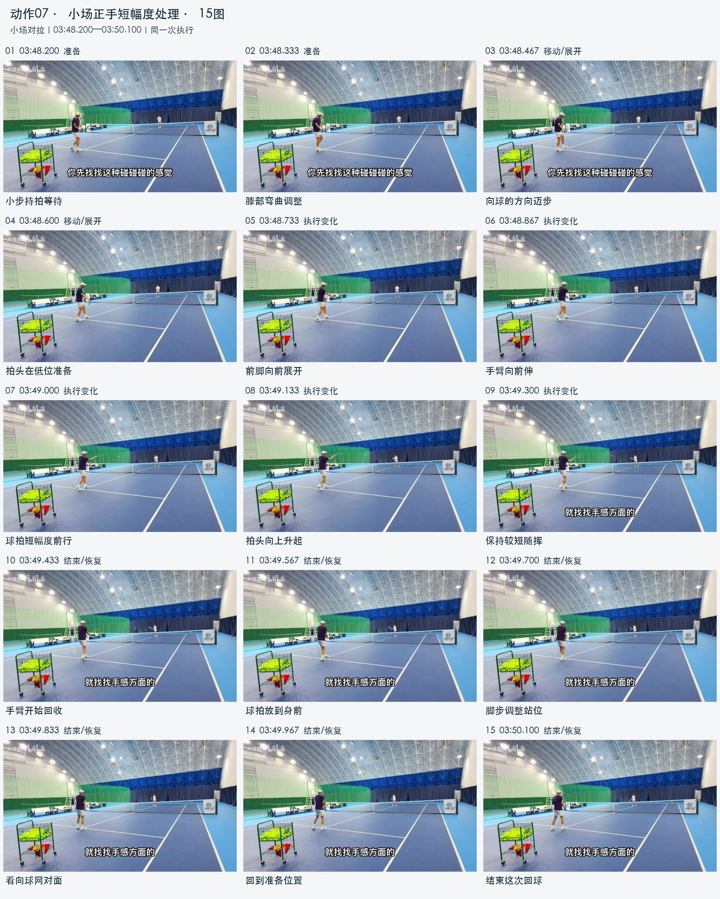

**动作 08：小场反手短幅度处理｜小场对拉｜03:51.000–03:53.400｜15 帧**

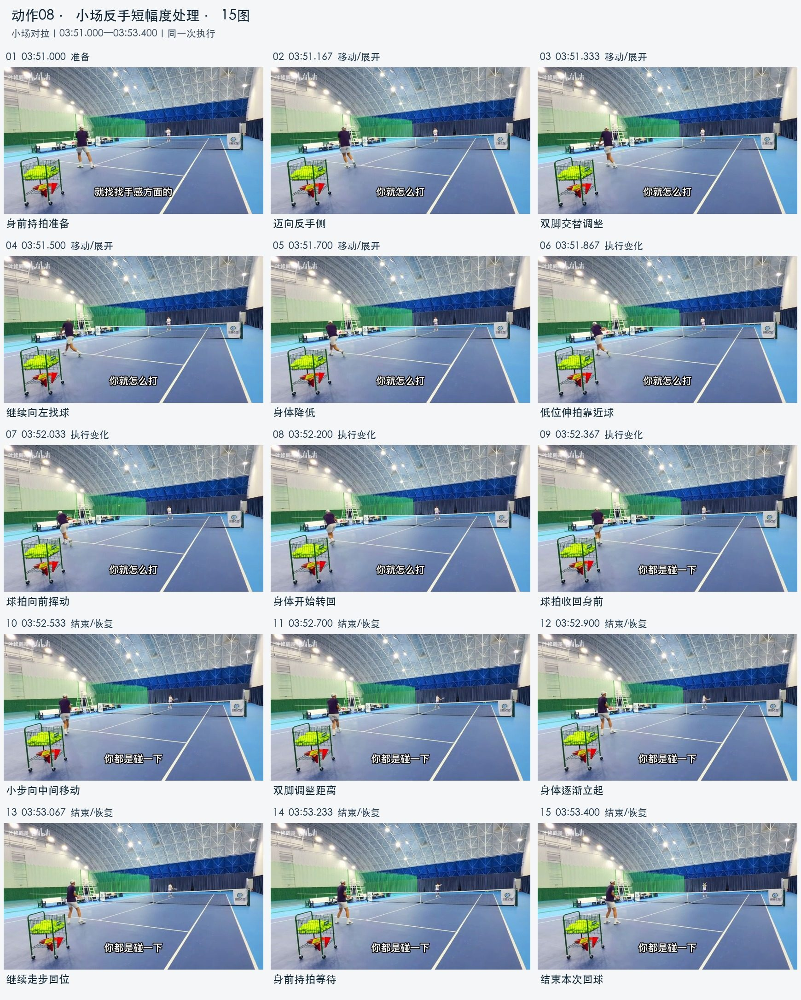

### 04:10–04:54｜固定路线也可练，本段继续随机

可以一人打斜线、一人打直线练固定路线；本段继续随机改变落点，把注意力放在脚步和不同来球的处理上。

对拉中一次回球没有接续好后重新开始，随后继续在小场左右调整并处理较深来球。

### 04:54–05:50｜移到底线，练向前抢拍

小场练习完成后移到底线，练习方式可以是双方互相抢节奏，也可以一人正常回球、一人向前抢。本段由协助者正常回球，持拍者主动向前处理；镜头从后方记录。

正手练习向侧前方接近来球，反手击球后继续向前。重点是主动把脚步带向来球，不一味留在后场加力。动作图分别保留正反手代表。

**动作 09：底线正手向前抢节奏｜对拉推进｜05:25.500–05:28.000｜15 帧**

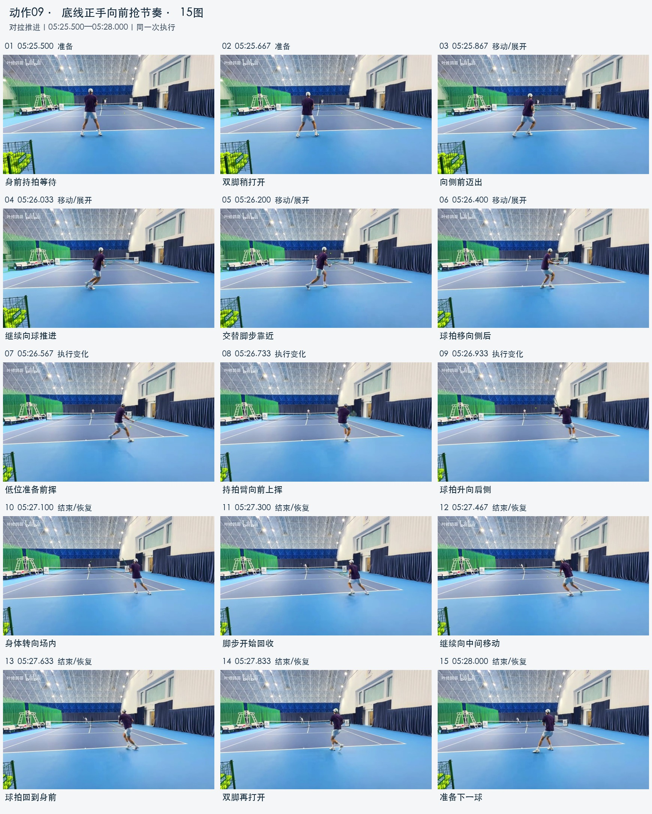

**动作 10：底线反手向前抢节奏｜对拉推进｜05:44.300–05:46.100｜15 帧**

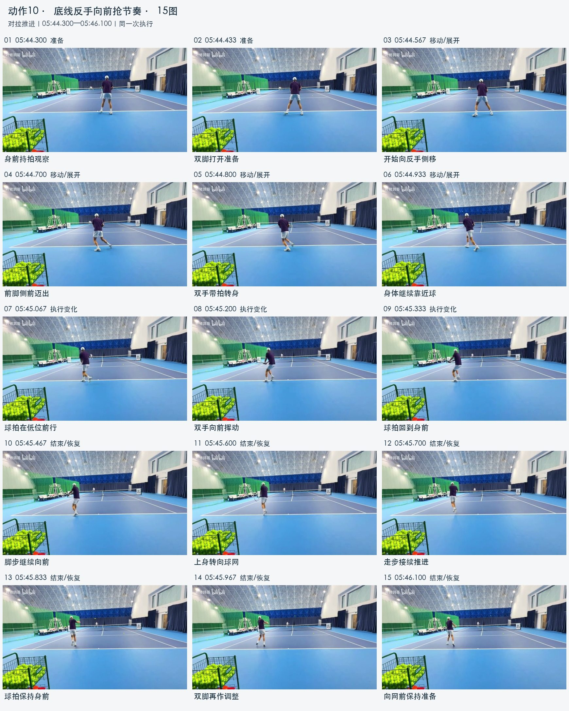

### 05:50–06:48｜第一拍做落点，再练后续衔接

第一拍先处理到合适落点，再练后续衔接与跟进，不急于一拍直接得分。推进对拉中继续练习向前处理后的跟进。

站位越靠前，出手时间越短，因此要缩短动作。随后准备跑动击球练习。

### 06:48–07:19｜跑起来时，不要一直把手举着

跑动击球时，如果注意力一直留在手和球拍上，既难抢节奏，也不利于跑动。课程以职业选手大范围移动时的自然摆臂作口头类比。

先演示举着球拍跑动击球，再加入自然摆臂并提高启动步频。动作图记录举拍跑动的对照。

**动作 11：举着球拍跑的对照｜实球错误对照｜07:10.100–07:13.100｜15 帧**

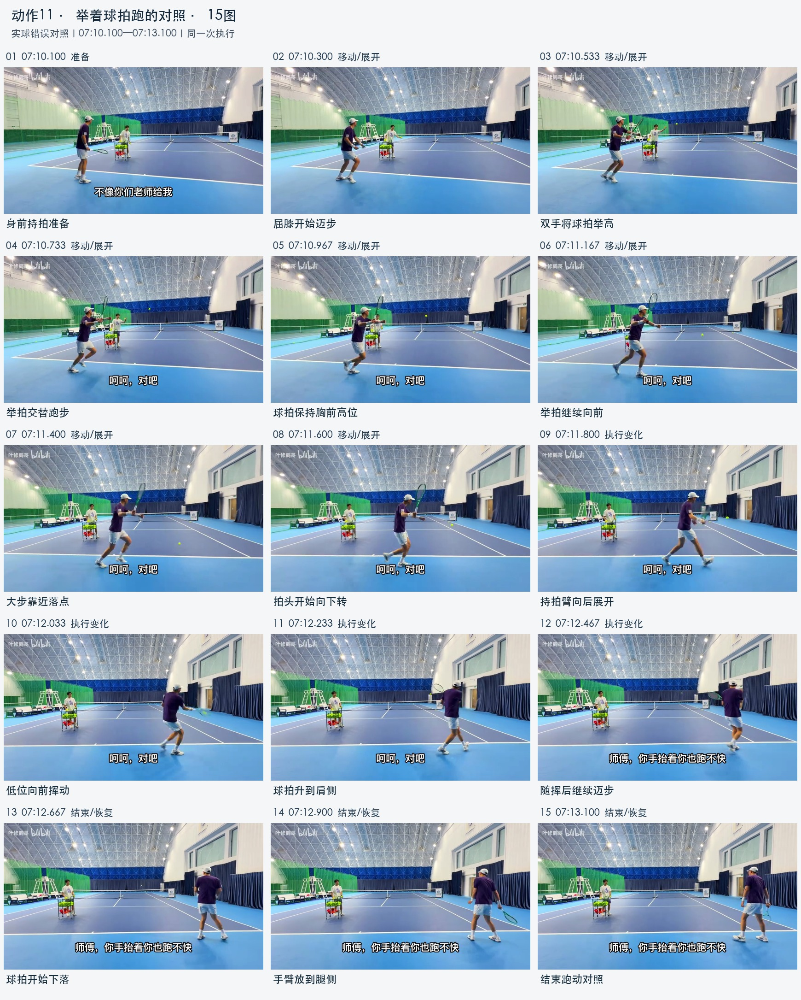

### 07:19–07:50｜迈步、后摆与正手引拍接上

协助者把球抛远，跑动时右脚迈出、持拍臂摆向身后，随后顺势进入挥拍准备，减少额外的大幅拉拍。原地示范中也练习迈步、持拍臂后摆和空挥的衔接。

随后以较大的拉拍幅度作对照，再次抛远球，练习自然摆臂跑动后的正手。大幅拉拍为无球局部动作，跑动正手则为实球喂球练习；动作图各保留一组。

**动作 12：迈步与持拍臂后摆配合｜局部空挥练习｜07:27.700–07:29.300｜15 帧**

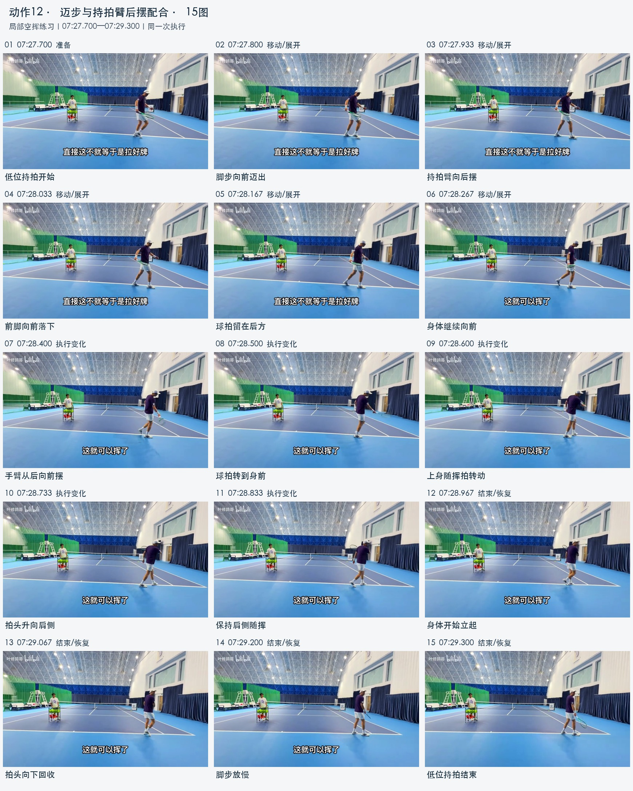

**动作 13：大幅拉拍的对照｜局部空挥反例｜07:41.100–07:43.200｜15 帧**

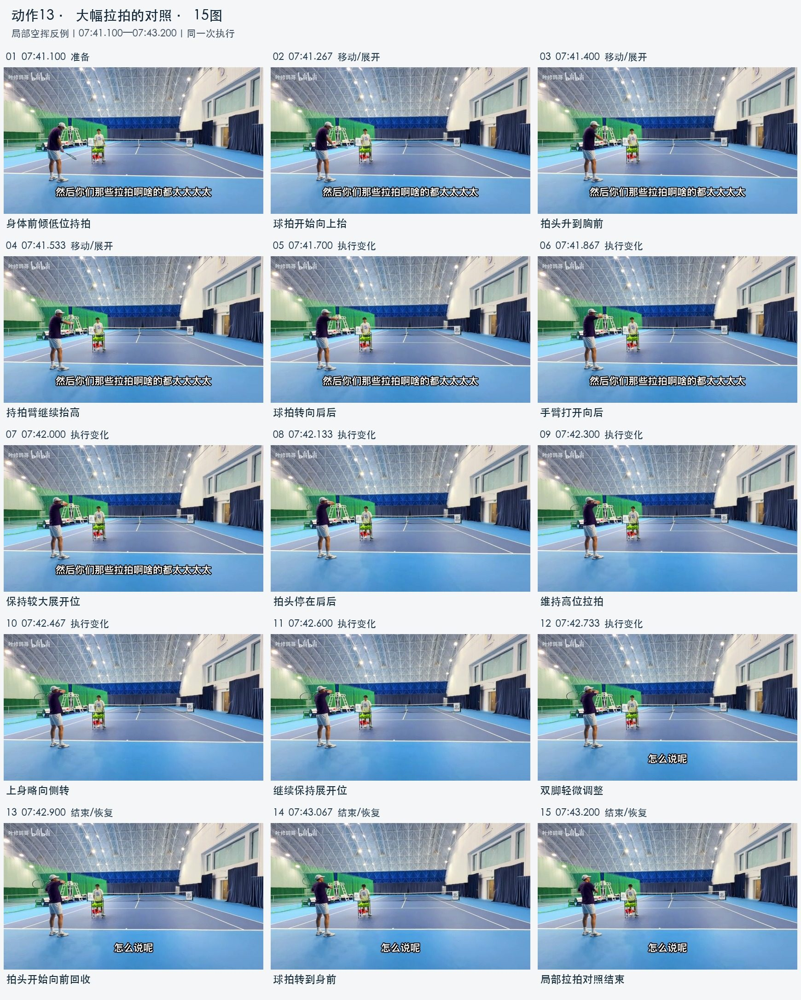

**动作 14：自然摆臂跑动正手｜跑动喂球｜07:48.100–07:51.200｜15 帧**

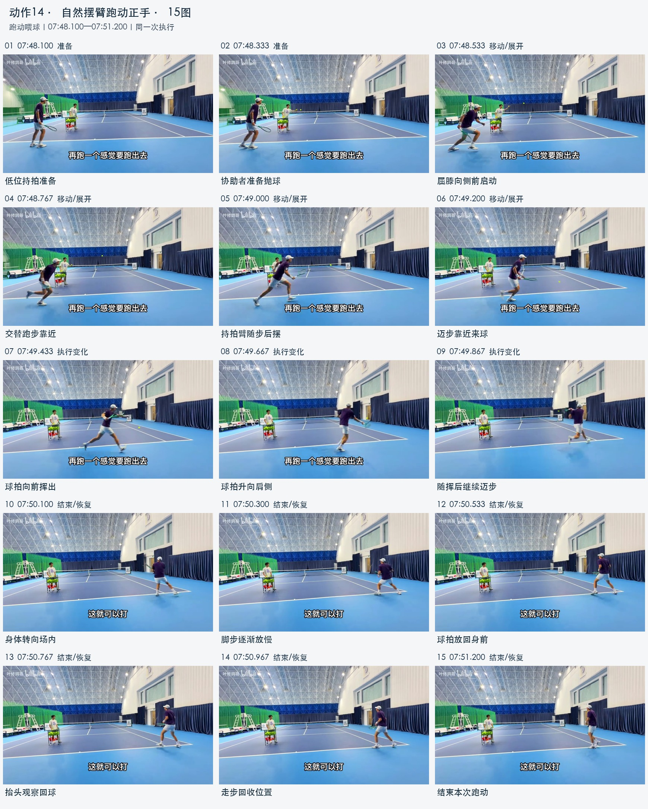

### 07:50–08:10｜启动先有步频，后面才能接上制动

启动先增加步频，让脚真正带着身体跑出去；不要原地只做小碎步，也不要一开始就只想着跨大步。之后再接制动。他用短跑启动作类比说明先把步频带起来。

### 08:10–08:40｜双手反手要让身体配合摆动

双手反手跑动时，摆臂需要与身体转动配合，不是手臂单独摆动。本段先演示小步移动中只摆手臂再处理球的对照。

随后将摆臂与胸椎和身体转动配合，再完成跑动双手反手。动作图保留只摆手臂的对照和身体转动配合后的实球各一组。

**动作 15：只摆手臂的反手对照｜实球错误对照｜08:21.800–08:23.800｜15 帧**

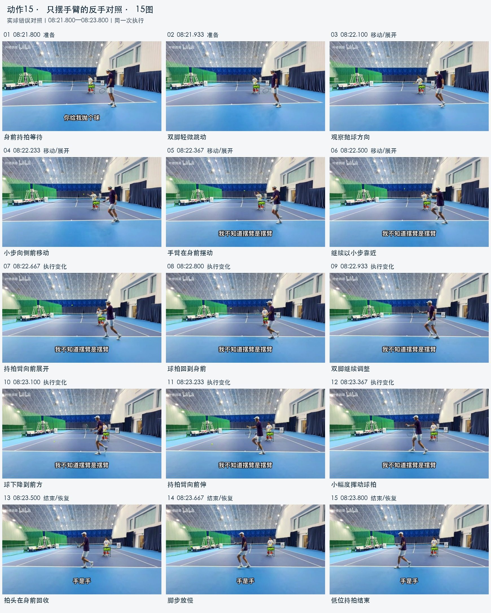

**动作 16：转身配合跑动双手反手｜跑动喂球｜08:29.000–08:31.700｜15 帧**

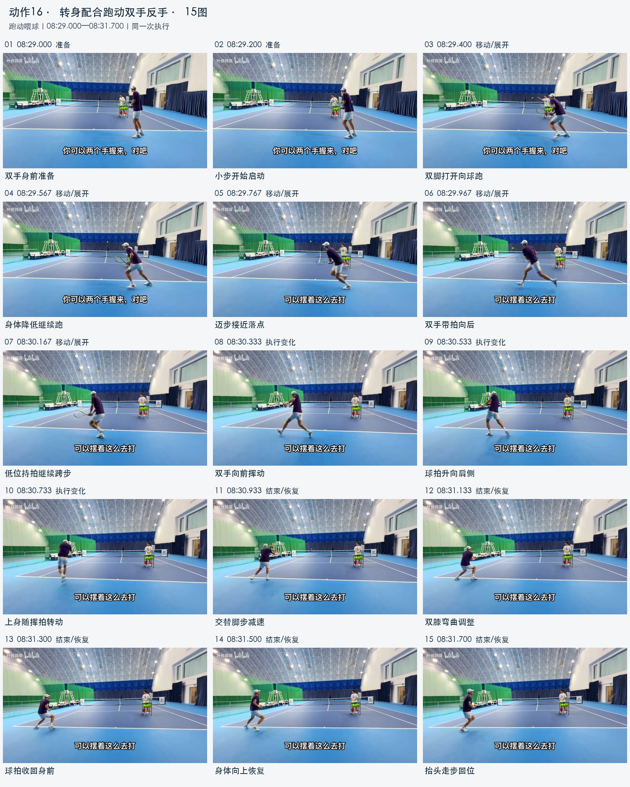

### 08:40–08:52｜单手跑动可以接切削

单手处理时，可以像正手一样先摆臂跑动，再接反手切削。本段示范向反手侧移动、举拍、单手向前展开并回位，与双手反手分开练习。

**动作 17：跑动后单手反手切削｜跑动喂球｜08:44.000–08:47.000｜15 帧**

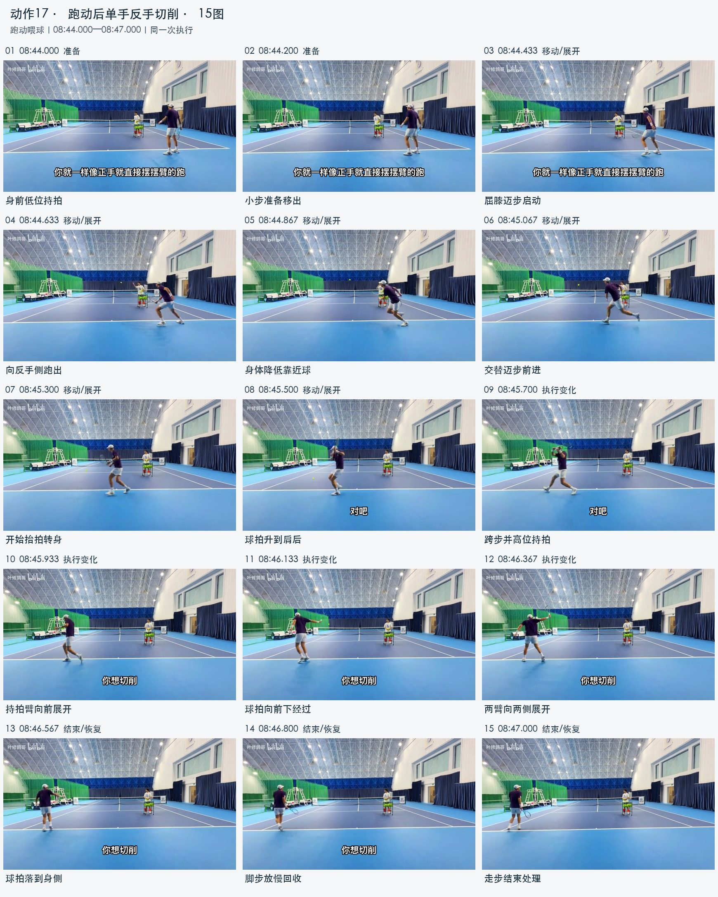

### 08:52–09:32｜回到正手，检查轻碰时动手腕的问题

重新回到前场练正手碰球停。轻碰时容易出现手腕动作，因此需要保持短处理的方向和控制。

喂球练习中对照了碰球附近松掉、用手腕擦球的做法；这种处理容易下网，也没有完成碰球下方的目标。动作图保留一遍实球对照，其余相同尝试合并。

**动作 18：轻碰时翻腕的对照｜实球错误对照｜09:17.300–09:18.933｜15 帧**

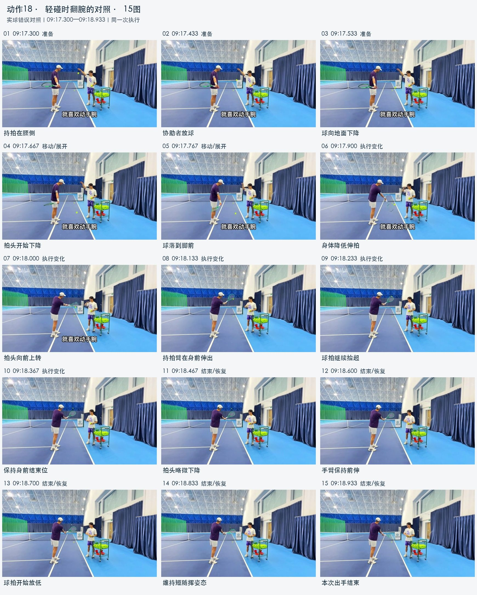

### 09:32–09:59｜抬大臂练习先建立类似下旋的动作感觉

随后练习一种被称作下旋正手的动作：从此前反手抬大臂练习延伸到正手，先处理球的下方，再沉肩、抬大臂，结束时拍面朝上。动作图分别保留低位起始、抬臂和回收的局部空挥，以及接喂球完成的短击球。

这一阶段的球仍按上旋处理，动作感觉类似下旋；真正加入下旋变化在课程后段。约09:55因来球过远调整喂球。

**动作 19：拍面朝上抬臂｜局部空挥练习｜09:45.800–09:48.300｜15 帧**

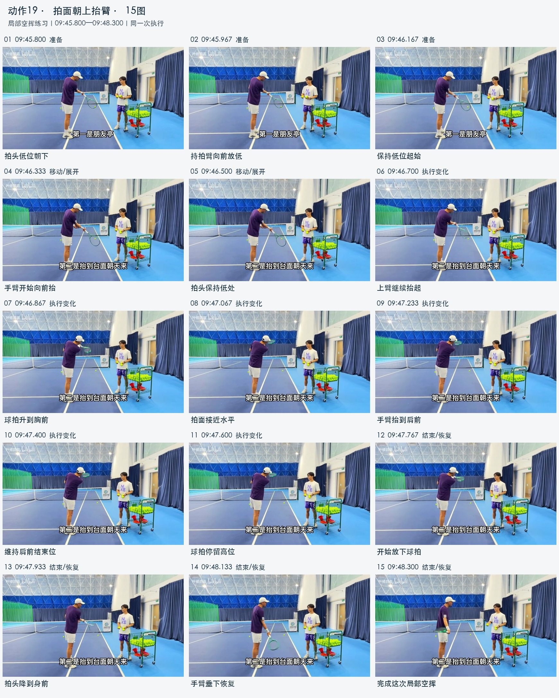

**动作 20：抬臂式正手短击球｜近距离喂球｜09:50.000–09:51.800｜15 帧**

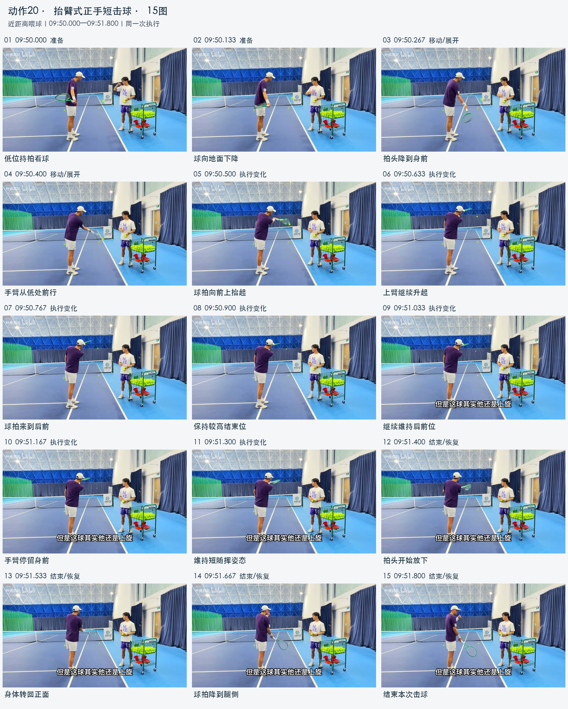

### 09:59–10:20｜抬臂之后，把收拍接得更紧凑

抬臂后接上少量沉肩内旋和前臂弯曲，缩小动作幅度。也可以先练到抬起结束，再逐步加入收拍。

动作图保留一遍抬臂后球拍来到头侧并紧凑收回的实球练习，与前面的抬臂短处理分开。

**动作 21：抬臂后接续紧凑收拍｜近距离喂球｜10:06.000–10:08.300｜15 帧**

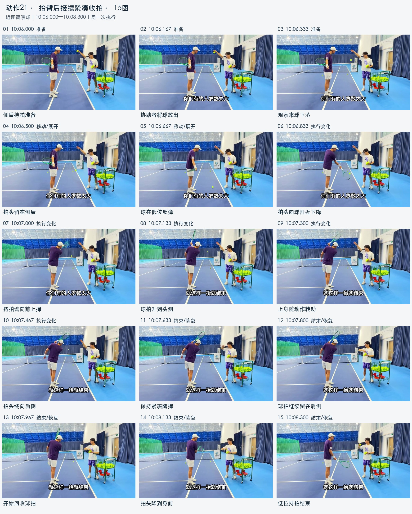

### 10:20–10:52｜加入带下旋与侧旋的正手变化

最后在前面练习基础上尝试带下旋：球拍路径稍向左带，并加入大臂外旋，末段再加入侧旋变化。

**动作 22：下旋正手变化｜近距离喂球｜10:35.500–10:37.500｜15 帧**

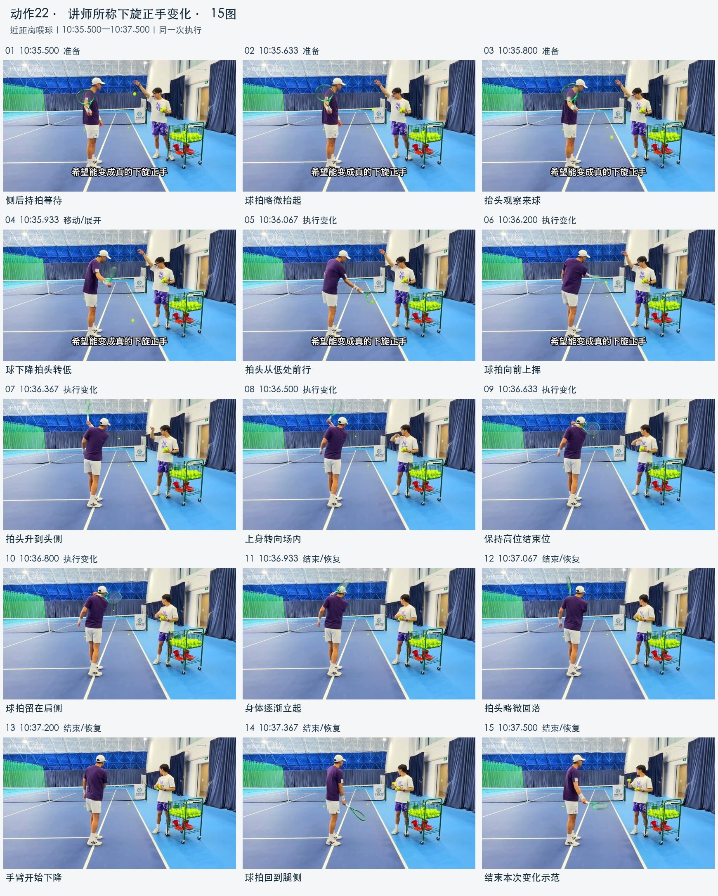
