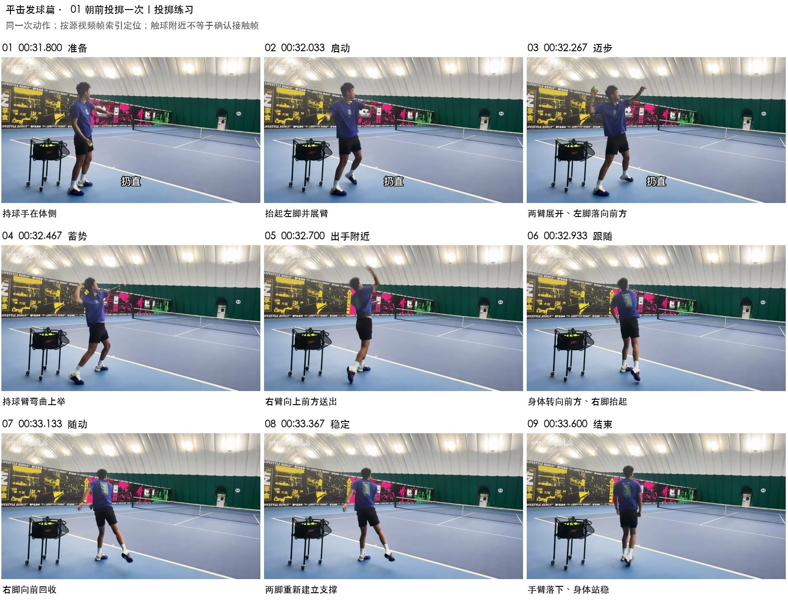
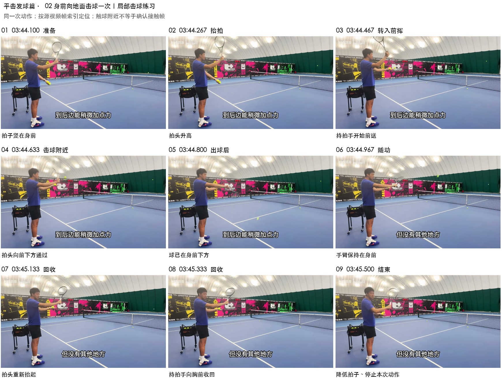
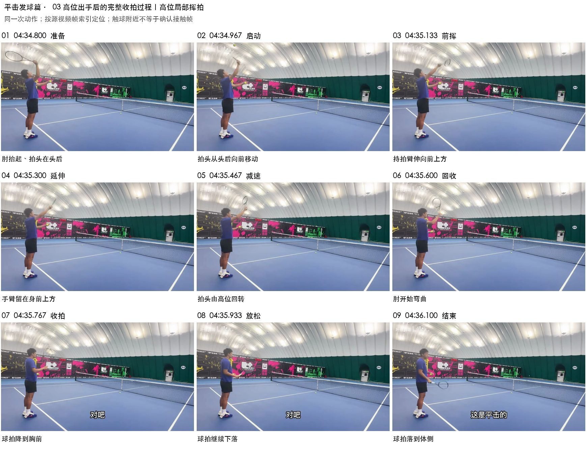
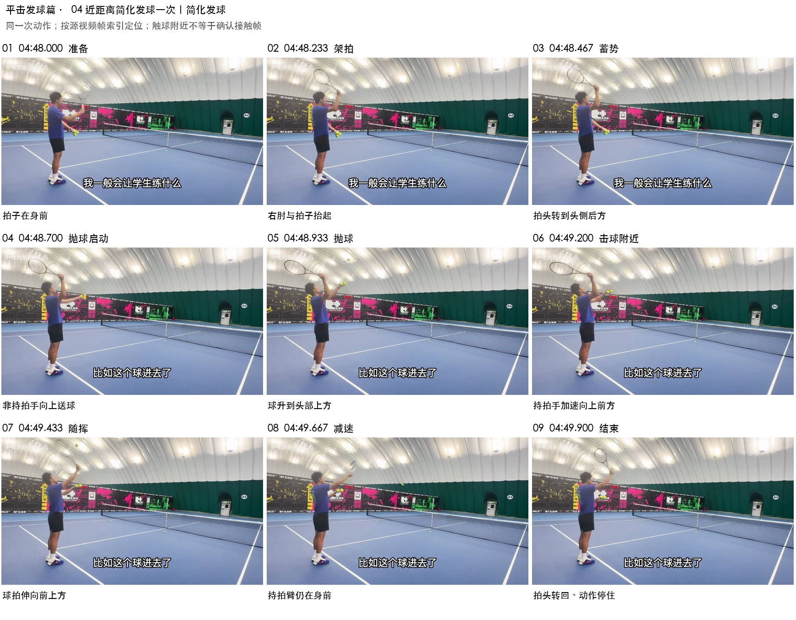
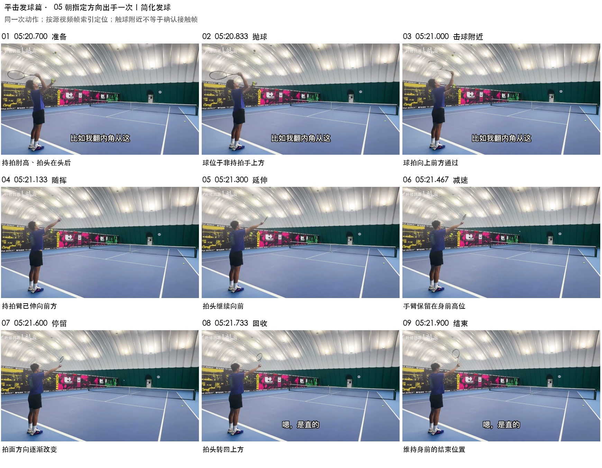
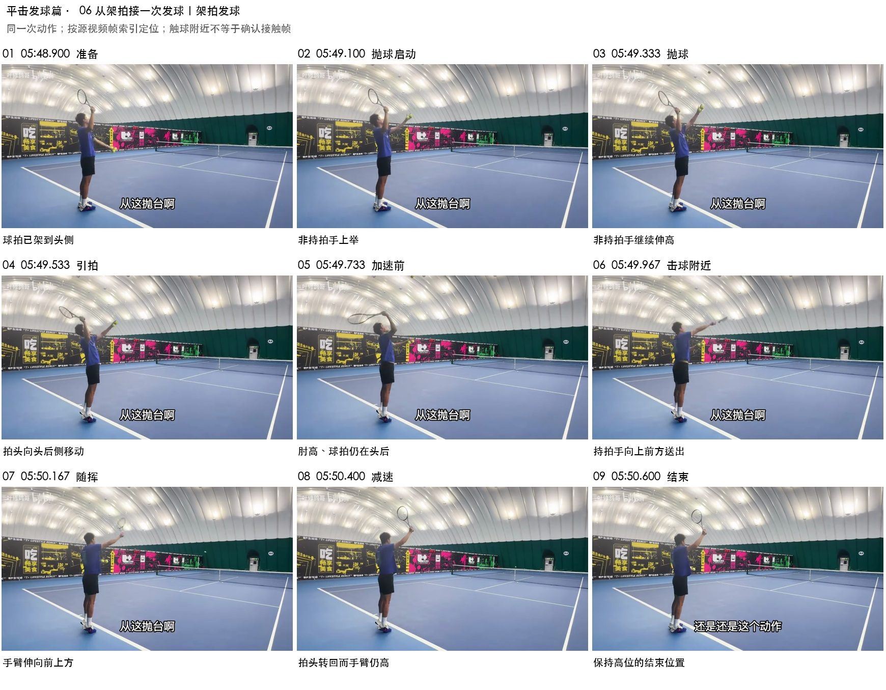
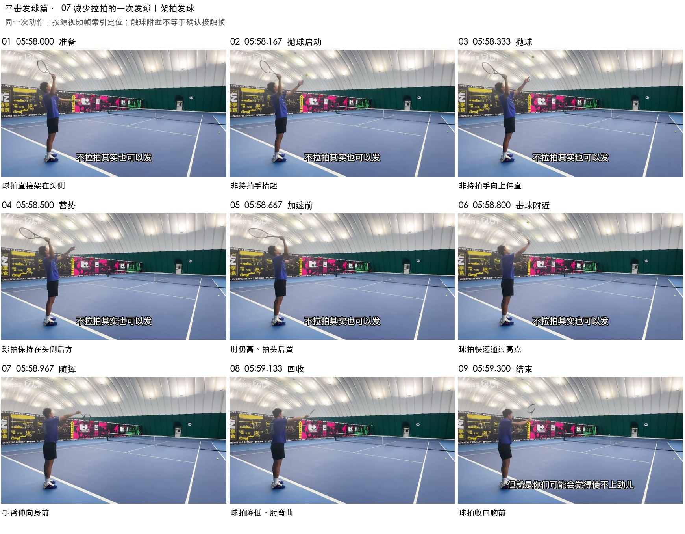
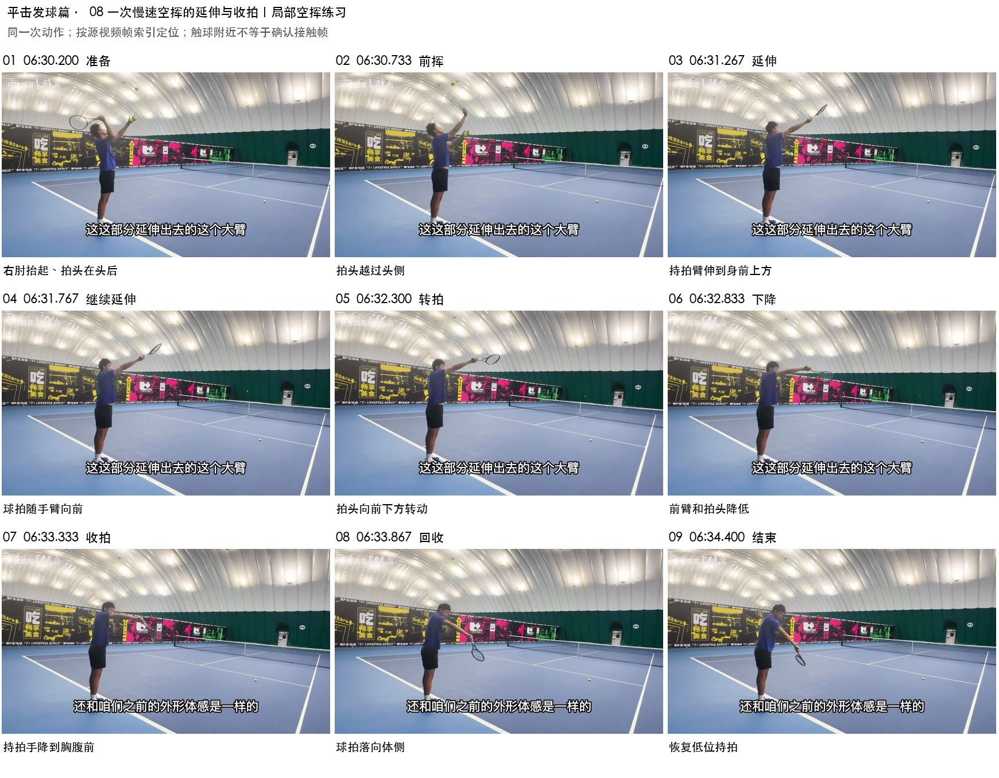
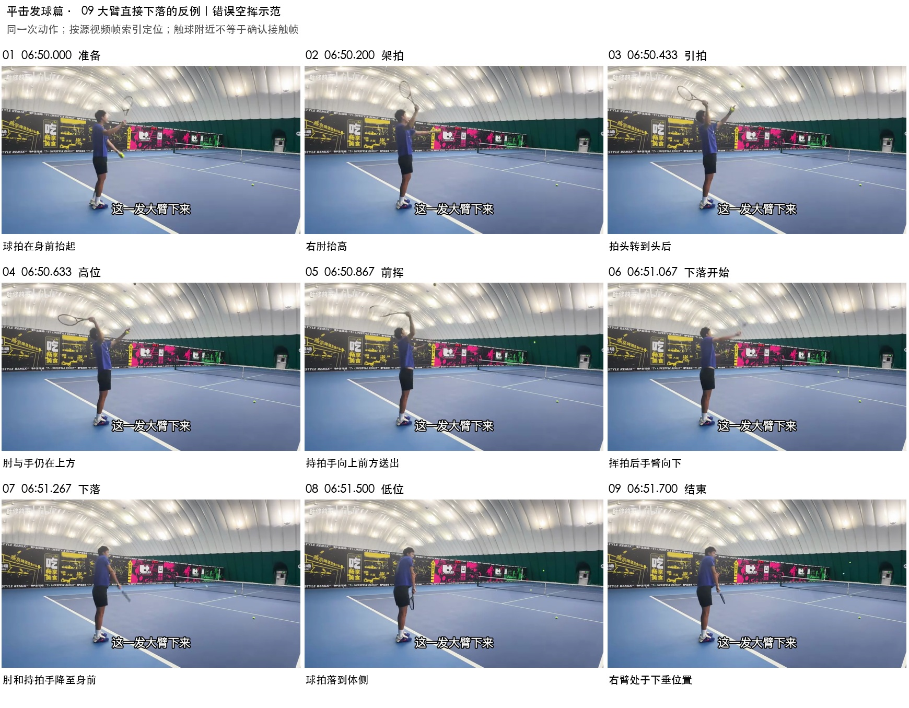
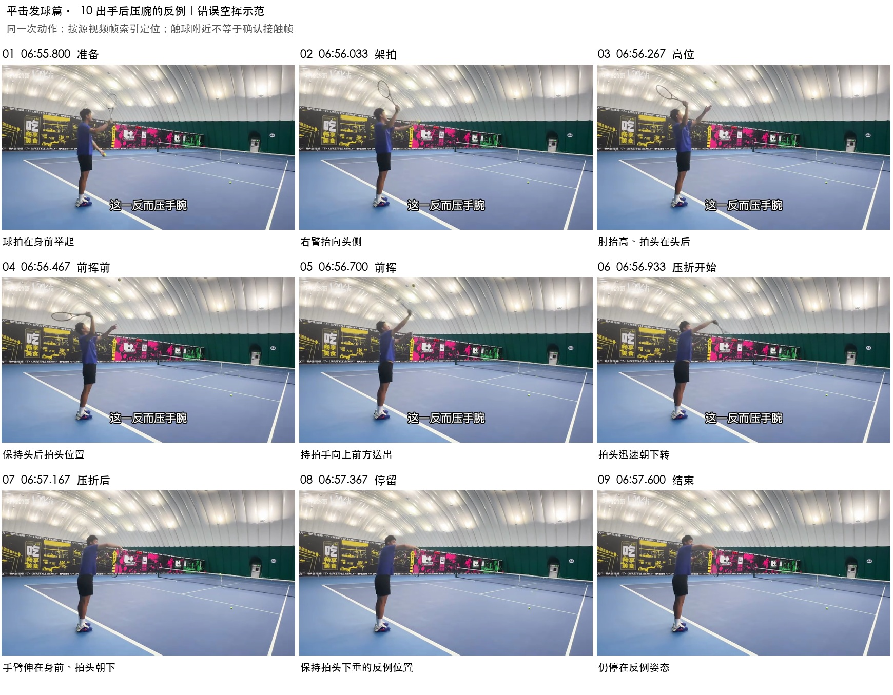

# 从零开始的网球自习系列课-平击发球篇（附发球损伤动作规避）

[Bilibili 原课](https://www.bilibili.com/video/BV1eU8iznE9P/) · 叶修鸽哥 · 合集位置待核 · 时长 07:16 · 整理日期 2026-11-06 · 发布日期 2026-11-06

## 课程总结

本课从朝目标方向投掷开始，用近距离局部击球建立拍面和出球方向，再退到底线并加入更高的起始位置和架拍。结尾用大臂直接下落和出手后压腕作对照。

## 技术总结

- 先练把球朝目标扔直，身体随动作转向目标。
- 让大臂和肘先出来，再接前臂旋转与延伸。
- 用近距离和简化动作先练出球方向，前臂动作从小做起。
- 提高起点及加入架拍后，仍保持大臂处在身前，继续送拍。

## 训练路线

1. 从投掷开始，先练方向和身体转向。
2. 在半场或靠网位置做局部击球，观察朝地击球后能否反弹过网，再接简化发球。
3. 回到底线练方向和落点，逐步升高起始位置并加入架拍。
4. 用慢速空挥核对延伸和收拍，再接到实球。

## 常见问题与调整

| 情况 | 调整方式 |
|---|---|
| 追求用力后出球方向散 | 退回近距离简化发球，缩小动作并重新对准目标。 |
| 出手后大臂直接下落或压腕 | 用慢速空挥恢复身前延伸，再接收拍。 |

## 按时间顺序的课程记录

### 00:00–00:20｜从基础动作逐步进阶

平击发球从基础投掷和出球方向练起，逐步提高准备和出手位置。本课先拆出扔球、方向和持拍手的动作，再接站位距离、落点与延伸，没有一开始就要求完整大力发球。

### 00:20–00:52｜先把球扔直，让身体能转向目标

镜头转到示范者后方，讲师先让练习者扔球，暂时不纠结出界，观察球是不是朝预期方向出去。他反复要求先练扔直，同时强调人要能转出来。

这里的“扔球”是指朝目标方向投掷的练习，用来体会出手方向，不是非持拍手的发球抛球。

**动作 01：朝前投掷一次｜投掷练习｜00:31.800–00:33.600｜9 帧**

01 准备｜02 启动｜03 迈步｜04 蓄势｜05 出手附近｜06 跟随｜07 随动｜08 稳定｜09 结束。

### 00:52–01:28｜大臂和肘能出来，再看前臂旋转

讲师结合肘的位置说明，扔球时大臂和肘需要能够出来；接着说这一阶段已经自然带有小臂内旋。他反复做抬臂、伸臂与扔球方向示意，比较哪些姿态容易朝前扔直、哪些更难。

### 01:28–02:12｜人朝目标区，拍面与挥拍方向相配

讲师要求人朝着要发的区，再握拍并观察挥拍轨迹与拍面的关系。约 01:44 示范轨迹与拍面垂直，随后让动作缩小，只用前臂做示意，观察球的出球轨迹是否直。

他还比较动作能否在上方停住，借此说明本阶段的控制要求。

### 02:12–02:56｜强调较短的出球过程，用比喻解释

讲师反复强调“出球时间短”，并把拖长的处理与出现旋转联系起来。随后用向冰箱里放东西、动作量变化等生活比喻继续解释，并讨论怎样主动缩短这一过程。

### 02:56–03:28｜转到半场，缩小前臂动作幅度

讲师让搭档往前到半场，再回到小臂内旋的部分。他指出这部分幅度可以很小，触球过程也短，此时不要额外加上大臂的移动；在身体前方，以较小幅度做出持拍手动作。

### 03:28–04:08｜向下出球，检查反弹后能否过网

讲师安排在身前做小幅动作，让球向地面出去，要求落地之后还能过网；随后再逐渐加一点力量。他强调先确认其他部位没有多余参与，再向后推进。

接着他示意加入肩部、大臂或过多压腕的情况，提示练习时留意这些变化。

**动作 02：身前向地面击球一次｜局部击球练习｜03:44.100–03:45.500｜9 帧**

01 准备｜02 抬拍｜03 转入前挥｜04 击球附近｜05 出球后｜06 随动｜07 回收｜08 回收｜09 结束。

### 04:08–04:48｜加入大臂位置，平击不要直接与力量绑定

讲师转到面向目标的站姿，抬起大臂并解释动作向前的方向。练习时可以把某些动作感觉做得夸张一点，但不要把“平击”直接和“大力”绑在一起。

这一段重点仍是建立出球和动作感觉。

**动作 03：高位出手后的完整收拍过程｜高位局部挥拍｜04:34.800–04:36.100｜9 帧**

01 准备｜02 启动｜03 前挥｜04 延伸｜05 减速｜06 回收｜07 收拍｜08 放松｜09 结束。

### 04:48–05:12｜用与网的距离控制练习难度

练习可在前后约两到三米的范围内调整站位。其推进办法是失误了往前上，发好了再往后退，逐渐来到更远、包括底线的位置。

**动作 04：近距离简化发球一次｜简化发球｜04:48.000–04:49.900｜9 帧**

01 准备｜02 架拍｜03 蓄势｜04 抛球启动｜05 抛球｜06 击球附近｜07 随挥｜08 减速｜09 结束。

### 05:12–05:44｜回到底线后练方向和落点

来到更远位置后，讲师强调还有很多东西需要练。他分别指向内角和外角，要求在较短的出球过程中把轨迹与稳定性控制好，不靠其他多余动作补偿。

**动作 05：朝指定方向出手一次｜简化发球｜05:20.700–05:21.900｜9 帧**

01 准备｜02 抛球｜03 击球附近｜04 随挥｜05 延伸｜06 减速｜07 停留｜08 回收｜09 结束。

### 05:44–06:24｜继续进阶到更高位置和架拍

讲师提到进一步进阶时的高度变化与架拍节奏，回应学习者可能觉得使不上劲的问题，再次提醒不要将这一阶段只理解为力量问题。他允许先增加少量拉拍，但同时强调大臂位置需要控制，动作过程仍短。

**动作 06：从架拍接一次发球｜架拍发球｜05:48.900–05:50.600｜9 帧**

01 准备｜02 抛球启动｜03 抛球｜04 引拍｜05 加速前｜06 击球附近｜07 随挥｜08 减速｜09 结束。

**动作 07：减少拉拍的一次发球｜架拍发球｜05:58.000–05:59.300｜9 帧**

01 准备｜02 抛球启动｜03 抛球｜04 蓄势｜05 加速前｜06 击球附近｜07 随挥｜08 回收｜09 结束。

### 06:24–06:48｜前臂旋转伴随延伸，大臂留在身前

前面所说的前臂旋转通常还伴随延伸；延伸出去的大臂会留在身体前方，并能在发完后停留。下图为一次慢速空挥，展示前挥、延伸和收拍的衔接。

**动作 08：一次慢速空挥的延伸与收拍｜局部空挥练习｜06:30.200–06:34.400｜9 帧**

01 准备｜02 前挥｜03 延伸｜04 继续延伸｜05 转拍｜06 下降｜07 收拍｜08 回收｜09 结束。

### 06:48–结束｜回看大臂下落和压腕的反例

如果前面的基础部分没有练好，动作完成时可能出现大臂直接下来，或以压手腕代替前面要求的动作。讲师用多个挥拍、下落与手腕姿态作对照，提醒这类动作可能增加肩部不适或网球肘风险（课程防伤提醒，如有持续疼痛请以专业医疗意见为准）。

**动作 09：大臂直接下落的反例｜错误空挥示范｜06:50.000–06:51.700｜9 帧**

01 准备｜02 架拍｜03 引拍｜04 高位｜05 前挥｜06 下落开始｜07 下落｜08 低位｜09 结束。

**动作 10：出手后压腕的反例｜错误空挥示范｜06:55.800–06:57.600｜9 帧**

01 准备｜02 架拍｜03 高位｜04 前挥前｜05 前挥｜06 压折开始｜07 压折后｜08 停留｜09 结束。
