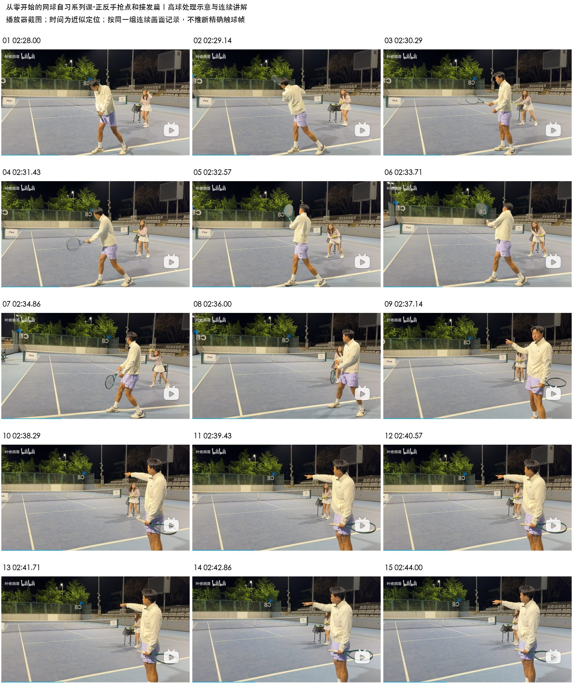
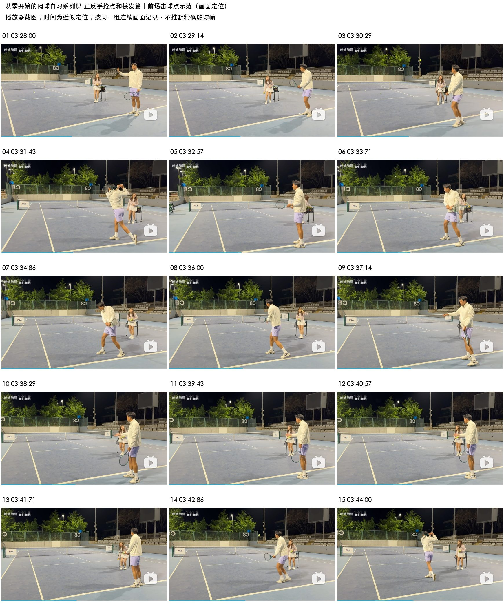
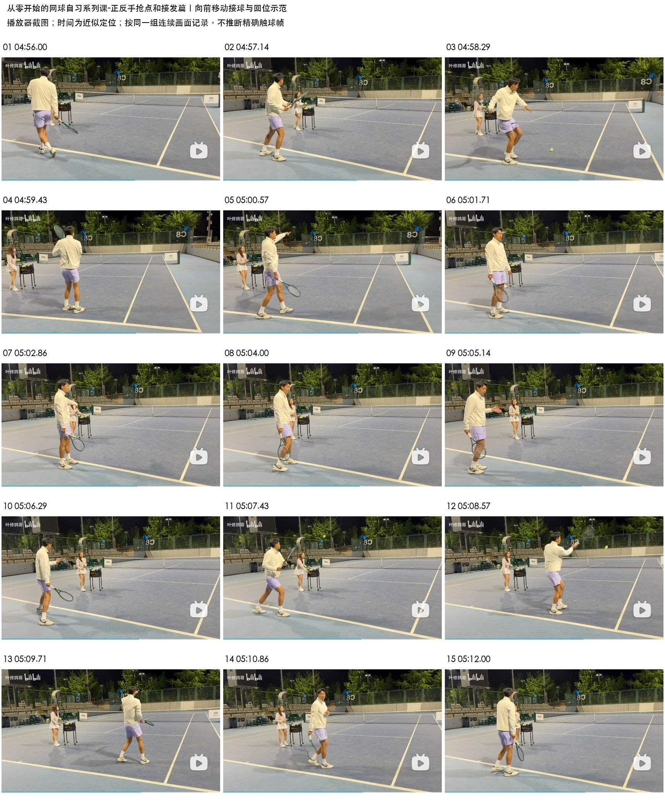
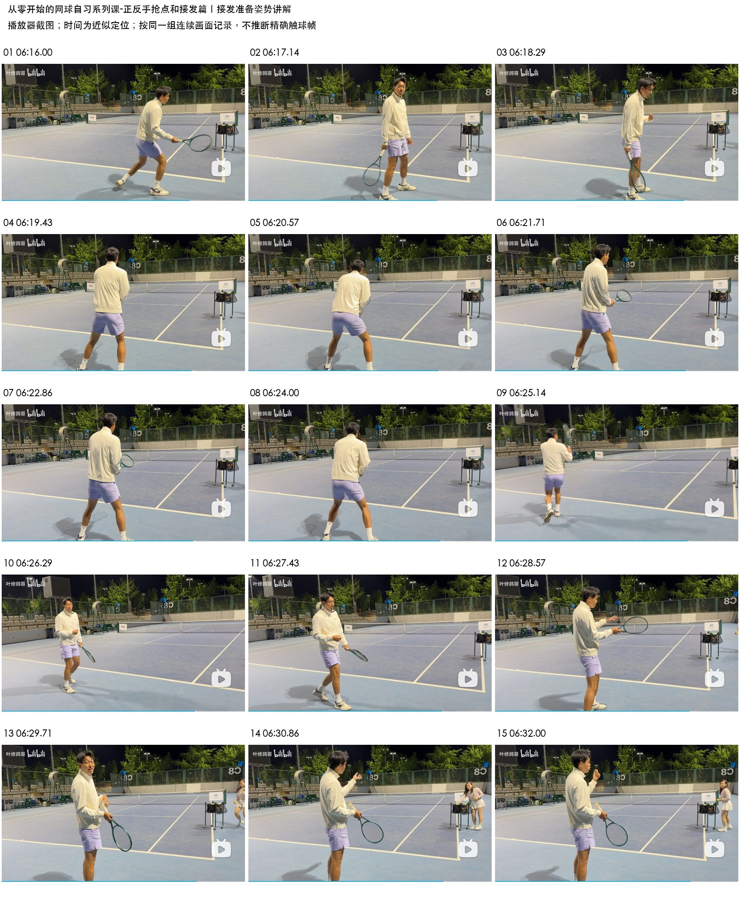
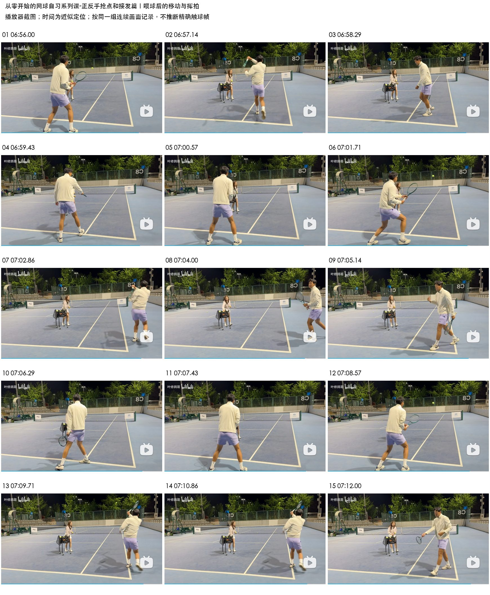
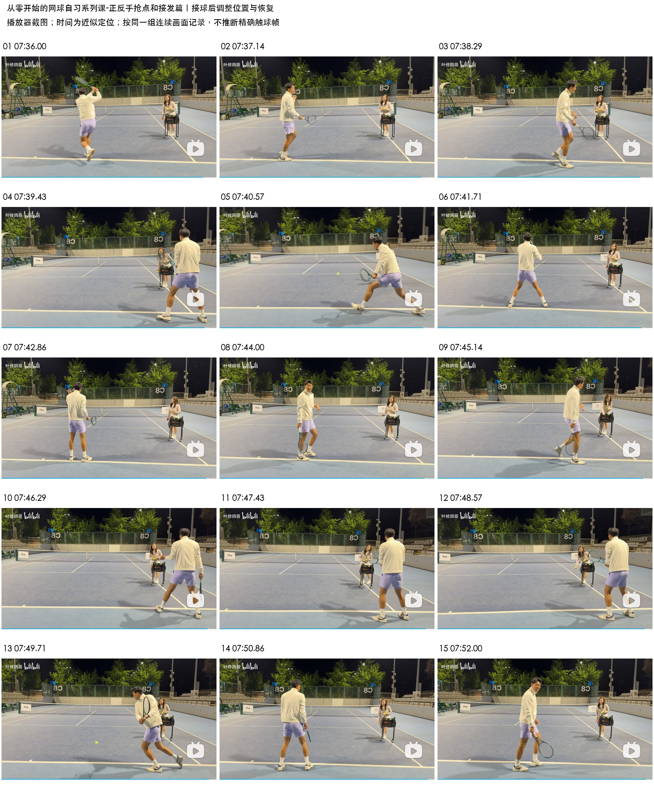

# 从零开始的网球自习系列课：正反手抢点和接发篇

[Bilibili 原课](https://www.bilibili.com/video/BV1FnVVzWEbB/) · 叶修鸽哥 · 合集第 20/35 集 · 时长 08:07 · 整理日期 2026-11-06 · 发布日期 2025-05-02

## 课程总结

本课先用四件套练主动找球、反手高球和正手抢上升期，再转入接发。接发通过搭档抛球练第一步、短动作回球和回位。

## 技术总结

- 主动向来球方向找击球位置。
- 反手高球抢上升期时，脚步先准时到位。
- 正手抢点时分别组织脚步与出拍，再把两者接起来。
- 接发准备时保留移动余量，先练第一步再接回球。

## 训练路线

1. 用正反手喂球练主动找球，加入高球和上升期变化。
2. 在接发位置用伙伴抛球练第一步、击球和恢复。
3. 逐渐把喂球抛得更斜、更深，再练反手一步到两步的衔接。

## 常见问题与调整

| 情况 | 调整方式 |
|---|---|
| 接发准备时站死 | 回到固定位置的抛球练习，把第一步与挥拍接起来。 |
| 抛球太浅，出脚时机练不出来 | 调整喂球深度与方向。 |

## 按时间顺序的课程记录

### 00:02–00:35｜从身体感受进入抢点

开头先接续前一课的沉肩、上臂外旋和支撑话题。讲师说希望训练者理解这些身体感受，力量训练可以帮助建立能力，但重点不是摆出一个“像样”的动作；感受和发力组织练对后，击球动作会逐渐出现。随后安排助教站到讲师后方喂球。

### 00:35–01:25｜四件套稳定之后，练主动找球和线路变化

讲师把基本击球稳定作为前提：如果只能彼此回高球，训练会停留在相持。要练习主动靠近合适的来球、敢于向球移动，而不是害怕球、等球落下来再处理。

示范讲解中用站位说明默认斜线回球后的回防位置：反手打斜线后回到偏中间的位置，正手打直线后也要顾及对方斜线。若能在反手一侧打出有质量的直线，会迫使对方多移动，甚至直接得分。这里的重点是主动选线和占据击球点，不是单纯加大力量。

### 01:25–03:58｜反手高球与上升期抢点

反手高球常让较低水平球员后退等待球落下，结果变得被动。练习时让助教把球喂得高一些、深一些；训练者可以调整位置，主动向前找球，在球上升阶段处理。

抢点时保持挥拍方向，避免从高处向下“盖”球或过度拧转身体。应在来球前争取位置，利用转体把球送向直线区域；这一拍不要求极快，先把方向打直并让对手离开舒适位置。画面里讲师和助教多次调整喂球深度、站位与方向，再重复找球、移动和挥拍。

**图 1｜反手高球与上升期抢点｜02:28–02:44**

**图 2｜主动向前抢点示范｜03:28–03:44**

### 03:58–05:12｜正手抢点：脚步和挥拍分开组织

正手也练主动找球。助教把球喂向目标一侧，讲师说明移动脚步与挥拍时间要能分开：先移动到合适位置，仍然留有时间完成挥拍，不要为了赶上球只碰一下，导致回球质量下降。

之后可按意图选择斜线或直线，也可打向对方反手一侧；讲师提到直线和较高的落点都能给对手反手制造压力。练习中通过改变喂球方向、深度和距离，保持移动后仍能主动挥拍。

**图 3｜接发的一步移动练习｜04:56–05:12**

### 05:12–06:14｜接发准备与一步启动

接发部分从较慢的发球开始：准备时脚下不要站死，按基本击球动作向球移动。若发球速度提高，完整跑两步再准备挥拍通常来不及；讲师把这一情形概括为“一步”，即迈出第一步直接接球，打完再回到准备位置。

讲师提到接发的启动方式有不同做法，例如先小步调整或从准备姿势直接垫步。本课把注意力放在不站死、别错过出脚时机；具体采用哪种步法可结合个人练习观察。不要把“接发”简化成固定的两步跑动。

### 06:14–07:18｜用抛球练第一步、接球和回位

练习从站在预定位置开始，由伙伴抛球。先练第一步启动和移动后的击球，再把球抛得更斜、更深一些；若球太浅、太靠前或方向不合适，训练者容易错过出脚时机，讲师会现场调整抛球位置。

若模拟较快的一发，可以练较紧凑的支撑/挡推式回球，球送出后立即准备回位。讲师提醒一发较快，回球动作要简洁，留出恢复站位的时间。

**图 4｜接发准备与不站死｜06:16–06:32**

**图 5｜喂球后移动、挥拍与恢复｜06:56–07:12**

### 07:18–08:04｜反手一步接发与两步衔接

练到反手侧时，讲师示范一步启动并抬起上臂；来球快时以紧凑挡推为主，不要额外掰腕或做过大的挥拍，以便打完能及时回位。常见问题是反手这侧停住，导致第一步和后续恢复断开；练习目标是把启动接球、回位连成两步。

结尾回到目标接发位置，由伙伴喂球，重复练一步启动。

**图 6｜反手一步启动与紧凑回球｜07:36–07:52**

