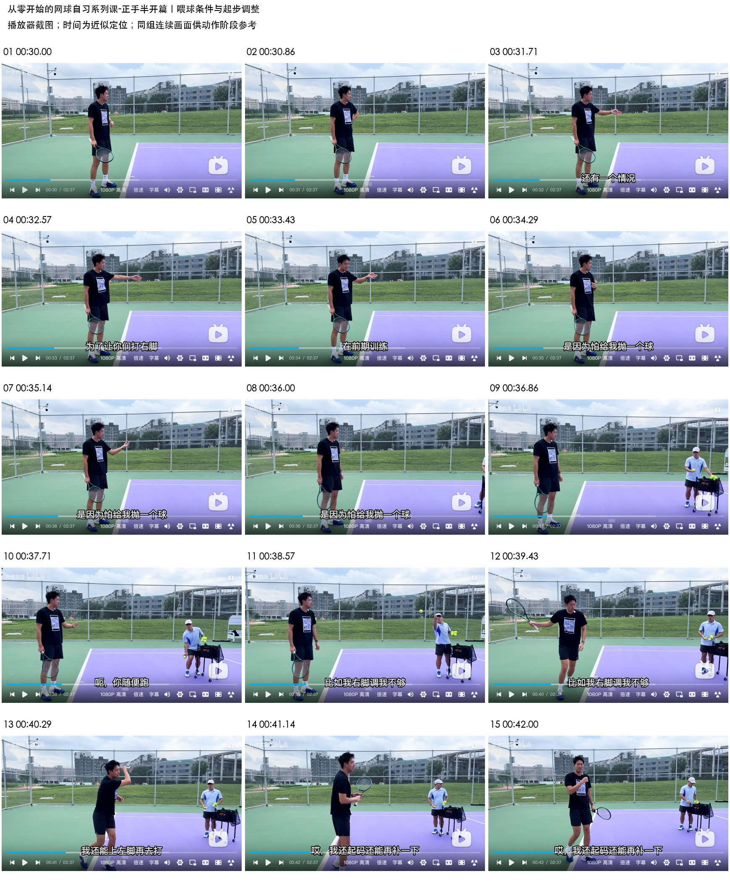
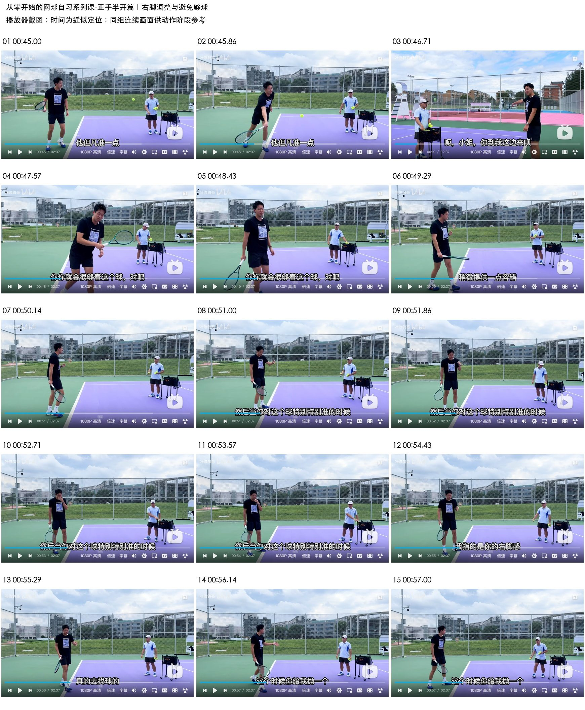
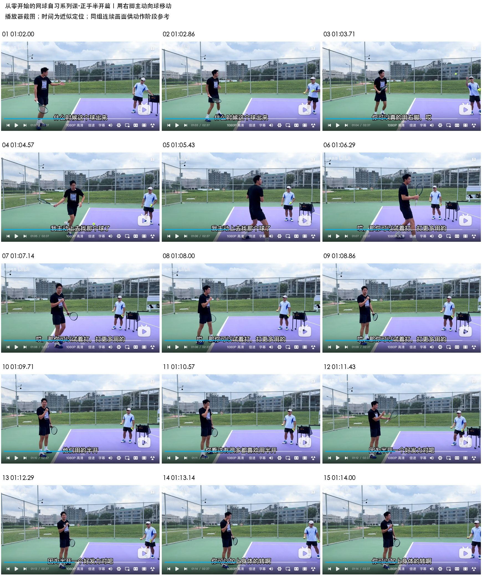
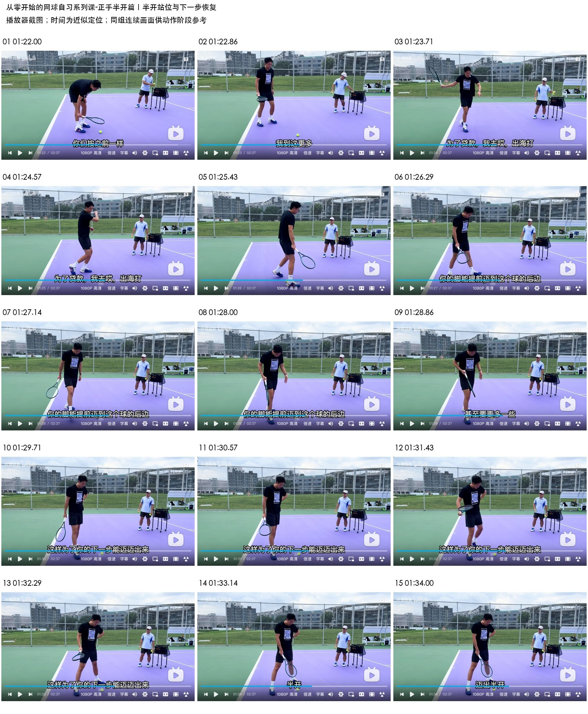
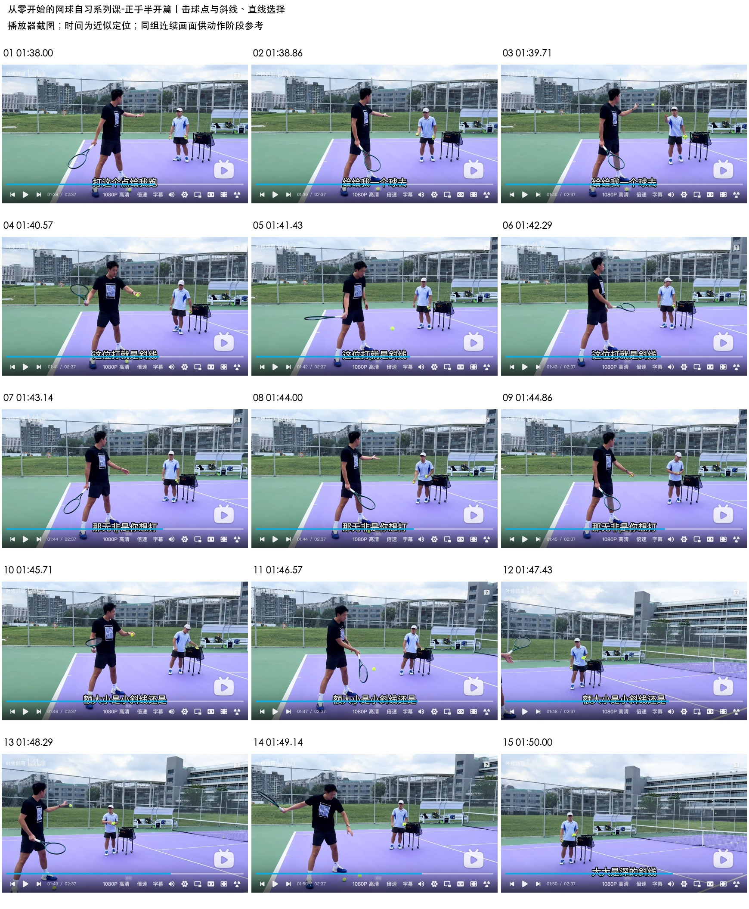
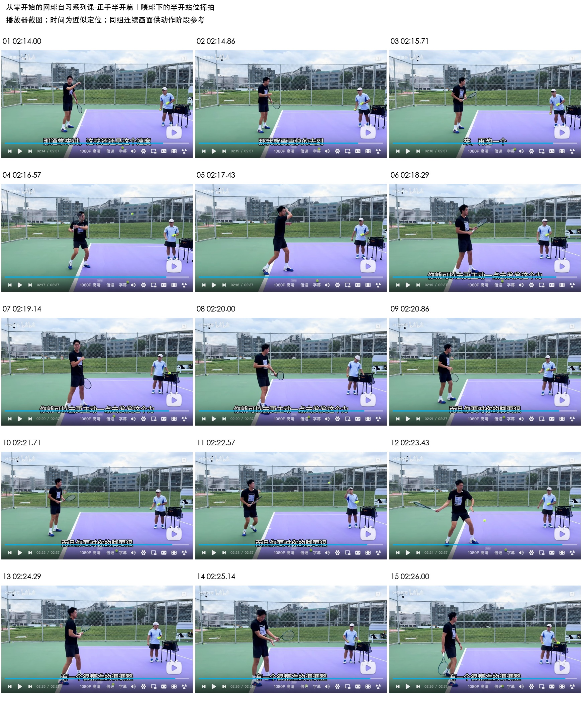

# 从零开始的网球自习系列课：正手半开篇

[Bilibili 原课](https://www.bilibili.com/video/BV1b4g8zkE9C/) · 叶修鸽哥 · 合集第 22/35 集 · 时长 02:37 · 整理日期 2026-11-06 · 发布日期 2025-07-20

关联课程：[正手篇](正手篇.md) · [正手内外旋补全篇](正手内外旋补全篇（改掰网球肘）.md)

## 课程总结

本课用搭档喂球练习正手半开式站位，把启动、调整击球位置、挥拍和击球后的下一步连起来。落点不稳定时可以补小步找位置，喂球稳定后练习用右脚主动到球后方。到位后再按目标选择斜线深浅或尝试直线，并随来球速度调整启动和步幅。

## 技术总结

- 喂球落点不稳定时，用小步修正身体与来球的距离。
- 落点较明确时，右手持拍的示范用右脚主动向球后方调整，给持拍臂留出挥拍空间。
- 判断来球时机后主动向前找球，用半开式站位把脚下移动接到转体挥拍上。
- 落脚时给击球后的下一步留出空间，打完继续调整位置。
- 根据目标练较短、更斜的斜线或更深的斜线。处理向外的来球、向身前发力时，也可尝试直线。
- 随来球速度和落点调整启动时机，启动后继续用小步微调。

## 训练路线

1. **喂球找位置**。搭档给正手喂球，落点有变化时允许自由移动和补小步，以到位后能顺畅挥拍为目标。
2. **主动找球**。喂球落点较稳定后，先判断球的方向和速度，再练用右脚到球后方。从半开式站位挥拍，打完接上下一步。
3. **加入线路目标**。先用较稳定的喂球练斜线深浅，再结合向外来球和身前发力尝试直线。换线路时观察是否仍有挥拍和继续移动的空间。
4. **随球速调整**。搭档持续喂球，练习明确来球后果断启动，靠近球时再微调脚下位置。

## 常见问题与调整

| 情况 | 调整方式 |
|---|---|
| 喂球落点变化，第一步过后还差一点位置 | 用小步补到合适的击球距离，再完成挥拍。 |
| 脚留在身后，只能伸手够球 | 用落点较稳定的喂球练右脚主动到球后方。 |
| 启动偏晚，站在原地等球 | 先辨认来球速度和落点，判断清楚后主动向球移动。 |
| 打完球迈不出下一步 | 检查击球前的落脚位置，给挥拍后的移动留空间。 |
| 改打直线或更斜的角度时失去击球空间 | 先把人与球的距离调合适，再按目标出拍。 |

## 按时间顺序的课程记录

### 00:00–00:30｜开场与准备喂球

开场安排搭档到指定位置喂球，准备练习正手半开式站位和脚步调整。

### 00:30–01:02｜根据喂球稳定度调整起步脚

训练初期，喂球落点不稳时可以自由跑动，再用小步修正人与球的距离。喂球稳定后，开始练预判落点并提前移动。右手持拍的示范用右脚主动调整到球后方，避免脚留在身后、身体前伸够球。

**图 01｜喂球准备与起步说明｜00:30–00:42**。展示喂球安排和起步条件。

**图 02｜脚步对照｜00:45–00:57**。对照右脚向球后方调整与脚留在后方、伸手够球的位置。

### 01:02–01:22｜半开站位与主动找球

半开式站位便于把向球移动和转体挥拍接起来。看清来球时机后主动向前找球，用右脚调整到合适位置，再接转体挥拍。

**图 03｜主动找球示范｜01:02–01:14**。展示右脚向来球方向移动和到位准备。

### 01:22–02:04｜脚步位置为下一步留空间，按目标选线路

提前到球后方，落脚时给击球后的下一步留空间。斜线既可以打短、打出更斜的角度，也可以打深。遇到向外的来球，向身前发力时可尝试打直线。换线路时，尤其是向外、向前找球时，要判断好人与球的距离，避免伸手够球。

**图 04｜半开站位与下一步示范｜01:22–01:34**。展示脚步提前到位、挥拍与击球后的移动衔接。

**图 05｜线路说明｜01:38–01:50**。结合站位和击球位置说明斜线与直线选择。

### 02:04–02:37｜根据球速增加主动性并练习微调

结尾用搭档喂球重复练习。先辨认来球速度和落点，判断后果断启动，靠近球时微调脚下位置，再组织挥拍。

**图 06｜连续喂球练习｜02:14–02:26**。展示随来球调整脚步后接半开式挥拍。

