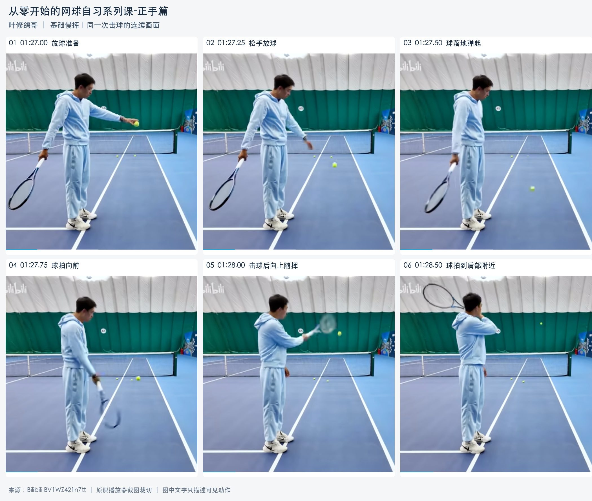
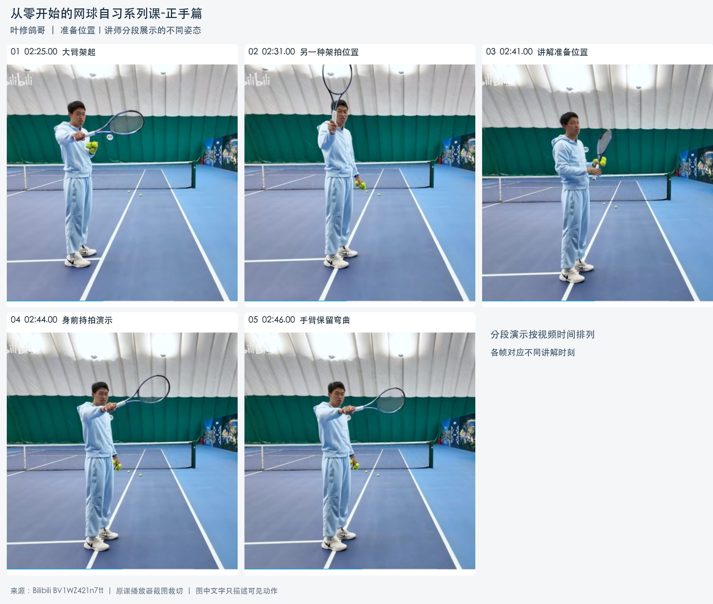
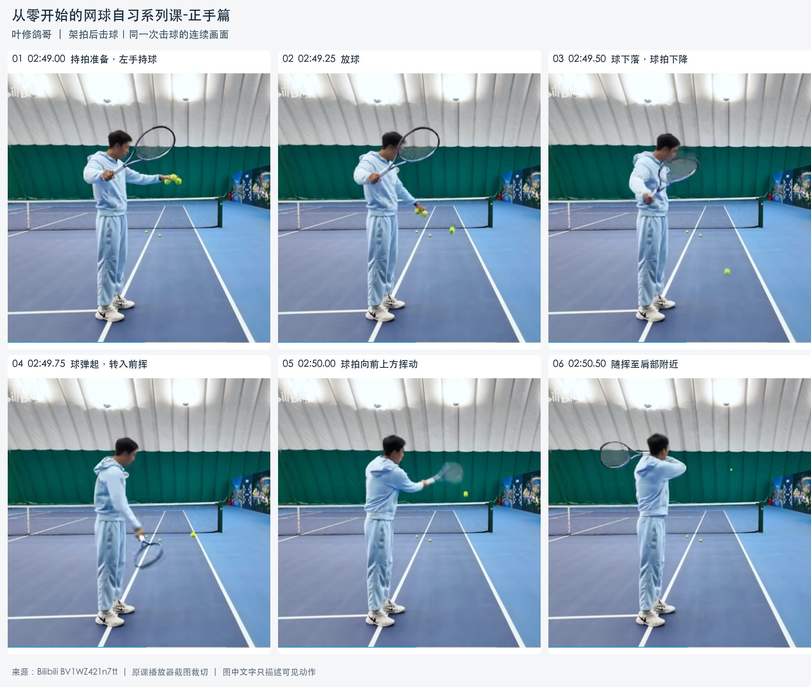
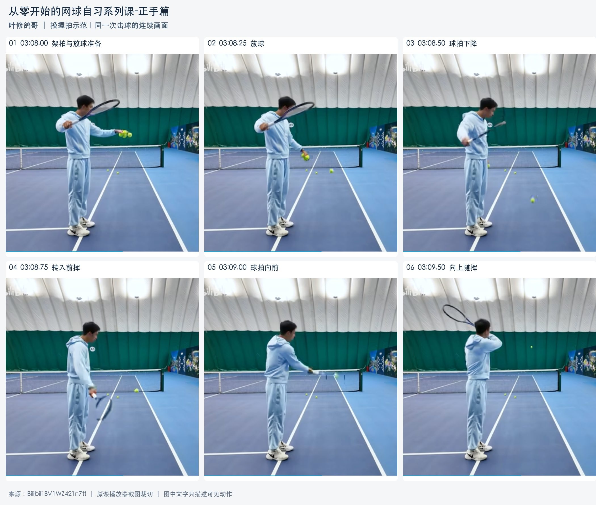
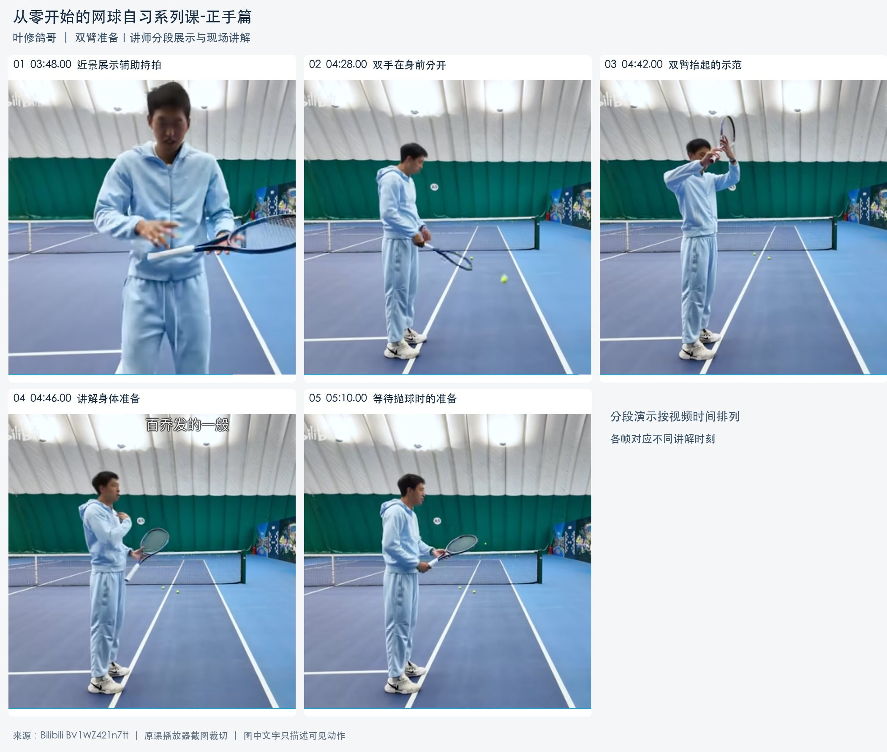

# 从零开始的网球自习系列课-正手篇

[Bilibili 原课](https://www.bilibili.com/video/BV1WZ421n7tt/) · 叶修鸽哥 · 合集第 3/35 集 · 时长 06:59 · 整理日期 2026-11-04

## 课程总结

本课用三组练习建立正手的基础击球流程：先放松慢挥把球送过网，再从预先架好的位置直接击球，最后接同伴抛球练习准备与击球衔接。练习从近距离和简单来球开始，逐步增加击球距离；目标是能够在不依赖突然甩手或临时拉拍的情况下完成击球，并用落点标准和录像检查练习质量。

## 技术总结

- 正手练习先选择一种能放松完成动作的握拍；课程要求至少换用两种握拍完成练习，以确认练习重点不依赖单一握法。
- 第一组从身前放球开始，放松持拍手、看清来球，以慢速挥拍把球送过网，不用大幅移动或猛发力。
- 第二组先把大臂架起，在身前准备；来球后从准备位置直接击球，减少临时向后拉拍。
- 击球先打实球的后方，再向上挥出；听击球声音，避免只擦到球。
- 第三组用同伴抛球或抛球机供球，以左手辅助把球拍推起，让两侧大臂抬起并支撑准备位置，再在身前击球。
- 练习从小场地逐步退到发球线和底线，按课程标准达到十球进九后再增加距离。
- 手部容易突然甩动或习惯性拉拍时，先退回预先架拍的练习；用录像检查大臂是否确实抬起，而不是只凭自己的感觉判断。

## 训练路线

1. **落球慢挥**：同伴给球，或用非持拍手在身前放球。放松持拍手，慢慢挥拍，把球送过网；先不增加身体移动和力量。
2. **加入方向与距离**：先练直线，把球控制在单打边线与双打边线之间。从小场地对小场地开始，十球进九后逐步后退；依次练至发球线后、底线打向对面前场、底线到底线。底线到底线练习以第一落点过发球线、第二跳越过底线为课程标准。
3. **预先架拍击球**：在身前架好大臂，保持手臂自然弯曲；接球后从准备位置直接击球，重复前面的方向和距离要求。
4. **同伴抛球衔接**：由同伴抛出简单来球，也可使用抛球机。左手辅助推起球拍，预先完成架拍后在身前击球；如果出现临时拉拍，退回第二组练习。
5. **检查与巩固**：三组练习都按相同的距离要求完成。用录像核对准备位置和手臂动作，再决定是否继续增加距离。

## 常见问题与调整

| 情况 | 调整方式 |
|---|---|
| 为了把球打过网而猛发力或突然甩手 | 退回身前放球的慢挥练习，先放松击球并把球送过网。 |
| 准备时习惯先用手把球拍向后拉 | 退回预先架拍练习；先把准备位置建立好，再从该位置直接击球。 |
| 大臂夹住、没有抬起，只剩小臂动作 | 用左手辅助推起球拍，重新建立两侧大臂抬起的准备位置；用录像核对动作。 |
| 击球只擦到球或击球声音偏轻 | 降低速度、简化供球，先打实球的后方，再向上挥出。 |
| 增加距离后落点失控 | 回到上一个距离，按十球进九的标准完成后再后退。 |

## 按时间顺序的课程记录

### 00:22–00:51｜更换握拍完成同一练习

课程列出大陆式、东方式、半西方式和西方式握拍，先选一种握拍开始，再至少换用另一种完成练习；更换握拍后仍然保持相同的练习目标。

### 00:51–01:35｜第一组：放松慢挥，把球送过网

从落球击球开始，可由同伴给球，也可用非持拍手在身前放球。持拍手保持放松，先看清球，再慢慢挥拍；不要求大幅移动或大力击球。练习中尝试打球偏下的位置并把球送过网。球下网时，检查是否打到球的上部；降低用力也能完成过网。

### 01:35–01:56｜用大臂带起球拍

持拍臂慢慢带起球拍，随挥到肩部附近；减少手部突然甩动，让大臂参与支撑动作。换用大陆式握拍后，仍练习简单的向前、向上击球。

### 01:56–02:20｜加入方向与距离标准

先练直线，把球控制在单打边线与双打边线之间的通道内。从小场地打到对面小场地，十球进九后逐步后退：先到发球线后，再到底线打向对面前场，最后练底线到底线。底线到底线时，第一落点过发球线、第二跳越过底线即可，不要求第一落点压到底线。

### 02:20–02:48｜第二组：在身前预先架拍

先把大臂架起，在身前做好准备，再接球击打。架拍外形可以按个人舒适度调整，不必统一成一个固定姿势。准备时避免拍面提前打开；小臂可稍作内旋并延伸，手臂保留自然弯曲。

### 02:48–03:23｜从架拍位置直接击球

来球后从已准备的位置直接击球，继续练习方向和距离。听击球声音，打实球的后方，不只擦过球。课程对照两种挥拍路径：打实球后从球的上方离开形成上旋练习；从球下方切过则作为下旋路径对照。本组仍以打实后向上挥出为主。

### 03:23–04:07｜第三组：同伴抛球与双臂支撑准备

改由同伴抛出简单来球，也可以使用抛球机。用左手帮助推起球拍，让两侧大臂抬起并支撑准备姿势，为随后的挥拍留出空间；然后在身前完成击球。大臂一直夹住时，小臂可活动的范围会变小，因此这一组继续练习先架好再打。

### 04:07–04:54｜手拉拍时简化准备

对已有手拉拍习惯的练习者，先把两手分开并直接架好，减少临时拉拍步骤，回到第二组的预先准备练习。架拍可以提前完成，也可以随来球完成，关键是大臂抬起并支撑准备位置。简单喂球和站定练习中，配合吸气、提起身体的稳定感，再体会手臂屈伸与挥动。

### 04:54–05:17｜随抛球准备后直接击球

同伴抛球时提前架好大臂，看清来球后直接击打，避免突然用手向后拉拍。本组以站定练习手臂动作，不额外增加脚步移动或大幅转体；脚下动作及其与击球的结合由后续课程展开。

### 05:17–06:14｜复练三组并用录像检查

三组练习都要逐步完成各个距离的要求，每个阶段达到十球进九再继续。录像用于核对大臂是否确实抬起，避免主观感觉已经架好、画面中却仍是夹臂和单独动手。现场调整继续围绕抬起大臂、扩大挥拍空间，以及减少手部过强发力和后段掰动。

### 06:14–06:59｜从简单的功能动作开始

从简单动作开始练，先体会不依赖大幅代偿也能把球打出去。练习效果以能否完成动作任务和控制击球为准，不以外观看起来是否猛烈判断。课程以这组正手练习结束。
